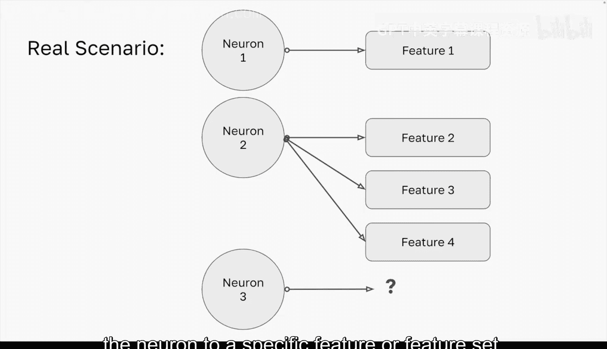
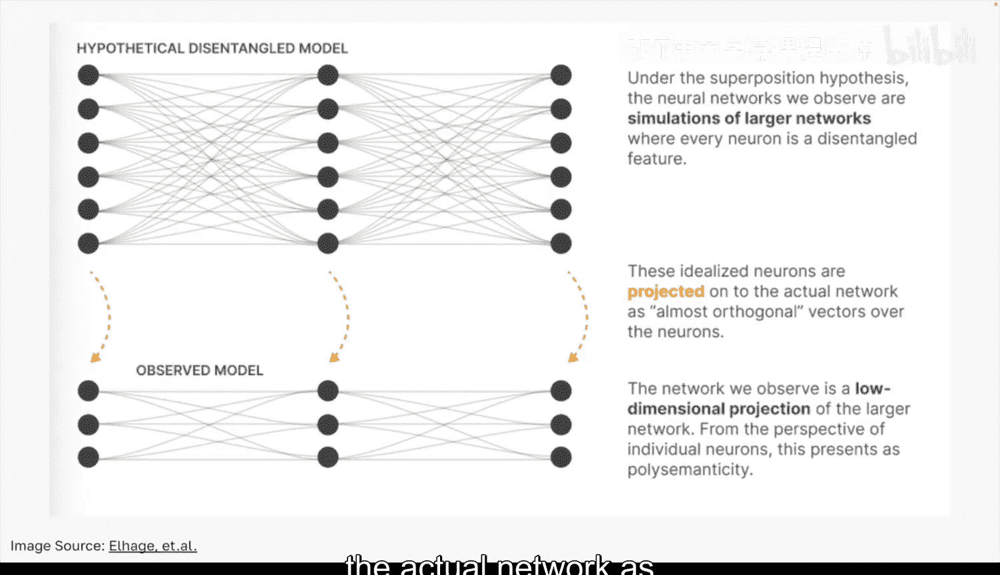
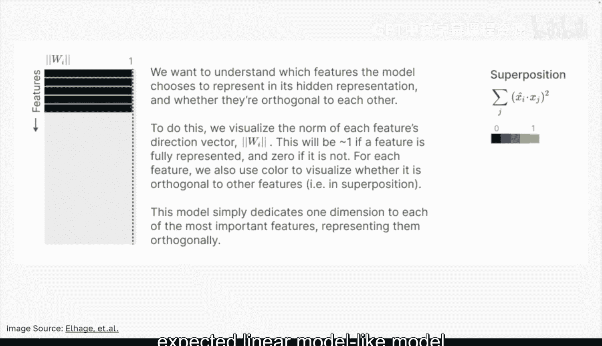
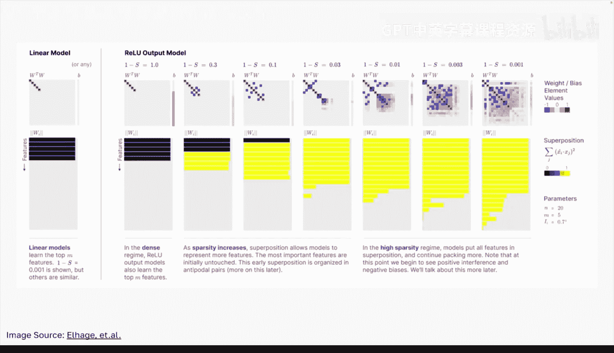
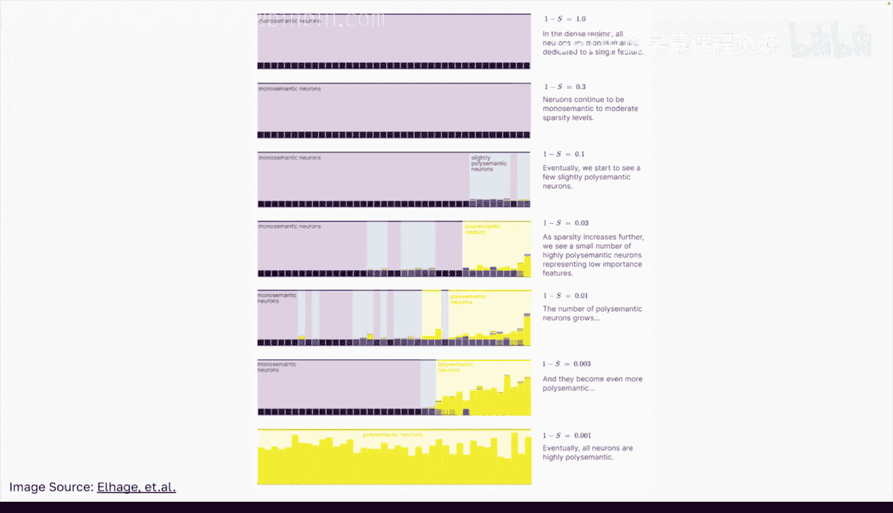
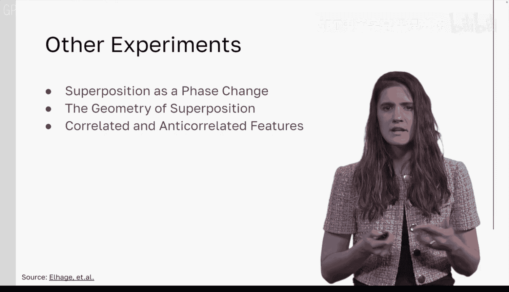
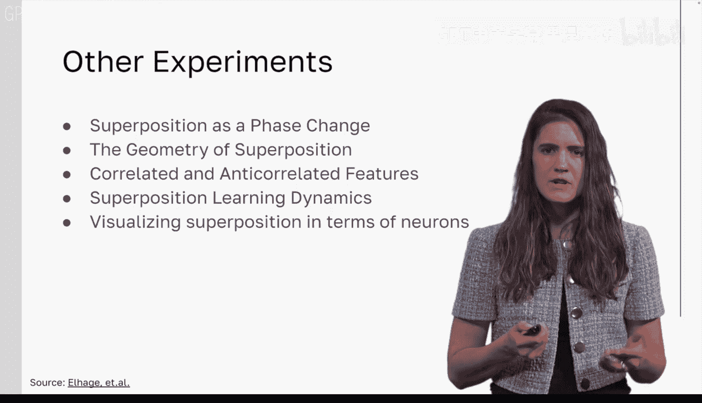
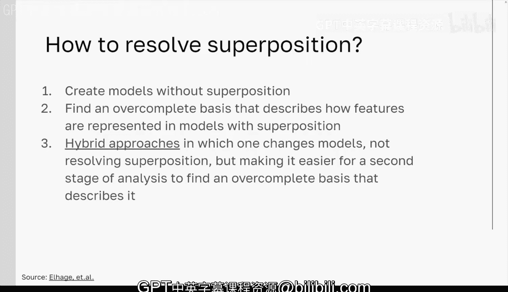

# 可解释人工智能 (XAI)：第17讲：叠加假设 🧠

在本节课中，我们将要学习神经网络中的一个核心概念——叠加假设。我们将探讨为什么神经元并非总是对应单一可解释的特征，以及网络如何通过“叠加”的方式，在有限的神经元中表示比其维度更多的特征。

---

## 理想与现实：从单一特征到多义性

上一节我们介绍了曲线检测器等理想情况，其中每个神经元清晰地对应一个特定特征。然而，神经元并非总是，或者说通常不会，如此清晰地映射到可解释的特征。

有时，我们会遇到**多义性**现象，即一个神经元映射到多个看似无关的特征。还有些时候，我们完全无法将神经元与任何特定特征或特征集对应起来。这才是现实中更常见的情况。

---

## 引入叠加假设

根据**叠加假设**，我们观察到的神经网络，实际上是对一个更大网络的模拟。在那个更大的网络中，每个神经元都对应一个**解耦的**（即独立的）特征。

这个概念有些抽象。我们可以这样理解：神经网络在学习和压缩数据时，将大量信息压缩到网络中，而观测到的网络则是这种压缩后的结果。

根据该假设，这些理想化的神经元被投影到实际的网络中，表现为在神经元向量空间上**几乎正交**的向量。

---

## 实验验证：基于“叠加的玩具模型”

本节内容基于El Hage等人于2022年发表的论文《Toy Models of Superposition》。该论文包含许多有趣的实验，我们将聚焦于以下实验目标，以提供支持叠加假设的证据。

论文表明，随着**稀疏性**增加，模型会使用叠加来表示比其维度更多的特征。下图来自论文，清晰地展示了这一点：

*   当模型**零稀疏**时，两个最重要的特征被分配了**专用的正交维度**，而其他特征则未被嵌入。
*   当稀疏性达到**80%** 时，模型表示了四个特征。
*   当稀疏性达到**90%** 时，所有五个特征都被嵌入，形成一个五边形结构，此时出现了**正干涉**的概念。

---

## 核心问题：网络能否表示比神经元更多的特征？

为了证明叠加的存在，我们首先需要回答：神经网络是否真的能够**有噪声地**表示比其神经元数量更多的特征？

为了回答这个问题，论文作者探索了两种模型：
1.  **线性模型**
2.  **ReLU输出模型**（增加了非线性）

他们通过一种**特征×特征矩阵**和特征长度向量 **`b`** 来可视化特征。他们发现，使用特征×特征矩阵（而不仅仅是特征矩阵）往往更容易进行可视化。

对于一个行为符合预期的线性小模型（`n=10`个神经元，`M=5`个特征），其可视化结果如下：它只能表示与其维度数量一样多的特征。

*   特征×特征矩阵对于最重要的特征表现为**单位矩阵**，对于较不重要的特征则为0。
*   偏置向量 **`b`** 在下一个子图中显示：对于模型学会“忽略”的特征，其值为0；对于其他特征，则为预期的正数。

---

## 可视化工具：方向向量范数与余弦相似度

另一种有用的可视化方法是观察每个特征**方向向量的范数**。如果一个特征被完全表示，其范数**约等于1**；如果未被表示，则**接近0**。

我们还可以计算两个特征向量之间的**余弦相似度**，并用颜色来可视化一个特征向量是否与其他特征正交（例如，在叠加状态下）。具体来说，可以计算两个权重向量 **`w_i`** 和 **`w_j`** 的点积平方和。

*   该值**接近0**（在可视化中显示为深蓝或黑色）表明该特征是独特的，并与其他特征**正交**。
*   该值**大于或等于1**（在可视化中显示为亮黄色）则表明该特征与其他特征高度相关，或者可以由其他特征的组合来表示。

在下图中，我们再次看到了之前提到的那个符合预期的线性模型。它只是简单地为每个最重要的特征分配一个维度，并以正交的方式表示它们。

---

## 稀疏性如何引发叠加

下图展示了关键变化。图像左侧是**线性模型**。紧挨着它的是**ReLU输出模型**，它很小，行为与线性模型相似，也就是我们之前幻灯片中可视化的模型。

从这里开始，事情变得有趣了。随着我们向图的右侧移动，模型的**稀疏性在增加**。从特征×特征矩阵可以看出，随着稀疏性增加，**叠加开始出现**。

模型通过让特征之间**不再正交**来表示更多的特征。这个过程从最不重要的特征开始，并逐渐影响到更重要的特征。

---

## 从单义性到多义性神经元

这是另一种可视化方式。在顶部，当模型是**稠密**的时，我们处于**单义性**状态，所有神经元都专用于单一特征。

随着我们增加稀疏性，**多义性神经元**开始出现，首先是从重要性最低的特征开始。最终，所有神经元都变得**高度多义**。

---

## 论文的更多探索方向

我们展示的只是该论文的一小部分，它为叠加假设提供了证据。论文还进行了其他实验，包括：
*   叠加作为一种相变
*   叠加的几何结构
*   相关与反相关特征
*   叠加的学习动态
*   从神经元角度可视化叠加

---

## 总结与展望：如何解决叠加问题？

总而言之，《Toy Models of Superposition》这篇论文为可解释性领域的叠加假设提供了实验证据。

为了进行可解释性分析，我们需要能够**解析叠加**。问题是，如何做到？

研究人员认为，可以通过以下三种方式之一来实现：
1.  **创建没有叠加的模型**。
2.  **找到一个过完备基**，来描述在具有叠加的模型中特征是如何被表示的。
3.  **混合方法**：不直接解决叠加，而是修改模型，使其更容易在后续分析阶段找到描述叠加的过完备基。

---

本节课中，我们一起学习了**叠加假设**的核心思想。我们了解到，神经网络中的神经元并非总是对应单一特征，而是可以通过叠加的方式，在有限维度内编码更多信息。我们通过论文中的实验，看到了**稀疏性**如何促使叠加现象发生，并介绍了几种可视化和验证叠加的方法。最后，我们探讨了未来解决叠加问题、实现更好可解释性的可能方向。理解叠加是解开神经网络内部表征之谜的关键一步。