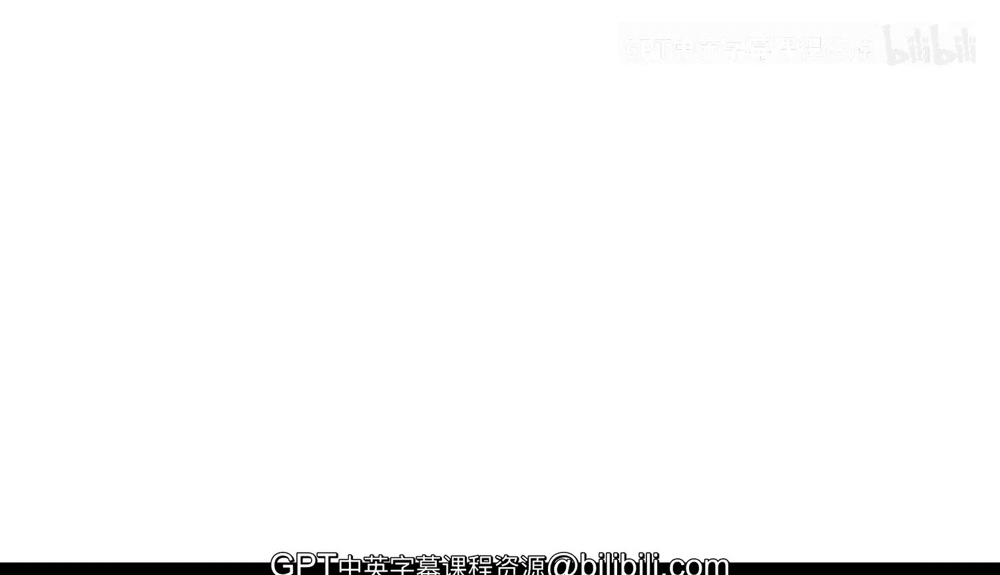
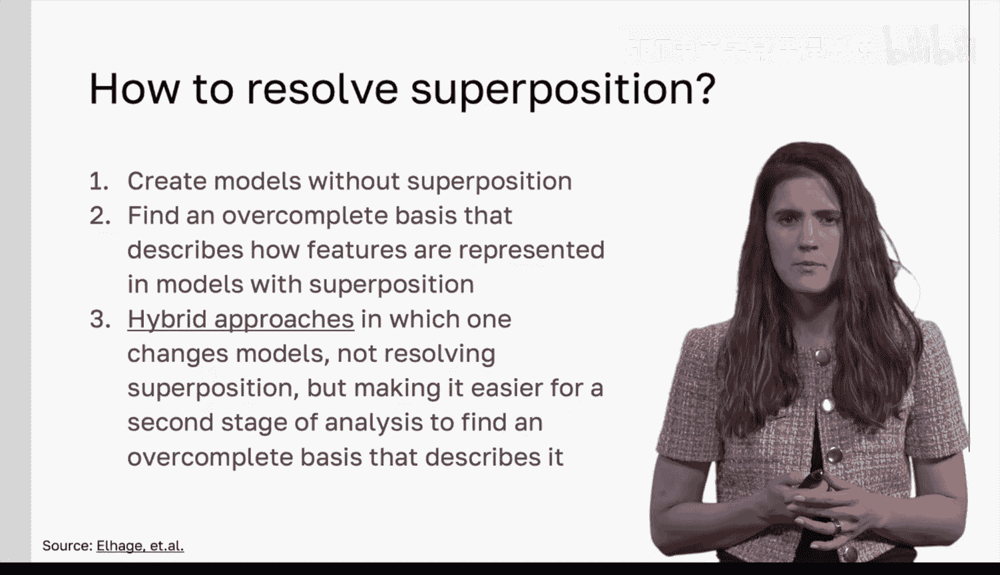
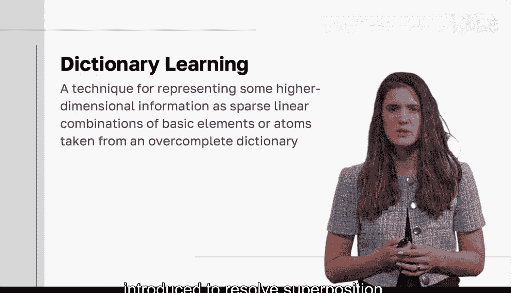
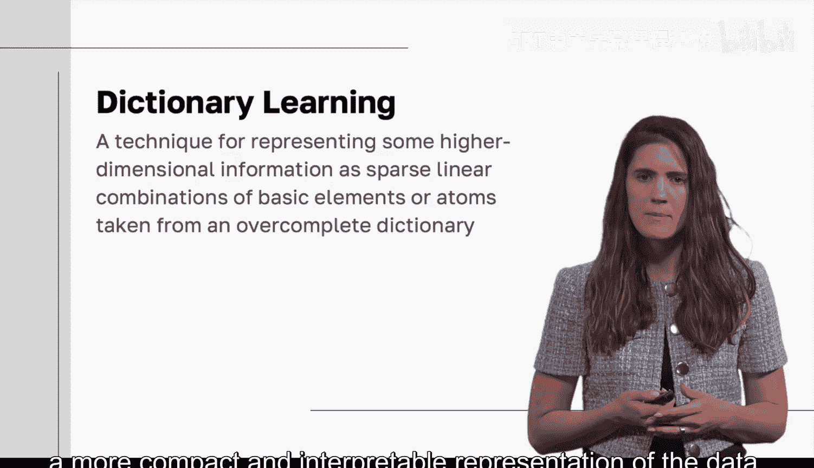
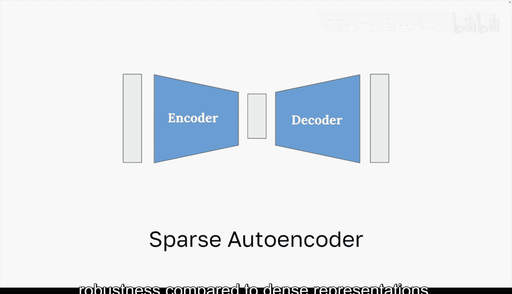
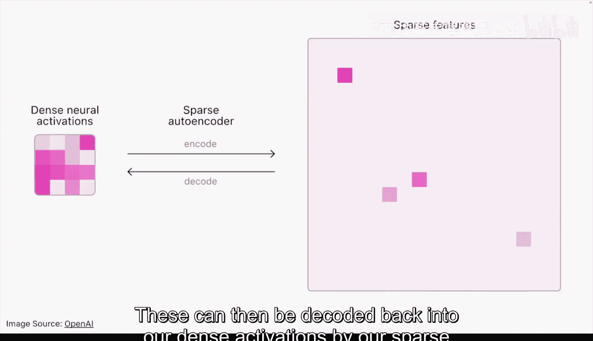

# 杜克大学《可解释人工智能｜Explainable AI (XAI)》中英字幕 p47 18_03_01_机制可解释性表示学习.zh_en -BV1HnrBBmEon_p47-

嗯。

In the lecture and superposition， we showed evidence for the superposition hypothesis for interpretability。

 we need to be able to resolve superposition。 The question is， how。

Am my researchers posited that you could do this in one of three ways。

 create models without superposition， find an overcomplete basis that describes how features are represented in models with superposition and hybrid approaches in which one changes models not resolving superposition but making it easier for a second stage of analysis to find an overcomplete basis that describes it。

Since this paper was introduced， MI researchers have explored these three ways to resolve a superposition。

 They determined that the best way to do this is a hybrid approach。

 which we are going to discuss in this section。

In the last year， a concept called representation learning has been introduced to resolve superposition。

 One way to do representation learning is an approach called dictionary learning。

 Dictionary learning is an unsupervised machine learning technique that aims to find a set of basis vectors or atoms that can represent highdisal data in a sparse and efficient way。

 The goal is to learn a dictionary of atoms from the data itself。

 rather than using a predefined set of basis vectors。

 Dictionary learning has already been applied in various domains， including image processing。

 audio signal processing and natural language processing In many real worldl problems。

 the data can be represented as a sparse， linear combination of a few elements from an overcomplete dictionary and overcomplete dictionary is a set of atoms or basis vectors that is larger than the dimensionality of the data。

This redundancy allows for sparse representations where most of the coefficients are zero。

 and the non zero coefficients capture the essential features of the data。

The process of dictionary learning involves finding a dictionary D and a set of sparse coefficients Al for each data sample X。

 such that x is approximately d times alpha， where most of the elements in alpha are 0 or close to 0。

 This can be formulated as an optimization problem。

The optimization problem is typically solved using an iterative approach。

 alternating between two steps， sparse coding， given the current estimate of the dictionary D。

 find the sparse coefficients alpha for each data sample X by solving a sparse coding problem and dictionary update。

 given the sparse coefficients alpha， update the dictionary D to be to better represent the data。

Dictionary update， given the sparse coefficients alpha。

 update the dictionary D to better represent the data。

 the sparse representations obtained from the dictionary can provide a more compact and interpretable representation of the data。

Spare autoencoderrs are a type of dictionary learning that aims to learn a sparse representation of the input data by imposing sparsity constraints on the hidden layers of the neural network architecture。

 The sparsity constraint is used as a form of regular。

 which helps the autoencoder learn a compressed and robust representation of the input data。

 The autoencoder architecture consists of two main components。 and encoder and a decoder。

 The encoder maps the input data to a lower dimensional representation known as latent or hidden representation。

 This is also called the bottleneck。 The decoder then attempts to reconstruct the original input data from this latent representation。

In sparse autoenrs， the hidden layers of the encoder are encouraged to be sparse。

 meaning that only a few neurons are active or nonzero for any given input。

 This sparsity constraint acts as an information bottleneck。

 forcing the autoencoder to learn a compact and informative representation of the input data。

There are two common ways to impose sparsity in sparse autoencoderrs。 L1 regular。

 The L1 norm of the activations in the hidden layer is added to the loss function as a regular term。

 This encourages the activations to be sparse as the L1 norm promotes sparsity by pushing the weights towards 0。

Or K L divergence regular In this approach， the average activation of the neurons in the hidden layer is constrained to be close to a desired small value like 0。

05。 This is achieved by adding a term to the loss function that minimizes the Colback libbller or KL divergence between the observed average activation and the desired sparse activation。

By imposing sparsity constraints， sparse autoenrs are encouraged to learn a compact and informative representation of the input data。

The sparse representation can provide better interpretability and robustness compared to dense representations。

Two papers that came out in 2023 from Cunningham and Bricken et all applied these sparse autoenrs to find highly interpretable features in small language models。

First， they sample the internal activations of a language model。

 and then they use these activations to train a sparse autoencoder whose weights form a featured dictionary。

 then they use these to interpret the resulting features。

Here is a visualization of sparse autoenrs for our application。

 We take dense neural activations shown on the right and use a sparse autoencoder to encode or map these dense activations to a sparse feature space。

 These can then be decoded back into our dense activations by our sparse autoencoder。

