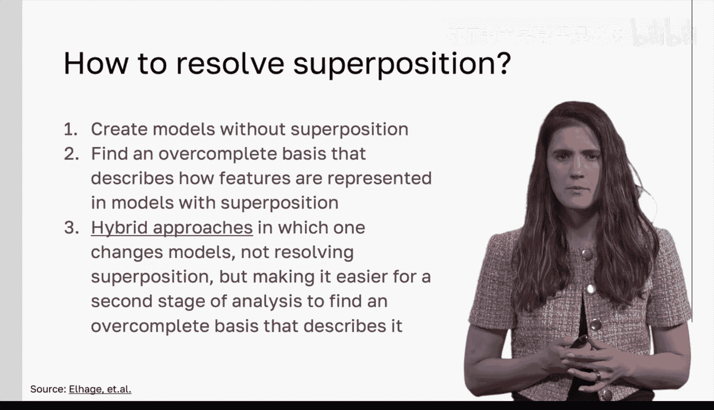
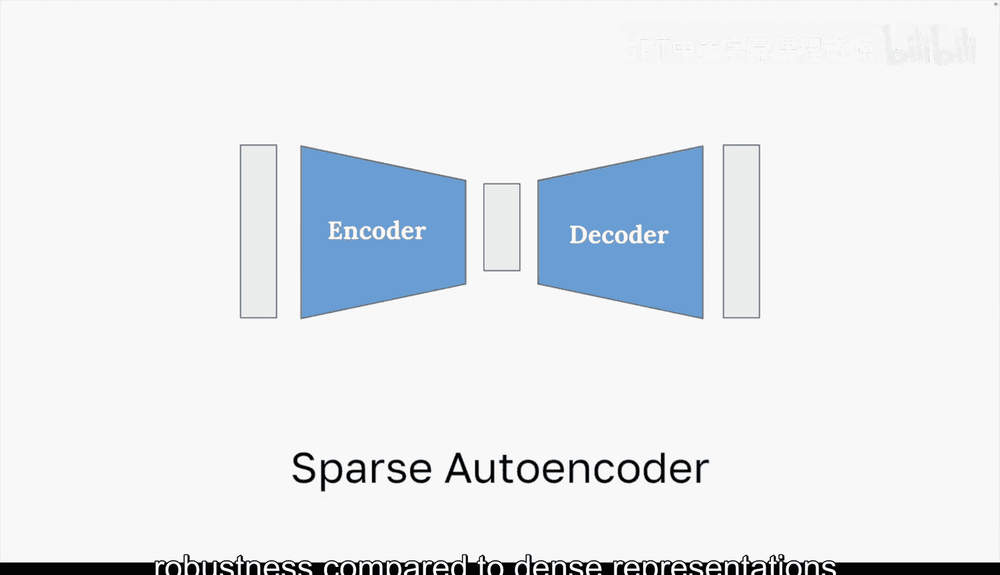
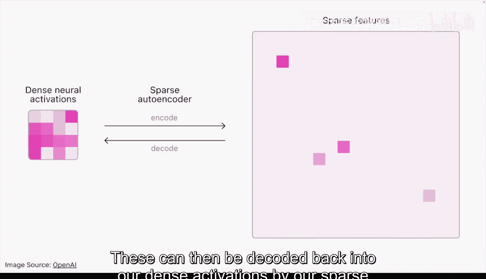

# 可解释人工智能：18_03_01：机制可解释性表示学习

在本节课中，我们将要学习如何解决神经网络中的“叠加”现象，以实现更好的可解释性。我们将重点介绍一种称为“表示学习”的混合方法，特别是“字典学习”和“稀疏自编码器”技术。

## 解决叠加问题的途径

在关于叠加的讲座中，我们展示了支持神经网络中存在特征叠加假说的证据。为了实现可解释性，我们需要能够解析这种叠加。问题在于，如何解析？

研究人员提出了三种可能的解决途径：
1.  创建不存在叠加现象的模型。
2.  找到一个过完备基，用以描述在存在叠加的模型中特征是如何表示的。
3.  采用混合方法，即不直接改变模型以消除叠加，而是让后续的分析阶段更容易找到一个描述叠加的过完备基。

自该论文发表以来，机器学习研究者们探索了这三种解决叠加的途径。他们确定，最佳方式是采用混合方法，这也是我们本节将要讨论的内容。

## 表示学习与字典学习

近年来，一种称为“表示学习”的概念被引入，用以解决叠加问题。进行表示学习的一种方法是“字典学习”。

字典学习是一种无监督机器学习技术，旨在找到一组基向量（或称“原子”），能够以稀疏且高效的方式表示高维数据。其目标是从数据本身学习一个原子字典，而非使用预定义的基向量集。字典学习已应用于多个领域，包括图像处理、音频信号处理和自然语言处理。

在许多现实世界问题中，数据可以表示为一个过完备字典中少数元素的稀疏线性组合。过完备字典是指其原子或基向量的数量大于数据维度的集合。

这种冗余性允许稀疏表示，即大多数系数为零，而非零系数则捕捉了数据的本质特征。

## 字典学习的过程

字典学习的过程涉及为每个数据样本 `X` 找到一个字典 `D` 和一组稀疏系数 `alpha`，使得 `X` 近似等于 `D * alpha`，其中 `alpha` 中的大多数元素为0或接近0。这可以表述为一个优化问题。

该优化问题通常使用迭代方法求解，在两个步骤之间交替进行：
*   **稀疏编码**：给定当前字典 `D` 的估计，通过求解稀疏编码问题，为每个数据样本 `X` 找到稀疏系数 `alpha`。
*   **字典更新**：给定稀疏系数 `alpha`，更新字典 `D` 以更好地表示数据。

从字典中获得的稀疏表示可以提供更紧凑且更具可解释性的数据表示。

## 稀疏自编码器

上一节我们介绍了字典学习的基本思想，本节中我们来看看一种特定类型的字典学习——稀疏自编码器。

稀疏自编码器是一种旨在通过学习输入数据的稀疏表示来实现字典学习的方法，它通过对神经网络隐藏层施加稀疏性约束来实现。稀疏性约束作为一种正则化形式，帮助自编码器学习输入数据的压缩且鲁棒的表示。

自编码器架构由两个主要部分组成：编码器和解码器。
*   **编码器**将输入数据映射到一个低维表示，称为潜在表示或隐藏表示（也称为瓶颈）。
*   **解码器**则尝试从这个潜在表示中重建原始输入数据。

在稀疏自编码器中，编码器的隐藏层被鼓励是稀疏的，这意味着对于任何给定输入，只有少数神经元是活跃的或非零的。这种稀疏性约束充当了信息瓶颈，迫使自编码器学习输入数据的紧凑且信息丰富的表示。

在稀疏自编码器中施加稀疏性有两种常见方式：
1.  **L1正则化**：将隐藏层激活的L1范数作为正则项添加到损失函数中。这鼓励激活变得稀疏，因为L1范数通过将权重推向0来促进稀疏性。
2.  **KL散度正则化**：在这种方法中，隐藏层神经元的平均激活被约束在接近一个期望的小值（如0.05）。这是通过向损失函数添加一项来实现的，该项最小化了观察到的平均激活与期望的稀疏激活之间的Kullback-Leibler散度。

通过施加稀疏性约束，稀疏自编码器被鼓励学习输入数据的紧凑且信息丰富的表示。与密集表示相比，稀疏表示可以提供更好的可解释性和鲁棒性。

## 应用实例：解释语言模型特征

了解了稀疏自编码器的原理后，我们来看一个具体的应用实例。

Cunningham和Bricken等人在2023年发表的两篇论文，将这些稀疏自编码器应用于在小型语言模型中寻找高度可解释的特征。

以下是其应用流程的可视化：
1.  首先，他们对语言模型的内部激活进行采样。
2.  然后，他们使用这些激活来训练一个稀疏自编码器，该自编码器的权重形成一个特征字典。
3.  最后，他们利用这个字典来解释得到的特征。

具体过程如下图所示：我们取右侧所示的密集神经激活，并使用稀疏自编码器将这些密集激活编码或映射到一个稀疏特征空间。随后，我们的稀疏自编码器可以将这些稀疏特征解码回密集激活。

## 总结

本节课中我们一起学习了解决神经网络特征叠加问题以实现可解释性的方法。我们重点探讨了混合方法中的表示学习技术，特别是字典学习和稀疏自编码器。我们了解了字典学习如何通过寻找过完备基来获得数据的稀疏表示，以及稀疏自编码器如何通过施加L1或KL散度正则化来学习紧凑且可解释的特征。最后，我们看到了这些技术如何被应用于解释语言模型的内部特征，为理解复杂模型的运作机制提供了有力工具。