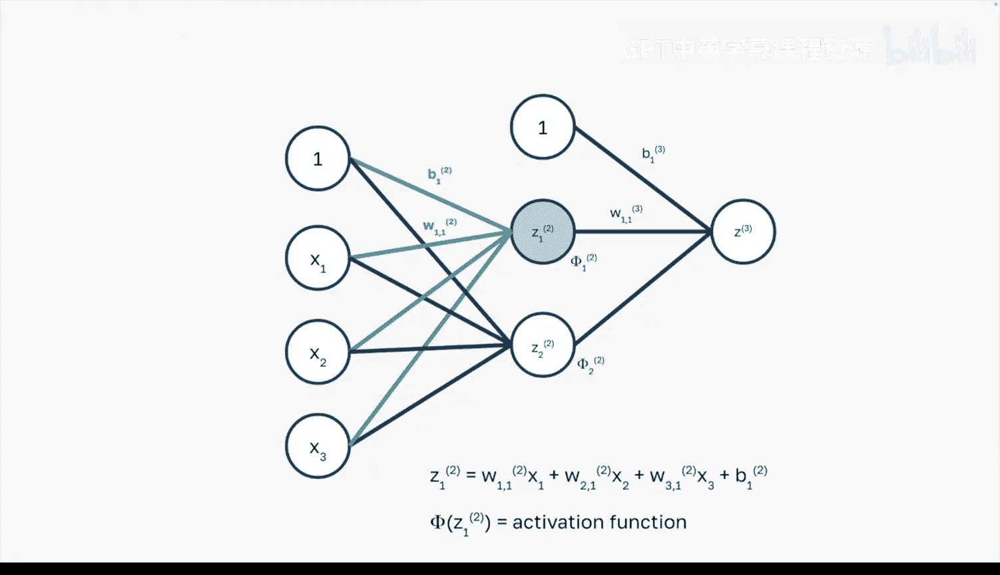
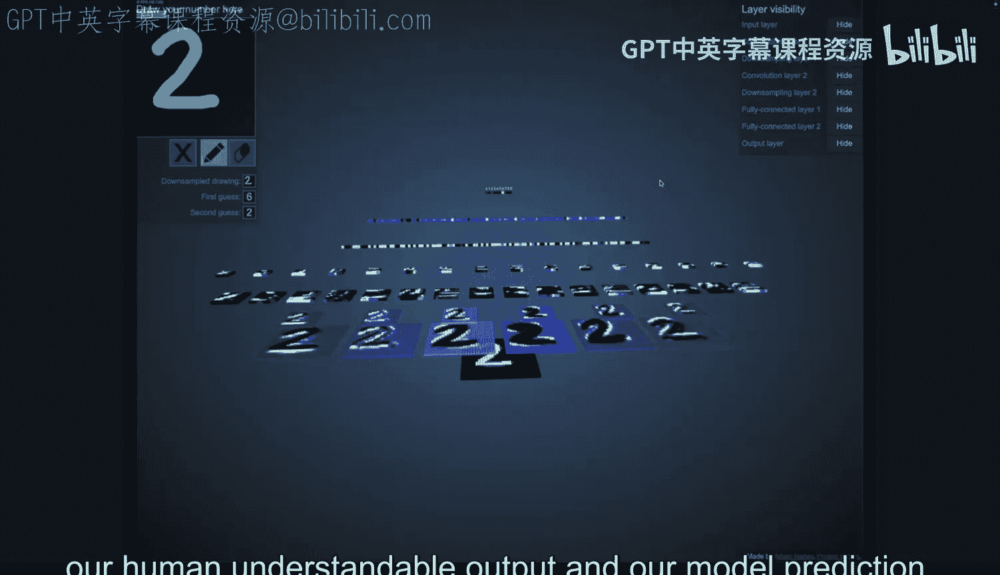

# 杜克大学《可解释人工智能｜Explainable AI (XAI)》中英字幕 p49 01_01_01_黑盒问题：可解释机器学习的动机.zh_en -BV1HnrBBmEon_p49-

You may have heard machine learning models and in particular deep learning models be referred to as black box models。

In the context of AI， black box models refer to models where the input and output are represented in ways that humans understand。

 but the information representations within the model are not represented in ways that a human can understand。

 Let's first consider representations of information。

 What are the ways in which humans communicate with one another。Humans communicate with language。

 either spoken or written， contained within language or concepts of numbers and symbols。

 We can also communicate via images， visual representations of our thoughts and ideas。Machines。

 on the other hand， only communicate via numbers with the exception of quantum computers。

 Comps today boil every concept or idea down into ones and zeros。

 open or closed gates on the electrical components on which computers are built。

We have learned to convert our representations of information。

 like language and images into numbers for a computer to understand。 For example。

 a color image is broken down into pixels and numeric values representing how much red。

 green and blue are in each pixel。 and these are the representations of information that exist in that image。

Similarly， text is broken down into tokens or parts of text。

 which are typically represented as fixed length vectors of numbers that are a compressed version of the meaning of the token。

 depending on the method used to generate this fixed length vector or embedding this vector could contain semantic and conceptual definitions of the token。

 and even the context in which the token is used。 This is especially useful for cases like the one here in which the word bank can have multiple meanings。

 depending on the context or what words are around it。

What this means is that we can put a human understandable input。

 like an image or a text based question into a machine learning model。

 and the model should be able to represent its output in a form that humans can understand whether that is a series of numbers representing bounding boxes of an object in an image。

 a class label or a string of tokens。So now let's return to our black box。

 we have an input that humans can understand and we have an output that humans can understand。

 but what is going on inside this black box， that's what we're here to talk about today。First。

 a brief review of the black box。 Since the number of traditional machine learning methods have varying degrees of interpretability。

 More on that in a few minutes， I'm going to focus here on deep learning models。

 which are based on a neural network architecture in a neural network architecture。

 we have layers of node。 Each node takes a weighted sum of its inputs and passes this through and often nonlinear activation function for each node in our network。

 we have some amount of weights for our weighted sum and a bias component that needs to be set。

The way we set these is through training the neural network。

 where we pass training data through the network and iteratively update these weights and biases。

 neural networks can have thousands， millions， even trillions of weights。

 And as we add more layers to a neural network， it gains the ability to extract increasingly abstract features from the input data。

 While this can enhance performance， it also becomes further from our human understandable representation。

Different architectures can also result in more abstraction。

 When your neural network arrives at an output， we often have no idea how the model reached the conclusion。

Here is a great visualization of this abstraction and a very simple convolutional neural network。

 This visualization was developed by Adam Harley， the link will be provided in course resources so you can check it out for yourself。

The way this visualization works is that at each node of the network。

 we can actually output a human understandable representation of what the model sees。First。

 I'm going to draw a number。 A numeric representation of this number is going to be our input layer to the model。

Next， I'm going to display the first layer of the neural network。

 You can see the image representations look mostly the same as the input layer。

 We're going to add a down sampling layer， which basically just makes everything smaller。

 And our second layer of the network extracts our original input a lot to the point that we can't even recognize the two。

Our next layers abstract information further and further into fully connected layers。 Finally。

 we map everything back to our human understandable output and our model prediction。😊。

A side note here that I want to emphasize， because there is a lot of confusion around this point。

 a black box model does not mean a model in which we cannot reproduce the result。

 If we have the model architecture， including trained weights。

 the same input data and the random seed used to produce the output for models containing some stochastic process。

 such as drop out layers or certain types of attention mechanisms， then we can reproduce the result。

 The idea around black box models is that while we may have the trained weights。

 these weights are not understandable by humans。In just a minute， we will talk about transparency。

 which is where the reproducibility comes into play。Now， perhaps you're wondering to yourself。

 who cares If I have the answer or model output， why do I need to understand how the model arrived at the answer。

Let's consider a few examples。1， you submit your resume to a company that uses an AI algorithm to select people to interview。

 You are not selected， even though your resume is a perfect match with the skills and requirements posted in the job description。

 You reach out to the company's recruiting team and they can't tell you why your application didn't make the cut because the model only gave an output with no explanation。

It turns out that they use current employee resumes in their training process。

 and many of the current employees had bocce ball as a skill in their resume。 You did not。

 and you didn't make the cut， despite botce ball not being a part of the job description or a necessary skill set for the job。

Now， replace botce ball with a specific gender or ethnicity。You applied for a loan。

 and you were denied， despite having an excellent credit score。 When you call the bank。

 they admit that they are now using an AI algorithm to process loan applications。

 and they aren't sure why your loan was denied。You go to the hospital in our triage using an AI algorithm。

 you are sent to the back of the line and required to wait three hours for treatment while kids with a cold are seen right away。

The AI algorithm is using information about your socioeconomic status to triage you。

 even though that data wasn't seen as important by the engineers training the algorithm。

 so they just left it in。These examples， while fictional， are based in reality， recruitment。

 finances， and healthcare are three high stakes domains that are actively using AI tools。Now。

 how about a real example In 2023， the Detroit Police used facial recognition technology。

 computer vision machine learning models， and falsely identified Portia Woodruff as a car jackcking suspect。

 She was arrested while eight months pregnant for a crime she did not commit。

Why did the models identify Portia as a suspect， They were unable to determine the reasons the model identified her picture。

These are just a few examples of where a lack of understanding around a model's decisions can have significant consequences。

And that is where we are going to kick off our introduction to explainable AI。

