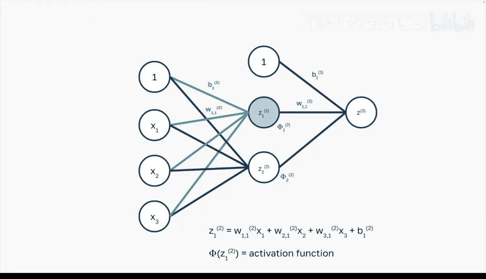
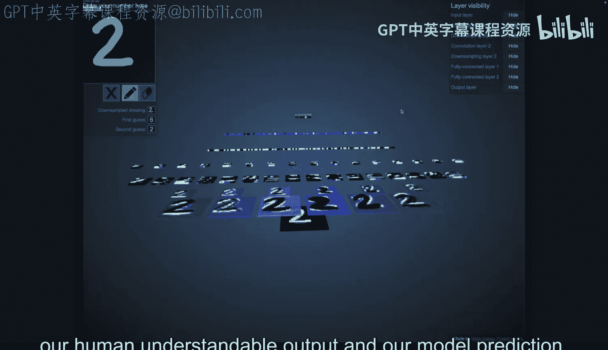

# 可解释人工智能：01：黑盒问题：可解释机器学习的动机 🎯

在本节课中，我们将要学习什么是机器学习中的“黑盒”问题，以及为什么理解模型内部决策过程至关重要。我们将探讨人类与机器在信息表示方式上的根本差异，并通过实例说明缺乏可解释性可能带来的现实后果。

## 信息表示：人类与机器的差异

上一节我们提到了“黑盒”模型，要理解它，首先需要了解人类与机器如何表示信息。

人类通过多种方式交流信息。我们使用语言（口语或书面语），其中包含数字和符号的概念。我们也通过图像，即思想和想法的视觉表示，来进行交流。

另一方面，机器仅通过数字进行交流（量子计算机除外）。今天的计算机将所有概念或想法归结为1和0，即构成计算机的电子元件上开关的门。

我们已经学会将我们的信息表示方式（如语言和图像）转换为计算机能理解的数字。例如：
*   一张彩色图像被分解为像素，每个像素用代表红、绿、蓝含量的数值表示。这些数值就是该图像中存在的信息表示。
*   同样，文本被分解为标记或文本片段，它们通常被表示为固定长度的数字向量。这个向量是标记含义的压缩版本。根据生成这个固定长度向量（或嵌入）的方法，该向量可以包含标记的语义和概念定义，甚至标记使用的上下文。这对于像“bank”这样根据上下文或周围词语可以有多种含义的情况特别有用。

这意味着，我们可以将人类可理解的输入（如图像或基于文本的问题）放入机器学习模型，而模型应该能够以人类可以理解的形式表示其输出。无论是代表图像中物体边界框的一系列数字、一个类别标签，还是一串标记。

## 深入黑盒：神经网络如何工作

现在让我们回到黑盒问题。我们有了人类可理解的输入和人类可理解的输出，但这个黑盒内部发生了什么？这正是我们今天要讨论的。

首先，简要回顾一下黑盒。由于传统机器学习方法具有不同程度的可解释性（稍后会详细讨论），这里我将重点讨论基于神经网络架构的深度学习模型。

在神经网络架构中，我们有多层节点。每个节点对其输入进行加权求和，并将结果通过一个通常是非线性的激活函数。对于网络中的每个节点，我们的加权和有一定数量的权重，以及一个需要设置的偏置分量。

我们设置这些权重和偏置的方式是通过训练神经网络：将训练数据通过网络传递，并迭代地更新这些权重和偏置。神经网络可以拥有数千、数百万甚至数万亿个权重。随着我们为神经网络添加更多层，它从输入数据中提取越来越抽象特征的能力也随之增强。虽然这可以提升性能，但也使其进一步远离我们人类可理解的表示方式。不同的架构也可能导致更多的抽象。

当你的神经网络得出一个输出时，我们通常不知道模型是如何得出结论的。

这是一个关于这种抽象过程的绝佳可视化示例，展示了一个非常简单的卷积神经网络。该可视化由 Adam Harley 开发，链接将在课程资源中提供，以便你自己查看。

这个可视化的运作方式是，在网络的每个节点，我们实际上可以输出模型所看到内容的人类可理解表示。
1.  首先，我画一个数字。这个数字的数值表示将作为模型的输入层。
2.  接下来，我将显示神经网络的第一层。可以看到图像表示看起来与输入层基本相同。
3.  我们将添加一个下采样层，这基本上只是让所有东西变小。
4.  我们网络的第二层极大地提取了原始输入，以至于我们甚至无法识别出数字“2”。
5.  随后的层将信息进一步抽象，直至全连接层。
6.  最后，我们将所有内容映射回人类可理解的输出和我们的模型预测。😊

这里我想强调一个重要的旁注，因为关于这一点存在很多混淆：**黑盒模型并不意味着我们无法重现结果的模型**。如果我们拥有模型架构（包括训练好的权重）、相同的输入数据，以及用于为包含某些随机过程（例如 Dropout 层或某些类型的注意力机制）的模型产生输出时使用的随机种子，那么我们就可以重现结果。黑盒模型的核心思想在于，虽然我们可能拥有训练好的权重，但这些权重是人类无法理解的。稍后我们将讨论透明度，可重复性正是在那里发挥作用。

## 为何需要可解释性：现实世界的启示

现在，你可能在想：谁在乎呢？如果我有了答案或模型输出，为什么需要理解模型是如何得出答案的？

让我们考虑几个例子。

以下是几个说明缺乏可解释性可能带来问题的场景：

1.  **招聘歧视**：你向一家使用AI算法筛选面试人员的公司提交了简历。尽管你的简历与职位描述中发布的技能和要求完全匹配，但你未被选中。你联系公司的招聘团队，他们无法告诉你为什么你的申请没有通过筛选，因为模型只给出了输出，没有解释。结果发现，他们在训练过程中使用了现有员工的简历，而许多现有员工的简历中都有“地掷球”这项技能。你没有这项技能，因此被淘汰了，尽管地掷球并非职位描述的一部分，也不是工作所需的技能。
2.  **信贷不公**：你申请贷款，尽管信用评分优秀，但仍被拒绝。当你致电银行时，他们承认现在使用AI算法处理贷款申请，并且不确定你的贷款为何被拒。
3.  **医疗分诊偏见**：你去医院，分诊使用了AI算法。你被排到队尾，需要等待三个小时才能得到治疗，而患感冒的孩子却可以立即就诊。AI算法正在使用关于你社会经济状况的信息来对你进行分诊，尽管训练算法的工程师认为这些数据不重要，但他们只是将其留在了数据中。

这些例子虽然是虚构的，但基于现实。招聘、金融和医疗保健是三个正在积极使用AI工具的高风险领域。

那么，一个真实的例子呢？2023年，底特律警方使用了面部识别技术（计算机视觉机器学习模型），错误地将 Portia Woodruff 识别为一起劫车案的嫌疑人。她在怀孕八个月时因一项她未犯的罪行而被逮捕。**为什么模型将 Portia 识别为嫌疑人？他们无法确定模型识别她照片的原因。**

这些只是模型决策缺乏理解可能造成严重后果的几个例子。而这正是我们开始介绍可解释人工智能的出发点。

## 总结

本节课中，我们一起学习了机器学习“黑盒”问题的核心。我们了解到，由于人类与机器在信息表示（语言/图像 vs. 数字/向量）上的根本差异，复杂的深度学习模型内部运作对人类而言是难以理解的。尽管这些模型能给出可理解的输出，但其内部数百万的权重和抽象的特征提取过程就像一个不透明的盒子。通过招聘、信贷、医疗和执法领域的实例，我们看到了这种不可解释性可能导致的歧视、不公和严重错误。正是这些现实风险，凸显了发展可解释人工智能的紧迫性和重要性，这也是我们本课程的起点。