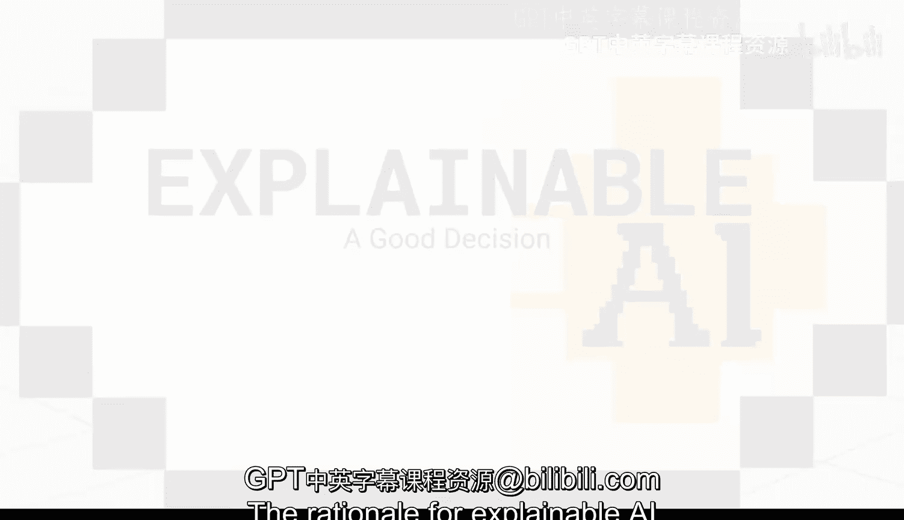
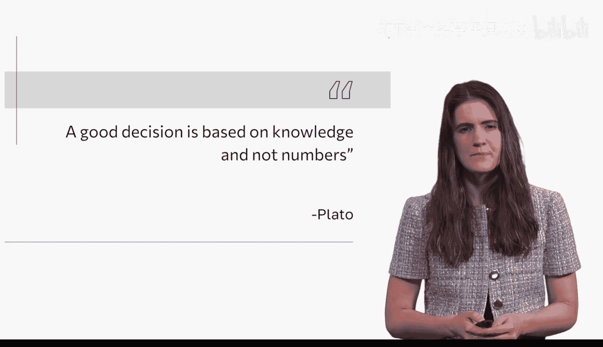
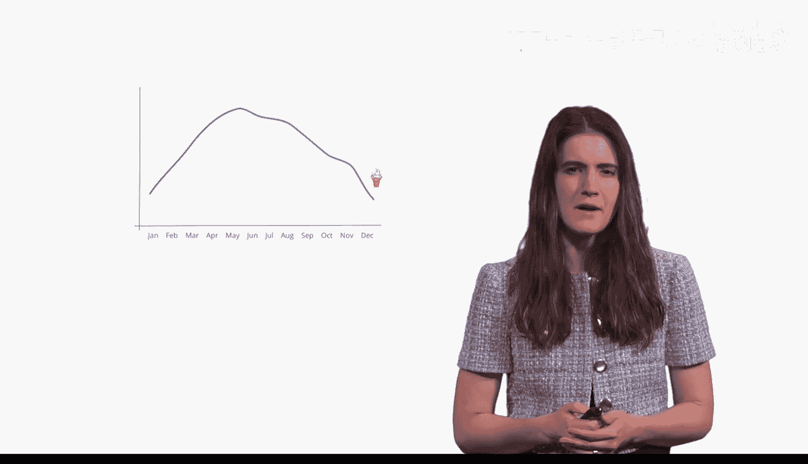
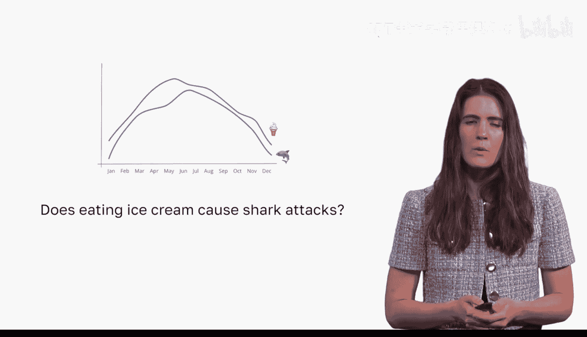
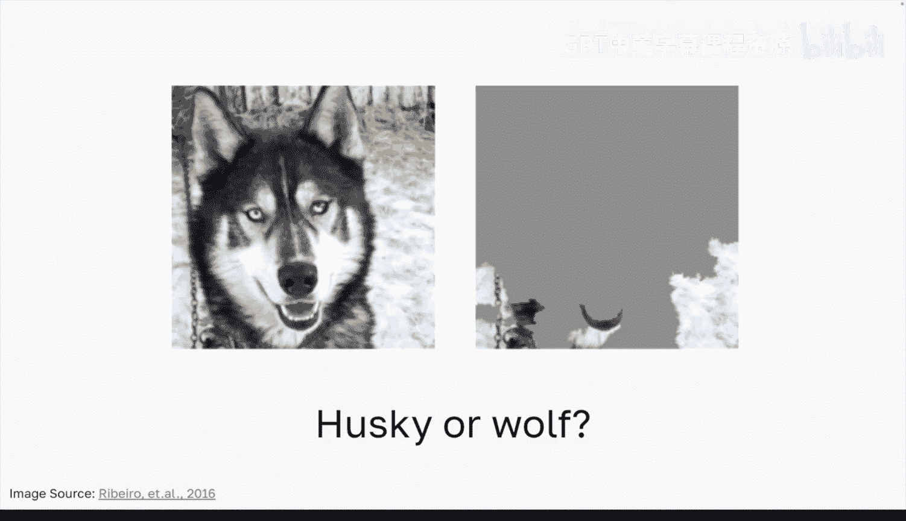
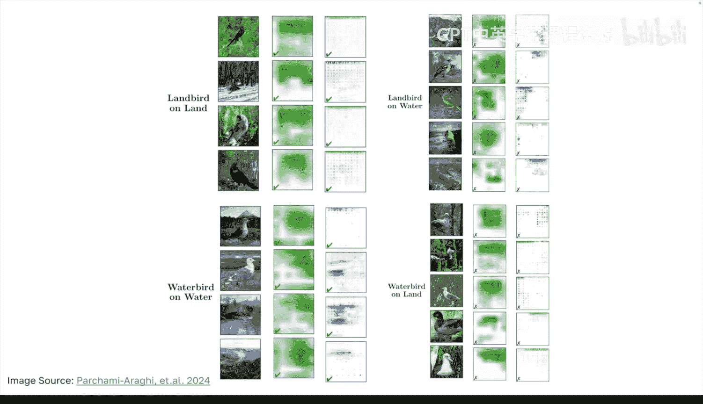
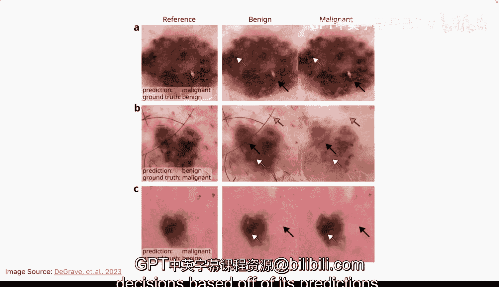

# 杜克大学《可解释人工智能｜Explainable AI (XAI)》中英字幕 p50 02_01_03_优质决策.zh_en -BV1HnrBBmEon_p50-

The rationale for explainable AI can be represented by this quote from Plato。

 a good decision is based on knowledge and not on numbers。

What do I mean by this？ We can plot ice cream sales by month。

And we can also plot shark attacks by month。When you look at these plots， you may ask the question。

 Does eating ice cream cause shark attacks From a purely numeric perspective。

 these two seem to be quite correlated with one another。

 So you might conclude that eating ice cream does cause shark attacks。

But when drawing this conclusion， we are ignoring our knowledge， specifically。

 our knowledge about seasonal temperature fluctuations and their impacts on both people eating ice cream and people entering the ocean。

Our conclusion then is quite different。 While these two events are correlated。

 we know one does not cause the other。

Similarly， when we train a neural network to classify an image as a husky or a wolf。

 as shown in this figure， for example， we may achieve very high accuracy and not question the results。

However， if we look at simply accuracy metrics or numbers。

 we're ignoring the reasoning or knowledge behind the classification decision made by the model。

If we don't dig deeper into understanding the model results。

 we would be unaware that the model was making this decision solely based on the background of the image。

Specifically， whether or not there was snow on the ground。

Similarly， we can take a look at the waterbids data set。

 which has images of land birds with land backgrounds and images of water birds with water backgrounds。

 this is what is used to train the model。Now let's say we want to test our model。

 but we want to test it on land birds on water backgrounds and waterbi on land backgrounds。

 I'm sure you see where this is going。Our model accurately classifies land birdsd and water birds in our first column。

 but doesn't predict a single bird correctly in our second column。

The authors of this recent paper used visualization methods to look at what part of the image the model was using to make the prediction。

They found that， in fact， the background being land or water is what the model was using rather than the bird itself。

In another recent paper， the authors tried to understand misclassifications in dermatology modeling。

 the authors used an approach to explain the model predictions and found that the presence of certain pigmentation or hair is caused the misclassifications。

 this can be very beneficial to understanding the model's behavior and how to make decisions based off of its predictions。

