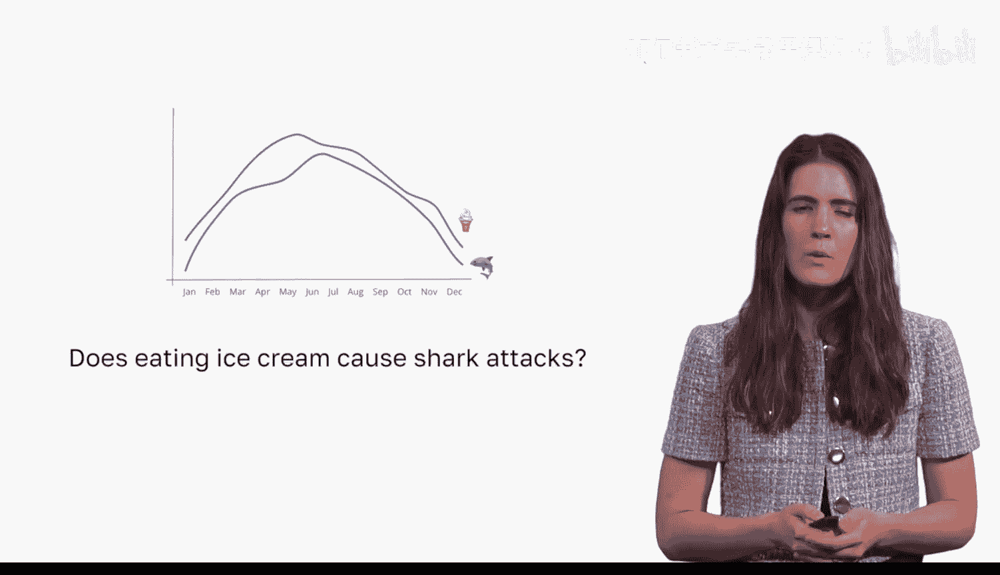
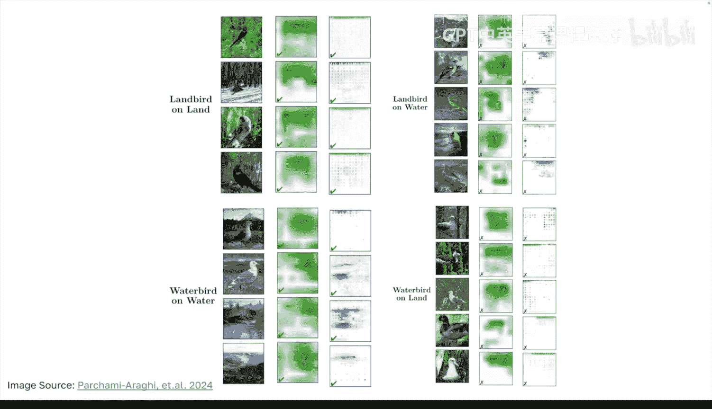
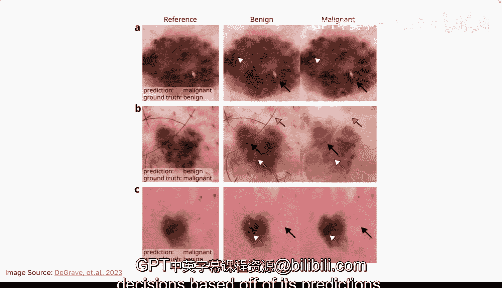

# 可解释人工智能 (XAI)：02_01_03：优质决策 📊

在本节中，我们将探讨可解释人工智能（XAI）的基本理念，理解为何仅仅依赖模型的“数字”输出（如准确率）是不够的，而需要结合“知识”来做出优质决策。我们将通过几个生动的例子来说明这一点。

---

柏拉图曾说过：“优质决策基于知识，而非数字。” 这句话精辟地概括了可解释人工智能的核心思想。它提醒我们，在依赖数据驱动模型时，不能只看表面的统计结果，而必须理解其背后的逻辑与因果。

上一节我们引出了XAI的重要性，本节中我们来看看几个具体的案例，它们展示了仅凭数字可能导致的误解。

## 冰淇淋销量与鲨鱼攻击 🍦🦈

我们可以绘制每月冰淇淋销量的图表。

同样，我们也可以绘制每月鲨鱼攻击事件的图表。

观察这两张图时，你可能会问：吃冰淇淋会导致鲨鱼攻击吗？从纯粹的数值角度看，这两者似乎高度相关。因此，你可能会得出结论：吃冰淇淋确实会导致鲨鱼攻击。

但在得出这个结论时，我们忽略了已有的知识，特别是关于季节性温度波动及其对人们吃冰淇淋和进入海洋行为影响的知识。

因此，我们的结论截然不同。虽然这两个事件相关，但我们知道其中一个并非另一个的原因。它们都受第三个变量——夏季高温——的影响。这个例子说明了**相关性不等于因果性**。

## 哈士奇与狼的分类模型 🐺❄️

类似地，当我们训练一个神经网络来将图像分类为哈士奇或狼时，如图所示，我们可能获得很高的准确率，并且不会质疑结果。

然而，如果我们只看准确率等指标或数字，我们就忽略了模型做出分类决策背后的推理或知识。

如果我们不深入理解模型的结果，我们将不会意识到模型做出决策仅仅基于图像的背景。具体来说，是基于地面上是否有雪。模型可能学会了“有雪就是哈士奇，无雪就是狼”的错误关联，而不是真正识别动物的特征。

## 水鸟数据集的分析 🐦🌊

同样，我们可以看看水鸟数据集。该数据集包含背景为陆地的陆地鸟类图像，以及背景为水面的水鸟图像，这些数据用于训练模型。

现在，假设我们想测试我们的模型，但我们想在“背景为水面的陆地鸟”和“背景为陆地的水鸟”上测试它。我相信你已经明白问题所在了。

我们的模型在第一列（正常背景）中准确分类了陆地鸟和水鸟，但在第二列（错位背景）中，没有正确预测任何一只鸟。

这篇近期论文的作者使用了可视化方法来观察模型使用图像的哪一部分进行预测。他们发现，事实上，模型使用的是背景（是陆地还是水面），而不是鸟本身。这揭示了模型可能依赖于数据中的虚假相关性（背景）而非核心特征（鸟类本身）。

## 皮肤病学模型的误分类 🩺🔍

在另一篇近期论文中，作者试图理解皮肤病学模型中的误分类。作者使用了一种方法来解释模型的预测，并发现某些色素沉着或毛发的存在导致了误分类。

这对于理解模型的行为以及如何基于其预测做出决策非常有益。它帮助领域专家（如医生）判断模型是关注了正确的医学特征，还是被无关的视觉线索所误导。

---

**本节课中我们一起学习了**：优质决策不能仅仅依赖于模型输出的“数字”（如准确率、相关性）。通过冰淇淋与鲨鱼攻击、动物分类、水鸟数据集以及皮肤病诊断等例子，我们看到，如果不探究模型决策背后的“知识”或逻辑，我们可能会被表面的相关性所欺骗，或者无法发现模型依赖了错误的特征。可解释人工智能（XAI）的目标正是提供这种深入的理解，确保我们的决策既基于数据，也基于正确的因果与领域知识。