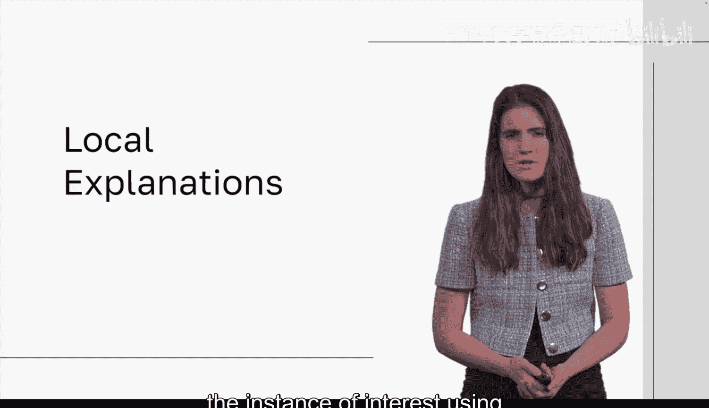
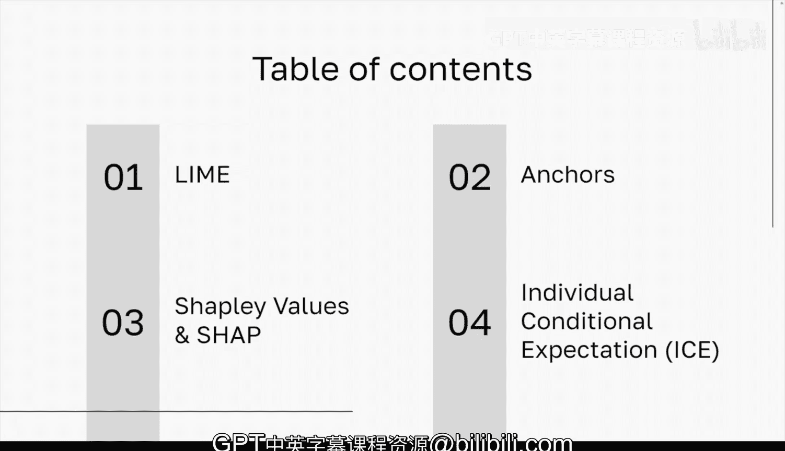

# 杜克大学《可解释人工智能｜Explainable AI (XAI)》中英字幕 p51 04_01_01_局部解释方法导论.zh_en -BV1HnrBBmEon_p51-

嗯。

The first module is going to focus on model agnostic explanation techniques。

 which means that the techniques we will discuss are able to be used across different types of models。

 Even when using complex black box models， various techniques aim to provide explanations in a model agnostic manner by treating the original model as a black box In this video。

 we're going to focus on local explanation techniques。

 Local explanations focus on explaining individual predictions。

 They approximate the original model's behavior locally around the instance of interest。

 using an interpretable model like linear regression。😊。

We are going to focus on the most popular local explanation techniques。

 we will discuss local interpretable model agnostic explanations or Lyme， we will next cover anchors。

 Shaplely values and Shaplely additive explanations or Shap。Finally。

 we will introduce individual conditional expectation or ice plots。

