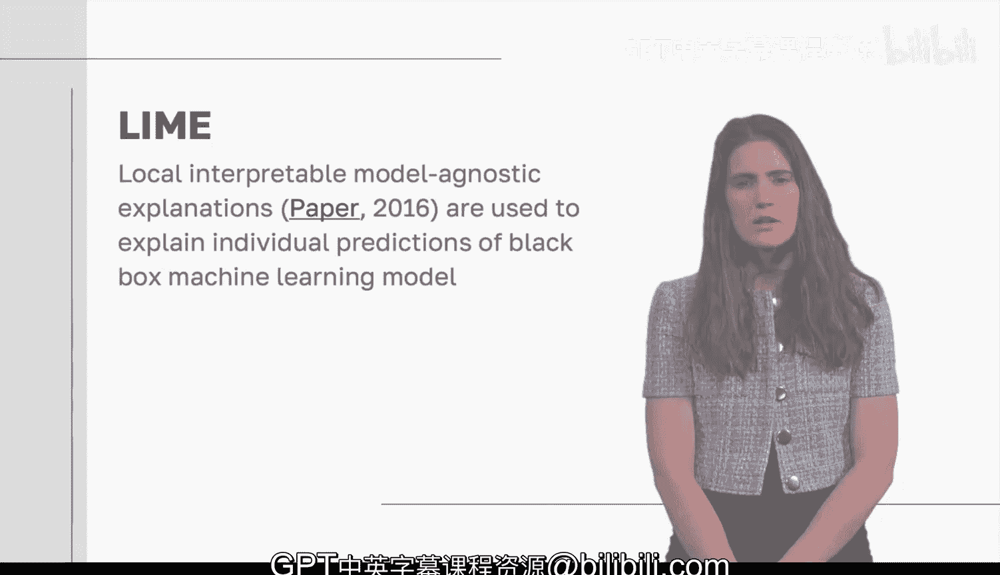
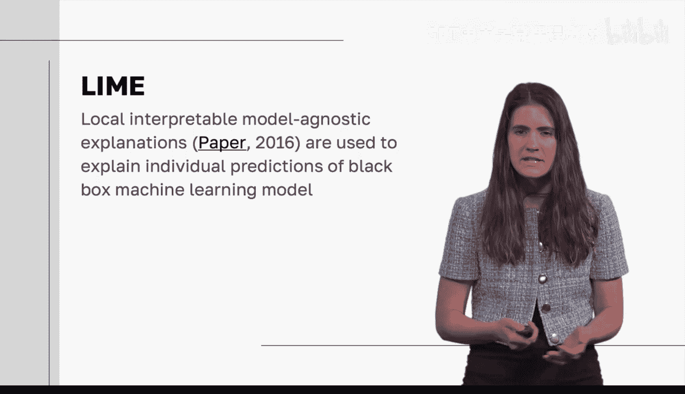
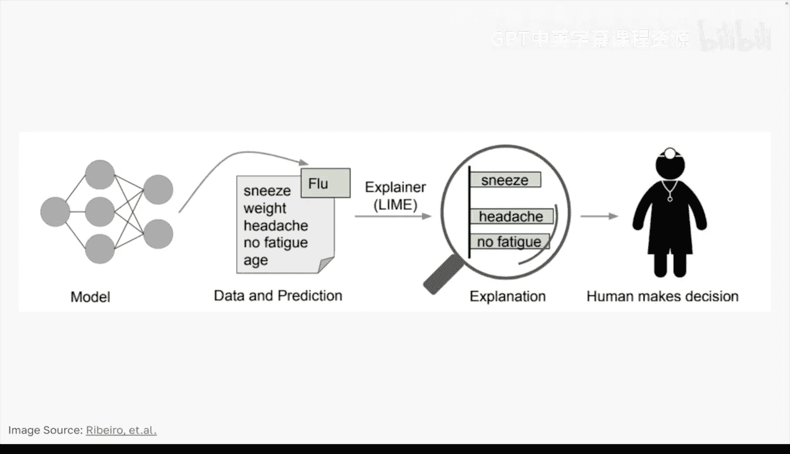
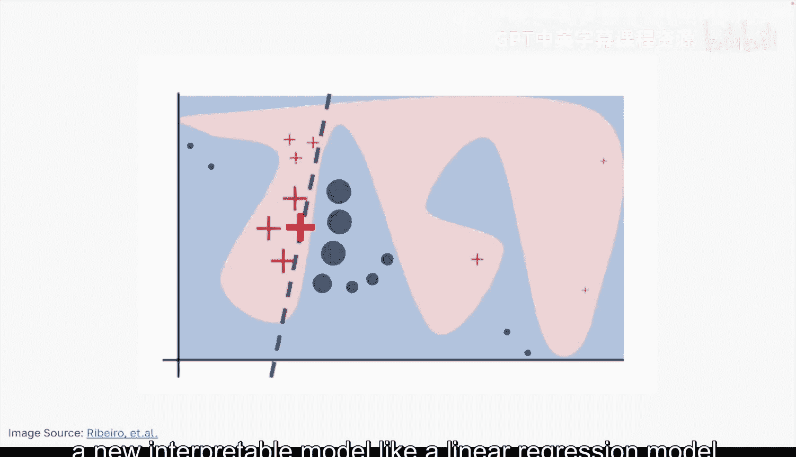
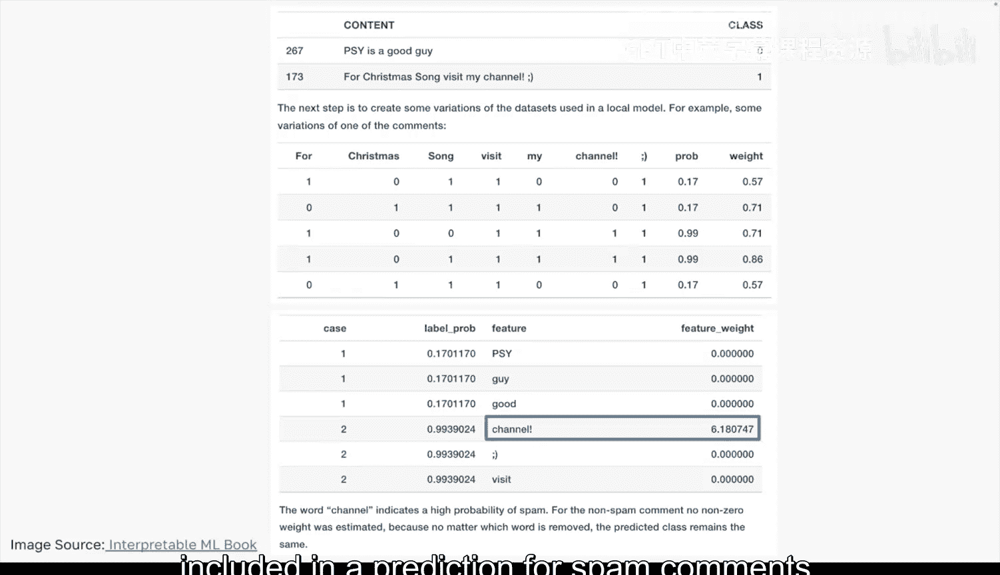
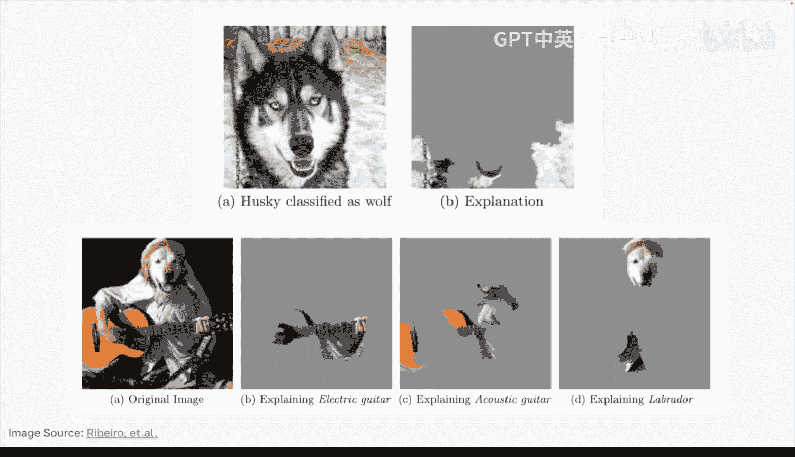
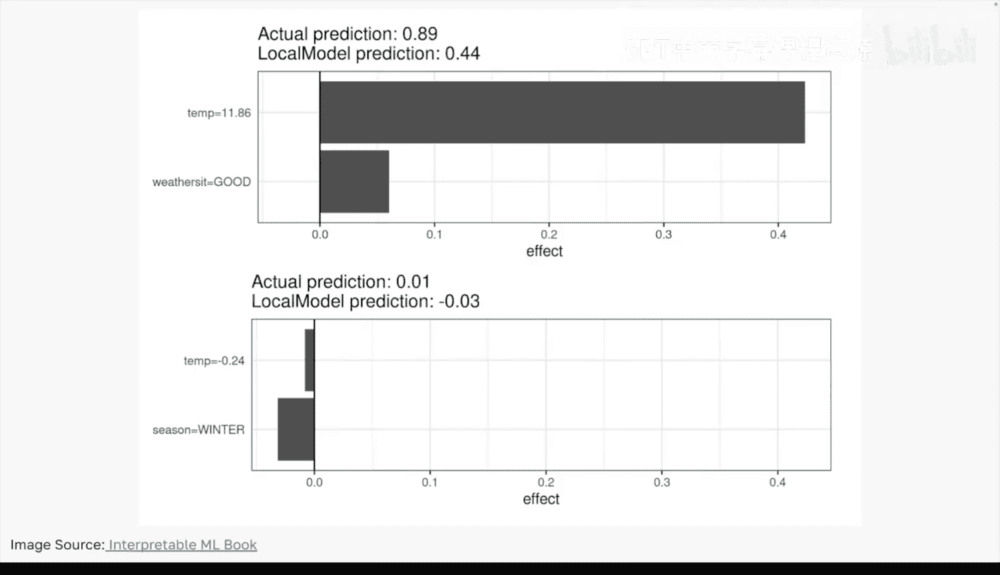
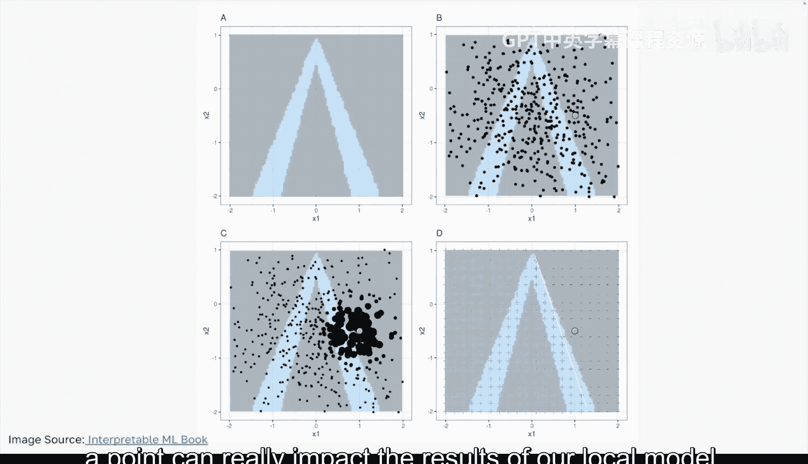
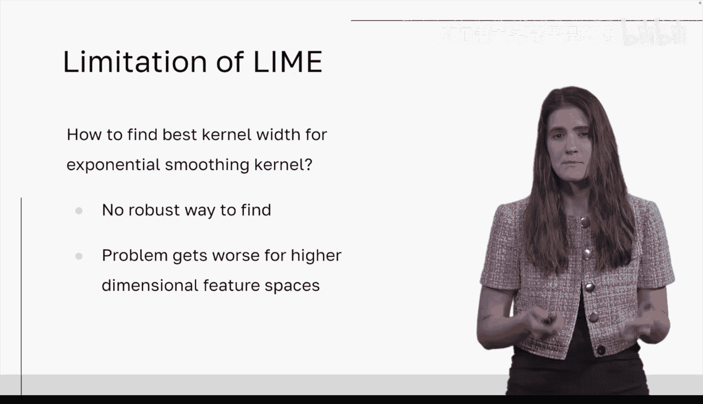
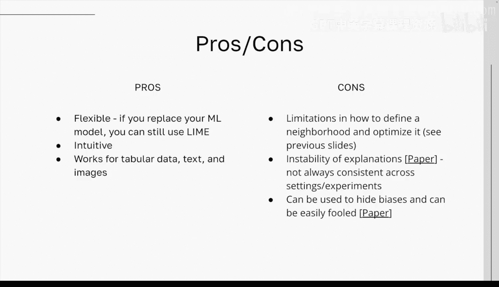

# 杜克大学《可解释人工智能｜Explainable AI (XAI)》中英字幕 p52 05_01_02_局部可解释模型无关解释（LIME）.zh_en -BV1HnrBBmEon_p52-

Local interpretable model， agnostic explanations or Lyme were introduced in 2016。

 They used interpretable models to explain individual predictions of a black box machine learning model。

An advantage to using Lyme is that it can be used for many data sources， including tabular data。

 text， and images。

The idea behind Li is illustrated in this figure from the original paper introducing Lime。

 you have some black box model and you have a prediction instance and the corresponding data or features used to get that prediction。

We can use Lyme to show the features that most contribute to our prediction。

 which can help humans make a more informed decision about whether to trust the prediction of the model。

So let's dive into how this works。

Here you can see a toy example used in the original paper to present intuition for limeme。

 The decision function of the original black box model is illustrated by the complex curve shown in the blue and pink background。

The bold Red Cross is our prediction instance of interest。

 What line posits is that while the complex decision function of the original model cannot be approximated with a linear model。

 we can use a linear model to approximate the decision function at this local area of interest。

 We can do this by sampling instances around our area of interest and using those to train a new interpretable model like a linear regression model。

😊。

Let's look at the process next first， you select an instance of interest。

 This is a prediction that you would like to explain。Next。

 you perturb your data set and get black box predictions for pertuurbed samples。From this。

 you generate a new data set that consists of these perturbed samples or variations of your data and the corresponding predictions。

Now you can train an interpretable model and you weight those sampled instances by their proximity to the instance of interest。

Now you have an interpretable local model that can be used to explain your prediction。

A reminder that this is a local explainable technique that should be used only for the instance or prediction of interest。

 it is not a globally faithful explanation and it won't generalize to other predictions made by your model。

If we take a look at the math， the explanation model， for instance， x， for example。

 a linear regression model， is that model minimizes the loss L， which could be any defined loss。

 for example means square error。This loss measures how close the explanation is to the prediction of the original model pi is a proximity。

 which is the measure of how larger the neighborhood around instance x is that we consider for the explanation。

G is the family of all possible explanations or all possible linear regression models。

 We try to keep the model complexity denoted here with omega low。

 which means we prefer fewer features。This is based on the principle of Oham's Razor Oham's Razor states that if you have two competing ideas to explain the same phenomenon。

 you should prefer the simpler one。For example， you hear a sound in the middle of the night and form two hypotheses。

 First is that your cat knocked something off the table。

 The second is that aliens landed on your roof and are now invading your house。

The simpler of the two hypotheses is that your cat knocks something off the table。

 so that is the one you should prefer according to Aham's razor。In the context of AI。

 if you have two AI models that perform similarly on your evaluation criteria。

 you should prefer the simpler， more interpretable one。

When we consider the practical application of this equation。

 Lime typically is only optimizing the loss component。

 the user is responsible for determining the complexity by selecting the maximum number of features that the linear regression model may use。

Let's look at lime and practice when using line for text。

 we create variations of instances by randomly removing words from the original text。

 the dataset set can be represented with binary features for each word。

 where feature equals1 if the corresponding word is included and feature equals zero if the corresponding word has been removed in the image shown here from the interpretable machine learning book。

 we can see an example where each word is removed from the original text and used to develop our interpretable linear model which can then be used to determine the importance of features or words in the prediction of a simple YouTube video comment classification of spam or not spam。

The first line shows a variation of the data set where the words Christmas。

 my and channel are removed。It looks like the word" channel has a high probability of being included in a prediction for spam comments。

Using lime for images is really interesting。 imagemage variations are created by segmenting the image into super pixelixs or interconnected pixels with similar colors。

 and then turning them on or off by replacing each pixel with a user defined color like gray。

 The user is also able to specify a probability for turning off a superpixel at each permutation。😊。

In these figures from the original lime paper， you can see examples of lime and practice in the bottom figure。

Different superpixs are highlighted to show the top classes used to predict electric guitar。

 acoustic guitar in Labrador。 The top figure shows the original image and the explanation of a bad model's prediction in a task classifying between husky and wolf。

 You can see here that the model only picked up some snow in the background to make its prediction。

 which is not desired。 Since we would like the model to use characteristics of the animal in the picture to determine whether it is a husky or a wolf。

😊。

Perhaps the most intuitive way that we may consider Lyme is using it for tabular data。

Lime can be used for tabular data to determine importance of features， as shown in the figure here。

 which shows that for one instance， temperature and weather had positive effects on the prediction for bike rental。

 and in another instance shown in the bottom， the temperature and season had a negative effect for the prediction for bike rental。

😊，However， there is significant limitation of Lyme when using tabular data。

In tabular data， lime samples are not taken around the instance of interest。

 but rather from the training data's mass center， you can see this visualized with this image from the interpretable machine learning book。

We are predicting classes represented by the blue and gray areas。

 The instance of interest is that bright yellow dot。

Data sampled from a normal distribution is shown in B and C。

 assigns a higher weight to points near the instance of interest。However。

 you can see that this definition of the neighborhood around a point can really impact the results of our local model。

The current Python implementation of Lyme uses an exponential smoothing kernel。

 reminder that a smoothing kernel is a function that takes two data instances and returns a proximity measure。

The kernel width determines how large the neighborhood of instances is。

 A small kernel width means that an instance must be very close to influence our local model。

 whereas a larger kernel width means that instances that are farther away also influence the model。

There is not yet a robust way to find the best kernel width。

 and this problem gets much worse in higher dimensional feature spaces。

So let's evaluate the pros and cons of Lyme as an explainable AI technique Lime is flexible if you replace your machine learning model because it is model agnostic。

 you can still use Lyme Li is also intuitive and it can work for different data sources。Now。

 there are limitations and challenges with using Lyme。 First。

 there are limitations in how to define a neighborhood and optimize it。 like we discussed。

 There is also not always consistency across sets or experiments， as researched in 2018。

You can also use limeme to hide biases and can easily fool others with it。

 which is not a very explainable property of limeme。 This was studied by Slack at all in 2020。

