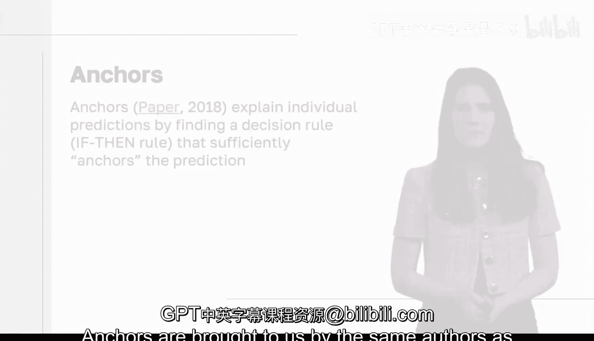
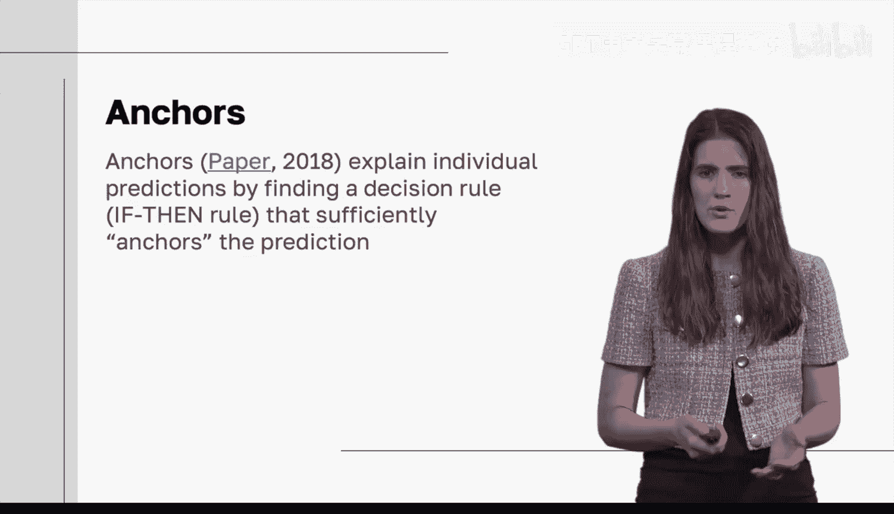
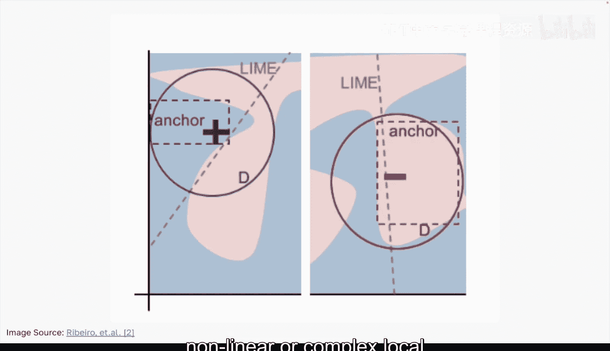
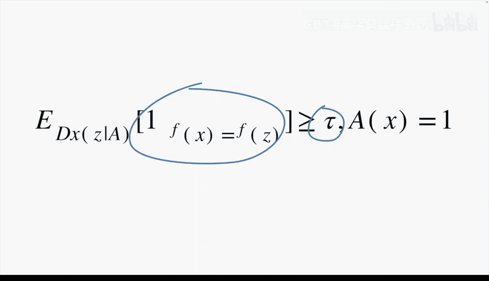
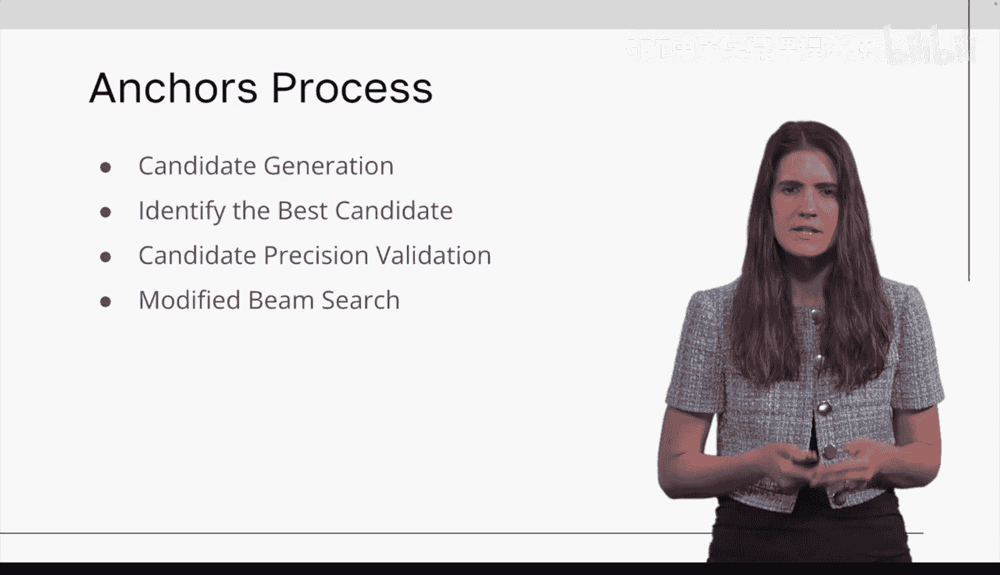
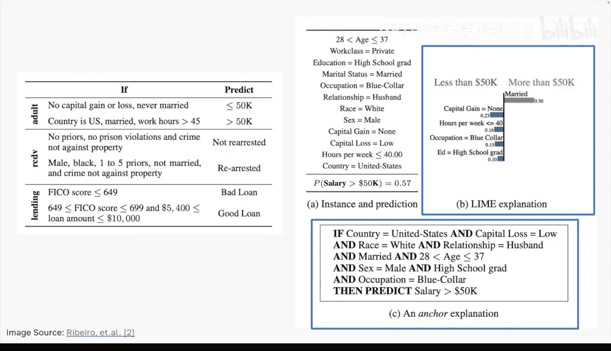
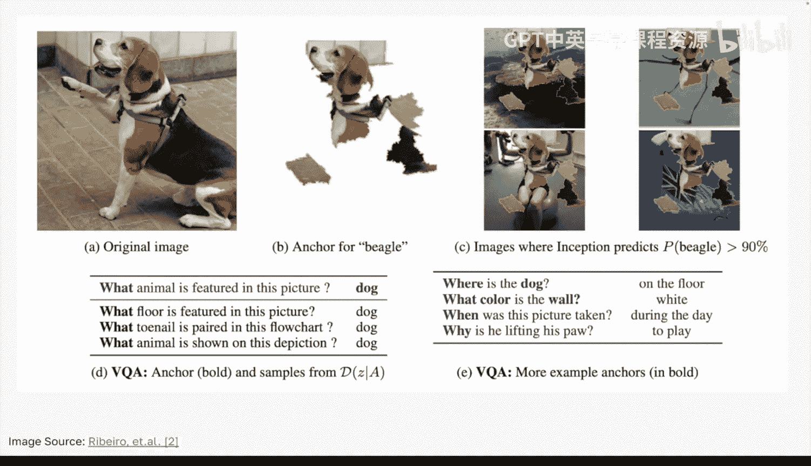
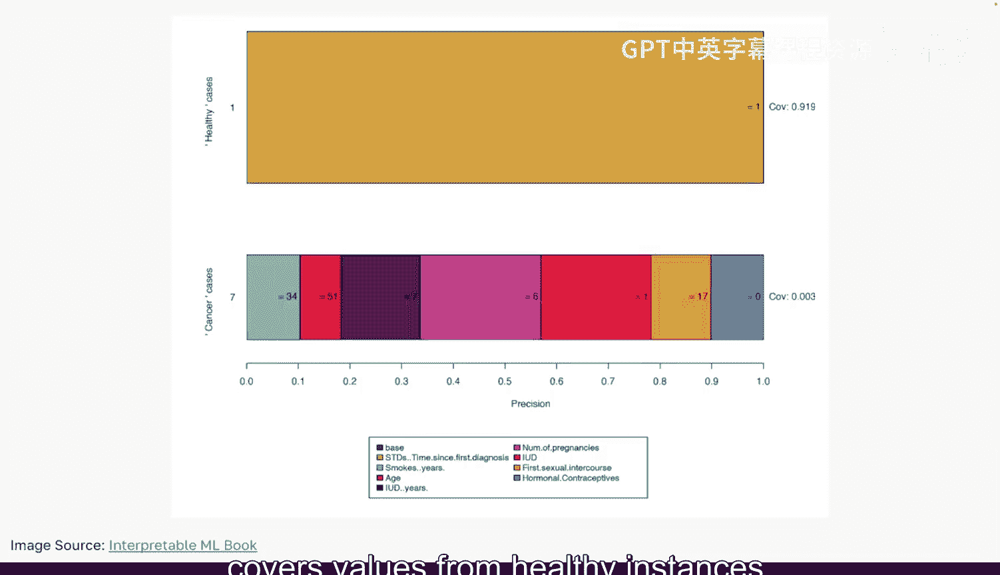
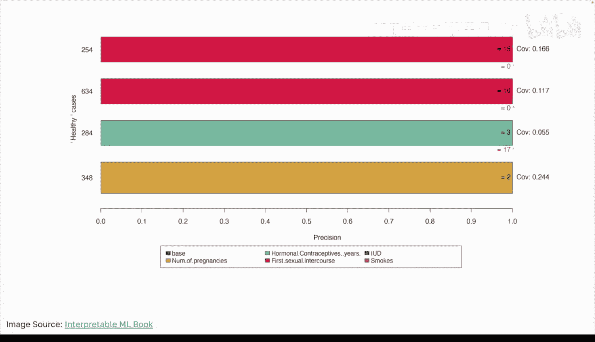
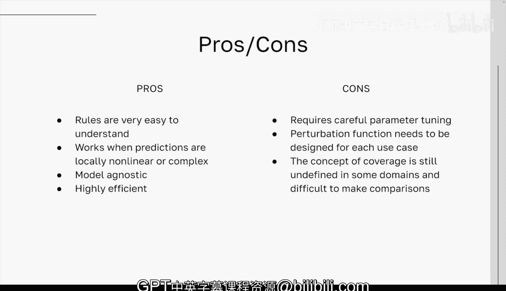

# 杜克大学《可解释人工智能｜Explainable AI (XAI)》中英字幕 p53 06_01_03_锚点解释法.zh_en -BV1HnrBBmEon_p53-

Inchs are brought to us by the same authors as the original line paper in a study called high precision model agnostic explanations with anchors。

 you will see a lot of similarities to the limeme approach。 Again。

 we are explaining individual predictions。 But this time。

 instead of using a linear model to approximate the local decision boundary as with lime。

 we are now finding a decision rule that sufficiently anchors the prediction。

Inchors are very easy to understand if then rules， and are great for classification use cases。

A major motivation is that we can't guarantee that local predictions can be approximated with a linear function。

Because we don't know what the complex decision boundary actually looks like。

 which is illustrated here by the pink and blue areas。 Again。

 we don't actually know if lime is a good approximation of even local instances with anchors。

 we don't have to approximate potentially nonlinear or complex local boundaries with linear models。

First， a is our anchor， and X is our instance of interest。

 A rule's precision results from evaluating neighbors or perturbations from the distribution ofs neighbors X matching A。

Using the provided machine learning model tonoted here as1 F of x equals f of z。

And tau is the precision threshold， only rules that achieve a local fidelity of at least tau are considered valid。

Now， constructing particular rules is typically infeasible。Instead。

 we create a probabilistic definition。 Before we talk more about this。

 we need to define the concept of coverage。 Coage is an anchor's probability of applying to its neighbors。

 Note here that there exists a trade off between coverage and precision。

The Ins approach uses four main components to find explanations。First， candidate generation。

 This generates new explanation candidates。 In the first round。

 it creates one candidate per feature of the instance being explained。 X。

 where each candidate fixes the respective value of possible perturbations in subsequent rounds。

 the best candidates from the previous round are extended by adding one feature predicate that is not yet included in them。

Next， best candidate identification。 This component compares candidate rules to determine which one explains the instance x the best To do this。

 it creates perturbations that match the currently observed rule and evaluates them by calling the model。

However， these model calls need to be minimized to limit computational overhead。

At the core of this component is a pure exploration multiar bandit algorithm。

 multiar bandits are used to efficiently explore and exploit different strategies called arms in analogy to slot machines using sequential selection。

In this setting， each candidate rule is considered an arm that can be pulled。

 Each time an arm is pulled。 Re neighbors are evaluated。

 and we obtain more information about the candidate rules' payoff Preion， in the case of anchors。

 The precision indicates how well the rule describes the instance being explained。

Then candidate precision validation This component takes more samples if there is no statistical confidence yet that the candidate exceeds the specific threshold tau。

Finally， the modified beam search， This component assembles all of the above components into a beam search。

 which is a graph search algorithm and a variant of the bread first algorithm。

 It carries over the B best candidates from each round to the next round， where B is the beam width。

 These B best rules are then used to create new rules。😊，At every round I。

 it generates candidates with exactly I predicates and selects the B best among them by setting a high value for B。

 The algorithm is more likely to avoid local optima。

 but this requires a high number of model calls and thereby increases the computational load。

Here is an illustration of the four components we discussed on the last slide。

 you have instance x to be explained。 parametersmeters include Model F and perturbation space D and hyperparameter。

 beam width B and precisionion threshold tau。The beam search assembles all of the other components。

 which starts with generating new candidates， using the multiarmed bandit to select B best candidates and determining if the best rule passes tau and if so measures the coverage。

 The anchor then is the candidate having the highest coverage。

Here are a few examples of anchors in practice Here is a table and a figure from the original paper where you can see simple if then anchor is used for tabular data sets Figure5 shows both the lime explanation in B and In explanation in C。

 Both are useful for explaining the model prediction instance。

Similar to lime， when we use anchors for images， we use a set of super pixelixs。

 You can see the anchor for bele is shown here in some figure B。

Anchors of a machine translation system are shown in bold for prediction of the Portuguese word for this。

 ista。

One call out when using anchors is that you need to be really careful if you have unbalanced data because the perturbation space reflects the training data in this example shown here。

 we want to determine what features lead to a particular prediction。In this particular data set。

 which is highly unbalanced， explaining instances labeled healthy yields empty rules as all generated neighbors evaluate to healthy。

Explanations for instances labeled cancer are overly specific。

 and they comprise many feature prediccateates since the perturbation space mostly covers values from healthy instances。

So what do we do if we have unbalanced data， there are a number of potential mitigation methods and each of these have their own limitations and should be used thoughtfully and carefully。

Potential mitigation strategies include defining a custom perturbation space through sampling differently。

 using a subset of training data or modifying the multiar bandit parameters， confidence and error。

 which could result more samples being drawn， ultimately leading to the minority being sampled more often。

In the example shown here from the interpretable machine learning book。

 they use a more balanced subset of the original data set from which to draw。

So let's evaluate the pros and cons of anchors and as an explainable AI technique。

 Rule are very human understandable， which makes anchors highly explainable。

 They are model agnostic and highly efficient， and they work when predictions are locally nonlinear or complex。

 However， anchors require careful parameter tuning。

 The perturbation function needs to be designed for each use case and the concept of coverage is still undefined in many domains。

 so it's difficult to make comparisons using anchors。😊。

