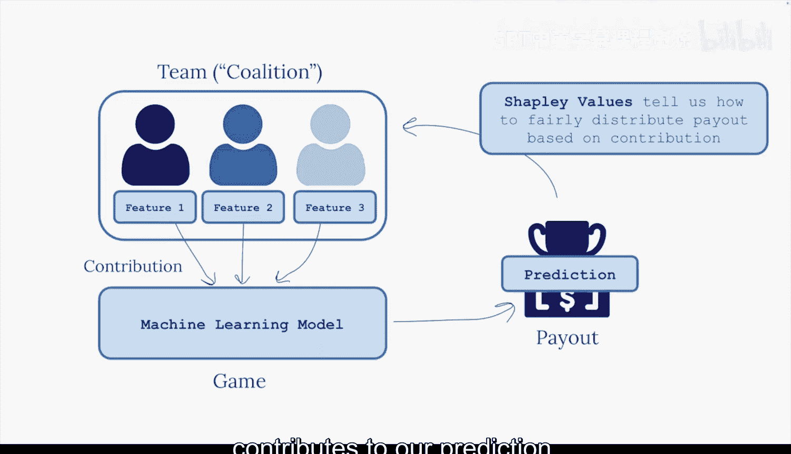
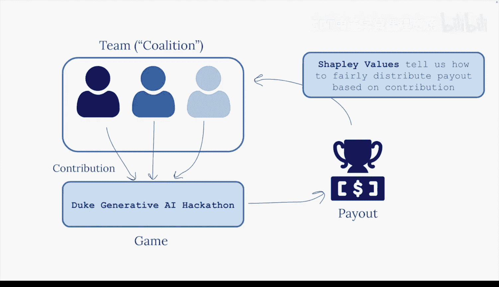
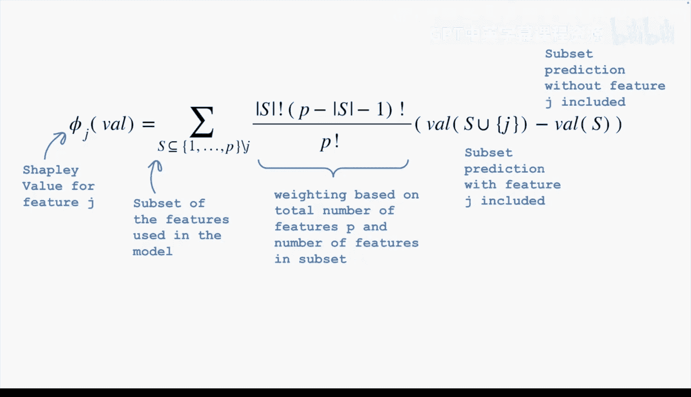
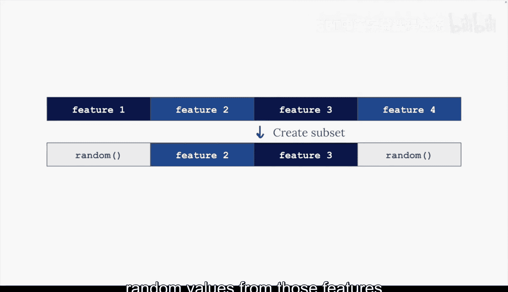
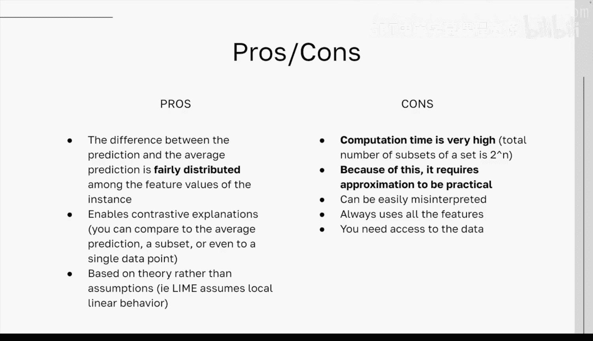

# 杜克大学《可解释人工智能｜Explainable AI (XAI)》中英字幕 p54 07_01_04_沙普利值.zh_en -BV1HnrBBmEon_p54-

Let's talk about Shapley values。 Shapley values were first introduced back in 1952。

 and as a coalition game theory concept。 here's the idea。

 Do cost a generative AI hackathon annually in the fall。

 You get two of your friends together to compete as a team or coalition at the hackathon or game。

 Let's say you all win a monetary award or payout from the hackathon。 Great job。

 But now you have to determine how to fairly distribute that payout among your team members based on their contribution。

😊，This is where Shaplely values come in， They tell us how to fairly distribute payout based on contribution。

For our purposes we can think of a coalition as all of the features used to train our machine learning model or game。

 the prediction is our payout and the Shaplely values tell us how much each feature contributes to our prediction。

So a recap， Shapley values invented in 1952 are a method from coalitional game theory where game players cooperate in a coalition or team。

 Shapley values tell us how to fairly distribute the payout to players depending on their contribution to the total payout。

Let's go back to our example。How do we go about determining how much of an impact each team member had？

Well， we need to examine the individual contribution of each team member， for example。

 you were an machine learning engineer and you built the entire model that was your winning idea。

 so maybe you should have a higher individual contribution to the end payout。

We also have to consider the interaction effects between players。

 You are only able to build that model because of your friend Casey's ability to do web scraping for the data set Without Casey。

 you would not have had as big of an individual contribution。But how do we do this。In this example。

 we jump into a time machine and we go back and we redo the hackathon with different subsets of the original team。

 We average over the contributions of each subset and get the marginal contribution of each player on the team。

I really like this explanation of the interpretation of Shapley values from the interpretable machine learning book。

How to interpret the Shaplely value， given the current state of feature values。

 the contribution of a feature value to the difference between the actual prediction and the mean prediction is the estimated Shaplely value。

How to not interpret the Shapley value， the Shaplely value of a feature value is not the difference of the predicted value after removing the feature from the model training。

It's really easy to interpret Shapley values incorrectly。

 so make sure to keep this in mind as you're using them。Let's dive deeper into the math。

We can find the Shaplely value for feature J by finding the difference between the subset prediction with feature J included and the subset prediction without feature J included。

 We weigh this based on the total number of features in our subset。

 and then we sum them over the subset of features used in the model。😊。

In practice， models usually have a fixed number of inputs so we can't just remove features。

 What we typically do instead is replace the feature with a random value from our training set over all of the subsets。

 the relevance of these random values is sampled out。

 You can see this visualized here where we created a subset of feature 2 and feature 3 and we replace feature 1 and feature 4 with random values from those features in our training dataset set。

So let's evaluate the pros and cons of Shaplely values as an explainable AI technique。

The difference between the prediction and the average prediction is fairly distributed among the feature values of the instance。

 This enables contrastive explanations。 So you can compare to the average prediction。

 a subset or even a single data point。And it's based on theory， rather than assumptions， for example。

 we talked about how Lyme assumes local linear behavior。On the other hand。

 computation time is very high， the total number of subsets of a set is2 to the n。Because of this。

 it requires approximation to be practical， which we're going to talk about in the chat video。

Like we discussed， Shaplely values can be easily misinterpreted。

It also always uses all of the features， and you need access to the data in order to compute your Shaly values。

