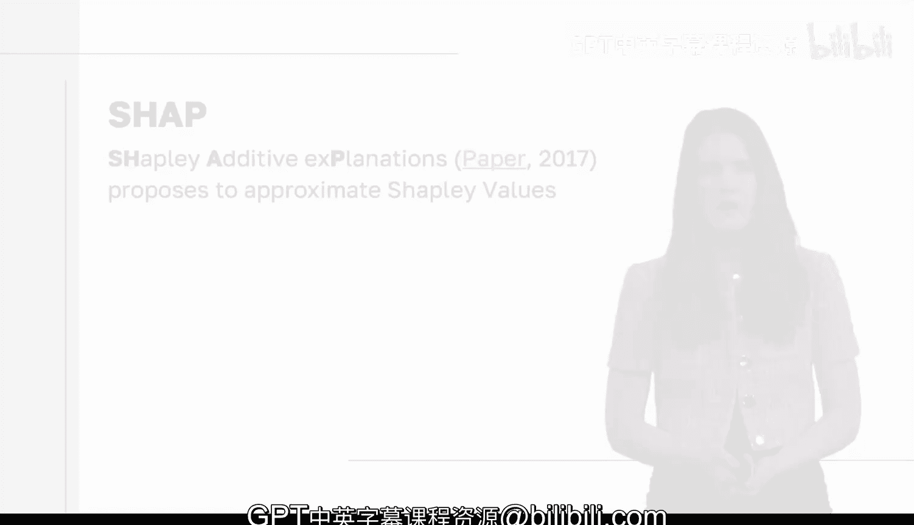
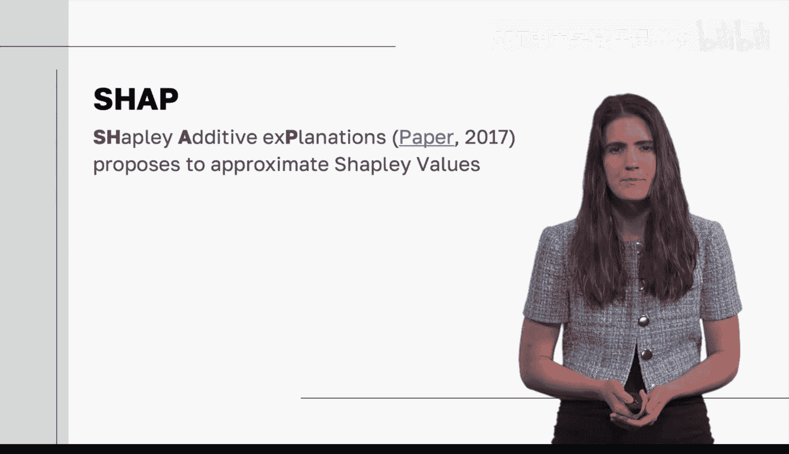
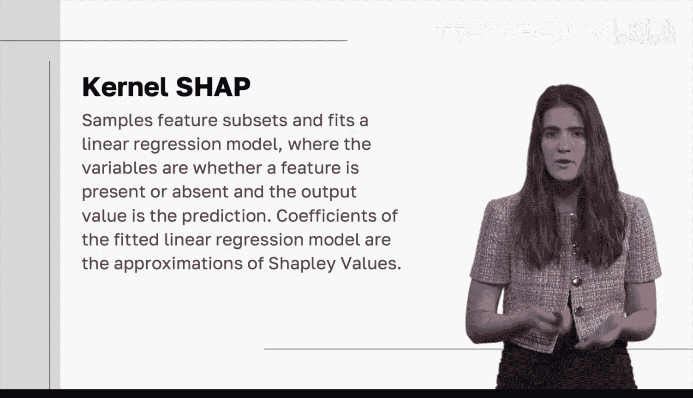
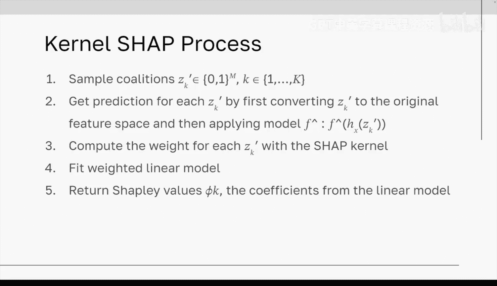
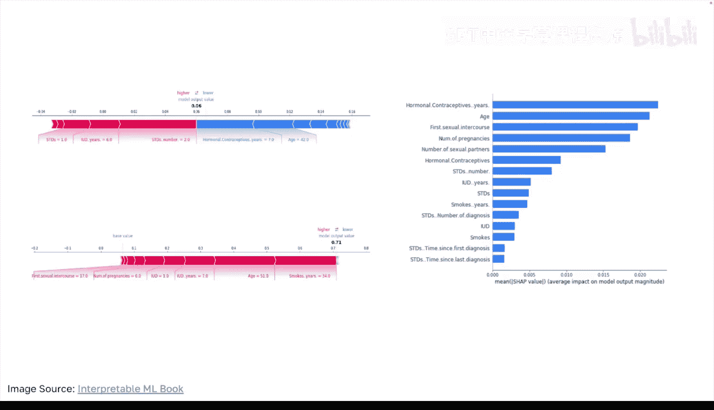
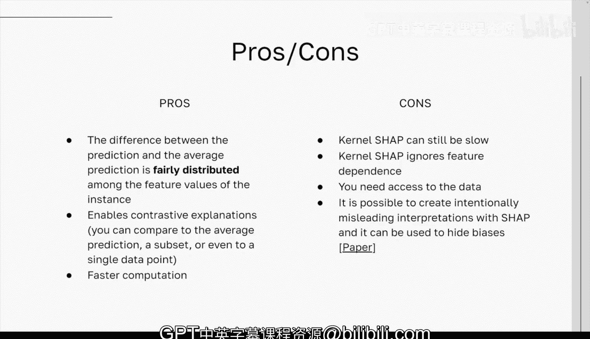

# 杜克大学《可解释人工智能｜Explainable AI (XAI)》中英字幕 p55 08_01_05_沙普利加性解释（SHAP）.zh_en -BV1HnrBBmEon_p55-

Yeah。Shaplely additive explanations， or Shap was introduced in 2017。

 They builded off of the concept of Shaplely values。 In the Shaplely values video。

 we talked about how they are extremely computationally expensive， and so they're not very practical。

 The Shap method proposes to approximate Shaplely values instead of outright calculating them。

There are a number of ways to approximate Shapley values， including but not limited to kernel Shap。

 tree Sha and deep Sha In this lecture， we're going to focus on kernel Shap。

 but in the code demo we will implement tree Sha so you can get a feel for a couple of different Sha approaches。

Colonel Shap is actually pretty similar in concept to lime。

 where we are approximating Shaplely values with a linear regression model。

We will sample feature subsets and fit a linear regression model where the output value is the prediction。

 and our variables are whether a feature is present or absent。

 The coefficients of our fitted linear regression model are the approximations of our Shaplely values。

Steps to kernelel Shap include one， sampling our coalitions。

 getting a prediction for each of our samples by converting it to original feature space and then applying our model to it。

Computing the weight for each sample with the Sha kernel。

 fitting the weighted linear model and returning approximations of Shaplely values。

 which are the coefficients from the linear model。

Here is a great visualization from the original chap paper that shows feature attribution values assigned to features by a human。

 by lime and by Sha。 We can see visually that Shap is much more consistent with human estimates than lime。

😊，When Shap is applied to image data， again， we see higher performance of our Sha values versus other explainability methods。

There are some really interesting ways to visualize outputs from Shap。

 Here are just a few examples from the interpretable machine learning book。

So let's evaluate the pros and cons of Shap as an explainable AI technique。

 Shap is based on Shaplely values， so a lot of the pros remain the same。

 The difference between the prediction and the average prediction is fairly distributed among the feature values of the instance。

 so it enables contrastive explanations。 you can compare to the average prediction。

 a subset or even to a single data point。In contrast to Shaplely values。

 Shap approximations provide much faster computation。However， just because it is relatively faster。

 it does not mean that it is fast。 Colonel Shap can still be pretty slow。

 It also ignores feature dependence。Just like Shaplely values， you need access to the data。

 and it is possible to create intentionally misleading interpretations with ShaHpP。

 and it can be used to hide biases。

