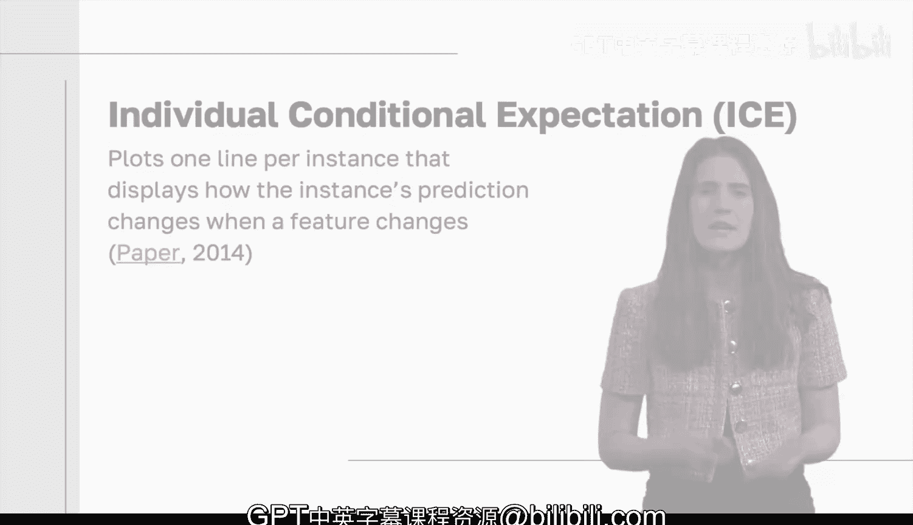
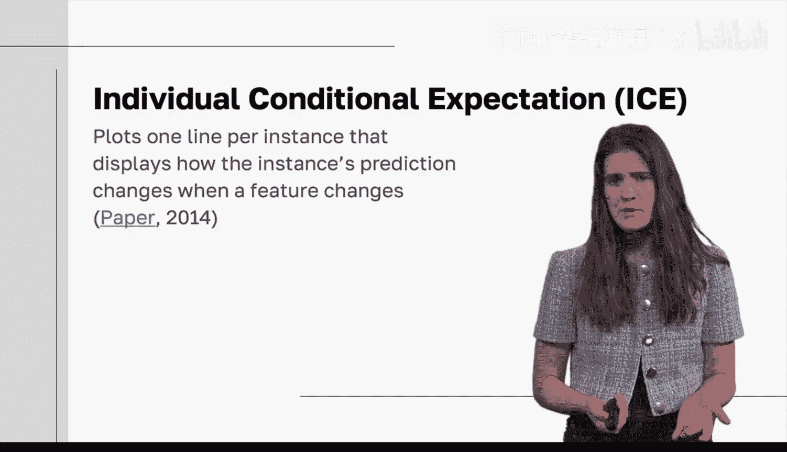
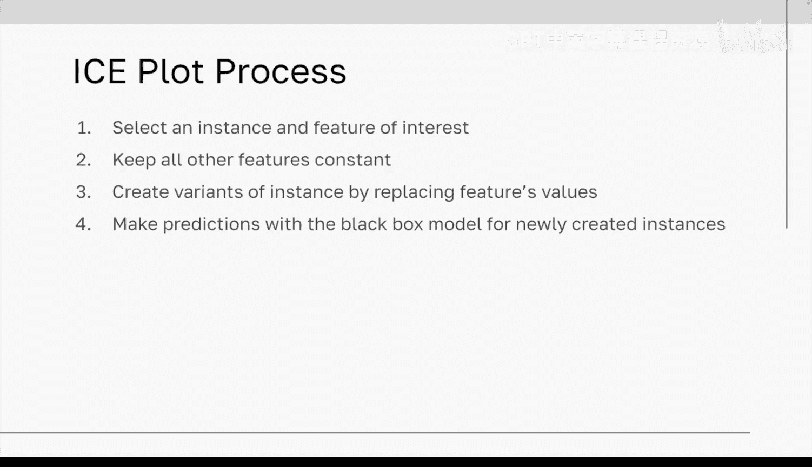
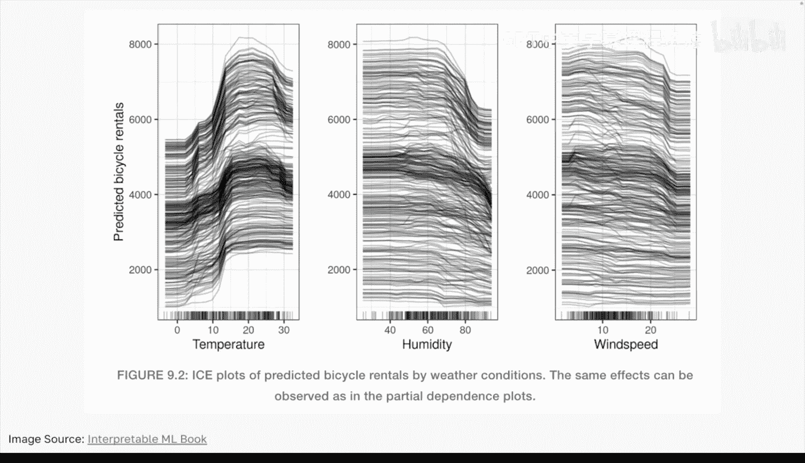
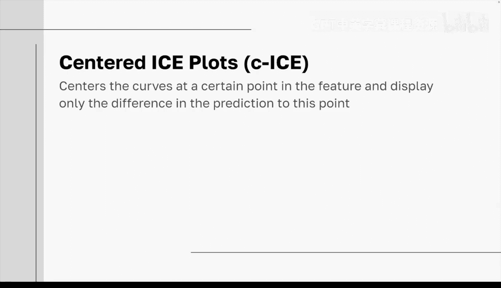
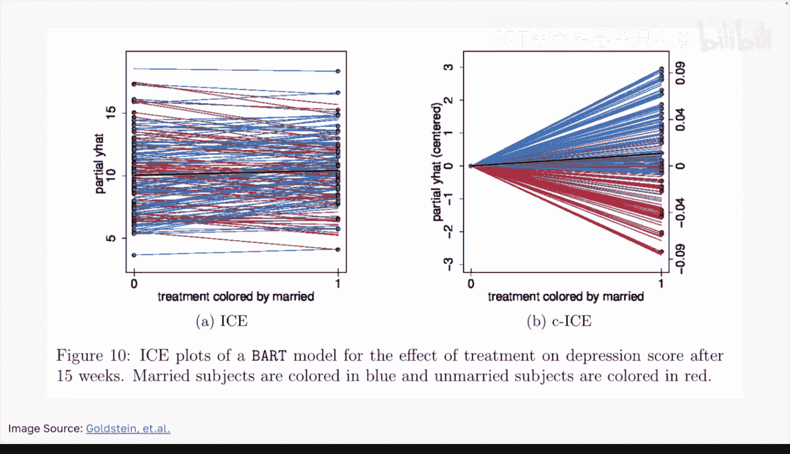
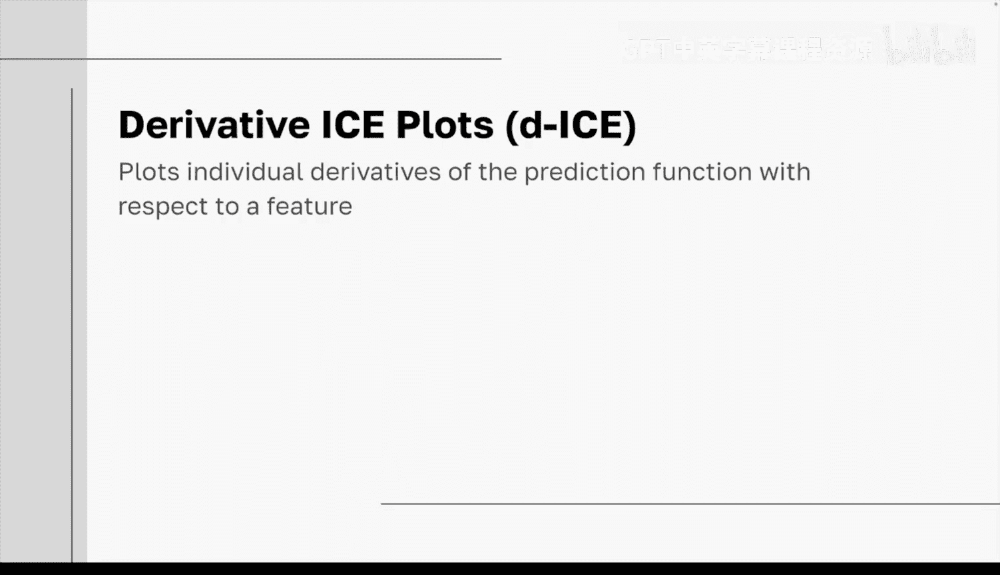
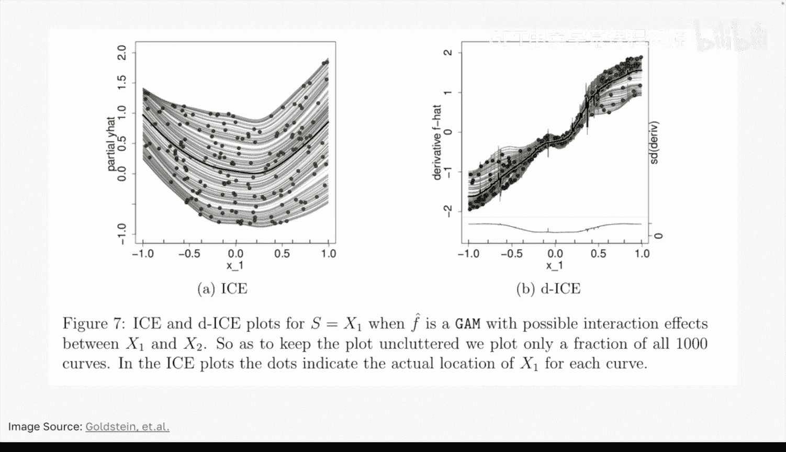
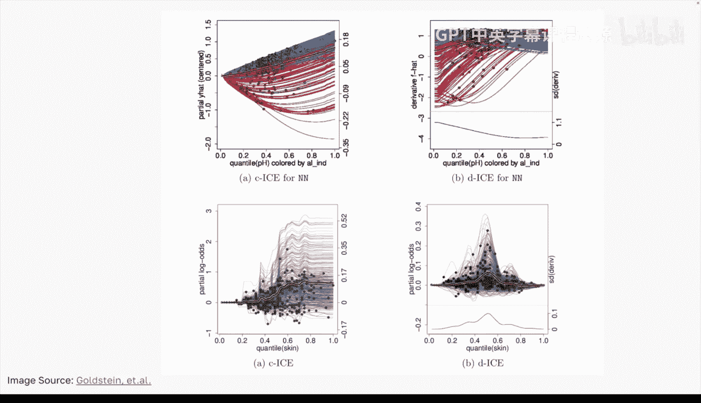
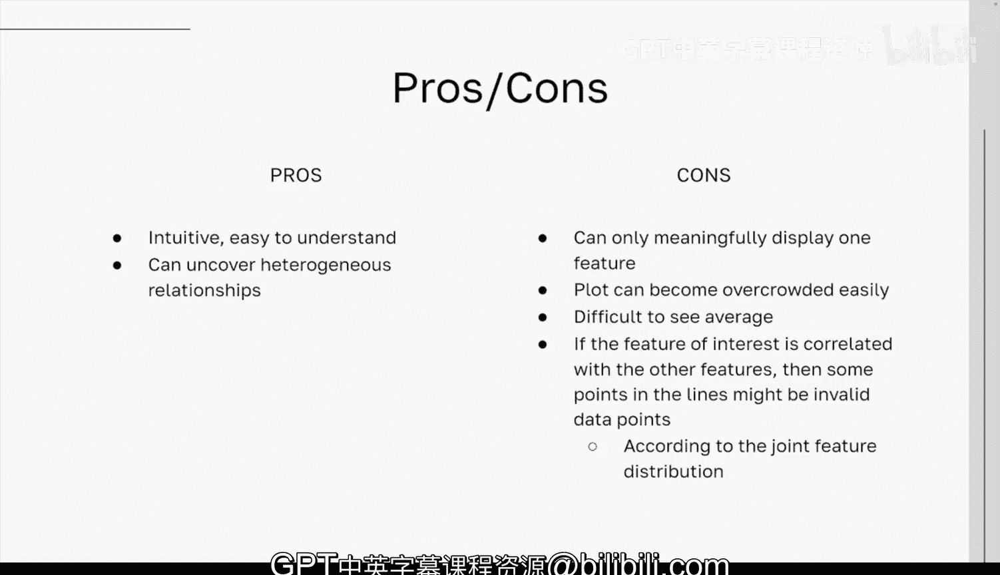

# 杜克大学《可解释人工智能｜Explainable AI (XAI)》中英字幕 p56 09_01_06_个体条件期望图（ICE）.zh_en -BV1HnrBBmEon_p56-

Individual conditional expectation or ice plots were introduced in 2014 by Goldstein at all。

 Ice plots plot one line per instance that displays how the instance's prediction changes when a particular feature changes。

By visualizing all of our instances， we can improve local explainability while also gaining a better global understanding。

In the figure from the original paper shown here， each light gray line shown is a single instance。

 This is a great way to visualize that for some instances。

 a higher age is associated with higher predictive values。

 while other instances show that higher ages are actually associated with lower predicted values。😊。

So how does this work？First， we select an instance and a feature of interest。

 We keep all other features constant and create variants of the instance by replacing the features's values。

 We make predictions with the black box model for newly created instances。

 And now we have a set of points for an instance with the feature value and respective predictions。😊。

Here is a visualization of ice plots of predicted bicycle rentals by weather conditions。

 If we focus on the temperature1， you can see an increase in predicted bicycle rentals increases as the first temperature increases。

 then drops off after approximately 30 degrees。 Note the variation in different instances。

 which is nicely visualized by the individual curves。

It can sometimes be difficult to tell whether ice curves differ between individuals because they start at different predictions。

 to solve this， we can center the curves at a certain point in the feature and display only the difference in the prediction to this point。

 This is called centered ice plots， or sea ice。

This figure from the original ice paper displays this nicely。

 it is difficult to see the trends using the ice plot， but when it is centered。

 there is clear differentiation。

If we want to know whether changes occur and in which directions they occur。

 we can look at derivative ice pots or D ice pots where we look at the individual derivatives of the prediction function with respect to a feature。

This also makes it easy to determine ranges of feature values where the black box predictions change。

 for some instance， as shown here in figure 7。

Here are more examples of sea ice and D ice plots， feel free to pause a video to look at these figures in more detail。

So let's evaluate the pros and cons of ice plots as an explainable AI visualization technique。

 Ice plots are intuitive and easy to understand， they can also uncover heterogeneous relationships。

However， ice plots can only meaningfully display one feature。

 Pos can become overcrowded easily and is difficult to see the average。

It is important to note that if the feature of interest is correlated with the other features。

 then some points in the lines might be invalid data points according to the joint feature distribution。

