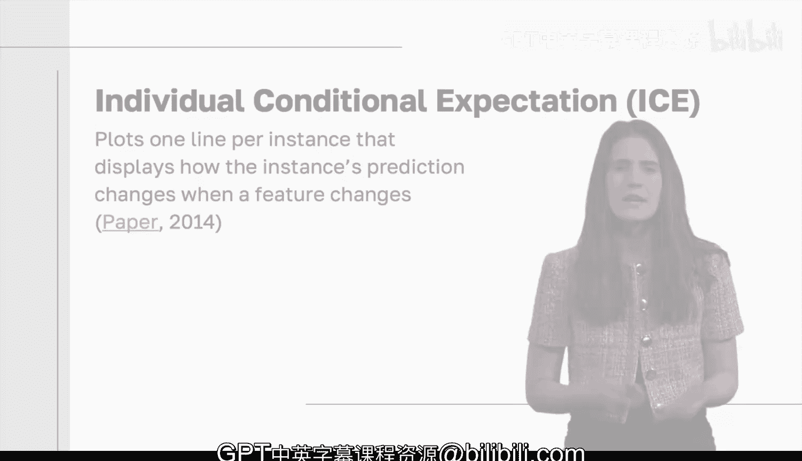
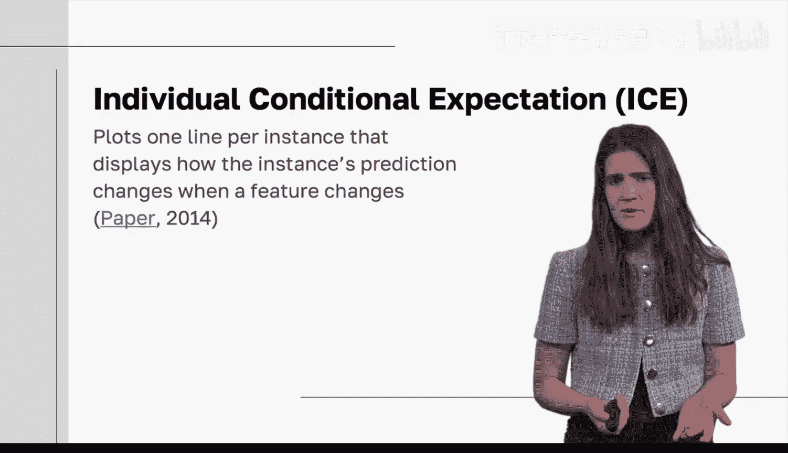
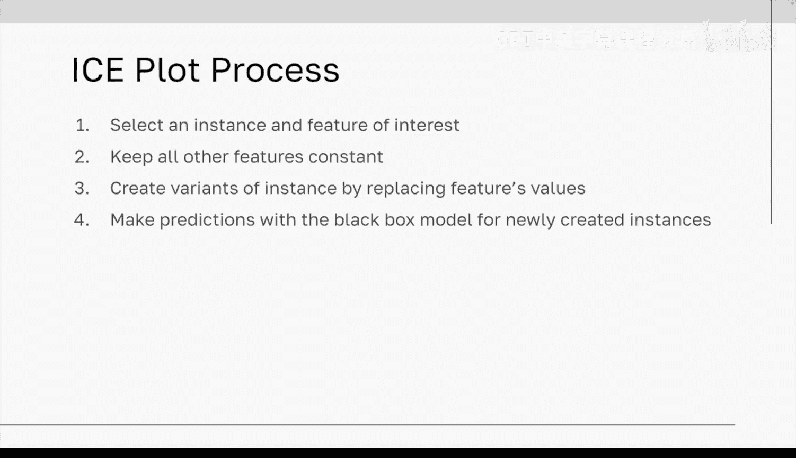
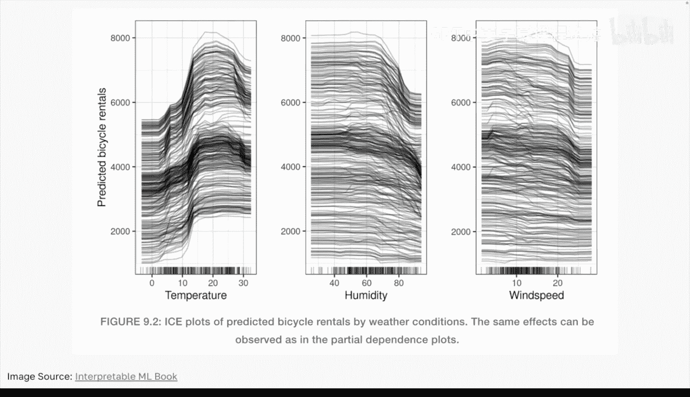
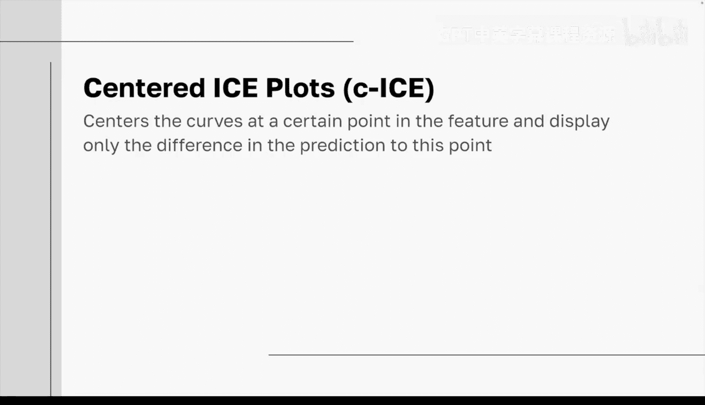
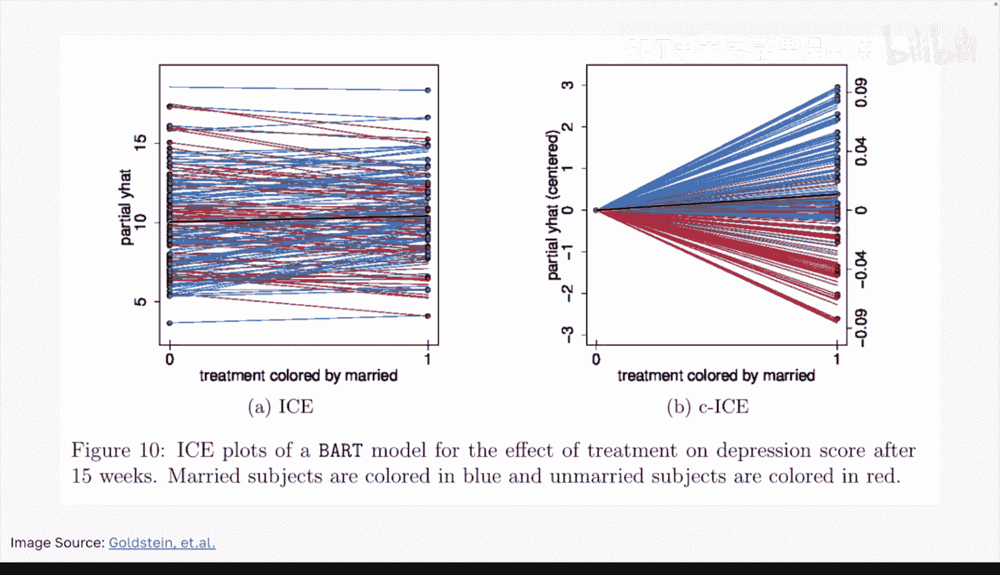
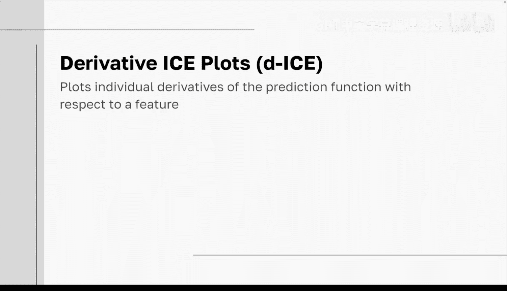
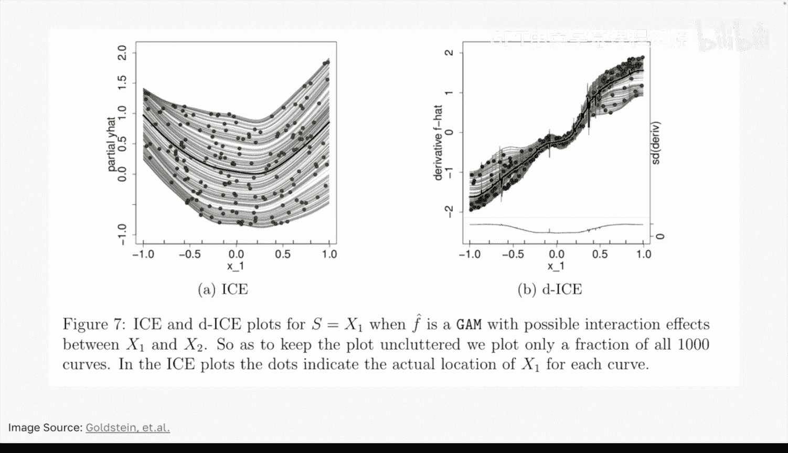
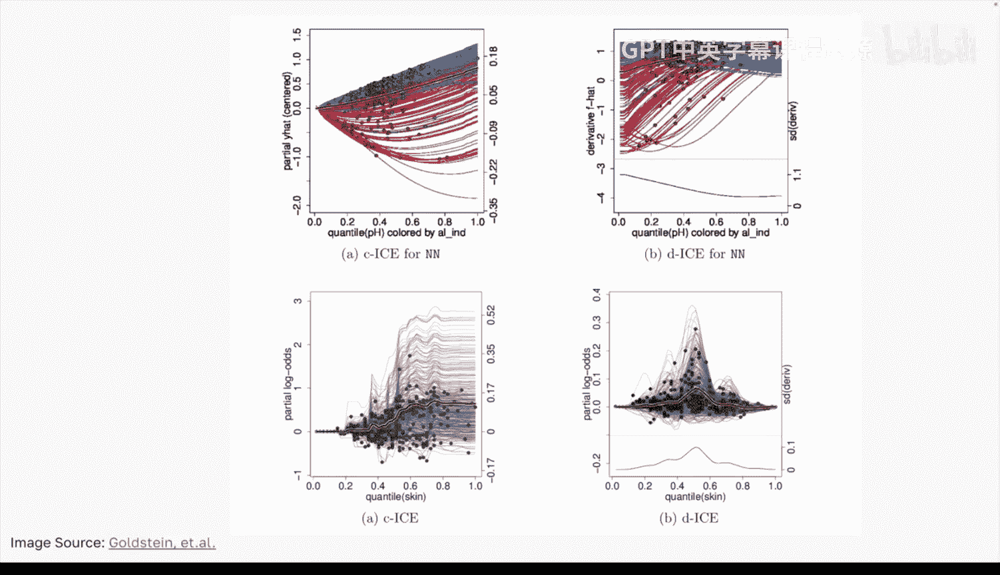
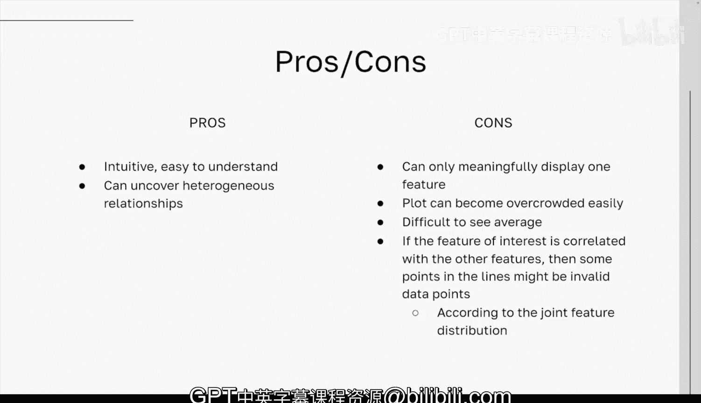

# 可解释人工智能：09_01_06：个体条件期望图（ICE）📊

在本节课中，我们将学习一种名为“个体条件期望图”（ICE）的可视化技术。ICE图由Goldstein等人于2014年提出，它通过绘制每个数据实例的预测变化曲线，来展示当某个特定特征变化时，模型预测如何随之改变。这种方法不仅能提升局部可解释性，还能帮助我们获得更好的全局理解。

## ICE图的工作原理🔍

上一节我们介绍了ICE图的基本概念，本节中我们来看看它是如何具体工作的。其核心流程可以概括为以下几个步骤：

以下是生成一条ICE曲线的具体步骤：
1.  **选择一个实例和一个感兴趣的特征**：首先确定要分析的具体数据样本以及要研究的特征。
2.  **固定其他特征，改变目标特征值**：保持该实例所有其他特征的值不变，仅对目标特征生成一系列不同的取值。
3.  **使用黑盒模型进行预测**：将上一步生成的所有新“实例”输入模型，得到对应的预测值。
4.  **绘制曲线**：以目标特征值为横轴，对应的模型预测值为纵轴，绘制出该实例的预测变化曲线。

通过重复此过程为多个实例绘制曲线，我们就得到了完整的ICE图。

## ICE图示例与解读🚲

理解了基本原理后，我们通过一个具体例子来直观感受ICE图。下图展示了基于天气条件预测自行车租赁量的ICE图：

如果我们关注特征`温度1`，可以看到，对于大多数实例，预测的自行车租赁量随着温度升高而增加，但在大约30度之后开始下降。图中不同的曲线清晰地展示了不同实例间的预测差异：有些实例在高温时预测值更高，而另一些则呈现相反趋势。

## ICE图的变体：中心化ICE图与导数ICE图🔄

标准的ICE图有时难以比较，因为不同曲线的起点（预测值）不同。为了解决这个问题，我们可以采用中心化ICE图。

**中心化ICE图**（c-ICE）将每条曲线在特征空间的某个参考点（例如特征最小值处）进行中心化，只显示相对于该点的预测差异。这使得曲线之间的趋势对比变得更加清晰。

此外，如果我们想直接了解预测变化发生的具体位置和方向，可以查看**导数ICE图**（d-ICE）。

**导数ICE图**绘制的是预测函数相对于目标特征的个体偏导数。公式表示为：
`d-ICE(x_s) = ∂f(x) / ∂x_s`
其中，`x_s`是目标特征，`f(x)`是模型预测函数。这使得我们能够轻松确定黑盒模型预测发生变化的特征值范围。

## ICE图的优缺点评估⚖️

最后，我们来总结一下ICE图作为一种可解释AI可视化技术的优缺点。

以下是ICE图的主要优点：
*   **直观易懂**：图形化展示，易于理解。
*   **揭示异质性关系**：能够发现特征与预测之间在不同实例上的差异化关系。

以下是ICE图的主要局限：
*   **一次只能显示一个特征**：无法直接展示多个特征的交互影响。
*   **容易 overcrowded**：当实例数量很多时，图形会变得拥挤，难以看清平均趋势。
*   **可能包含无效数据点**：如果感兴趣的特征与其他特征相关，那么ICE曲线中的某些点可能不符合真实的联合特征分布，属于无效推断。

## 总结📝

本节课中，我们一起学习了**个体条件期望图**及其变体。我们了解了ICE图通过为每个实例绘制预测随单一特征变化的曲线，来同时提供局部和全局的模型洞察。我们还探讨了**中心化ICE图**用于更好地比较趋势，以及**导数ICE图**用于精确定位预测发生变化的区域。尽管ICE图在可视化异质性关系方面非常强大，但我们也需要注意它一次只能分析一个特征以及在实例过多时可能显得拥挤的局限性。