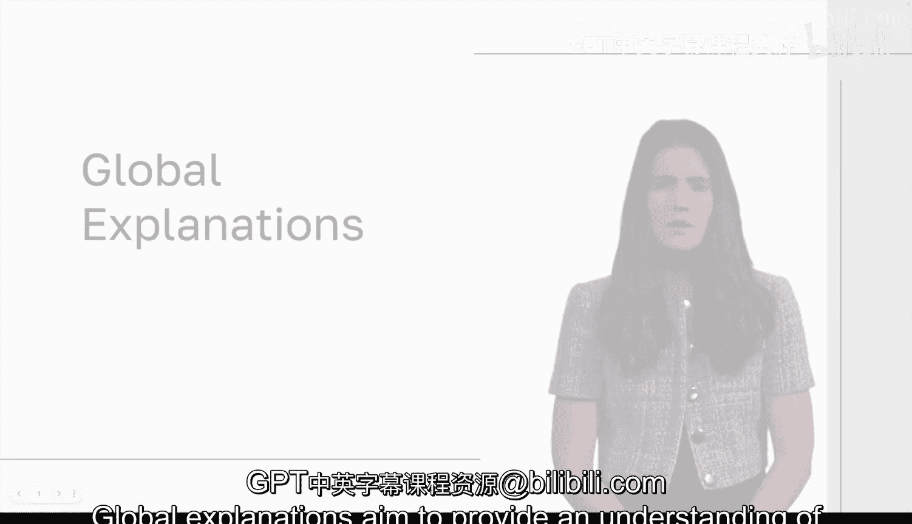
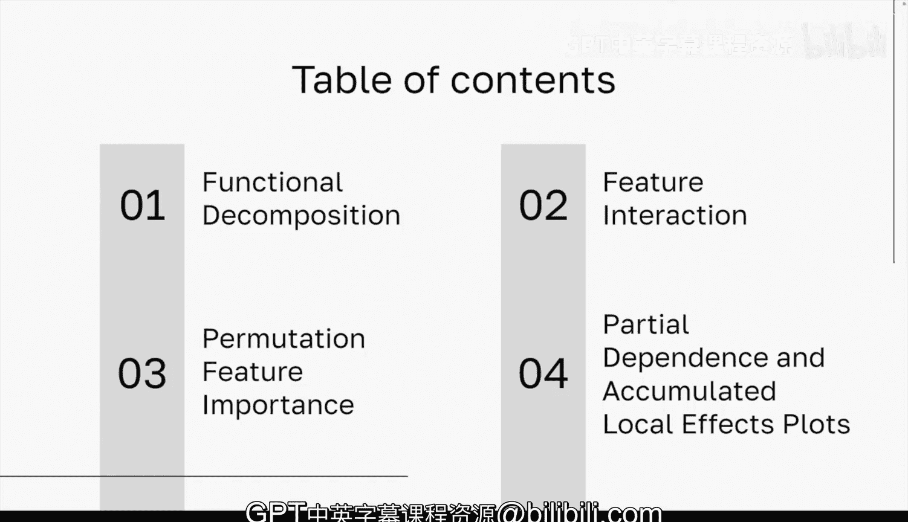

# 杜克大学《可解释人工智能｜Explainable AI (XAI)》中英字幕 p57 10_01_01_全局解释方法导论.zh_en -BV1HnrBBmEon_p57-

Global explanations aim to provide an understanding of the overall behavior and decision making process of a machine learning model。

 rather than focusing on individual predictions or local regions of the input space。

 These explanations can help identify patterns， trends and relationships that govern the model's behavior across the entire input domain。

We're going to discuss a number of common global explanations， including functional decomposition。

 feature interaction， permutation feature importance， partial dependence plots。

 and accumulated local effects plots。These global explanation techniques can provide valuable insights into the overall behavior and decision making process of a machine learning model。

 They can help identify important features， detect interactions。

 uncover nonlinear relationships and gain a better understanding of how the model operates across the entire input space。

 This understanding can be crucial for model interpretation。

 debugging and building trust in the model's predictions。😊。

