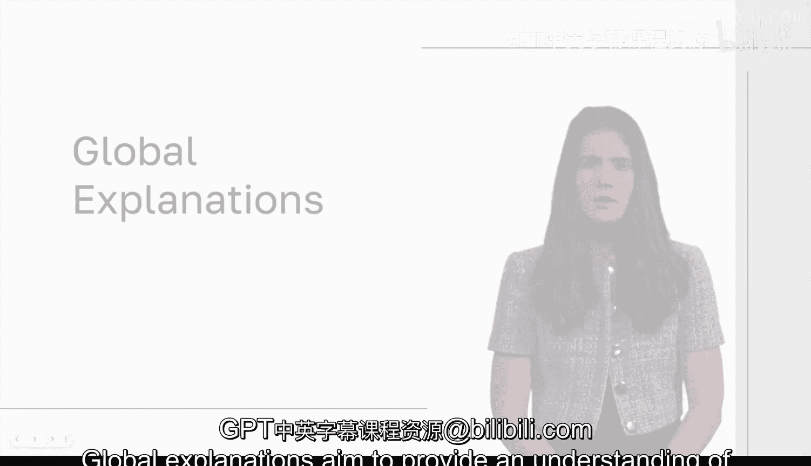
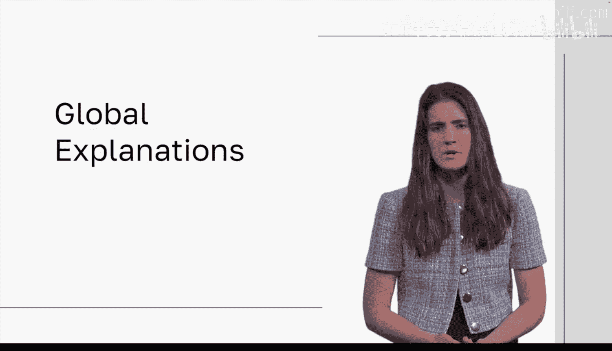
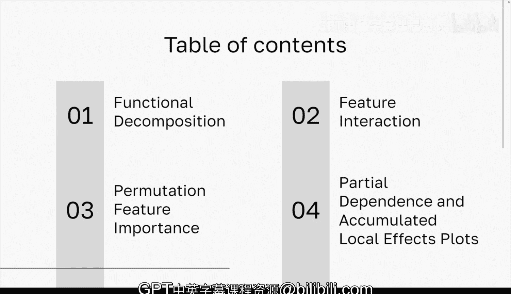

# 可解释人工智能：10：全局解释方法导论 🧭

在本节课中，我们将要学习全局解释方法的基本概念。全局解释旨在帮助我们理解机器学习模型的整体行为与决策过程，而非仅仅关注单个预测或输入空间的局部区域。

上一节我们介绍了可解释人工智能的多种视角，本节中我们来看看全局解释方法的核心目标与价值。

## 全局解释的目标

全局解释旨在提供对机器学习模型整体行为和决策过程的理解。这些解释有助于识别支配模型在整个输入域内行为的模式、趋势和关系。

## 常见的全局解释方法

我们将讨论几种常见的全局解释方法。以下是这些方法的简要列表：

*   函数分解
*   特征交互
*   排列特征重要性
*   部分依赖图
*   累积局部效应图

## 全局解释的价值

这些全局解释技术可以为理解机器学习模型的整体行为和决策过程提供宝贵的见解。它们可以帮助识别重要特征、检测特征间的交互作用、揭示非线性关系，并更好地理解模型在整个输入空间中的运作方式。

这种理解对于模型解释、调试以及建立对模型预测的信任至关重要。😊

本节课中我们一起学习了全局解释方法的基本概念、常见技术及其重要价值。全局解释通过揭示模型的整体行为模式，为我们打开了理解复杂机器学习模型的黑箱，是构建可信、可靠人工智能系统的关键一步。