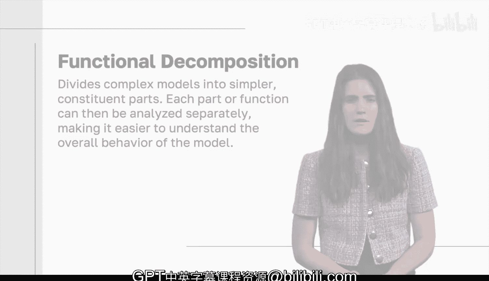
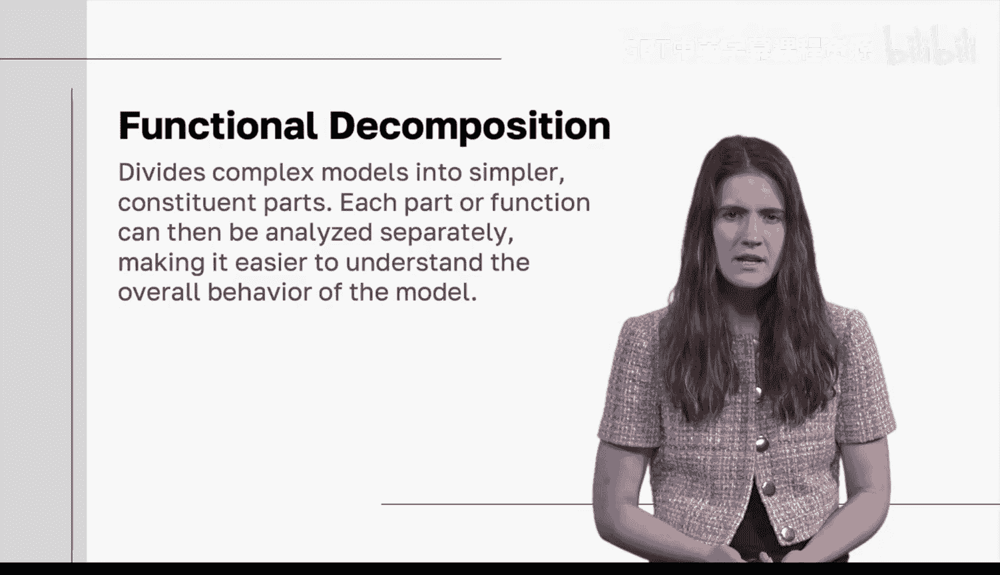
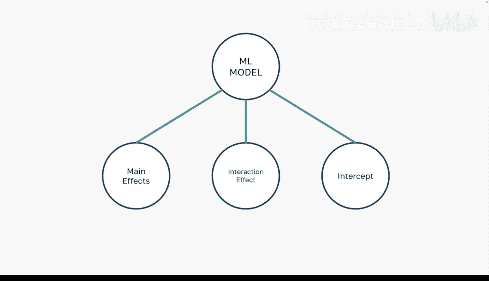
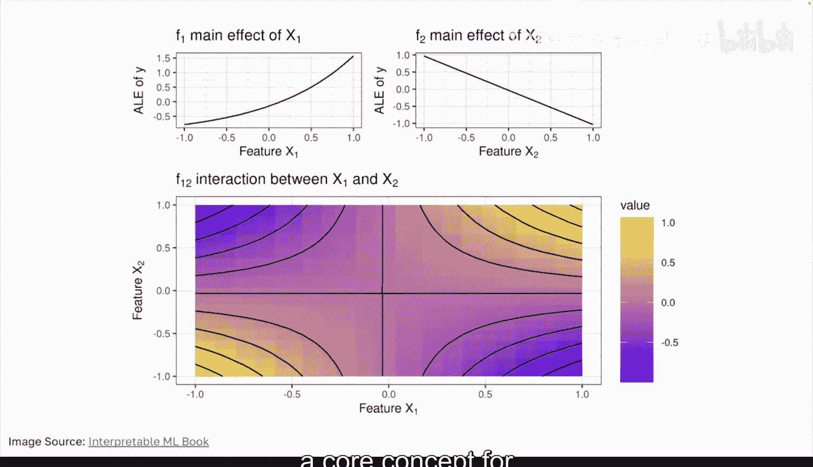
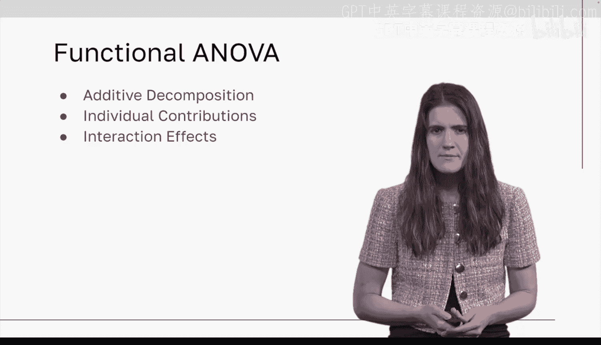
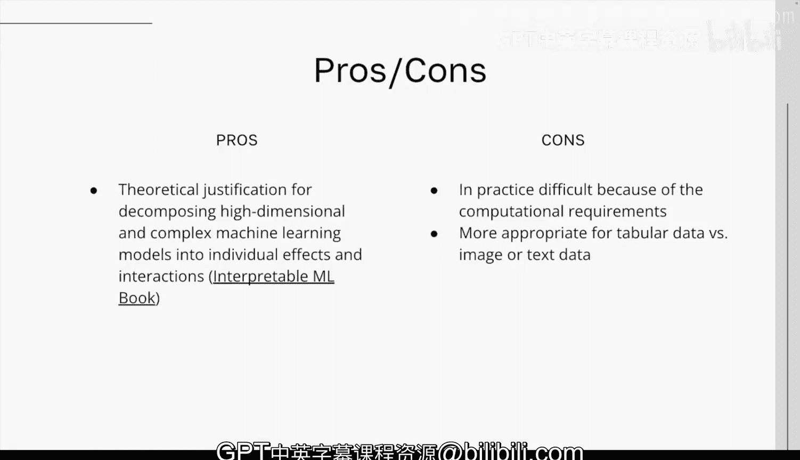

# 杜克大学《可解释人工智能｜Explainable AI (XAI)》中英字幕 p58 11_01_02_函数分解.zh_en -BV1HnrBBmEon_p58-

Functional decomposition is a key concept in X AI， which is why we we are discussing at first。

 Funal decomposition divides complex models into simpler， constituent parts。

 Each part or function can then be analyzed separately。

 Ma it easier to understand the overall behavior of the model。

We break down a machine learning model into the following components。

 main effects how each feature affects the prediction。

 independent of the values of the other feature。Interaction effect。

 the joint effect of the features and the intercept。

 what the prediction is when all other feature effects are set to 0。

There are a number of ways to do this， including functional andnova and accumulated local effects。

 We are going to talk about accumulated local effects later in this module。

In this visualization of functional decomposition from the interpretable machine learning book。

 you can see the main effects of two features x1 and x2 shown in the top plots。

 The bottom plot shows the interaction between x1 and x2。

This concept of breaking a model down into its constituent parts is a core concept for global explanations。

 as we will soon see。

Functional Anova is one method for functional decomposition。

Its components include additive decomposition， where you decompose the prediction function F of x of a model into a sum of terms。

 where each term represents the effect of one or more input features on the prediction。

Individual contributions by breaking down the prediction function into these additive components。

 this allows for an analysis of how much each feature and their interactions contributes to the model's output。

And interaction effects， Lastly， we quantify interaction effects between the features。

Let's evaluate the pros and cons of functional decomposition as an explainable AI technique。

Functional decomposition provides us with the theoretical justification for decomposing high dimensional and complex machine learning models into individual effects and interactions。

However， in practice， it is difficult because of the computational requirements。

 also it is more appropriate for tabular data than for image or text data。

