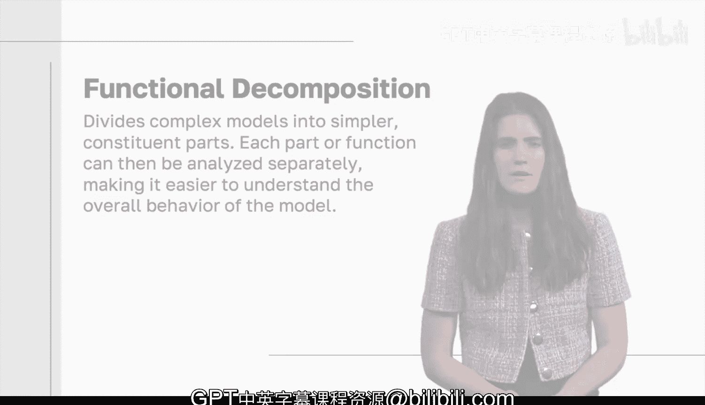
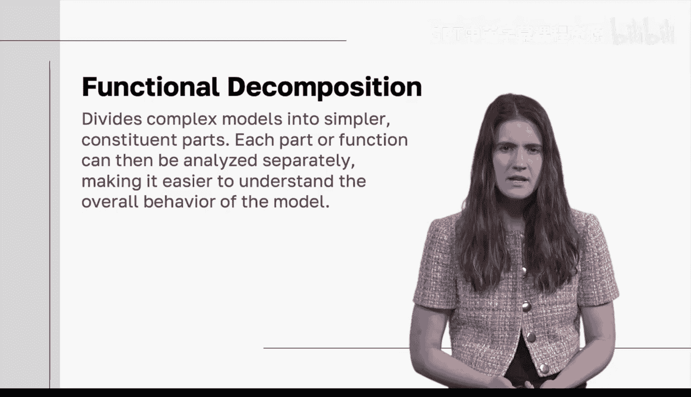
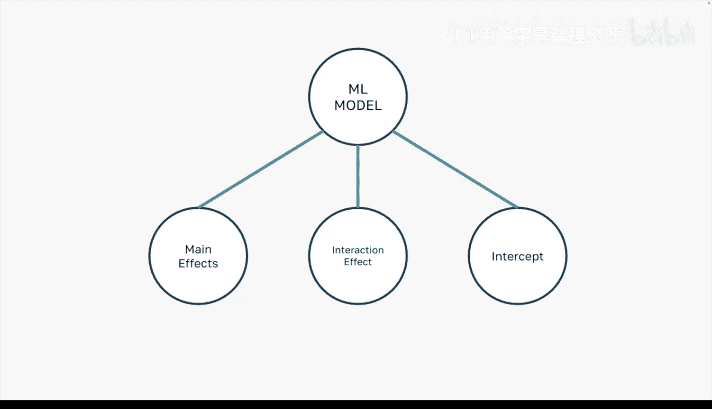
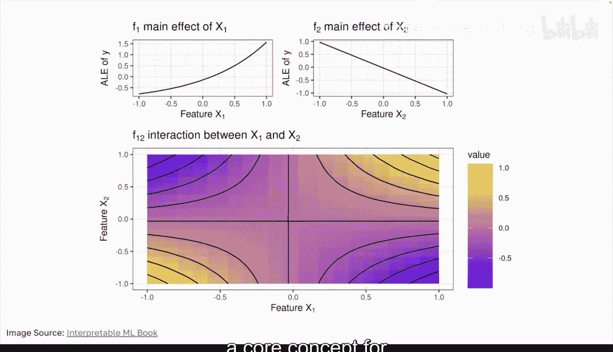
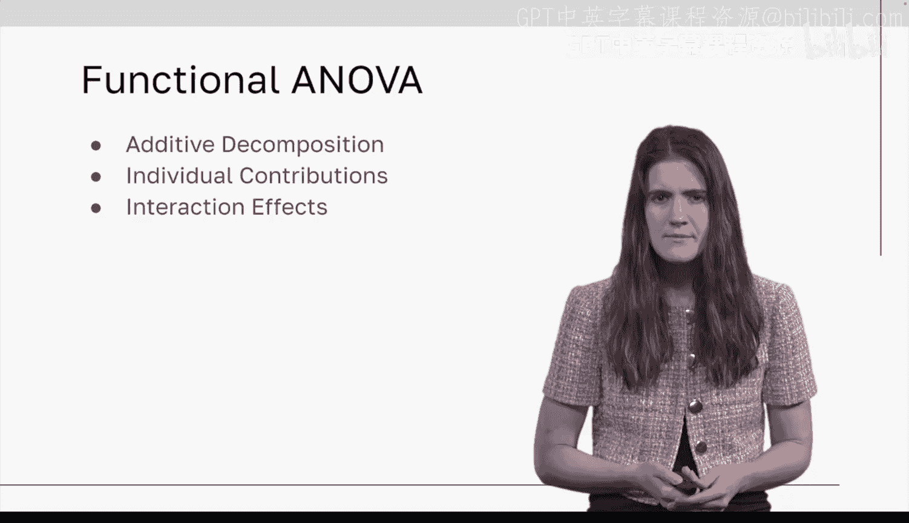
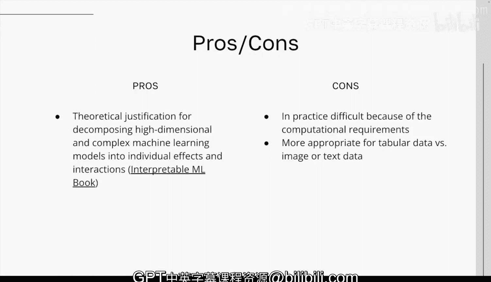

# 可解释人工智能：第11章：函数分解 🧩

在本节课中，我们将要学习可解释人工智能（XAI）中的一个核心概念——函数分解。我们将了解它的定义、组成部分、实现方法以及优缺点。

函数分解是可解释人工智能中的一个关键概念，因此我们首先讨论它。函数分解将复杂模型分解为更简单的组成部分。每个部分或函数都可以被单独分析。这使得理解模型的整体行为变得更加容易。

上一节我们介绍了函数分解的基本概念，本节中我们来看看它的具体组成部分。

我们将一个机器学习模型分解为以下几个部分：
*   **主效应**：每个特征如何影响预测，独立于其他特征的值。
*   **交互效应**：特征之间的联合效应。
*   **截距项**：当所有其他特征效应被设置为0时的预测值。

有多种方法可以实现函数分解，包括函数方差分析（Functional ANOVA）和累积局部效应（Accumulated Local Effects）。我们将在本模块的后面讨论累积局部效应。

在理解了组成部分之后，我们通过一个可视化示例来加深印象。

在《可解释机器学习》一书中关于函数分解的可视化图中，你可以看到两个特征x1和x2的主效应显示在上方的图中。底部的图显示了x1和x2之间的交互作用。将模型分解为其组成部分是全局解释的一个核心概念，我们很快就会看到。

接下来，我们介绍一种具体的函数分解方法。

函数方差分析（Functional ANOVA）是函数分解的一种方法。它的组成部分包括：
*   **加法分解**：将模型的预测函数 `F(x)` 分解为一系列项的和，其中每一项代表一个或多个输入特征对预测的影响。
*   **个体贡献**：通过将预测函数分解为这些加法分量，可以分析每个特征及其交互作用对模型输出的贡献程度。
*   **交互效应**：最后，我们量化特征之间的交互效应。

最后，我们来评估一下函数分解作为一种可解释人工智能技术的优缺点。

以下是函数分解的优缺点分析：
*   **优点**：函数分解为我们提供了将高维复杂机器学习模型分解为个体效应和交互效应的理论依据。
*   **缺点**：然而，在实践中，由于计算要求高，它实施起来比较困难。同时，它更适合表格数据，而不是图像或文本数据。

本节课中我们一起学习了函数分解。我们了解到，函数分解通过将复杂模型拆解为主效应、交互效应和截距项，为理解模型行为提供了清晰的框架。虽然它在理论上非常强大，尤其适用于表格数据，但在实际应用中需要考虑其计算成本。