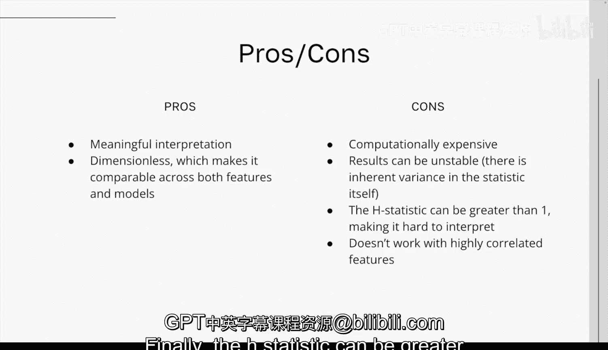
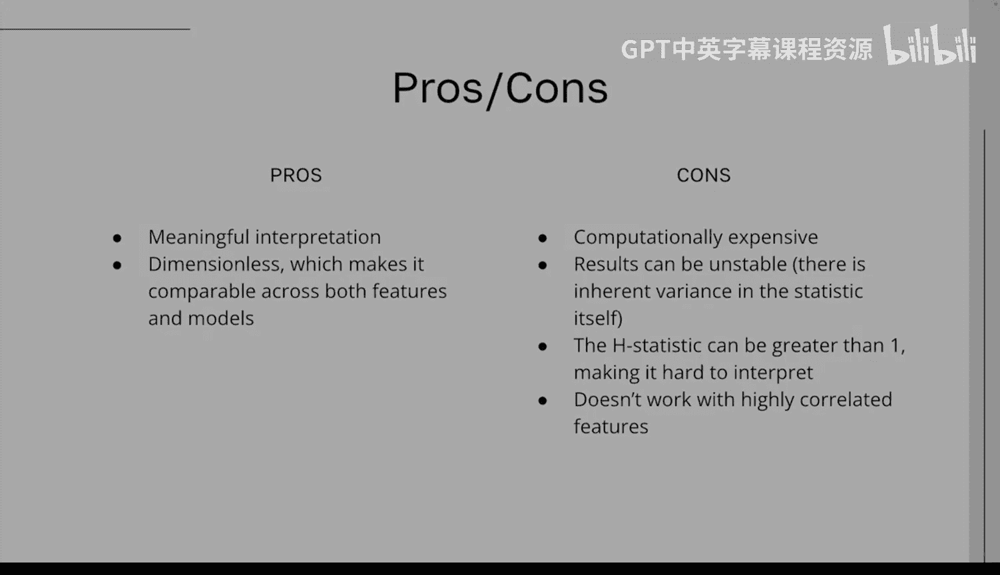

# 杜克大学《可解释人工智能｜Explainable AI (XAI)》中英字幕 p59 12_01_03_特征交互作用.zh_en -BV1HnrBBmEon_p59-

🎼，🎼，Building off of functional decomposition， let's introduce feature interaction。

When we consider decomposition， we first decompose a model prediction into a constant term。

 a term for each feature， and a term for the interaction between factors。

Let's take a look at an example。 I've added a table predicting car prices in the upper right corner of this slide。

 There are only two features， fuel type and brand。 The base price for a gasoline non luxuryury car is $30000。

 We consider this our constant term。Our field type term is plus $20。

000 for electric and zero for gasoline。And our brand term is plus $40。

000 for luxury and zero for non luxury。 finally， our interaction term。

This is where feature interaction comes in to estimate the interaction strength。

 we can measure how much of the variation of the prediction depends on the interaction of the features。

 and we can do this with something called the H statistic。In 2008。

 Friedman and Popescu introduced the H statistic， which we use for feature interaction。

 they introduce both the two way H statistic， which looks at the interaction between two features。

 J and K， and they introduce the total H statistic。

 which looks at the interaction between feature J and all other features。In these figures。

 from the original data， you can clearly visualize the feature interaction strength。

 This gives us an easy to understand visual， to understand how different features are interacting。

Let's take a quick look at the math for the H statistic。

 which iterates over all of the data points and at each point the partial dependence is evaluated。

 which in turn is done with all and data points， the H statistic for the interaction between J and K is shown on the left。

 and the statistic for the interaction between J and any other feature is shown on the right。

One thing that we must acknowledge is the computational cost associated with feature interaction and how this affects the practical implementation In the worst case。

 we need two n squared calls to the machine learning models predict function to compute the2 way H statistic J versus K。

And we need3 n squared for the total H statistic， which is J versus all。To speed at the computation。

 we can sample from the end data points， it's important to note here that this increases the variance of the partial dependence estimates。

 which can make the H statistics unstable。Interpreting the H statistic can be challenging。

 as we will discuss in the next slide， but the standard interpretation is this。

 if the H statistic is zero， no interaction。If the total H statistic is one。

All of the variance of the function is explained by the sum of the partial dependence functions。

If the 28h statistic is1， each single partial dependence function is constant。

 and the effect in the prediction only comes through the interaction。

So let's evaluate the pros and cons of feature interaction as an explainable AI technique Fe interaction provides us with a meaningful interpretation that is dimensionless so we can use it to compare across both features and models。

However， it is computationally expensive。 Results can be unstable due to the inherent variance in the statistic itself。

 Like many X AI approaches， it doesn't work with highly correlated features。Finally。

 the H statistic can be greater than one， making it hard to interpret。

