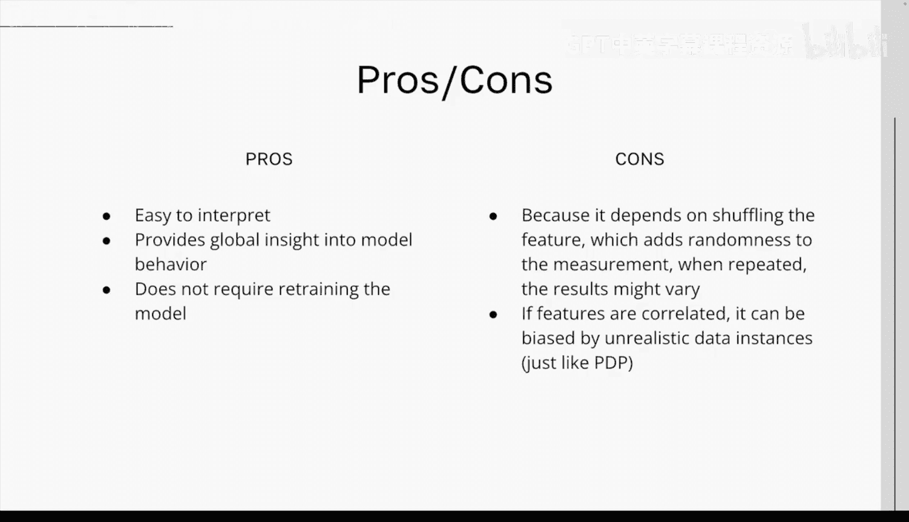
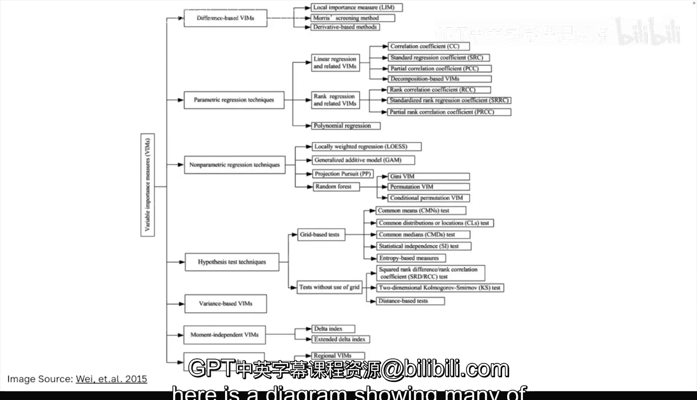

# 杜克大学《可解释人工智能｜Explainable AI (XAI)》中英字幕 p60 13_01_04_置换特征重要性.zh_en -BV1HnrBBmEon_p60-

。

The importance of a feature can be measured by calculating how much model's prediction error increases after permuting the feature。

 If shuffling a feature's value increases the model's error， the feature is important。

 If the model error doesn't change after shuffling a feature's values。

 a feature is considered unimportant。This concept was first introduced for random forest in 2001。

 It was updated to be model agnostic and renamed model Reliance in 2018。

Let's walk through the model agnostic method developed in 2018 called model reliance。

 Our input is the trained model F hat feature matrixtri X， target vector Y and an error measure。

 First， we estimate the original model error。The mean squared error is commonly used here。

Then for each feature， we generate feature matrix x perm by permuting feature J in the data X。

 This breaks the association between feature J and the true outcome Y。Next。

 we estimate the error based on the predictions of the permuted data。

We calculate the permutation feature importance either as a quotient or a difference。Lastly。

 we sort features by descending feature importance。

Here is an example visualization of the importance for each feature in predicting byte counts with the support vector machine model。

 These plots are fairly intuitive， with temperature exhibiting the greatest importance。

 which is shown here at the top。😊，Let's evaluate the pros and cons of permutation feature importance or model reliance as an explainable AI technique。

This method is easy to interpret， it provides global insight into model behavior。

 and it does not require retraining the model。However。

 because the method depends on shuffling the feature。

 which adds randomness to the measurement when repeated， the results might vary。

 If features are correlated， it can be biased by unrealistic data instances。

There are alternative ways of calculating feature importance。

 Model specific feature importance examples include the G importance in random forest and standardized regression coefficients in regression models。

An alternative to permutation based feature importance is vary based feature importance measures like functionalnova。

 which was previously discussed。 There are many measures。

We will not cover them specifically in this course。

 but here is a diagram showing many of these approaches from a 2015 paper。

