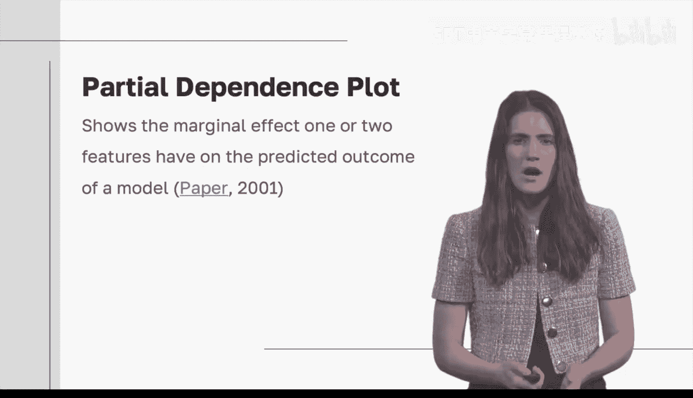
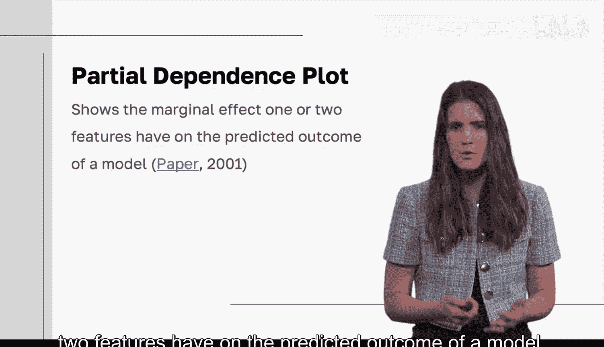
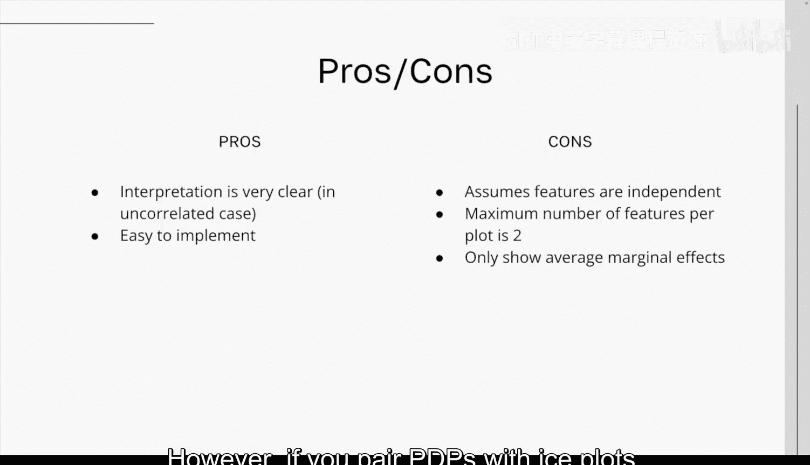
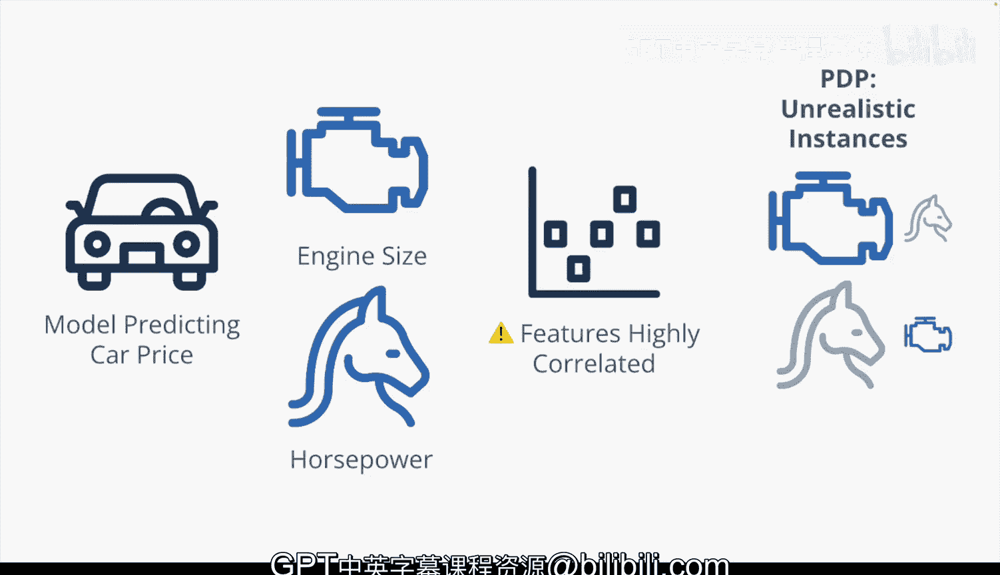

# 杜克大学《可解释人工智能｜Explainable AI (XAI)》中英字幕 p61 14_01_05_偏依赖图.zh_en -BV1HnrBBmEon_p61-

嗯。A partial dependence plot， PDP or PD， shows the marginal effect one or two features have on the predicted outcome of a model。

Here are examples of partial dependence plots from the original paper by Friedman。

 If this looks familiar， it should， it is the average of the lines of an ice plot。

 just like with ice plots， the PDP can show the relationship between a feature and the target。

Here's the process for creating a PDP first， select your feature of interest。

 then for every instance in the data set， keep all other features the same。

 create variants of the instance by replacing the features's values with values of a grid。

And make predictions with the black box model for newly created instances。

You now have a set of points for an instance with the feature value from the grid and the respective predictions。

Finally， average across all instances and plot。In practice。

 we can take an approximation of the partial dependence for computational efficiency here's our equation。

 we vary the value of x of S， take the model prediction with fixed values for features excluding x of S of observation I。

 and we average over n observation in the training data。

Here you can see PDpss for the count of bicycles sold and temperature， humidity and wind speed。

 Temper has the most interesting PDP。 when it's hotter， more bikes are rented。

 We see this trend go up to 20 degrees Celsius， flatten and dip down slightly at much higher temperatures。

😊，Now let's evaluate the pros and cons of PDPs as an explainable AI technique PDPs are easy to implement and interpretation of the results is very clear in uncorrelated cases。

 However， this approach assume features are independent， the maximum number of features per plot is2。

 and we only show average marginal effects， however， if you pair PDPs with ice plots。

 you get the local information too。

Let's consider a machine learning model that predicts the price of a car based on two features。

 the engine size in liters and horsepower In reality these two features are strongly correlated。

 cars with larger engines tend to have higher horsepower。

Now let's say we want to use a PDP to understand how the model's prediction of car price depends on the engine size feature。

The issue arises when computing the average predictions for the certain engine size grid values。

 For example， when considering a large engine size like 5 liters。

 the method will replace the engine size with 5 liters for all instances。

 Even for those with low horsepower values like 100 horsepower。 In reality。

 a car with 5 liter engine and only 100 horsepower is highly unlikely and unrealistic due to the strong correlation between engine size and horsepower。

However， the PDP method still includes these unrealistic instances in its averaging step。

 effectively pretending that such instances are plausible and contributing to the estimated effect of engine size on car price。

As a result， the PDP for engine size may be biased。

 as it incorporates predictions for unrealistic combinations of feature values。

 which can lead to a distorted estimate of the true relationship between engine size and car price。

This example highlights how PDPs can struggle when features are strongly correlated。

 as they may average over unlikely or implausible instances。

 potentially leading to misleading interpretations of a feature's effect on the model's predictions。

