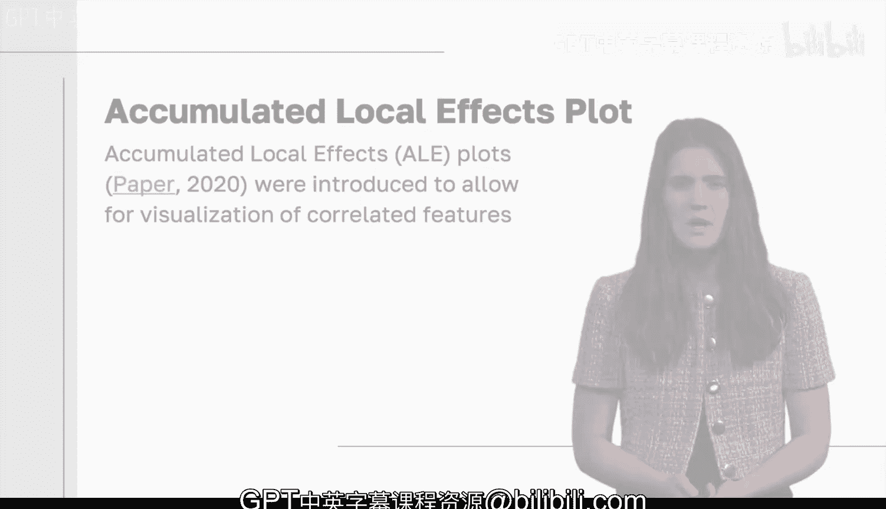
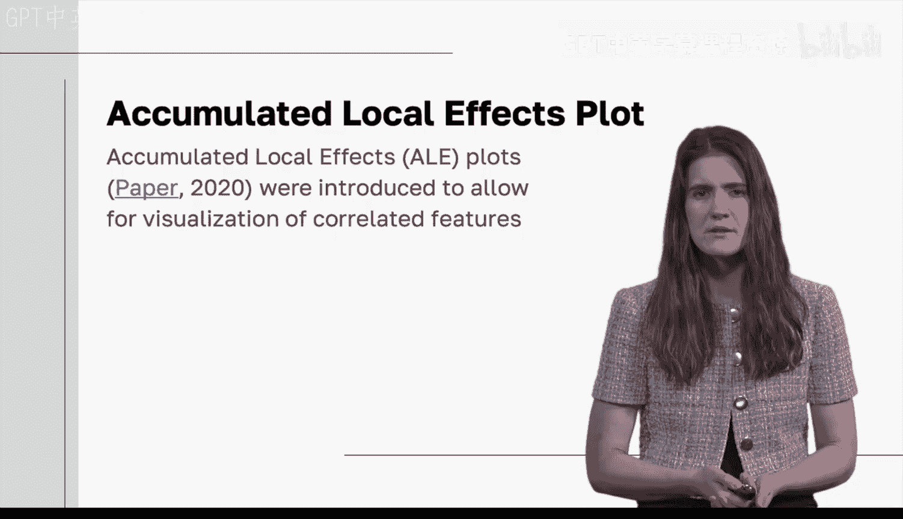
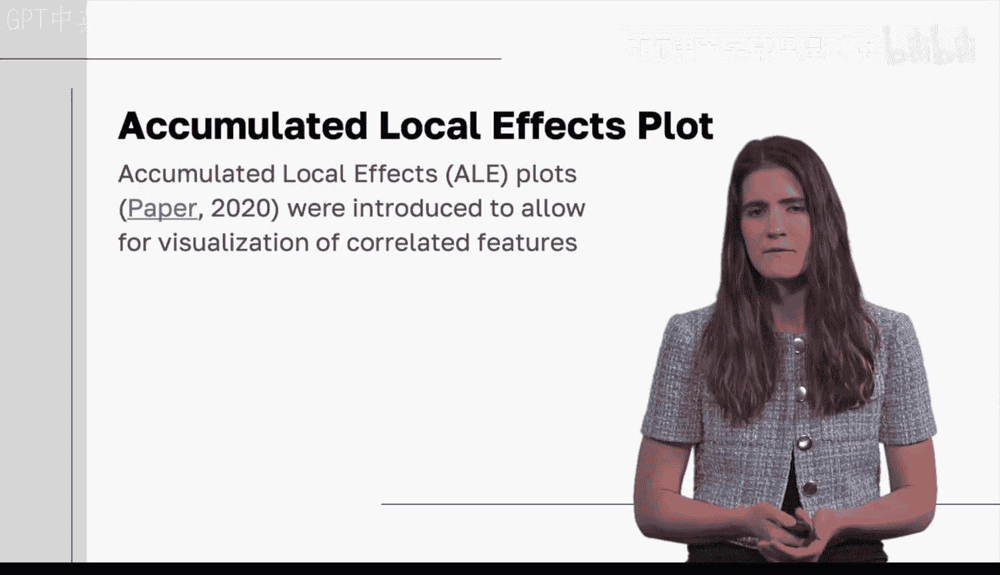
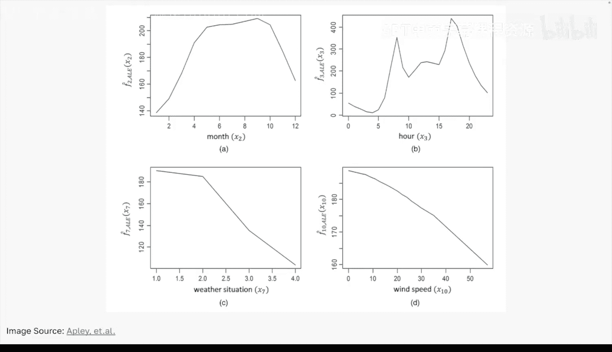
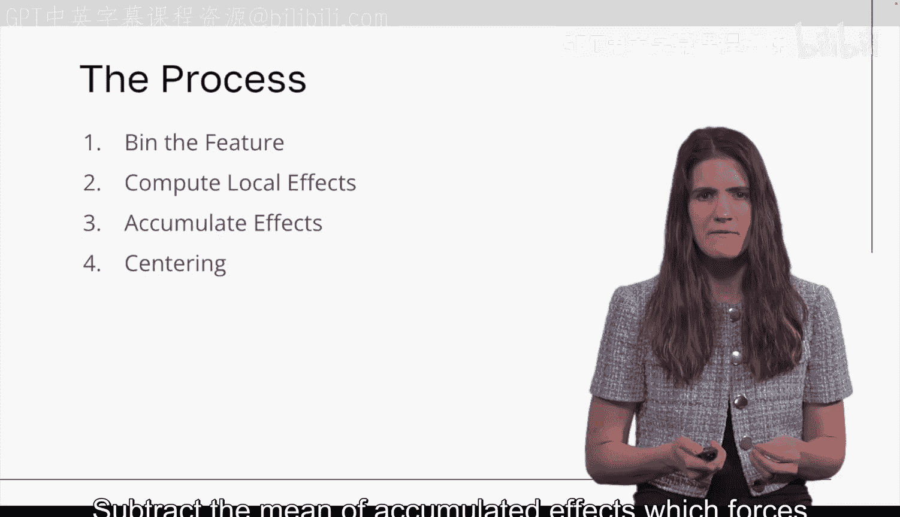
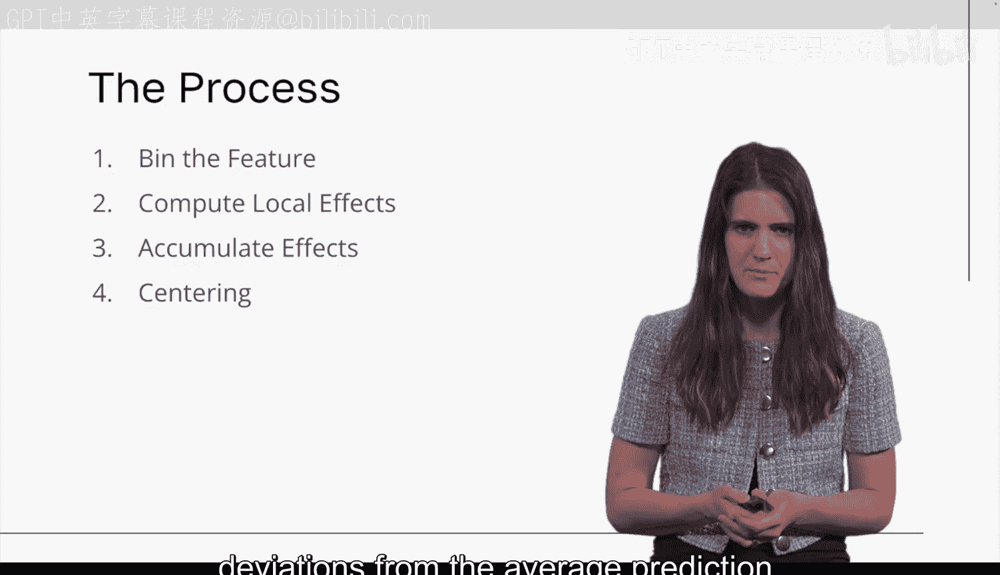
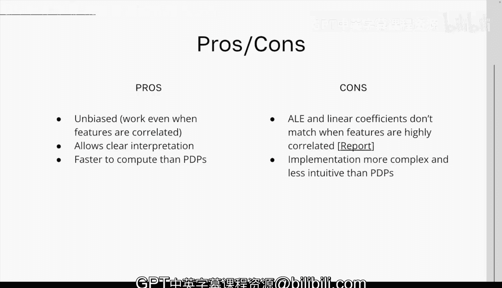

# 杜克大学《可解释人工智能｜Explainable AI (XAI)》中英字幕 p62 15_01_06_累积局部效应图（ALE）.zh_en -BV1HnrBBmEon_p62-

🎼，🎼，When we discussed the limitations of partial dependent spots or PDPs。

 we found that PDPs do not have clear interpretations when features are correlated in real life。

 features are usually correlated or relationships between features are not well understood。

This is why accumulated local effects or ale plots were introduced in 2020。

Ail plots include local effects and accumulation。Ail plots focus on local changes in the prediction when a feature value changes。

 unlike PDPs， which average out the effects over the entire feature space。

Instead of plotting the local effects directly， ale plots accumulate these effects across the range of the feature。

 This helps in understanding the global trend of how the feature influences predictions。

Here are a few examples of ale plots from the original paper。

 theyre exploring the effects of features month， hour， weather and wind speed on bike sharing。

To create an a plot， we're going to follow the following steps bin the feature。

 So we divide the feature of interest into several intervals or bins。

 These bins help in managing the data and computing local effects within smaller。

 more manageable segments。😊，Next， compute local effects for each bin。

 calculate the local effect of the feature on the prediction。

 This involves calculating the change in prediction when moving from the lower to the upper edge of the bin。

 averaging this change over all instances that fall into that bin。And accumulate effects。

 starting from the first bin， accumulate the local effects across all bins。

 sum up the average effects sequentially to show how the feature influences the prediction as the value changes。

And centering to make the plot more interpretable， center the accumulated effects around 0。

Subtract the mean of accumulated effects which forces the interpretation to focus on deviations from the average prediction。

This plot compares PD Ps and ale plots。 In this case。

 the PDP estimates are influenced by the odd behavior of the model outside of the data distribution。

 which is visualized in the steep jumps in the plots。 By contrast。

 the ale plots correctly identified the linear relationship between the features and the prediction。

Now let's evaluate the pros and cons of a plots as an explainable AI technique。

Ill plots are unbiased and work even when features are correlated。

 they allow for clear interpretation and are faster to compute than PDPs。However。

 when features are very highly correlated， ale and linear coefficients have been shown to not match。

 This is not a perfect solution for highly correlated features。 Additionally。

 the implementation of ale plots is more complex and less intuitive than PD D P。

