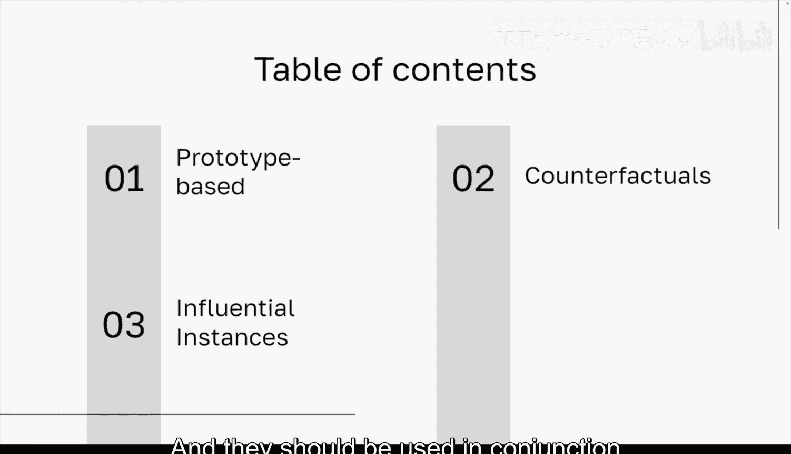

# 杜克大学《可解释人工智能｜Explainable AI (XAI)》中英字幕 p63 16_01_01_基于实例的解释方法导论.zh_en -BV1HnrBBmEon_p63-

Yeah。Example based explanations are a way of interpreting and understanding the decisions made by machine learning models。

 particularly in complex tasks like computer vision and natural language processing。

 These explanations aim to provide human understandable justifications for a model's predictions by presenting relevant examples or counterfactual scenarios。

 We are going to talk about a few different types of example based explanations。

 including prototype based explanations， counterfactual explanations and influential instances。

Example based explanations can be particularly useful in high stakes。

 decision making scenarios such as medical diagnoses， loan approvals or criminal risk assessment。

 where it is crucial to understand the reasoning behind the model's predictions。

 These explanations can help build trust in the model's decisions。

 identify potential biases or flaws and facilitate human AI collaboration。😊，However。

 it's important to note that like all XAI techniques。

 example based explanations may not always fully capture the complex decision making process of deep neural networks。

 and they should be used in conjunction with other interpretation techniques to gain a more comprehensive understanding of the model's behavior。

