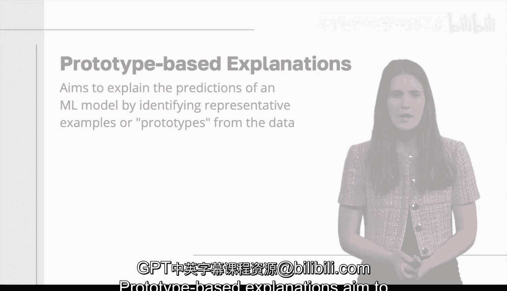
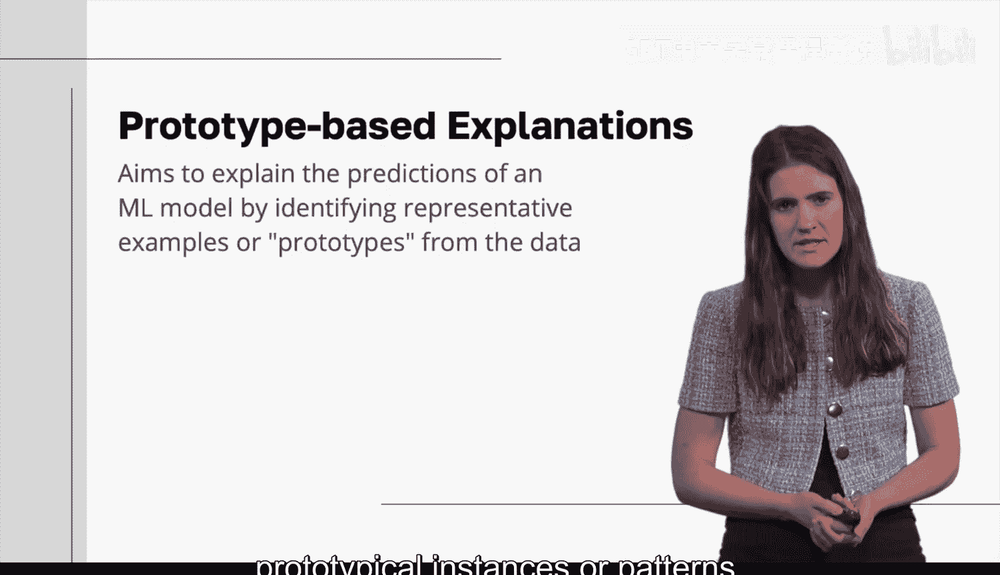
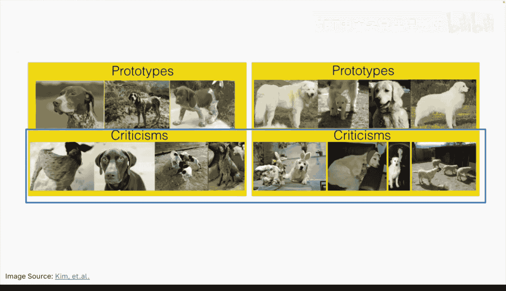
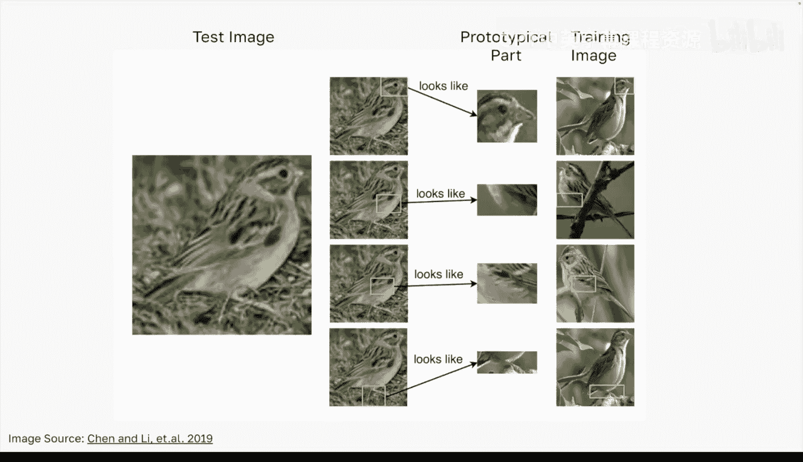
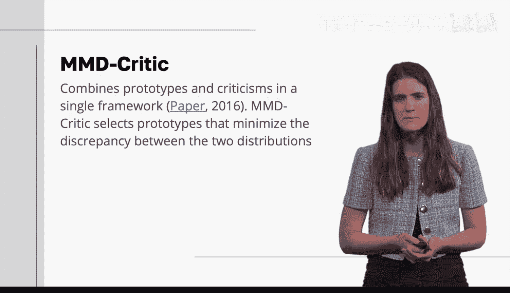
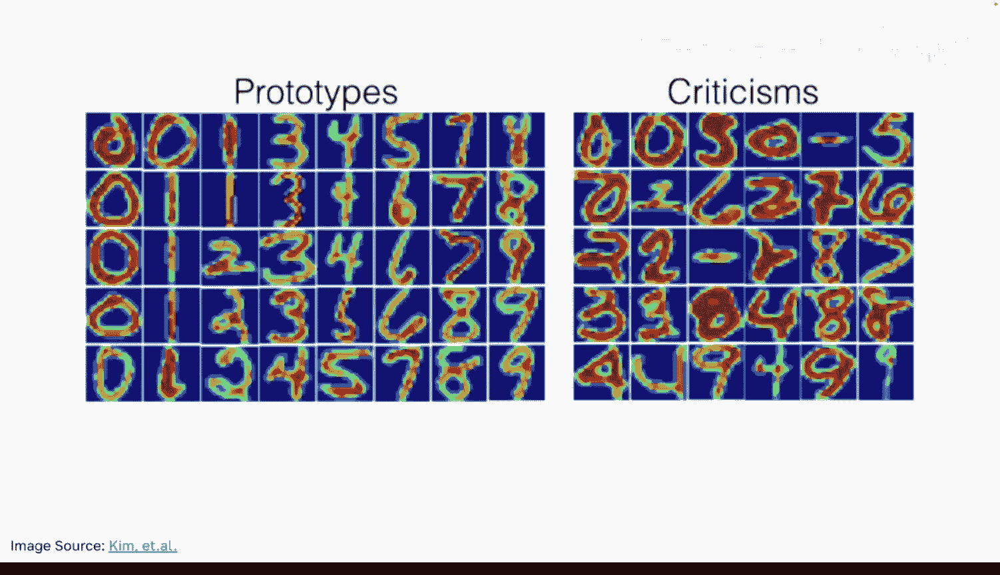
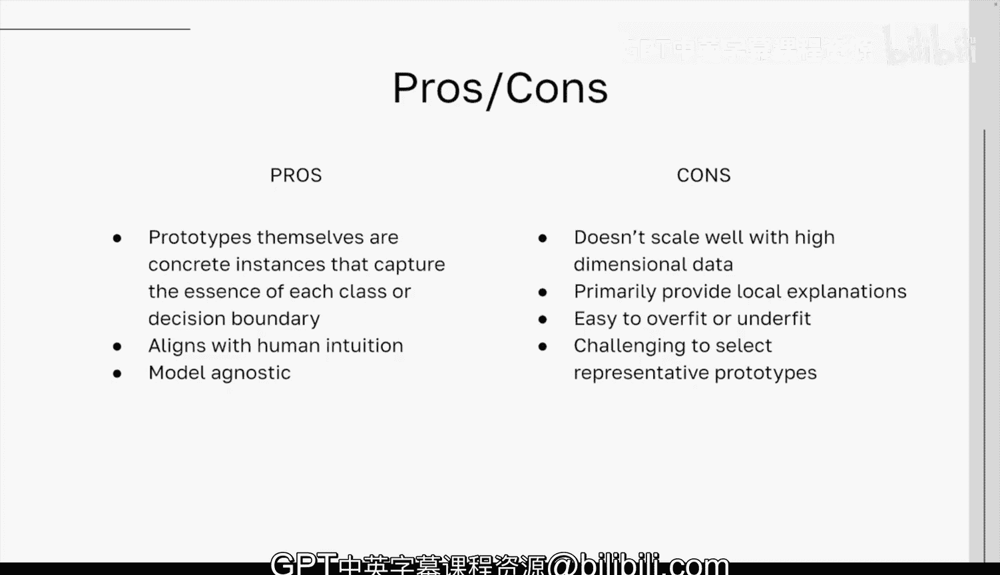

# 杜克大学《可解释人工智能｜Explainable AI (XAI)》中英字幕 p64 17_01_02_基于原型的解释.zh_en -BV1HnrBBmEon_p64-

Prototype based explanations aim to explain the predictions of a black box model by identifying representative examples or prototypes from the data。

 The main thesis is that we represent the model's knowledge in terms of prototypical instances or patterns。

Let's dive into implementation for a given prediction。

 the model selects the most similar training examples or prototypes these prototypes are typically chosen based on their closeness in feature space to the input instance。

How it does this is the model assesses the similarity between the input instance and various prototypes。

 The similarity is typically measured using distance measuress like Euclidean distance in feature space。

The system then presents these prototypes to the user。

 showing how the input instance resembles these examples。

 Users can inspect the prototypes to see common features and patterns。

 making it easier to understand why the model made a certain prediction。In addition to prototypes。

 you can use contrastive examples or criticism。 These are examples that are similar but belong to a different class。

 This helps users understand what differentiates the predicted class from other classes。

Prototypes and criticisms are always actual instances from our data。

These methods have been extended to neural network explainability。

 which we're going to talk about in the explaining deep learning module。

One type of prototype based explanation introduced in 2016 is MMD critic。

 The name comes from their use of the maximum mean discrepancy MM D2 sample statistical test。

The main idea behind MMD critic is that it selects prototypes that minimize the discrepancy between two distributions。

Data points in areas with high density are good prototypes。

 whereas data points from regions that are not well explained by the prototypes are selected as criticisms。

Figures from the original paper show examples of prototypes and criticisms for the USPS data set。

 As you can see， it is very easy for humans to understand prototypes and criticisms。

 even if they don't understand the underlying models themselves。

The general approach to MMD critic is first， select the number of prototypes and criticisms you want。

Find prototypes with greedy search where prototype distributions is close to the data distribution。

 and find criticisms with greedy search， where criticisms equal the prototype distribution differs from your data distribution。

Maximum mean discrepancy is the measure of how different two distributions are。

 The goal of MMD critic is to minimize the squared MMD。Now that we understand MMD。

 we can discuss the algorithm for finding prototypes。 First。

 you start with an empty list of prototypes。 Well the number of prototypes is less than the chosen number m for each point in the data set。

 we check how much MMD is to is reduced when the point is added to the list of prototypes。

 add the data point that minimizes our MMD to the list When that process is complete。

 return the list of prototypes。😊，Let's evaluate the pros and cons of using prototype based explanations as an explainable AI technique。

Prototypes themselves are concrete instances that capture the essence of each class or decision boundary。

 This aligns with human intuition。 They are also model， agnostic。However。

 prototype based explanations do not scale well with high dimensional data。

 It is primarily used to provide local explanations， and it is easy to overfi or underfi。Finally。

 it is very challenging to select representative prototypes。

