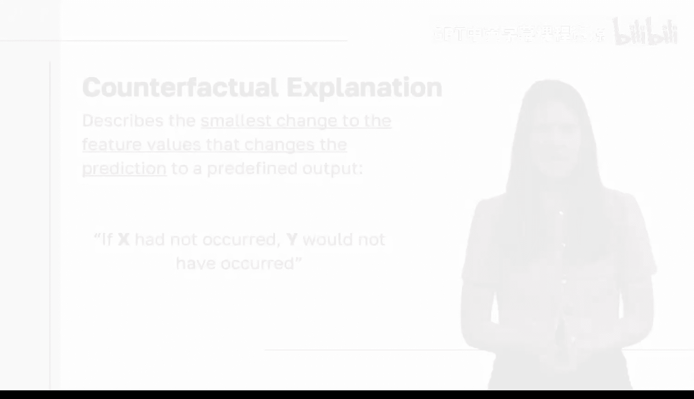
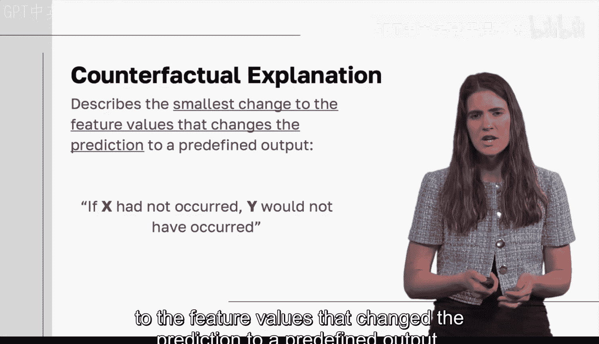
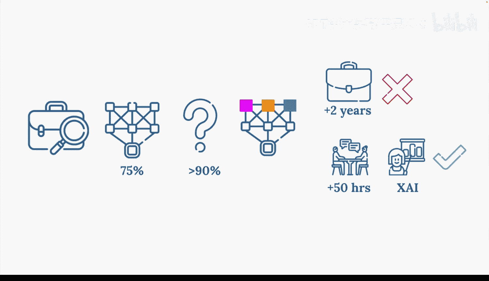
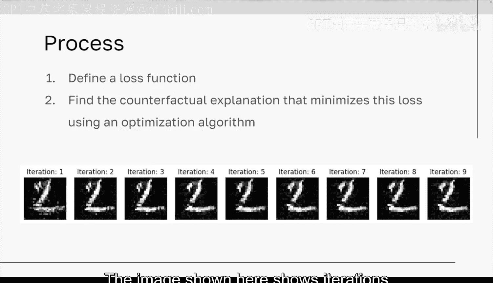
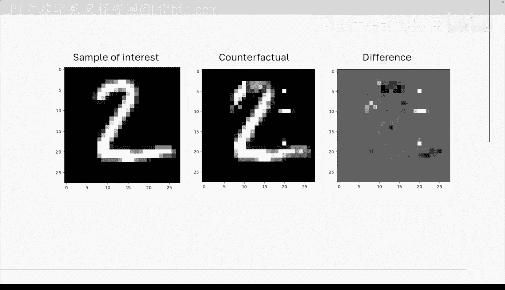
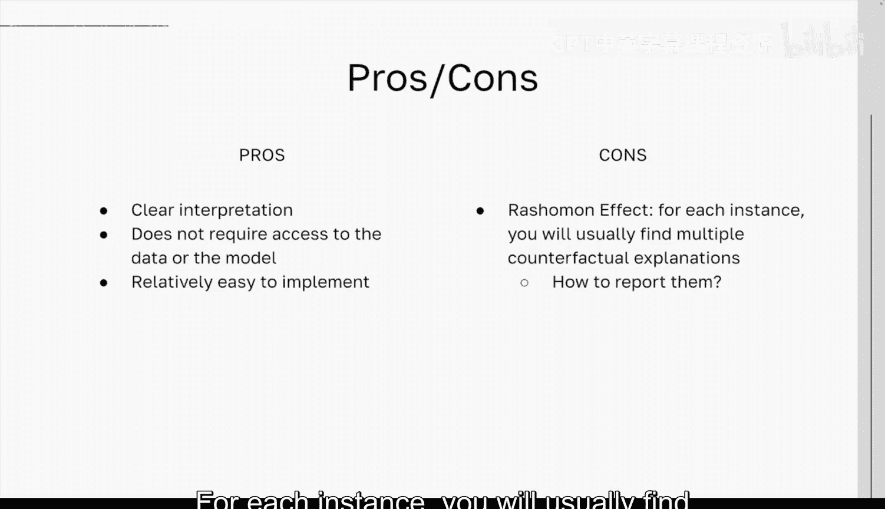
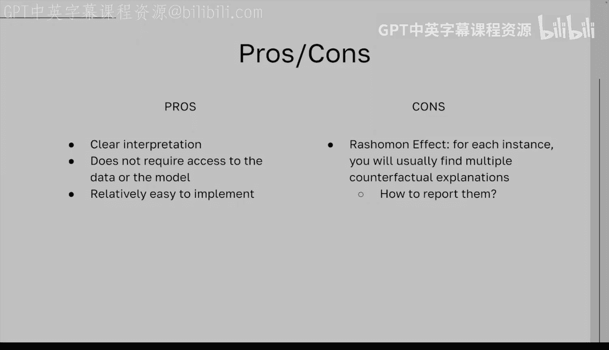

# 杜克大学《可解释人工智能｜Explainable AI (XAI)》中英字幕 p65 18_01_03_反事实解释.zh_en -BV1HnrBBmEon_p65-

Counterfactuals describe a causal situation。 If X had not occurred， Y would not have occurred。

We can simulate counterfactuals for predictions of a black box machine learning model by changing the feature values of an instance before making the predictions and analyzing how the prediction changes。

A counterfactual explanation of a prediction describes the smallest change to the feature values that change the prediction to a predefined output。

An example of a counterfactual that follows the pattern。 If X had not occurred。

 Y would not have occurred。 If I hadn't forgotten my umbrella。

 I wouldn't have gotten soaked in the rain。Let's consider an intuitive example。

 You are applying for machine learning jobs and you are unsure about your chances of landing your desired job at a top tech company。

 you decide to put together a model using historical data applicants with features like education。

 work experience， skills， projects and interview preparation hours to predict your probability of receiving a job offer。

The model predicts your chances of receiving a job offer as 75%。That's okay。

 but you want to maximize your chances。 You want greater than 90%。

 You begin experimenting with the feature values to see how you could have improved your predicted outcome。

You learned that if you had an additional two years of work experience。

 your chances would increase to 85%。However， gaining two years of experience is not immediately actionable。

You then focus on factors within your control， such as interview preparation and specific skill enhancements。

 you describe the wordb that if you dedicate 50 more hours to interview preparation and complete a course in explainable AI。

 your predicted success rate would rise to 92%。By exploring these counterfactual scenarios。

 you use your model to make data driven decisions。

Our intuitive example shows building counterfactual explanations via a trial and error approach。

 but we are machine learning engineers。 there must be a better way。

 We can use an optimization algorithm to minimize loss  One， define a loss function。

 This loss takes this input the instance of interest。

 a counterfactual and the desired counterfactual outcome。

Find the counterfactual explanation that minimizes this loss using an optimization algorithm。

 There are many methods for this which differ in their definition of the loss function and optimization method。

The image shown here shows iterations to build counterfactual explanations。

This is a sample of interest from the Mnis data set and a generated counterfactual。

 We have also visualized the difference between them to show what pixels needed to be changed for this to be misclassified as a six in the guided programming exercise。

 you will develop your own counterfactuals using the Ms data set。

Let's evaluate the pros and cons of counterfactual explanations as an explainable AI technique。

Counterfactual explanations have clear interpretation。

 do not require access to the data or the model， and is relatively easy to implement。However。

 the Raaman effect makes the use of counterfactuals challenging。

 The Rashman effect refers to the phenomenon where different people give drastically different accounts or descriptions of the same event or experience。

The term originates from the 1950 Japanese film Raman in the film。

 the same incident is described in four contradictory ways by four witnesses or participants。

 Each account is plausible and self consistent， but they are all fundamentally incompatible with each other。

 It is the same with counterfactuals。 For each instance。

 you will usually find multiple counterfactual explanations。

 and there's no standardized way on how to report them。

