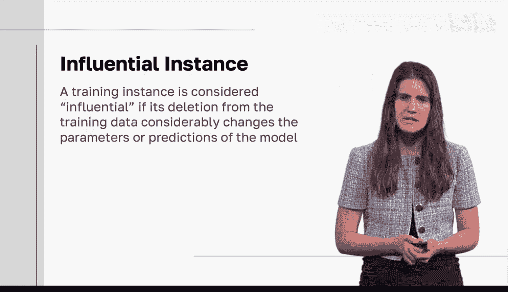
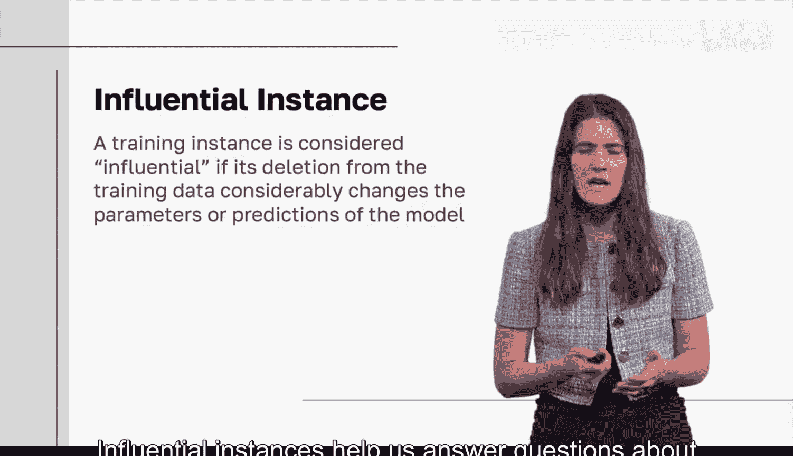
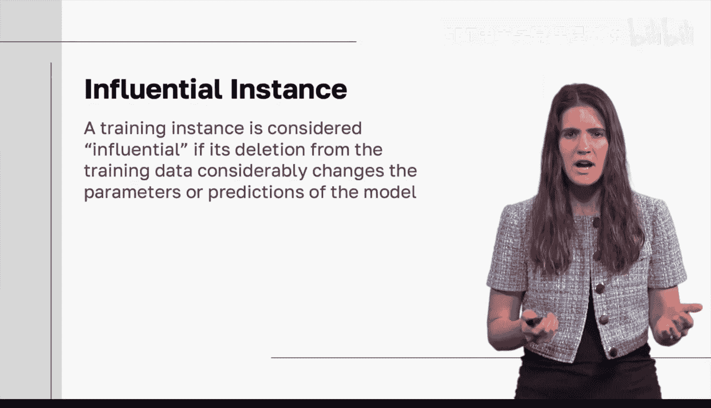
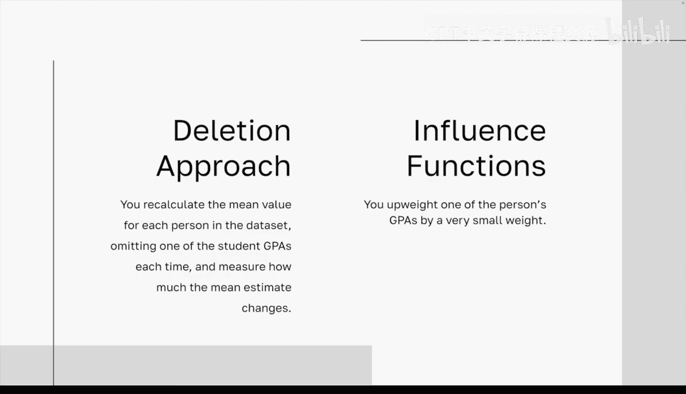
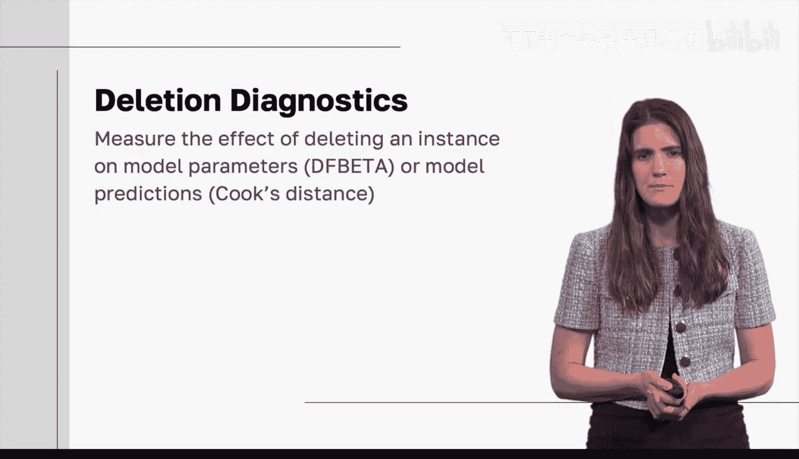
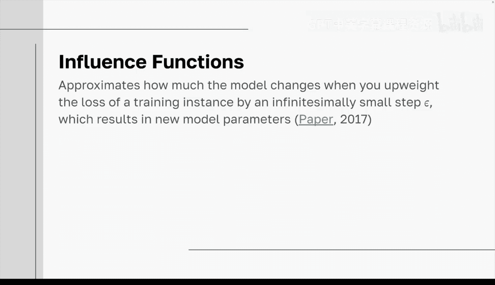
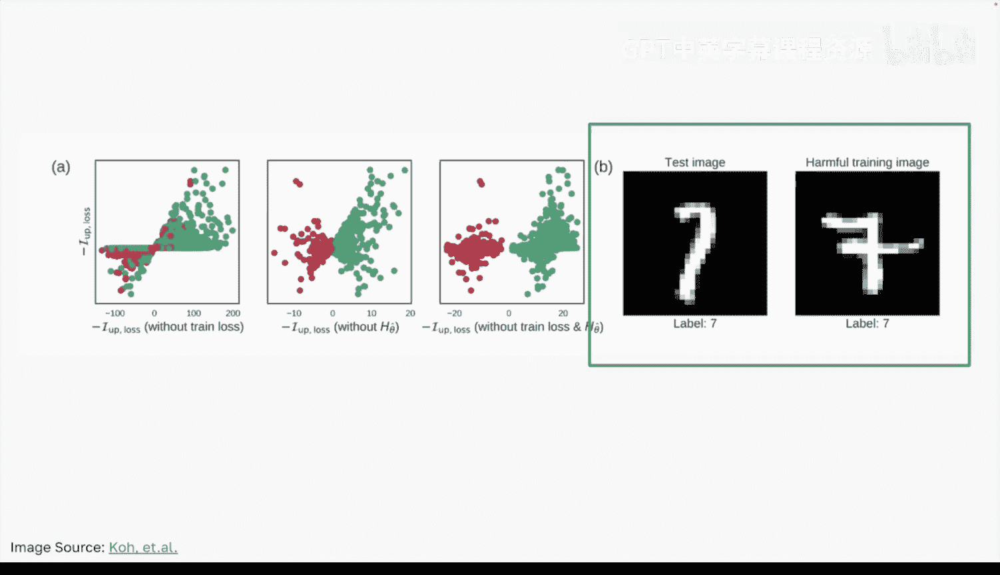
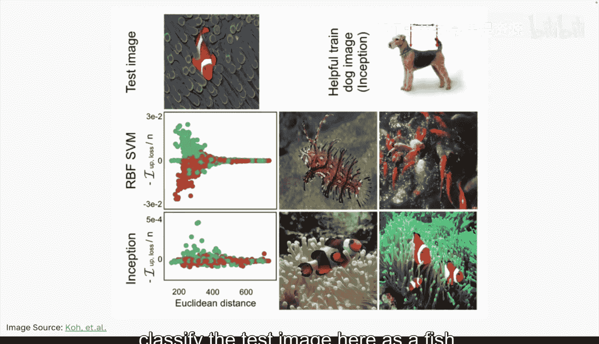
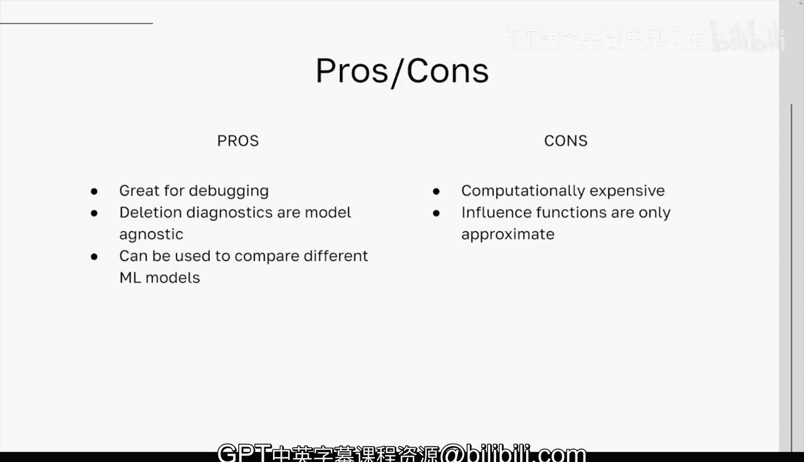

# 杜克大学《可解释人工智能｜Explainable AI (XAI)》中英字幕 p66 19_01_04_影响实例分析.zh_en -BV1HnrBBmEon_p66-

嗯。

Deleting a training data instance can affect the resulting model。

A training instance is considered influential if its deletion from the training data considerably changes the parameters or predictions。

By identifying influential training instances， we can debug models and better explain their behaviors and predictions。

Influential instances help us answer questions about global model behavior and about individual predictions。

 which were the most influential instances for the model parameters or the predictions overall。

 which were the most influential instances for a particular prediction。

There are two major types of influential instances， deletion diagnostics and influence functions。

One note is that influential instances are not model agnostic。

 each type has its own specific requirements。

You have decided to estimate the average GPA of Coursera students so you sample your classmates in your XAI class for a moment。

 let's ignore your sampling approach。How much can your average GPA be influenced by a single person？

With the deletion approach， you recalculate the mean for each person in the dataset。

 omitting one of the student GPs each time and measure how much the mean estimate changes。

With influence functions， you upweight one of the persons by a very small weight。

 this corresponds to calculating the first derivative of a statistic or a model。

Detecting influential data points is crucial in building robust machine learning models。

 Let's explore two popular techniques。 Df beta and cooks distance。 First， let's talk about Df beta。

 Df beta measures the effect of deleting an instance on the model's parameters。

 It's particularly useful for models with weight parameters such as logistic regression or neural networks by calculating Df beta。

 you can identify instances that have a disproportionate influence on the models' learned weights。

Next， we have cook's distance。 This metric measures the effect of deleting an instance on the model's predictions。

 originally created for linear regression models。 cook's distance includes a square term and the mean squared error。

 However， it can be modified to work with other model types by removing these specific terms。

 The math and process behind these techniques are relatively simple for Df beta。 your move instance。

 recalculate the weight vector and compare it to the weight vector obtained with all instances。😊。

And for cook's distance， you remove an instance， recalculate the model predictions。

 and compare them to the predictions obtained with all instances。

Influence functions introduced in 2017 introduced an alternative to deletion diagnostics。

 Instead of deleting training instances， influence functions can be used to approximate how much the model changes when you upweight the loss of a training instance by an infinitesimally small step。

Which results in a new model parameter。This requires access to the loss gradient with respect to the model parameters。

 so only some models qualify like logistic regression， support vector machines and neural networks。

Here are examples of influence functions from the original 2017 paper In figure 1 B。

 you can see the test image and a harmful training image with the same label。

 The presence of the training image makes the model think that the test image is less likely to be a 7。

 This is an example of a harmful training image。

When classifying between fish and dogs， a helpful trained dog image is shown in Figure  four。

This training image has been shown to be influential in helping the inception model correctly classify the test image here as a fish。

One note before we wrap up influential instances， you may be thinking that influential instances look pretty similar to outliers。

However， influential instances look at relationships between the instance and their corresponding model parameters to predictions。

 whereas outliers look at the relationship between an instance and the other instances or data。

An influential instance is not necessarily an outlier and vice versa。

 If an outlier influences a model， it is an influential instance。Now。

 let's evaluate the pros and cons of influential instances as as an explainable AI technique。

 Influential instances are great for debugging and deletion diagnostics are mostly model agnostic。

 These methods can be used to compare different machine learning models。😊，However。

 they are computationally expensive， and it's important to know that influence functions are only approximate。

