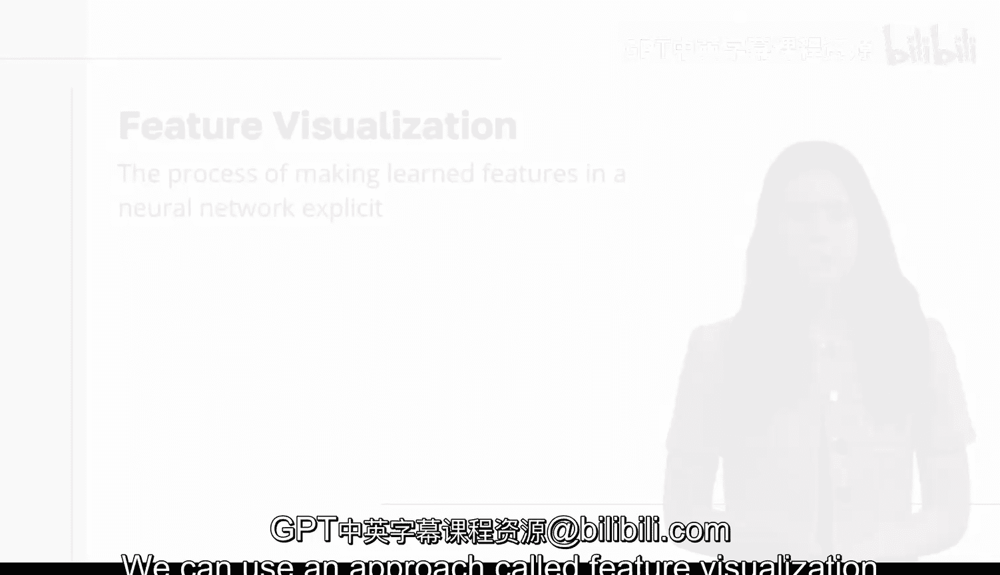
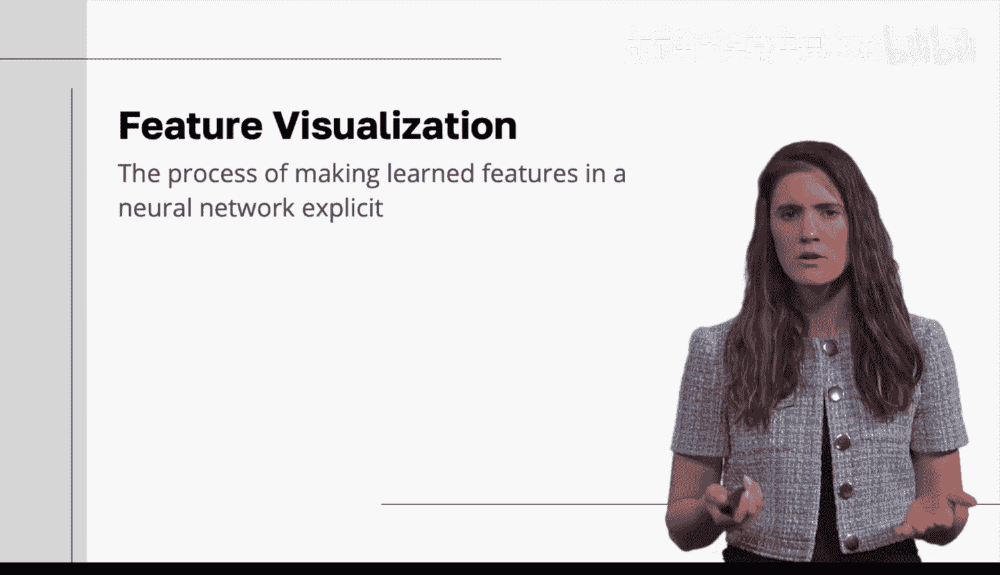
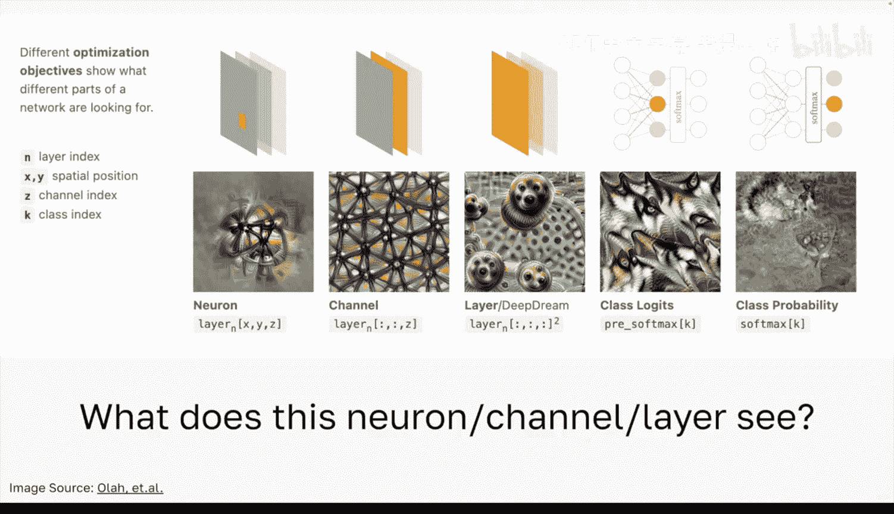
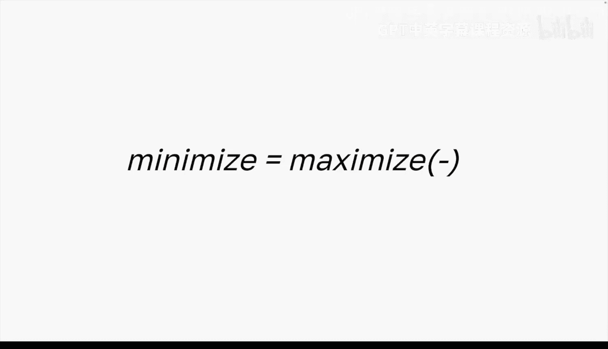
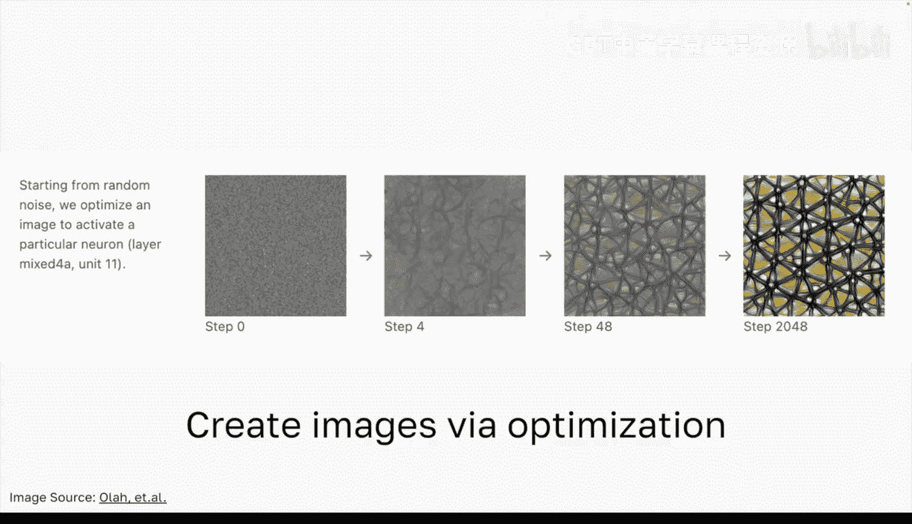
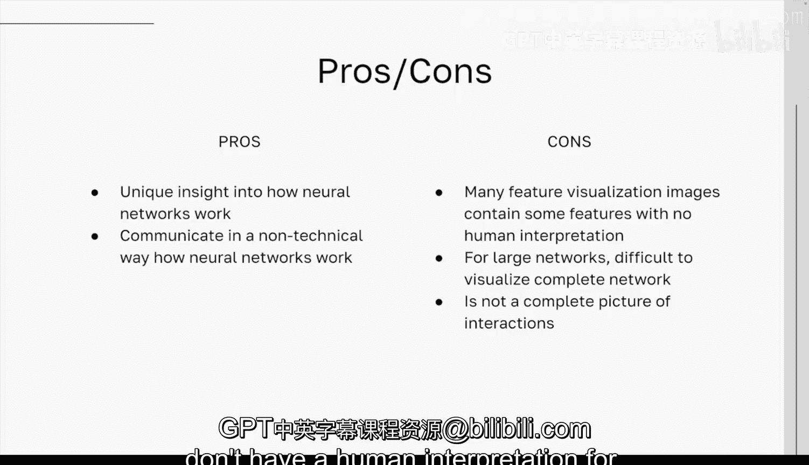

# 杜克大学《可解释人工智能｜Explainable AI (XAI)》中英字幕 p67 20_02_02_特征可视化.zh_en -BV1HnrBBmEon_p67-

We can use an approach called feature visualization to visualize what is happening inside a neural network。

 Fe visualization is the process of making learn features in a neural network explicit。

 It answers the question， what does this neuron， channel or layer see。

In this visualization from Google's article introducing the approach in 2017。

 we can see different feature visualizations at the neuron level， the channel level。

 and the layer level。

With feature visualization， we are looking to maximize the activation of a neuron， H for an image。

 the input of our network。In this equation， X and Y refer to the spatial position of the neuron。

 n refers to the layer and Z to the channel index for the mean activation of an entire channel Z in layer N。

 we perform a summation over the channel as part of the equation， as shown here。

One note is that instead of maximizing the activation， you can also minimize it。

 which is the same as maximizing it in the negative direction。

In terms of implementation， first， we create images via optimization。

 we start with random noise to obtain meaningful visualizations。 We put constraints on the image。

 like only small changes are allowed。 and to reduce noise in the visualization。

 we can apply jittering rotation or scaling of the image before optimizationization。

 We can also add other regularization， for example， frequency penalization。

 reduces the variance of neighboring pixels， and generating images with learn priors can be used。

 for example， usingganNs or dennoing autoencodrs。This visualization shows the process of optimization。

 starting from random noise， starting from random noise。

 we optimize an image to activate a particular neuron。

 attempting to maximize it as we showed in the equation on the previous slide。

Let's evaluate the pros and cons of feature visualization as an explainable AI technique。

Feature visualization provides us with a unique insight into how neural networks work。

 and it allows us to communicate in a non technical way how neural networks work。However。

 it is not a complete picture of interactions for large networks， it is difficult to visualize。

And many feature visualization images contain some abstract features that we don't have a human interpretation for。

