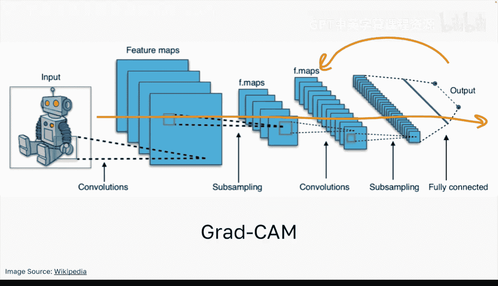
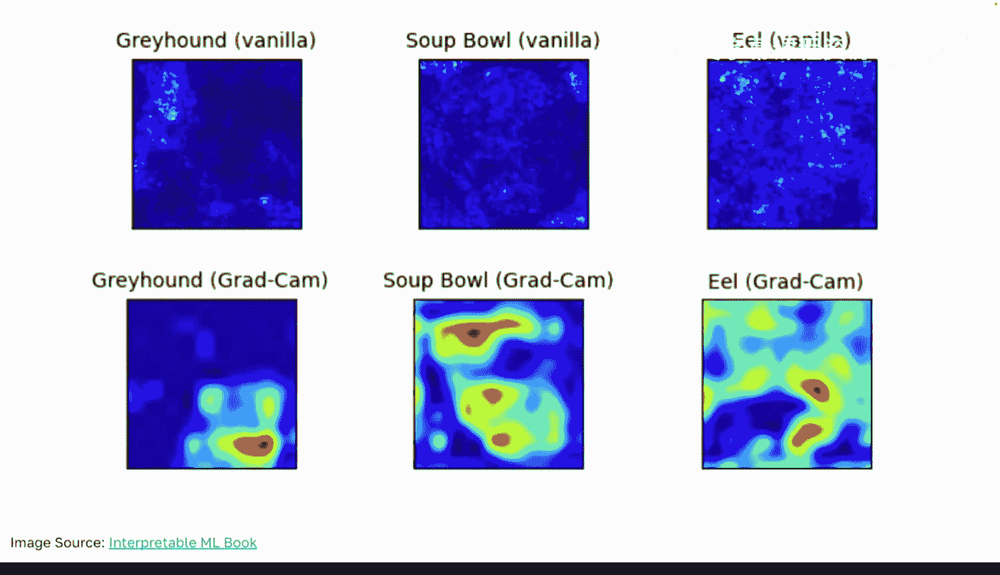
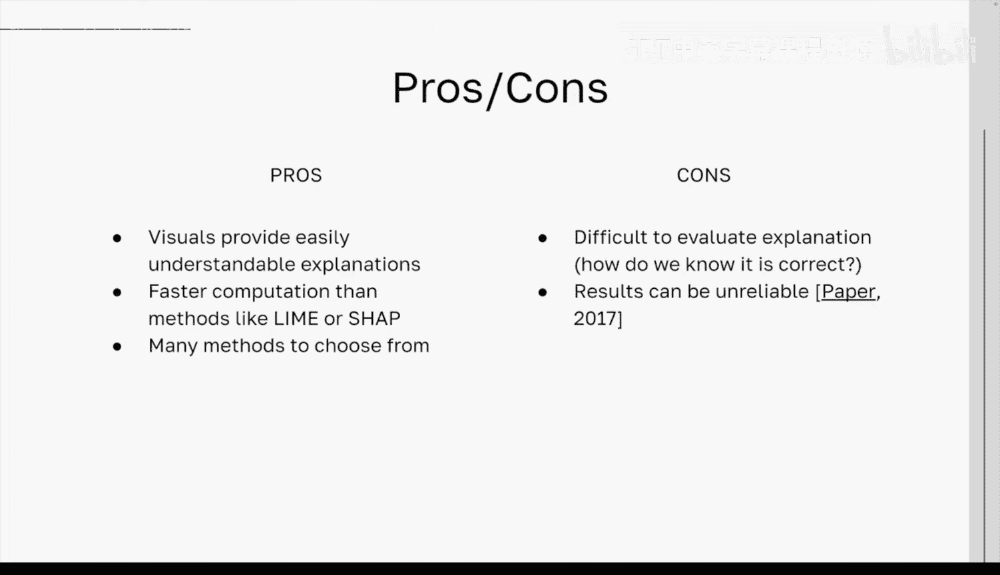
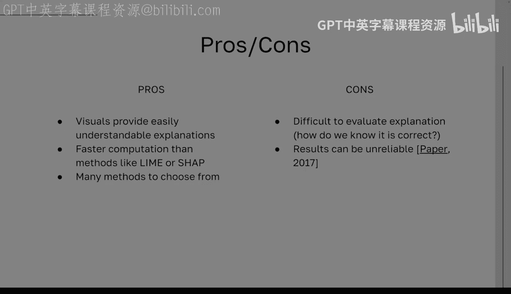

# 杜克大学《可解释人工智能｜Explainable AI (XAI)》中英字幕 p68 21_02_03_特征归因.zh_en -BV1HnrBBmEon_p68-

Our next explanation method is commonly used in computer vision applications。

 We have already talked about one type of feature attribution， occlusion or perturbation based。

 where we manipulate parts of the image to generate explanations like limeme and chap Here we will introduce gradient based feature attribution where we compute the gradient of the prediction or classification score with respect to the input features。

 There are many ways to calculate the gradient。Salliency maps are a feature attribution method for images。

 here is an example of a saliency map for the Duke Chapel for the predicted object class of castle。

There are many ways to calculate the gradient of the prediction or classification score with respect to the input features。

 including vanilla gradient or salliency maps， which we saw in the previous slide。

 Dcomnet and gradcam and its variations， including guided gradcam and smooth grad。Today。

 we will cover the vanilla gradient and grad cam methods。

Banilla gradients provide pixel level importance， where gradCm provides region level importance。

Before we jump into implementation of the vanilla gradient。

 make sure to go back and review back propagation this is a foundational topic in neural networks and is a prerequisite for understanding feature attribution gradient based methods。

In order to implement the vanilla gradient， we calculate the gradient of the loss function for the class of interest with respect to the input pixels。

 Here's what the process looks like。 One， perform a forward pass of the image of interest2。

 compute the gradient of the class score of interest with respect to the input pixels。

 set all other classes to0。And visualize the gradients。

 show absolute values or highlight negative and positive contributions。

One challenge to note here is the saturation problem。 When the activation goes below 0。

 it gets stuck there。 D back propagation。 the gradient flowing through this neuron will be 0。

 indicating no changes needed in the weights connected to this neuron。

Now let's talk about gradCm or gradient weighted class activation map gradCm is not back propagated all the way back to the image。

 but usually to the last convolutional layer to produce a localization map that highlights important regions of the image。

 the primary goal of gradCm is to understand at which parts of an image a convolutional layer looks for a certain classification。

It does this by analyzing which regions are activated in the feature maps of the last convolutional layers。

To implement gradCAm， these are the steps， first， forward， propagate the input image through the CNN。

Then obtain the raw score for the class of interest。

 This is the activation of the neuron before the softm layer。 set all other class activations to 0。😊。

Then back propagate the gradient of the class of interest to the last convolutional layer before the fully connected layers。

 weight each feature map or pixel by the gradient for the class and calculate an average of the feature maps weighted per pixel by the gradient。

 Then apply Raylude to the average feature map。😊，To visualize。

 scale values to the interval between 0 and 1， upscale the image and overlay it over the original image。

If using a variation of grad cam called guided grad cam。

 you would then multiply the heat map with guided back propagation。

Here's an example from the interpretable machine learning book that shows both vanilla gradients and gradcm for a greyhound。

 a bowl of soup， and an eel。

Let's evaluate the pros and cons of feature attribution as an explainable AI technique。

 The visuals from feature attribution provide easily understandable explanations。

 There are many methods to choose from， and the computation is much faster than methods like limeme or Shap。

 However， it is difficult to evaluate the explanation。 How do we know the explanation is correct。😊。

It has also been shown by Kiermens at all that results can be unreliable and unstable in feature attribution methods like saliency maps。

