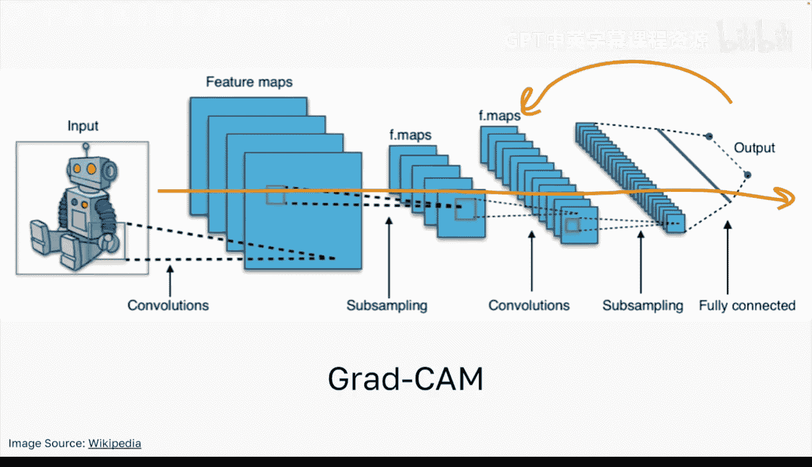
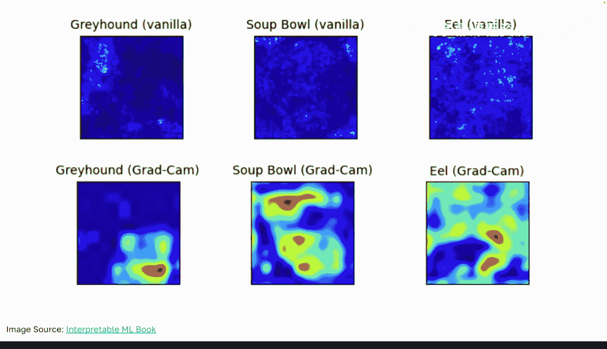
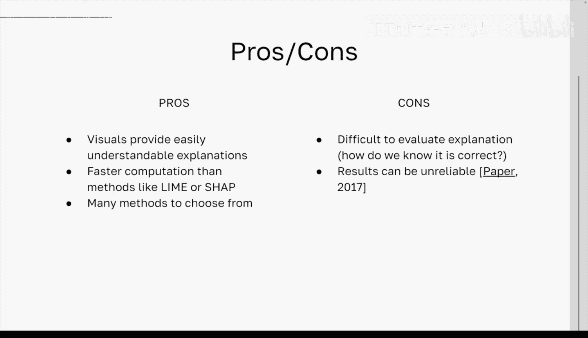
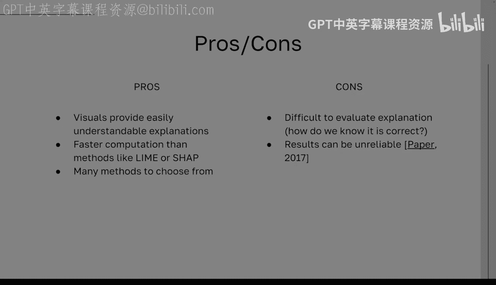

# 可解释人工智能：第68课：特征归因方法详解 🧠

在本节课中，我们将学习两种基于梯度的特征归因方法：原始梯度法和Grad-CAM。这两种方法主要用于解释计算机视觉模型的决策，通过计算模型预测相对于输入特征的梯度，来可视化图像中哪些区域对模型的判断最为重要。

---

## 基于梯度的特征归因方法

上一节我们介绍了基于遮挡或扰动的特征归因方法，如LIME和SHAP。本节中，我们将探讨基于梯度的特征归因方法。这类方法通过计算模型预测分数相对于输入特征（如图像像素）的梯度，来生成解释。梯度反映了输入特征的微小变化对模型输出的影响程度。

---

## 原始梯度法（Vanilla Gradient）

原始梯度法，也称为显著图（Saliency Map）方法，它提供了像素级别的重要性评估。在深入实现细节之前，请确保您已复习过神经网络中的反向传播原理，这是理解基于梯度的特征归因方法的基础。

以下是实现原始梯度法的步骤：

1.  对感兴趣的图像执行一次前向传播。
2.  计算目标类别的预测分数相对于输入像素的梯度。
3.  将所有其他类别的梯度设置为0。
4.  可视化梯度：可以展示其绝对值，或分别突出显示正负贡献。

此方法面临的一个挑战是“饱和问题”。当神经元的激活值低于0时（例如在ReLU激活函数后），梯度可能变为0，导致反向传播时无法更新权重，从而可能遗漏一些重要特征。

---

## 梯度加权类激活映射（Grad-CAM）

与原始梯度法不同，Grad-CAM并不将梯度一直反向传播回原始图像，而是通常传播到最后一个卷积层。它的主要目标是生成一个定位图，突出显示图像中对特定分类至关重要的区域，从而理解卷积层关注图像的哪些部分。

以下是实现Grad-CAM的步骤：

1.  将输入图像前向传播通过卷积神经网络（CNN）。
2.  获取目标类别的原始分数（即Softmax层之前神经元的激活值），并将所有其他类别的激活值设为0。
3.  将目标类别的梯度反向传播到全连接层之前的最后一个卷积层。
4.  用该类别梯度对每个特征图（或像素）进行加权，并计算这些加权特征图的逐像素平均值。
5.  对平均后的特征图应用ReLU激活函数，以聚焦于对类别有正面影响的特征。
6.  为了可视化，将值缩放到0到1之间，将热图上采样至原图尺寸，并叠加到原始图像上。

如果使用Grad-CAM的一个变体——导向Grad-CAM（Guided Grad-CAM），则需要将Grad-CAM生成的热图与导向反向传播（Guided Backpropagation）的结果相乘。

---

## 方法对比与示例

下图展示了原始梯度法与Grad-CAM在解释模型识别“灰狗”、“一碗汤”和“鳗鱼”时的可视化结果对比。可以看到，原始梯度法（左列）的响应更为分散和像素化，而Grad-CAM（右列）则能更清晰地突出与目标物体相关的连贯区域。

---

## 特征归因方法的评估

最后，我们来评估特征归因作为一种可解释AI技术的优缺点。

**优点：**
*   可视化结果直观易懂。
*   可供选择的方法众多。
*   计算速度远快于LIME或SHAP等方法。

**缺点：**
*   解释结果的评估较为困难，难以判断解释是否正确。
*   研究表明，如显著图这类特征归因方法的结果可能不可靠且不稳定（由Kiermens等人提出）。

下图进一步说明了不同方法在稳定性和可靠性方面的差异。

---

## 总结

本节课中，我们一起学习了两种重要的基于梯度的特征归因方法：提供像素级重要性的原始梯度法，以及提供区域级重要性、能更好定位关键区域的Grad-CAM。我们了解了它们的实现步骤、直观对比，并讨论了这类方法的优势与当前面临的挑战，例如评估困难和结果的不稳定性。理解这些方法有助于我们更好地解读和信任深度学习模型在计算机视觉任务中的决策过程。