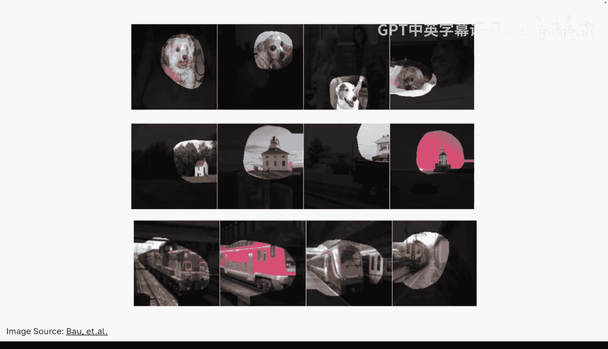
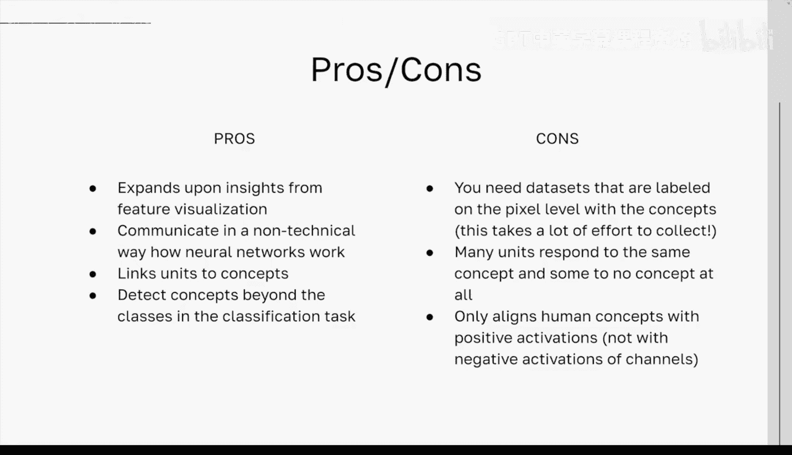
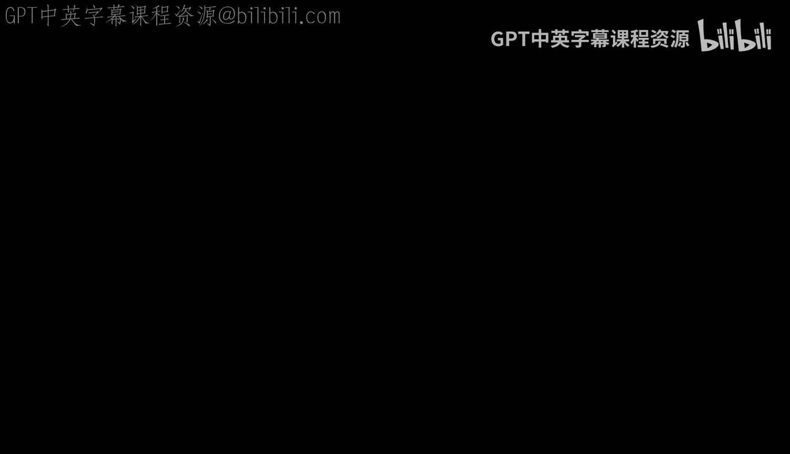

# 杜克大学《可解释人工智能｜Explainable AI (XAI)》中英字幕 p69 22_02_01_网络解构分析.zh_en -BV1HnrBBmEon_p69-

Network dissection， introduced in 2017， links human concepts with individual neural network units。

The key hypothesis is， do convolutional neural networks learn disentangled features？

Disentangled features just means that can individual network units detect specific real world concepts。

 This implies that the network is interpretable。 Siler alert， CNNNs are， in fact。

 not perfectly disentangled。 Let's take a closer look。

The implementation of network dissection is fairly straightforward。 First。

 get images with human labeled visual concepts。 These could be pixel wise labeled images with concepts of different abstraction levels。

 Second， measure CNN channel activations for images。 and lastly。

 get the alignment of activations and labeled concepts。

This method can be used to probe any convolutional layer。Let's dive deeper into this implementation。

Starting with measuring the channel activations for each convolutional channel K and for each image X。

 we forward propagate image X to the target layer containing channel K。

 and then we extract the pixel activations of convolutional channel K a sub K of x Overall images。

 we calculate the distribution of pixel activations alpha sub K， Then we determine the 0。

995 quantile level T sub K of activations Al sub K。For each image X。

 we scale the activation map a sub K of x to the resolution of image X。 The result is s sub K of x。

 and then we binize the activation map。 A pixel is either on or off。

 depending on whether or not it exceeds the activation threshold T sub K。

 The new mask is then M sub K of x is equal to s sub K of x。

 which is greater than or equal to t sub K of x。We now have one activation mask per image and channel。

Now let's talk about align alignining activations and concepts for each channel。

 we find the human concept that most activates that channel。

We compare the activation mass with all labeled concepts。

Then we quant the alignment between activation mass K and concept Maask C with the intersection over union or IOU score。

 unit K is a detector of concept C when I O of K C is greater than 0。04。

A reminder of our intersection of union equation is shown on the right。

 If we look at a visual example。 we have the Duke Chapel。

 The human annotated ground truth is a dashed red line。

 The blue solid line is our top activated area。 The area of intersection is where these two intersect。

 And then the area of union。 It contains both of these areas and their intersection。

Let's look at some examples in this image from the original paper。

 we can see mass of the concepts relating to dog， house， and train。

Another example from the original paper， which shows comparisons between activations and human labeled concepts。

Let's evaluate the pros and cons of network dissection as an explainable AI technique Network dissection expands upon insights from feature visualization and communicates in a nontechnical way how neural networks work we can use it to link units to concepts and we can detect concepts beyond the classes in the classification task。

However， we need data sets that are labeled on the pixel level with the concepts。

 This takes a lot of effort to collect。 Many units respond to the same concept and some to no concept at all。

 which can be confusing。 Finally， it only aligns with human concepts with positive activations。

 not with negative activations of channels。😊。

