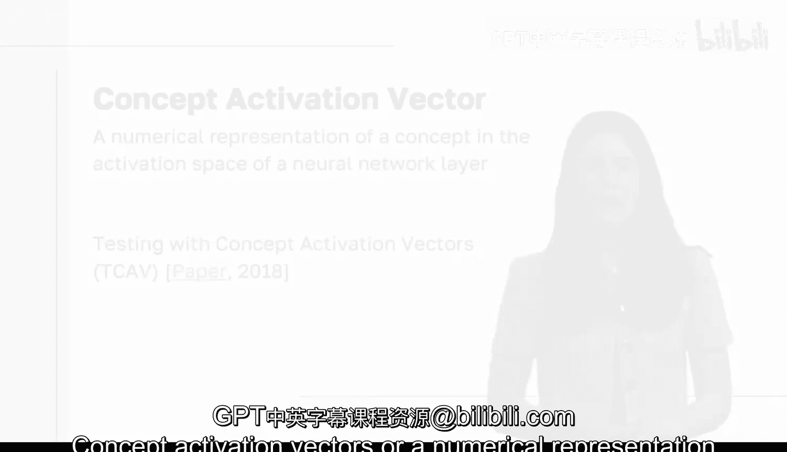
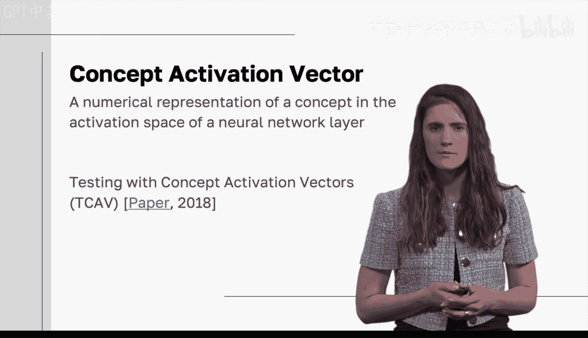
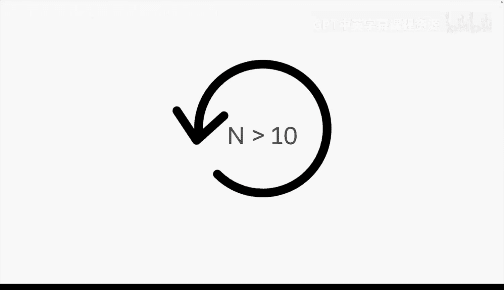
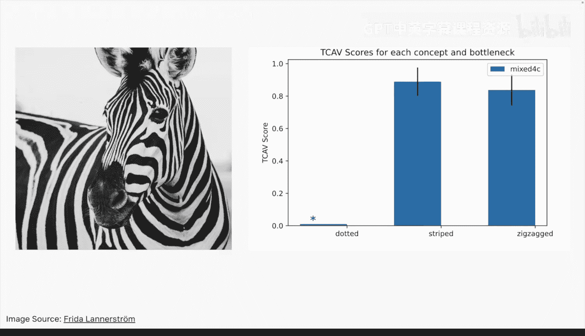
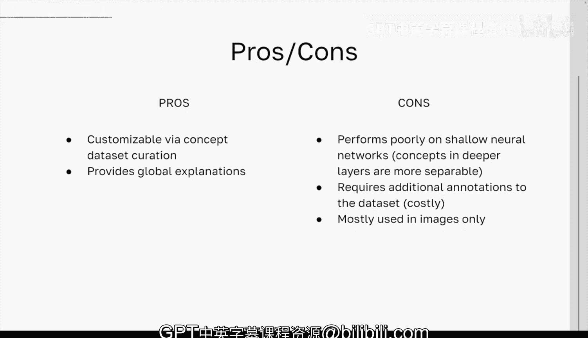

# 杜克大学《可解释人工智能｜Explainable AI (XAI)》中英字幕 p70 23_02_03_概念激活向量.zh_en -BV1HnrBBmEon_p70-

Concept activation vectors are a numerical representation of a concept in the activation space of a neural network layer testing with concept activation vectors or TCav was first introduced in 2018。

 For any given concept， TCav measures the extent of that concept's influence on the model's prediction for a certain class。

We are going to walk through the implementation of TCAab with an example， classification of zebras。

First， curate data sets， a concept data set that represents concept C and A random data。

Here on the right you see the target dataset set and a random data set on the left。

 you see three different concepts， striped， zigzagged， and dotted。

Next， target a hidden layer L and train a binary classifier which separates the activations generated by the concept set from those generated by the random set。

 the binary classifier can be an SVM or logistic regression model。

The coefficient vector of this trained binary classifier is the concept activation vector。

Given an image input X， we can measure its conceptual sensitivity by calculating the directional derivative of the prediction in the direction of the unit concept activation vector。

 as shown here， this component maps the activation vector to the logicit output of class K。

 and this component maps the input X to the activation vector of layer L。😊。

We calculate the ratio of inputs with positive conceptual sensitivities to the number of inputs for each class。

Now， how do we know if our concept activation vector is robust instead of training only one concept activation vector。

 we train multiple using different random data sets while keeping the concept dataset set the same。

 a meaningful concept will generate concept activation vectors with consistent TC scores。

 Here are the steps Collect n random data sets。 The recommendation from the paper is n is greater than or equal to 10。

 Then fix the concept dataset set and calculate your TCf score using each of the N random dataset sets。

 Next， apply a two sided T test to N TCf scores against other TCf scores generated by a random concept activation vector。

 A random concept activation vector can be obtained by choosing a random data set as the concept dataset。

😊，Use multiple hypothesis correction， like Bonferoni multiple hypothesis correction for your hypothesis testing。

Here， we look at the class zebra and the concepts dotted striped in zigzag。

 We are exploring a layer called mixed 4 C。 You can see on the right。

 the Tcf score for each concept is displayed on a bar chart， As one might expect。

 the Tefev scores are high for concepts striped in zigzagged for the zebra class。

 but very low for the concept dotted。😊。

Let's evaluate the pros and cons of concept activation vectors as an explainable AI technique。

 TCav is customizable via concept data set creation， and it provides great global explanations。

 However， there are some caveats。 It performs poorly on shallow neural networks。

 This is because concepts in deeper layers have been shown to be more separable。😊。

TCav requires additional annotations to the dataset set， which can be costly。 Finally。

 TCav is primarily used for image data only。

