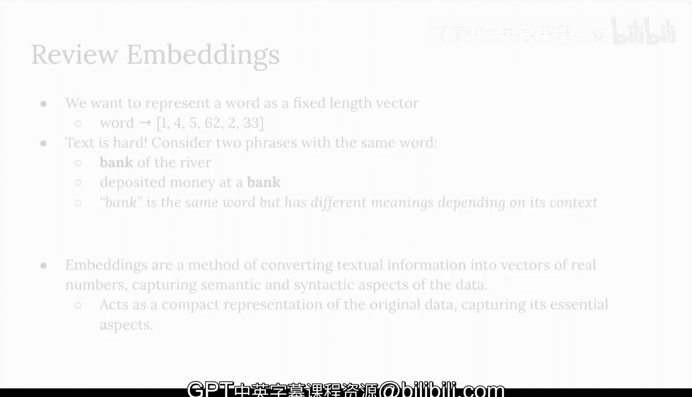
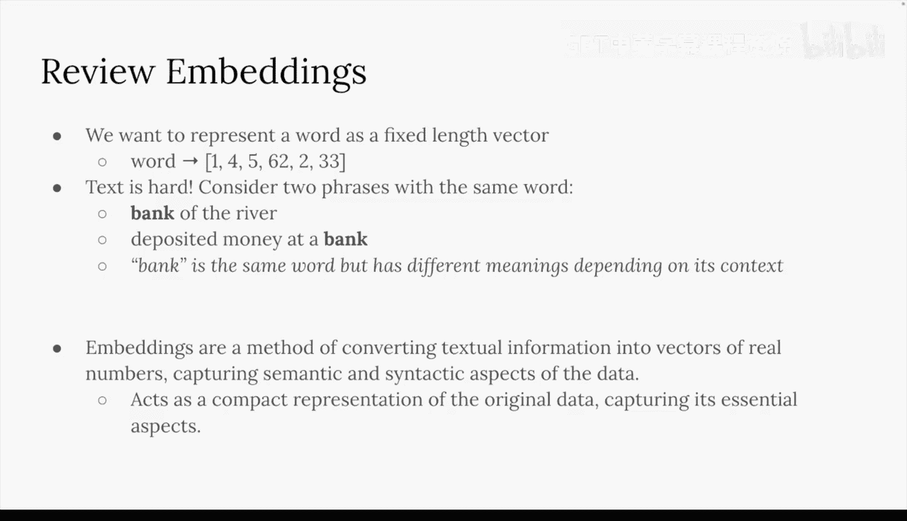
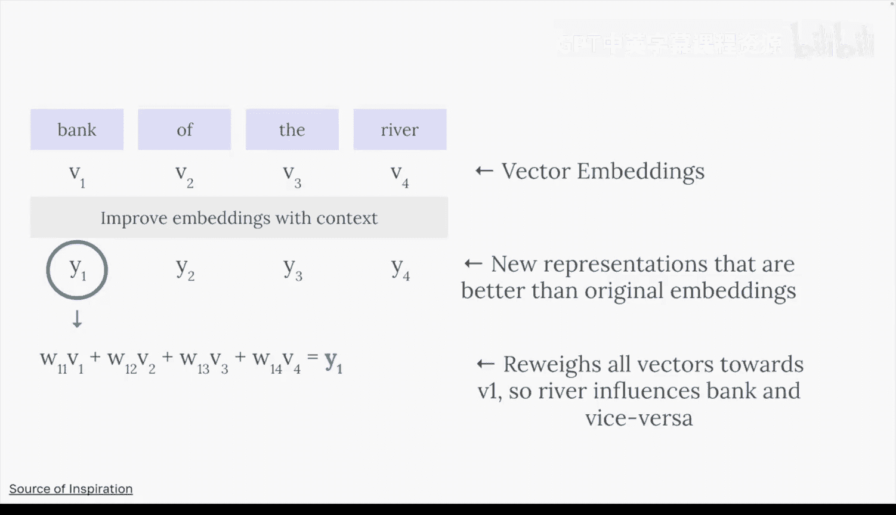
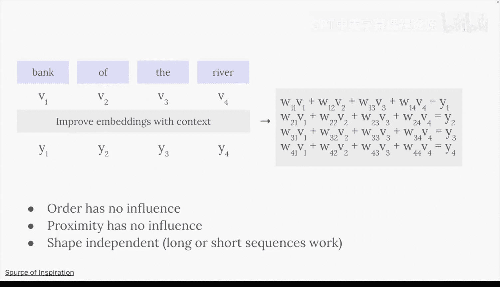
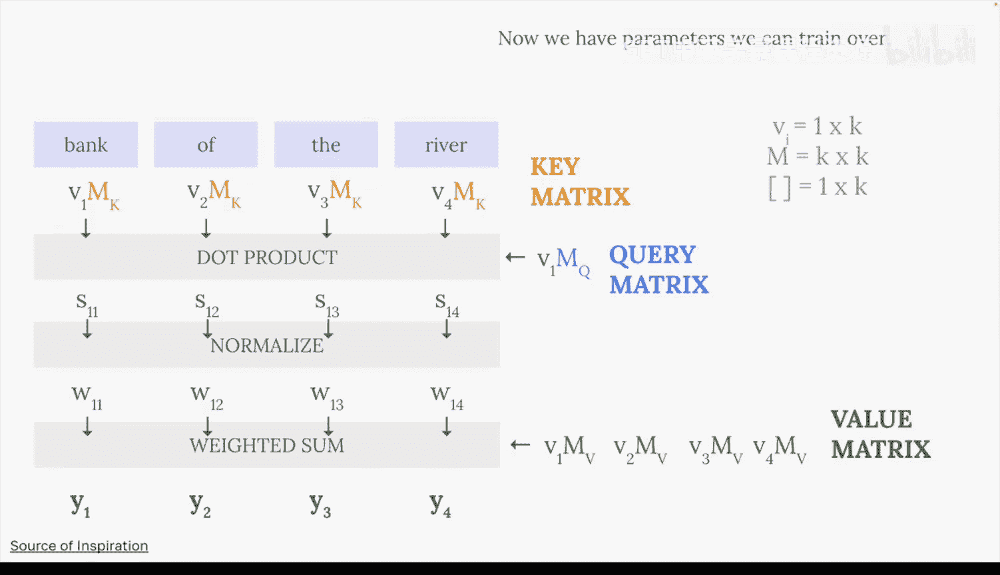
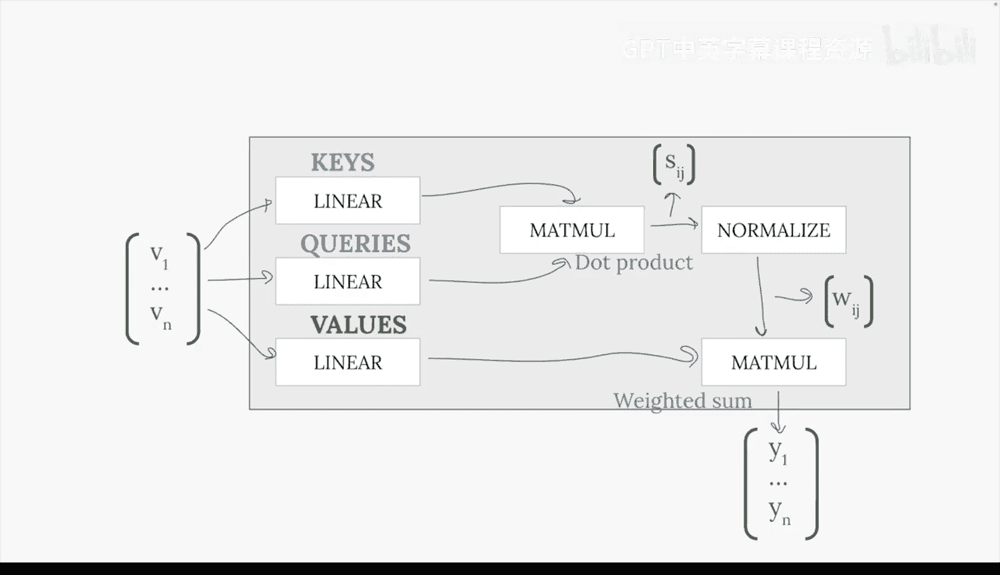
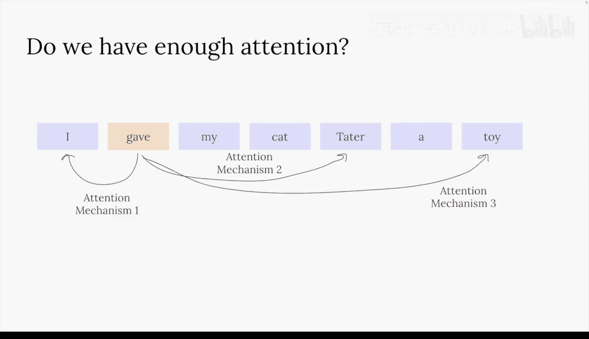
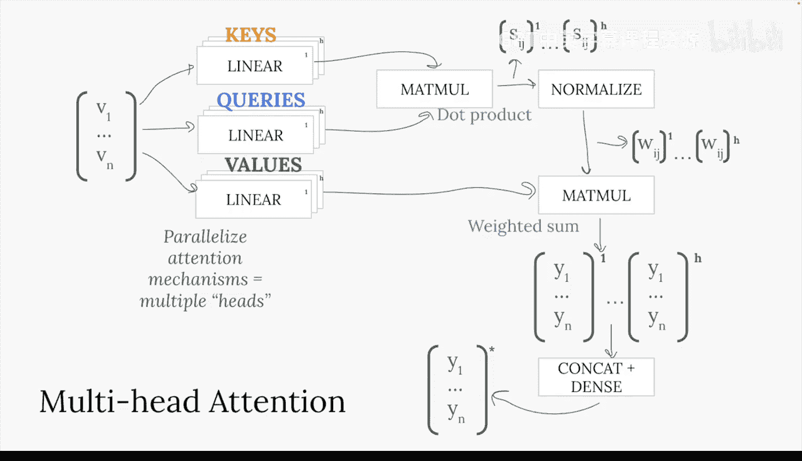
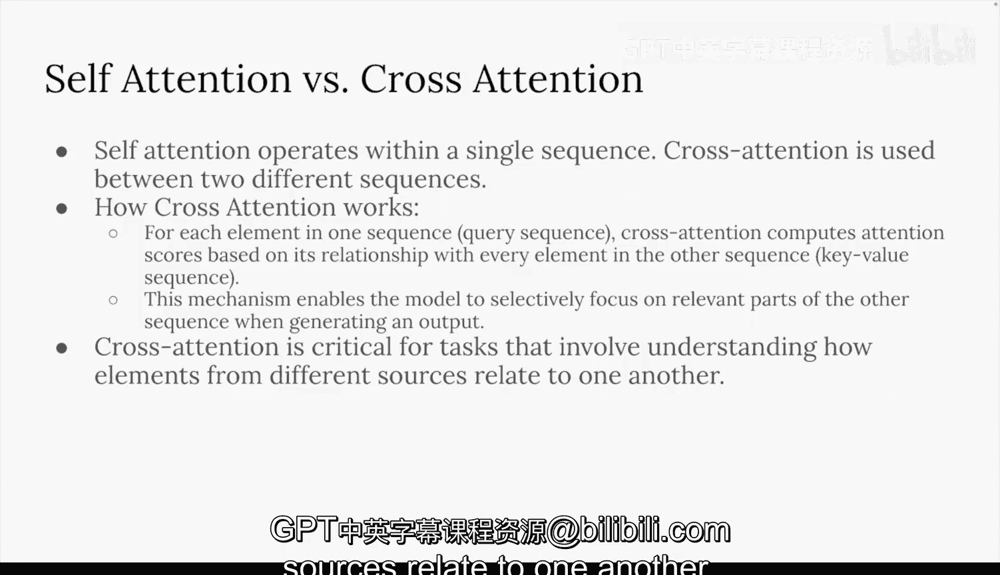

# 杜克大学《可解释人工智能｜Explainable AI (XAI)》中英字幕 p71 24_02_01_注意力机制综述.zh_en -BV1HnrBBmEon_p71-

First， let's review embeddings。 We want to represent a word or a subword as a fixed length vector for input into a neural network。

 but text is hard。 Consider these two phrases that contain the same word。

 Bank of the river and deposited money at the bank。 Bank is the same word in both。

 but has different meanings depending on its context or the surrounding words。

Ebeddings are a method of converting our text information into vectors of real numbers。

 capturing semantic and syntactic aspects of the data。

 it acts as a compact representation of the original data， capturing its essential aspects。

Let's jump into a simplified version of self attention。

 Let's say that we have the phrase Bank of the river。

 We can embed each word as a vector embedding denoted as V1， V2， V3 and V4。

 corresponding to each word in the phrase。 The goal of self attention is to improve these original embeddings with context。

We would ideally like our output to be new representations that are better than the original representations。

 we're going to call these Y1， y2， Y3 and y4。Let's focus on the first word bank。

 We know that bank can have multiple meanings depending on its context。 Remember。

 the goal is to go from our original vector embedding V1 to a new vector embedding that is better。

 Y1。We start by taking the dot product between each vector and every other vector in the sequence。

 V1。 v1 v1。 v2， v1。 v3 and V1 dot v4， the output are referred to as scores。

We take these scores and we normalize them via a soft max function。

 because we would like to have all of our weights sum to one。

 Now we have these weights that are normalized scores。

These weights are used to re all vectors towards V1， so river influences Bank and vice versa。

 y1 is this reweighted vector。

We do this for each of the words in our sequence， something to note here with our process。

 order has no influence。 proximityity has no influence， and it is shape independent。

 long or short sequences work。 you just end up with a longer or shorter weighted sum。

Here I am drawing it in another way where we have each of the mathematical operations and their inputs。

 the dot product of V1 and the original embeddings are the scores which are then normalized and become our weights and await weighted sum between the weights and our original embeddings create our new vector embeddings Y1。

 Y2， Y3 and y4。One thing to note is that this has all been pure mathematical operations so far。

 there is nothing being trained， so what happens if we introduce trainable parameters？

We are going to introduce trainable parameters at each place that the original embeddings are used。

These are called keys， queries and values。 They come from a nod to databases。

 but don't think about the analogy too hard。 Keys are associated with our original embeddings。

 Our query says I want V1 to get more context。 And when I combine query and keys。

 I want to get back the values。 Like I said， don't think about the database analogy too hard here。

Now we have parameters that we can train over， we have a key matrix。

 a query matrix and a value matrix。 these are what we are going to train our trainable weights note that these matrices are k by k where k is the length of our original embedding vector。

If we draw this as a self attention block， we have linear layers where original vector embeddings combine with our keys。

 queries and values， trainable matrices。 The rest of it is the same。 We have our dot product。

 which gives us scores， We normalize that， which gives us weights。

 and we perform a weighted sum to get our output， improved vector embeddings y1 through yn。

And now we have a block that we can use to train our keys， queries and values， matrices。

 These trainable parameters are the same as our trainable weights in a traditional neural network layer。

The TLDR here is that self attention is the process of adding more context。Now。

 we compose pose the question， do we have enough attention。

 Consider the word Ga in the sentence I gave my cat， Tater， a toy。

The word gave needs to attend to multiple parts of the sentence simultaneously。

 It needs to attend to I to tater and to toy。 These could all be separate attention mechanisms with their own trained keys。

 queries and values， matrices。

This brings us to the concept of multi head attention in which we parallelize attention mechanisms by having multiple heads here。

 we have one through H heads。 This results in having one through H scores， weights and final outputs。

Now， our final output needs to be the same size as our input vector em bedding。

 so what we do here is we cancatenate and send our one through H outputs through a dense layer to end up with an output that is the same size as it was previously。

We've reviewed self attention。 but what about cross attention。

 Self attention operates within a single sequence。 Cross attention is used between two different sequences。

 Here is how cross attention works for each element in one sequence， a query sequence。

 cross attention computes attention scores based on its relationship with every element in the other sequence。

 the key value sequence。This mechanism enables the model to selectively focus on relevant parts of the other sequence when generating an output。

Cross attention is critical for tasks that involve understanding how elements from different sources relate to one another。

