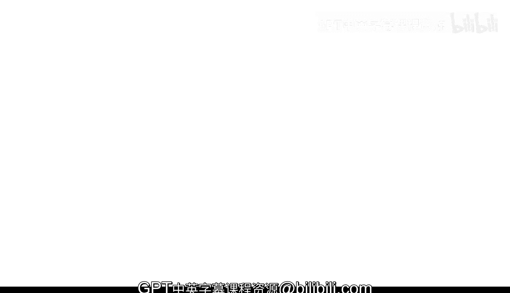
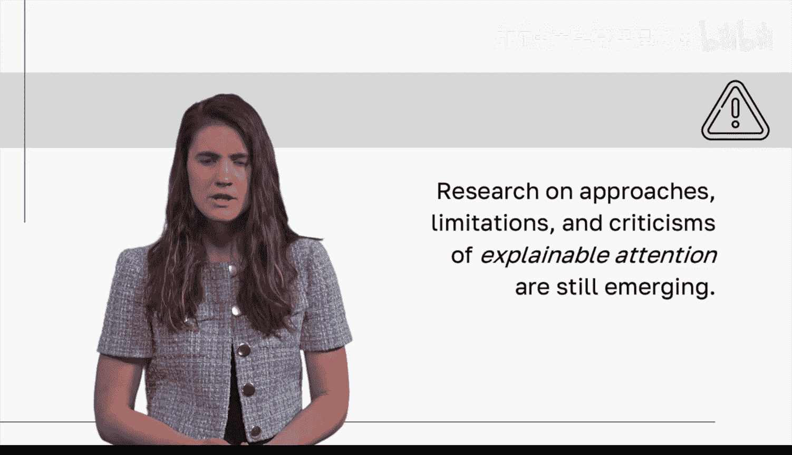
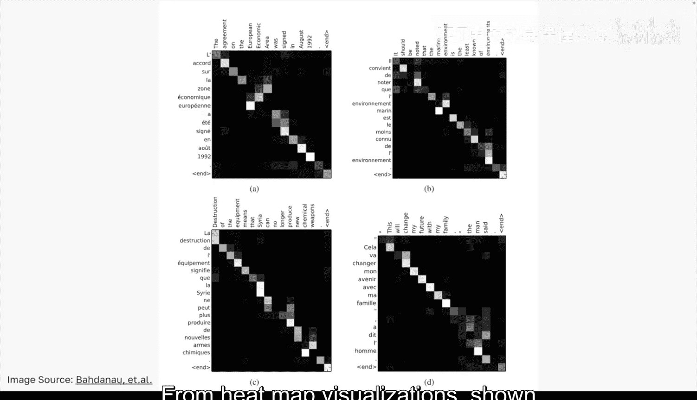
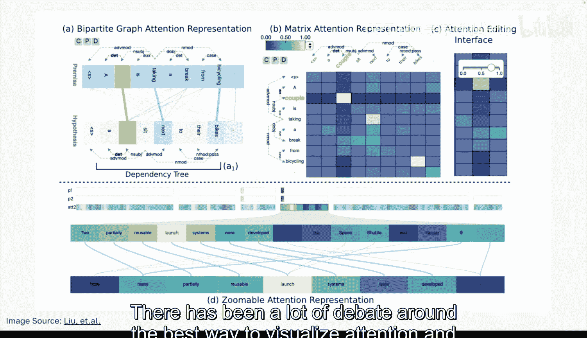
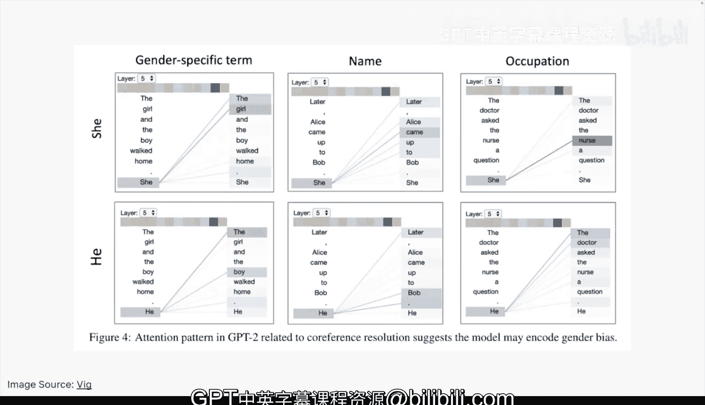

# 杜克大学《可解释人工智能｜Explainable AI (XAI)》中英字幕 p72 25_02_02_注意力可视化.zh_en -BV1HnrBBmEon_p72-

Explainable attention is a relatively new concept， research on approaches。

 limitations and criticisms of the approach are still emerging。

As with all of the topics in explainable AI， we should maintain a critical perspective and ensure that we are using the approaches for the right reasons and that the theory behind the concepts are robust。

In this section， I will share the latest research on approaches， limitations， and criticisms。

Over the years， visualizing attention has been a topic of great debate from heat map visualizations shown here from a 2015 paper to graph and matrix attention representations shown here from a paper in 2018。

 there has been a lot of debate around the best way to visualize attention and whether we should be doing it at all。

Perhaps the most commonly used method for visualizing attention。

 and likely the one that you have seen used in explanatory articles is Bert Viz introduced in 2019。

 It visualizes attention in the transformer architecture at multiple scales。

 Bert Viz extracts the attention weights or scores from each layer and head of the transformer for a given input。

 It's important to know that Bert Viz is a tool for visualizing transformers and is not limited to the Bt family of models。

Here you can see some visualizations from Bert Viz。

 where higher weights between tokens are shown in darker colors， as you can see。

 you can probe different layers in your network using Bert Viz。

This shows a couple other ways we can use Bert Vz to visualize attention patterns。

 a whole model view on the left， and a neuron view of GPT2 shown on the right。

The original paper suggested that this visualization method could be used to detect biases like proposed encoded gender bias shown here in figure four from the original paper。

