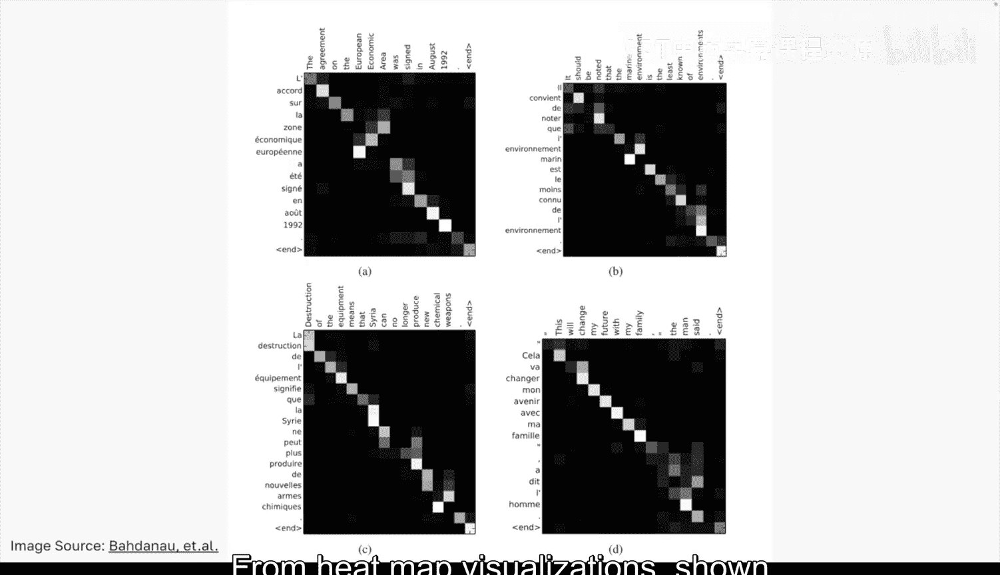
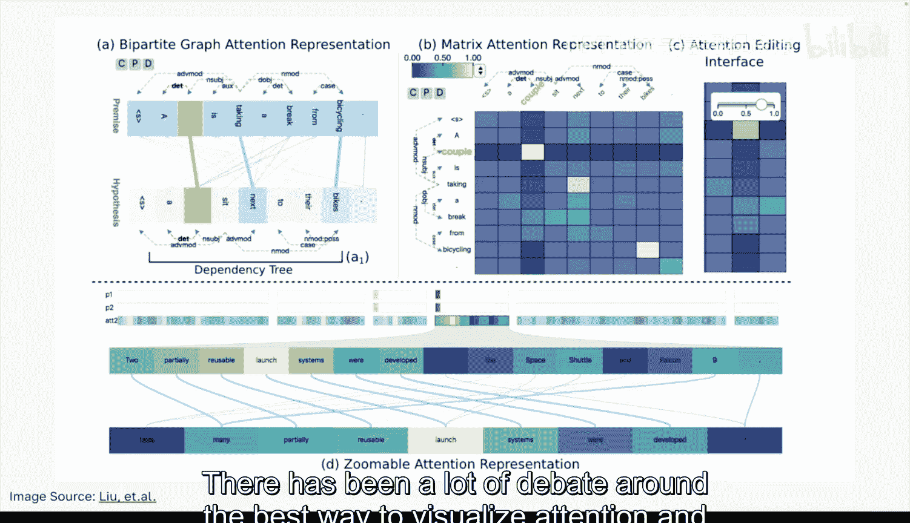
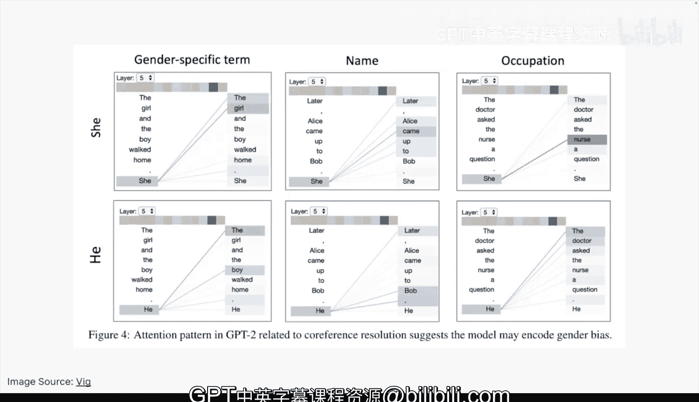

# 可解释人工智能：第72讲：注意力可视化 👁️

在本节课中，我们将学习注意力机制的可视化方法。注意力可视化是理解模型如何聚焦于输入数据特定部分的重要工具。我们将探讨其常用方法、相关工具以及当前研究中的争议与局限。

上一节我们介绍了可解释注意力的基本概念，本节中我们来看看具体的可视化技术及其应用。

## 注意力可视化的演进与争议 📊

多年来，如何可视化注意力一直是一个备受争议的话题。从2015年论文中展示的热力图可视化，到2018年论文中显示的图与矩阵注意力表示，学界围绕最佳可视化方式及其必要性进行了大量讨论。

## 常用可视化工具：Bert Viz 🔧

或许最常用的注意力可视化方法是2019年提出的 **Bert Viz**。它也是解释性文章中最常引用的工具之一。Bert Viz 可在多个尺度上可视化Transformer架构中的注意力。

**Bert Viz** 会为给定输入，从Transformer的每一层和每个注意力头中提取注意力权重或分数。需要明确的是，Bert Viz 是一个用于可视化Transformer的工具，并不局限于BERT系列模型。

以下是Bert Viz生成的一些可视化示例。其中，词元间权重越高，显示的颜色越深。如图所示，你可以使用Bert Viz探查网络中不同的层。

这里展示了使用Bert Viz可视化注意力模式的另外两种方式：左侧是整个模型的视图，右侧是GPT-2的神经元视图。

原始论文提出，这种可视化方法可用于检测偏见，例如原论文图四所示的存在编码的性别偏见。

## 注意力可视化的研究方法与批评 🧐

可解释注意力是一个相对较新的概念，关于其方法、局限性和批评的研究仍在不断涌现。

与可解释人工智能中的所有主题一样，我们应保持批判性视角，确保我们使用这些方法是出于正确的原因，并且概念背后的理论是坚实的。

在本节中，我分享了关于方法、局限性和批评的最新研究。

## 总结 📝

本节课中，我们一起学习了注意力可视化的主要方法。我们回顾了该领域的演进与争议，重点介绍了常用的Bert Viz工具及其应用场景，并强调了在研究和应用这些可视化技术时保持批判性思维的重要性。理解这些工具有助于我们更深入地洞察模型的行为，但同时也要注意其解释的局限性。