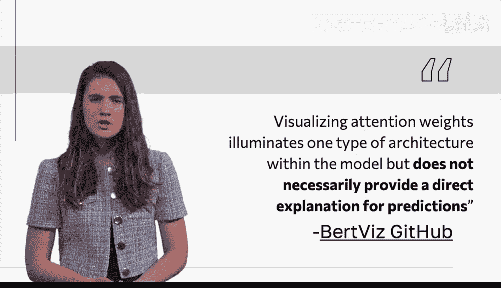
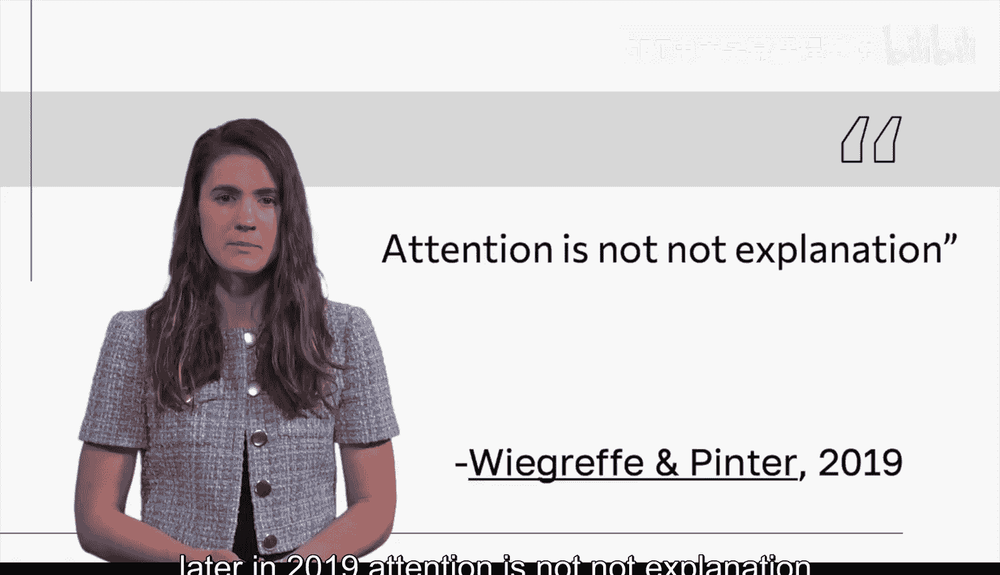
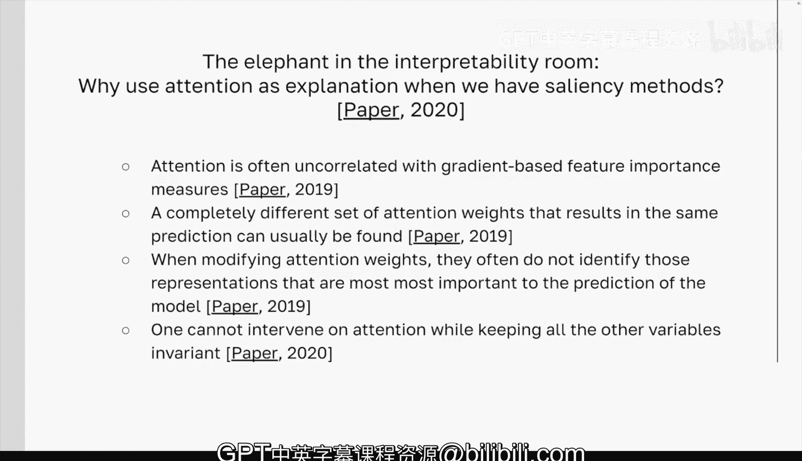

# 杜克大学《可解释人工智能｜Explainable AI (XAI)》中英字幕 p73 26_02_03_可解释注意力机制争议.zh_en -BV1HnrBBmEon_p73-

Like you mentioned previously， using attention as a proxy for interpretability or explainability is a topic of great debate in the community。

 There have been several papers showing that visualizations of attention can be grossly incorrect。

 Even the Bertvizs repository itself， has been updated to read visualizing attention weights illuminates one type of architecture within the model。

 but does not necessarily provide a direct explanation for predictions。

If you wish to understand how the input text influences output predictions more directly。

 consider saliency methods。

In 2019， Jane and Wallace came out with a paper entitled "Attention is not Expation。

Hightening the debate， Wegriff and Piter fired back with another paper later in 2019。

 attention is not explanation。

This debate became the elephant in the room in the explainable AI community。It also became a paper。

This paper to be specific， a paper released in 2020 by Google research titled The Elephant in the interpretability Room。

 Why Use attention as explanations when we have saliency methods shared the following rationale for why we should not be using attention for explainability。

 The goal of the explanation is to reveal which input words are the most important ones for the final prediction。

According to a 2019 paper， attention is often uncorrelated with gradient based feature importance measures。

Another paper showed that a completely different set of attention weights that results in the same prediction can usually be found。

Another analysis published in 2019 described that when modifying attention weights。

 they often do not identify those representations that are most important to the prediction of the model。

And a 2020 paper concluded that one cannot intervene on attention while keeping all the other variables invariant。

As this debate continues， it is important to acknowledge all of the limitations of using attention for XAI What about some alternatives？

