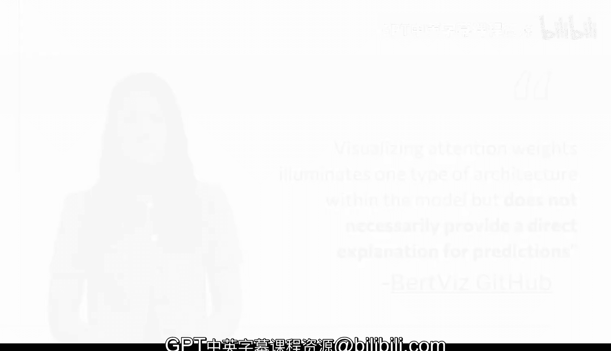
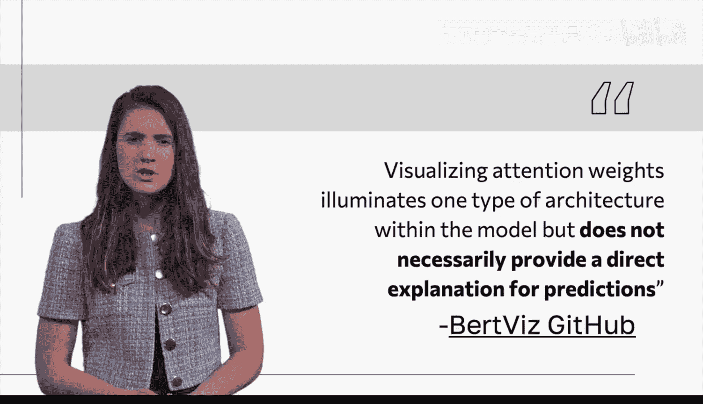
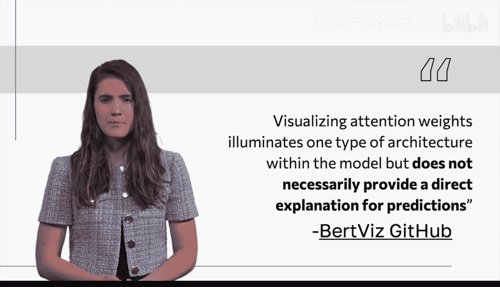
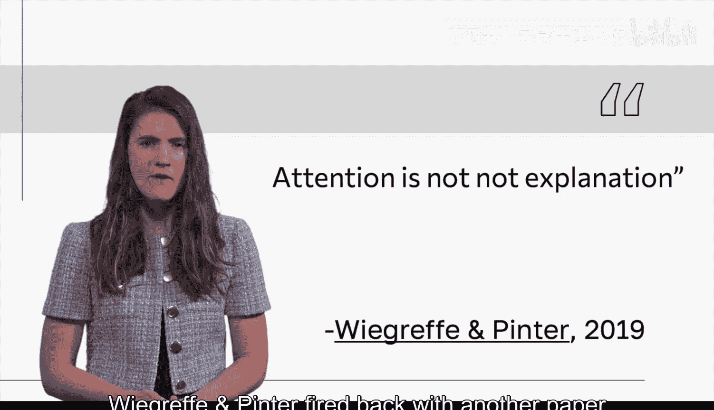
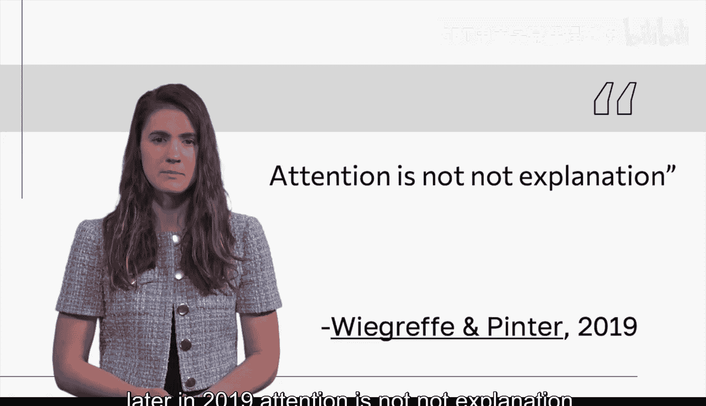
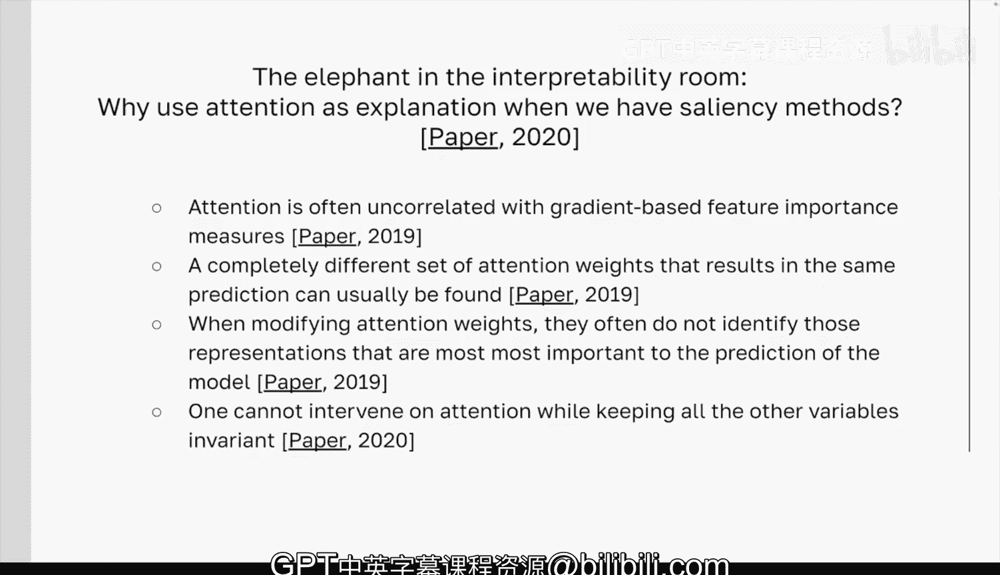

# 可解释人工智能：26：可解释注意力机制争议 🔍

在本节课中，我们将探讨一个在可解释人工智能（XAI）领域备受争议的话题：使用注意力机制作为模型可解释性或可解释性的代理。我们将回顾相关研究，分析其局限性，并简要介绍替代方法。

---

正如之前提到的，使用注意力作为可解释性或可解释性的代理，在学术界是一个备受争议的话题。

已有数篇论文表明，注意力机制的可视化结果可能严重失真。

即使是Bertvizs代码库本身，其说明也已更新为：“可视化注意力权重揭示了模型内部的一种架构，但不一定能为预测提供直接的解释。”

---

上一节我们提到了注意力机制在解释性上的局限性。本节中，我们来看看更直接的替代方法。

如果你希望更直接地理解输入文本如何影响输出预测，可以考虑使用**显著性方法**。

---

在2019年，Jane和Wallace发表了一篇题为《注意力不是解释》的论文，加剧了这场辩论。

随后在2019年晚些时候，Wegriff和Piter发表了另一篇论文进行反驳，标题同样是《注意力不是解释》。

---

这场辩论成为了可解释人工智能领域中“房间里的大象”（指显而易见却被忽视的问题）。它甚至催生了一篇专门的论文。

具体来说，是谷歌研究院在2020年发布的一篇题为《可解释性房间中的大象：既然我们有显著性方法，为何还要用注意力作为解释？》的论文。该论文分享了不应将注意力用于可解释性的理由。

---

解释的目标是揭示哪些输入词对最终预测最重要。

根据2019年的一篇论文，注意力权重通常与基于梯度的特征重要性度量不相关。

另一篇论文表明，通常可以找到一组完全不同的注意力权重，却能产生相同的预测结果。

2019年发表的另一项分析指出，当修改注意力权重时，它们往往无法识别出对模型预测最重要的那些表征。

而一篇2020年的论文得出结论：人们无法在保持所有其他变量不变的情况下干预注意力权重。

---

随着辩论的持续，承认使用注意力机制进行XAI的所有局限性至关重要。那么，有哪些替代方案呢？

---

在本节课中，我们一起学习了关于使用注意力机制进行模型解释的争议。核心观点是：**注意力权重不等于模型解释**。虽然可视化注意力有助于理解模型架构，但它与基于梯度的显著性方法等指标关联性弱，且存在多种权重能导致相同预测，因此其作为解释工具的可靠性存疑。对于寻求更直接因果解释的场景，建议考虑转向**显著性方法**等其他技术。