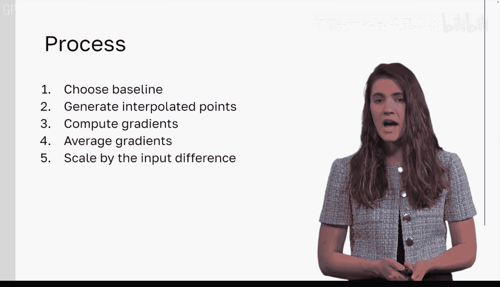
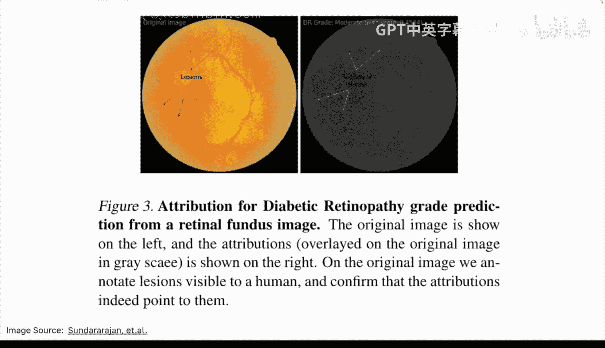
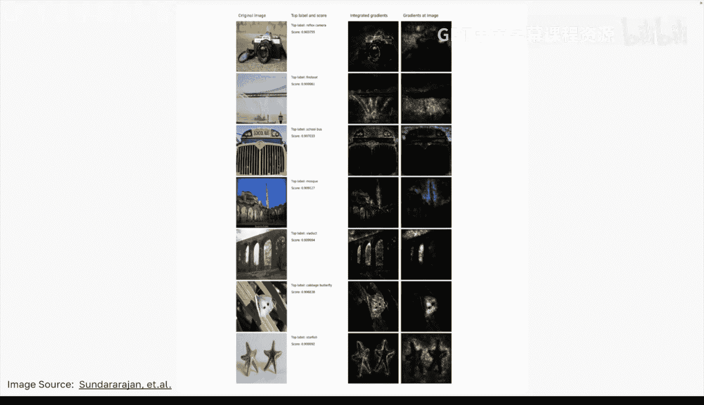
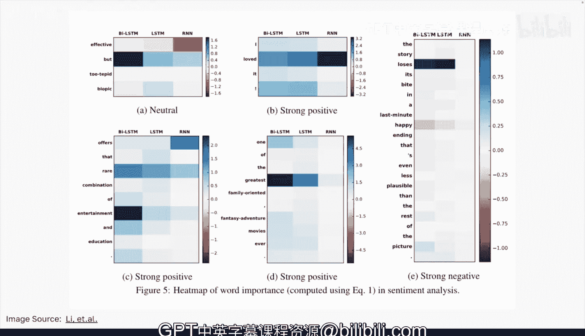

# 杜克大学《可解释人工智能｜Explainable AI (XAI)》中英字幕 p74 27_02_04_显著性映射替代方法.zh_en -BV1HnrBBmEon_p74-

Salliency methods can be used as alternatives here。

 The elephant in the interpretability ri paper recommended the following salliency methods as alternatives to using attention for explainability。

 gradient based methods such as integrated gradients。

 propagation based methods like layer wise relevance propagation and occlusion based methods。

Input salliency methods reveal why one particular model prediction was made in terms of how relevant each input word was to that prediction。

This makes them much more explainable than using the highly debated attention visualization。

Integrated gradients or Igs were introduced in 2017。

 Integrated gradients are defined as the path integral of the gradients along the straight line path from the baseline x prime to the input X。

 We consider the straight line path from the baseline x prime to the input X and compute the gradients at all possible points along the path。

 Integrated gradients are obtained byccumulating these gradients。In the figure。

 you can see that path P2 in green corresponds to that linear path used by integrated gradients here。

 the partial derivative of f of x with respect to Xi is the gradient of f of x along the ifh dimension。

In practice， when we implement integrated gradients， this is the process we follow。

 choose a baseline， selected baseline input that represents an absence of features， for example。

 if the input is an image， the baseline could be an image with all pixels set to zero。Next。

 generate interpolated inputs， create a series of interpolated inputs between the baseline x prime and the actual input X。

 this can be done using a linear path。Next， compute your gradients for each interpolated input x sub I。

 compute the gradient of the model's output with respect to the input。

 This tells us how much each input feature at X sub I affects the output。Then average the gradients。

 average the gradients over all the interpolated inputs。

 This average gradient represents the contribution of each feature along the path from the baseline to the actual input。

Then scale by the input difference， multiply each average gradient by the difference between the actual input and the baseline。

 this scales the gradient contributions to reflect the actual input features。

This figure shows attribution for diabetic retinopathy， grade prediction from a retinal image。

 The original image is on the left， and the attributions are overlaid on the original image On the right。

 The lesions annotated in the original image do， in fact。

 show up in our integrated gradient based attributions。

Here are more images in their integrated gradients shown in the middle column。

Another saency method to consider as an alternative to explainable attention is layerwise relevance propagation or LRP introduced in 2019。

 LRP is a method for the decomposition of the prediction of a neural network computed over a sample down to the relevant scores for the single input dimensions of the sample。

The process of LRP is straightforward。 Start with a forward pass to attain the output。

 the top level relevance， and then use a custom backward pass that at each layer redistributes the incoming relevance among the inputs of that layer。

 Relevance is redistributed until we arrive at the input layers。

 and each layer type has its own propagation rules。 For example， feed forward layers and LSTM layers。

An advantage to LRP is the precise control you have over the approach。

Here is a heat map over misclassified sentences1 and2， and manually constructed sentences 1 A，1， B。

1 C，2A，2 B and 2C。 The predicted class is used as the target class for the visualization。

 so words that were important to the visualization can be highlighted。

The last salency method we will cover in this module is occlusion based methods introduced in 2017 Here you compute input salliency by occluding or erasing input features and measuring effects on the model。

 you can erase various parts of the representation such as input word vector dimensions。

 intermediate hidden units or input words。This image from the original paper shows the word vector dimension importance for different training strategies and word vectors in word to Vec and G。

This image shows the word importance in sentiment analysis for different model architectures。

There are other saliency methods that can be used for attention based networks beyond the ones covered here today and new methods and approaches are currently being researched。

