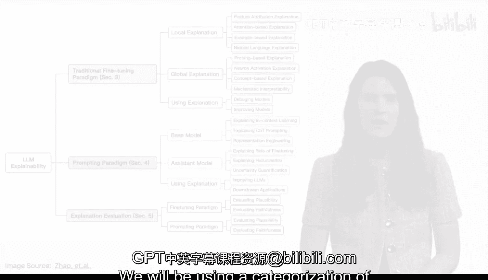
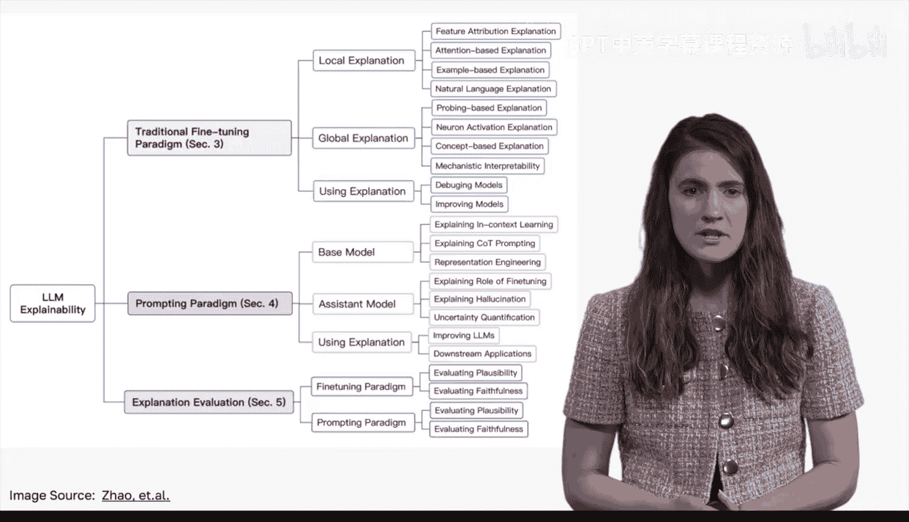
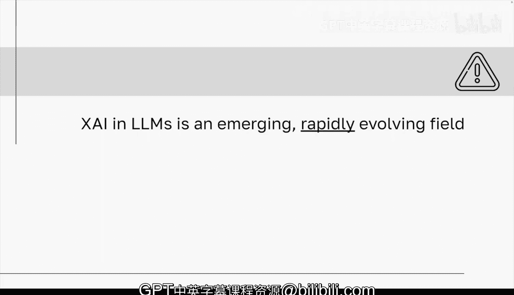

# 杜克大学《可解释人工智能｜Explainable AI (XAI)》中英字幕 p75 28_03_01_大语言模型可解释性挑战.zh_en -BV1HnrBBmEon_p75-

We will be using a categorization of large language model explainability proposed by Zotal in 2023。

 primarily we will be discussing X AI in fine tuning and in prompting and will' cover many of the explanation approaches shown here。

In addition to fine tuning and prompting， we will also discuss XAI and LLM knowledge augmentation or retrieval augmented generation or RAG。

It's worth discussing some of the challenges to employing X AI methods to large language models。

 First， the sheer size and complexity of large language models like G 4。

 with an unknown number of parameters， likely in the trillions。

 makes tracing their reasoning intractable。 They learn high dimensional distributed representations that are entangled and abstract。

 There exist few or no ground truths。 which makes it difficult to design explanation algorithms that accurately reflect the decision making process of an LM。

 This also makes evaluating explanation， faithfulness and fidelity challenging。

The lack of transparency for many LLMs， a lack of documentation around model architecture， weights。

 and data makes it difficult to develop explainable approaches。One note， before we get started。

 explainability in L L Ms is an emerging， rapidly evolving field。

 What this means is that this material may be outdated in six months。

 I hope to continue updating this course as new research is published。 However。

 I caution you that this is not the source of all truth in explainable L L Ms。

 It is merely a timestamp of the current progress in the field。

 As part of your continued education in X AI。 I encourage you to read the latest papers and stay up to date with the shifting mindsets and perspectives on X AI in L Ms。

😊。

