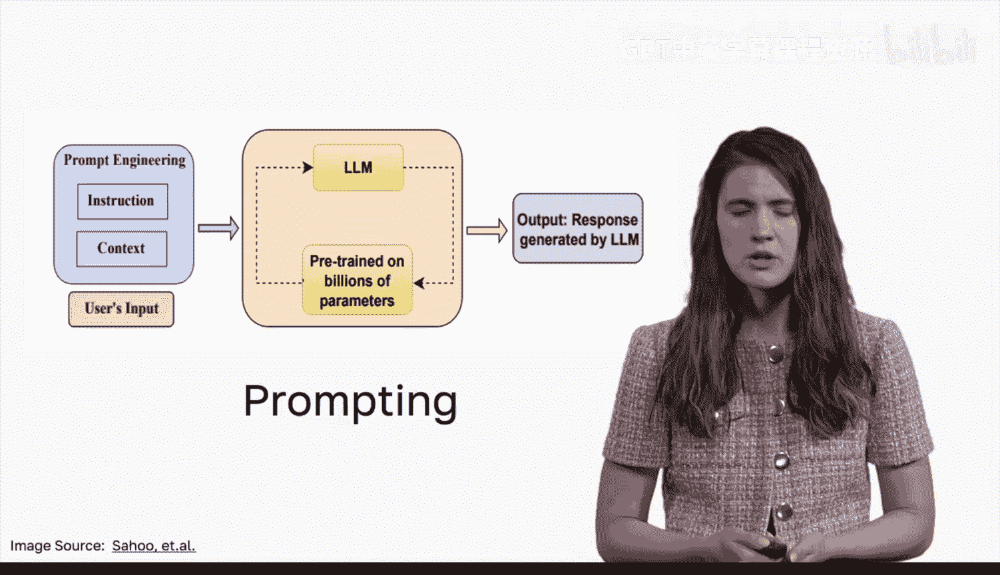
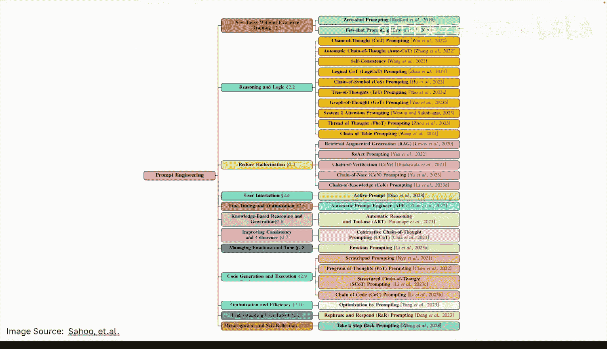
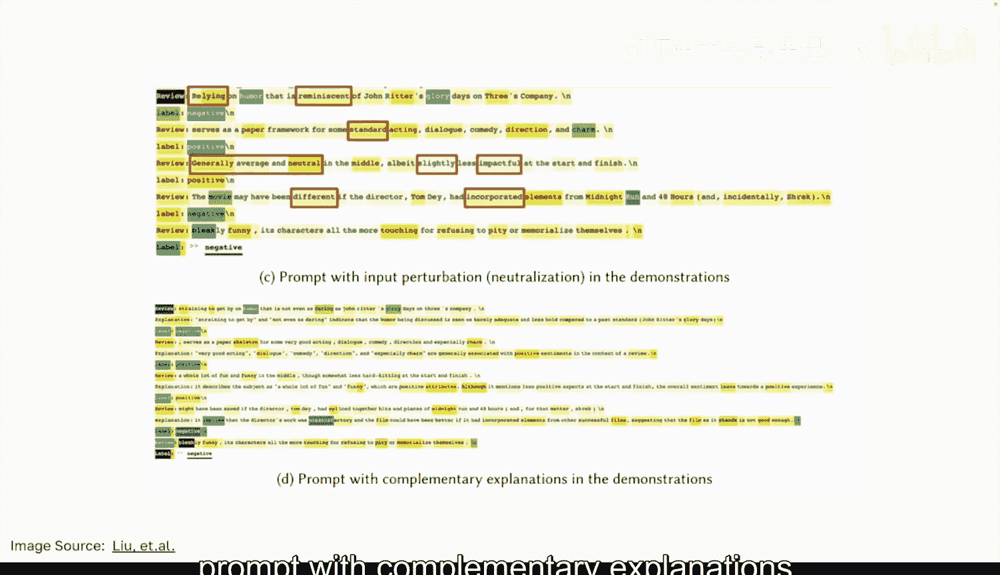
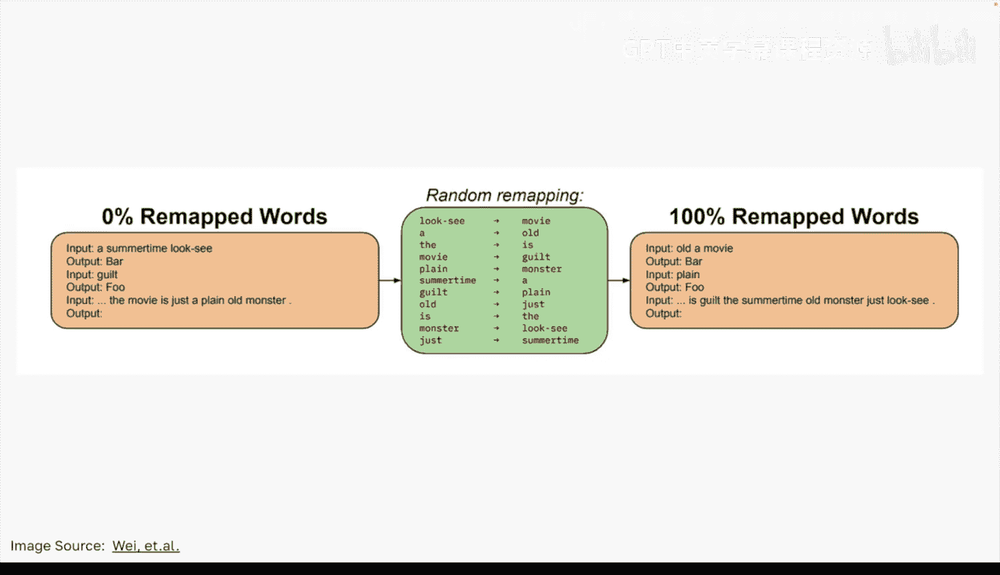
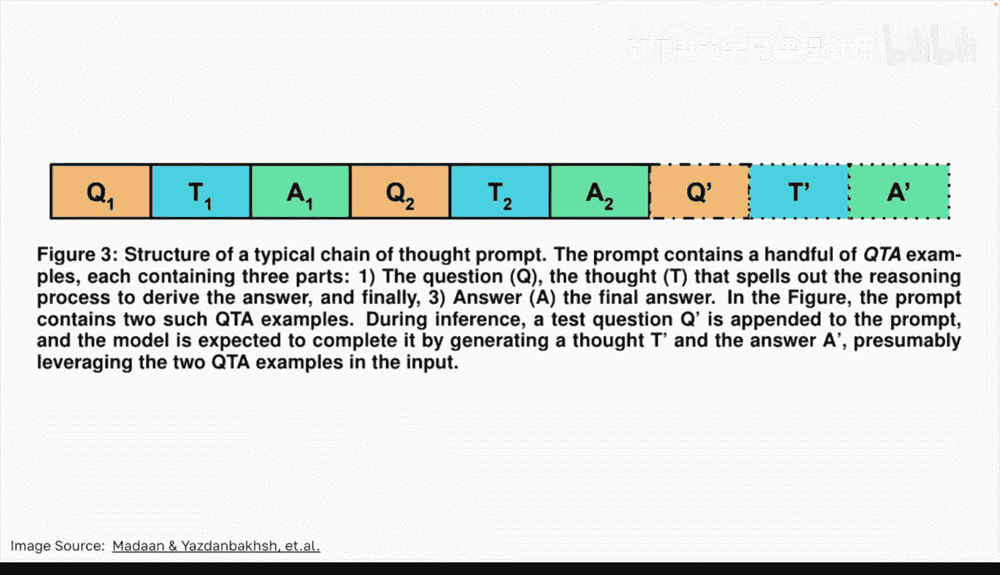
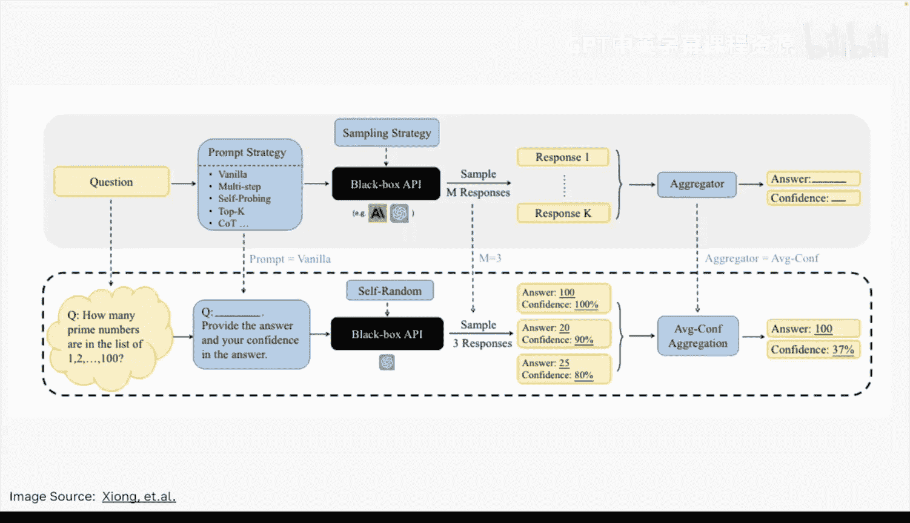
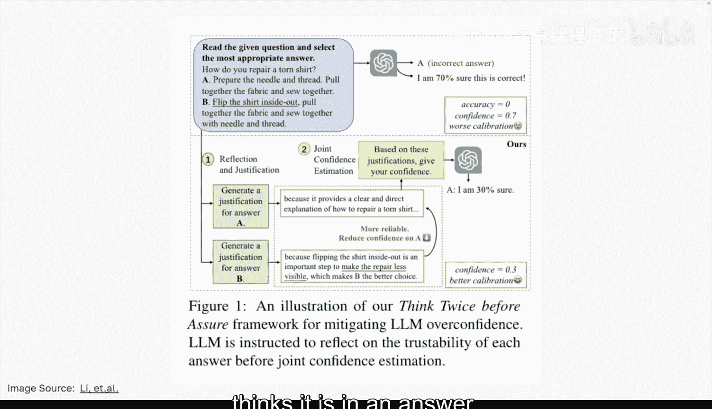

# 杜克大学《可解释人工智能｜Explainable AI (XAI)》中英字幕 p77 30_03_03_大语言模型提示工程可解释性.zh_en -BV1HnrBBmEon_p77-

Let's begin by reviewing prompting of large language models Proing involves strategically designing task specific instructions in natural language to guide model output without altering parameters。

 Promp engineering includes instruction， context and user input。

 which is used to guide the output of the pretrained large language model。

There are many different prompting methodologies， with some of them outlined in this figure from a 2024 paper from Sahuitel。

In the context of explainability， we will discuss two types of prompting in context learning and chain of thought。

In contexttex learning is when a model is shown task demonstrations as part of the prompt。

And chain of thought or COT involves prompting the model to describe its reasoning and go step by step through a problem。

When we think about explainability of in context learning， the question we are trying to answer is。

 how does in context learning influence model behavior？To answer this question。

 recent research has relied on contrastive demonstrations， perturbations of input text， flip labels。

 and using semantically unrelated labels。 Lee et all in 2023 uses the SST2 sentiment analysis benchmark as a baseline task to explain IL by investigating how IclL works in LLMs by analyzing contrastive demonstrations and saency maps。

 The authors built contrastive demonstrations by flipping labels perturbing input text and adding complementary explanations。

Here you can see prompt with label flipping in the demonstrations。

Here you can see prompt with input perturbation and prompt with complementary explanations。

Way at all 2023 explains how ICL is affected by semantic priors versus input label mappings by investigating two setups。

 ICL with flipped labels and ICL with semantically unrelated labels。

 This figure shows an overview of remapped inputs where words are remapped to other words to reduce the semantic meaningfulness of inputs。

We ask a similar question when we think about explainability of chain of thought prompting。

 how does chain of thought or Co T prompting affect the behavior of large language models To answer this question。

 recent research has explored salliency scores， perturbations and counterfactuals。

 This figure shows the structure of a typical chain of thought prompt with the question Q。

 thought T and answer A。

Woo at all in 2023 analyzed the saency scores of the input tokens here。

 saency scores indicate how influential each input token is on the model's output。

The goal is to understand whether chain of thought prompting changes saency scores compared to standard prompting。

 or why does chain of thought improve performance？22022 papers perturbed chain of thought demonstrations in few shot prompts by adding errors to determine which aspects are important for generating good explanations。

 And one of these papers from Madon et al also proposes counterfactual prompts to perturb key components of a prompt like symbols。

 patterns and texts。

Uncertainty poses a significant challenge for current large language models。

 Despite their impressive capabilities in generating humanlike text。

 large language models can exhibit overconfidence， and provide responses with a high degree of certainty。

 even when their training data is incomplete or ambiguous。 This lack of uncertainty。

 quantification can lead to potential risks such as propagating misinformation。

 or making critical decisions based on unreliable outputs。

 addressdressing this issue is crucial for building trustworthy and reliable AI systems。

 particularly in high stakes domains like health care， finance and decision making。

Consistency based uncertainty estimation， as posited by Xi Yong at all in their 2024 paper。

 involves generating multiple responses to a question and using the consistency between these responses to estimate the model's confidence。

 They do this by introducing randomness into the answer generation process。

 selfcon or adding misleading hints to the prompt， induce consistency to produce varied responses。

 The idea is that if a fine tuned LLM is more consistent across multiple responses than it has higher estimated confidence in the answer。

😊，Another paper by Dwent all looks at token level uncertainty。 Here's the main concept。

 LLMs generate text by predicting each token。 token level uncertainty methods calculate a confidence score for each predicted token based on its probability distribution。

And the overall uncertainty can be estimated based on the aggregation of token level uncertainties。

Now， you may be asking， can't we just ask an LLM to tell us how confident it is in the answer？

The answer is probably not。 While there are research frameworks being proposed。

 like the one by Lee at all in 2024 for having an L L M justify its confidence rather than the naive approach of simply asking an L M to give its confidence。

 There are a few things to consider。Current LLMs hallucinate frequently and don't know what they don't know or what is outside their training data。

 They are highly likely to just make something up。It's also difficult to map this confidence to anything real。

 While this may be an interesting approach to try to understand how confident a model thinks it is in an answer。

 it is not an explainable AI approach。

