# 杜克大学《可解释人工智能｜Explainable AI (XAI)》中英字幕 p80 33_03_02_生成对抗网络可解释性.zh_en -BV1HnrBBmEon_p80-

Yeah。

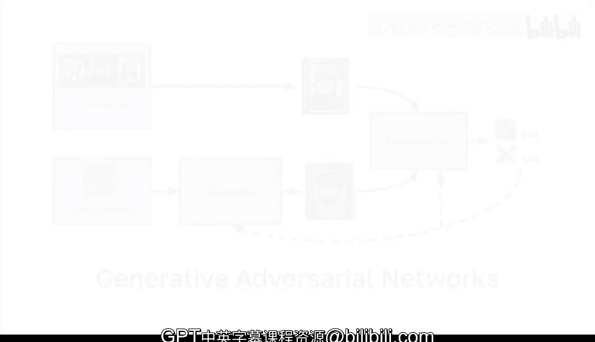

First， a quick review of GNs。 GNs are a clever use of game theory。

 essentially pitting two networks against each other。

 You have a generator model that turns random noise into synthetic images。

 and you have a training set of actual images。 both the synthetic image and an actual image from the training set are fed to a simple classification model。

 the discriminator who tries to determine which images are fake and which are real。

 The generator and the discriminator models are trained together。

 The way they are trained is zero sum。 when the discriminator is correct in its prediction。

 the generator model is penalized。 And when the generator fools a discriminator。

 the discriminator model is penalized。At a limit， the generator generates perfect replicas from the input domain every time。

 and the discriminator can tell the difference and predicts unsure 50% for real and fake in every case。

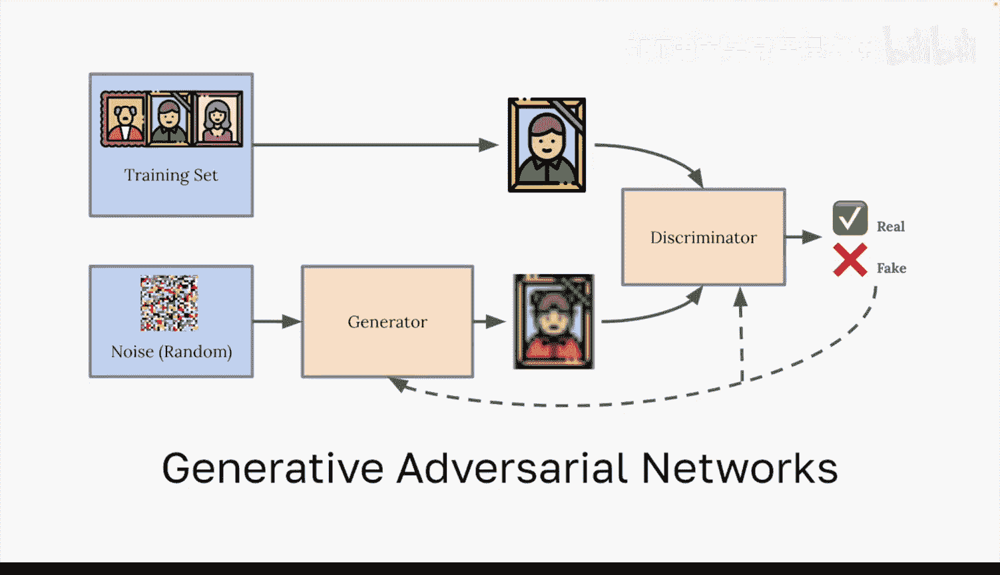

The input to the generator is a random noise fixed length vector sampled from a simple distribution like a Gaussian or a uniform distribution。

This is a source of randomness that the generator can use to produce diverse outputs。

 and it usually has significantly fewer dimensions than the desired output。

 The input noise is passed through a series of layers in the network。

 which transform the noise into data samples that resemble the training data。

 These layers can be convolutional， fully connected or combinations。

 We refer to the representations learned by the model as latent space。

 as they are intended to capture the underlying distribution of the training data。

 and our output is a synthetic data example。I like to think of the generator model flow in terms of embeddings。

 First， you start with a meaningless embedding， then the generator transforms or maps this meaningless embedding into an embedding that represents the training data。

The output is an embedding that corresponds to a realistic data sample。 Finally。

 the embedding is decoded into data samples that ideally represent real examples from the training set to fool the discriminator model。

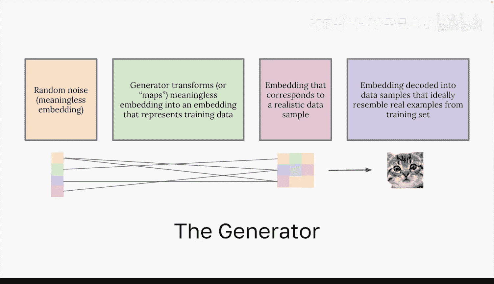

The discriminator model is simple。 It is a binary classifier trying to determine whether an input image is real or fake。

 We only use the discriminator for training， and it is usually discarded after training。

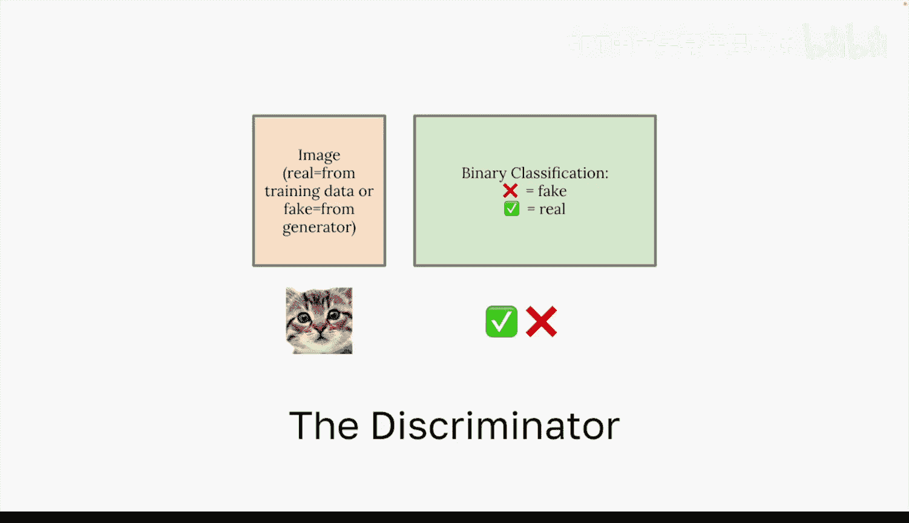

Now that we have reviewed GANs， let's talk about explainability in GANs。

One method for explainability inganNs is network dissection。

 Bow at all demonstrated the use of network dissection methods in GNs by combining network dissection with a segmentation network。

 they were able to answer a number of interesting questions。

 Does the network learn internal neurons that match meaningful concepts。

 Do these sets of neurons merely correlate with objects。

 or does the GN use those neurons to reason about objects。

And can causal neurons be manipulated to improve the output of aganN？This image should look familiar。

 If not， review the network dissection section in the explaining neural networks lecture。

 The only difference here is the addition of that segmentation component。

You can use network dissection to perform perturbations with GNs。

 neuronsons can be activated and deactivated directly。

 This allowed the study authors to identify and silence neurons that cause mistakes in image generation。

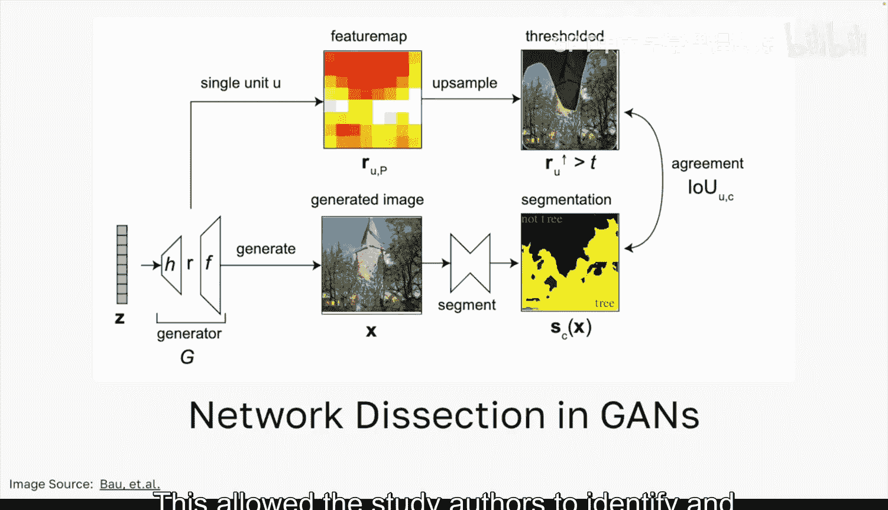

If you have watched the X AI in LLM's lecture， you will remember that we discussed latent space dimensionality reduction and visualization for explainability。

 Well， this can also be applied to image generation。

 Harconin et all applied principal component analysis or PC in G latent space and found that it gives semantically significant directions。

 What does that mean， Well， it means that perturbing inputs in these directions in certain layers ofganNs lead to explainable edits in properties of generated images。

 You can see this in the figure from the paper， which is a 2D illustration showing a principal activation direction for aganN model called bigganN。

 randomandom latent vectors are sampled and converted into activations。

 The PC direction shown here as V is computed from these samples。

 and then PC coordinates are computed Back in the latent space。

 the direction U is computed by regression from Z subj to X subj。😊。

This is a pretty cool technique because it is unsupervised so you don't need labeled data like many other explainability techniques。

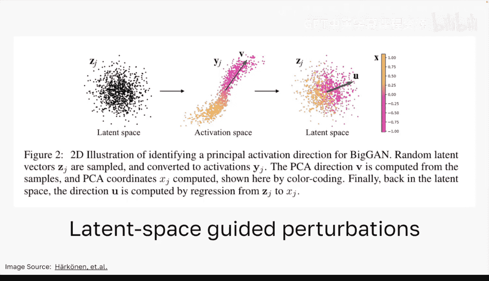

Here are some images from Harcona at all。 This figure shows sequences of image edits using control discovered with their method on three different G models。

 The initial image is on the left and various features are updated using latent space guided perturbations。

In this figure， rows 1 through2 illustrate the largest principal components in the intermediate latent space of the G model style GN 2。

 They span the major variations expected in portrait photography。

 including perceived gender and head rotation。Shanitol also performs latent space guided perturbations and GNs。

 which they apply to specifically edit these faces during image generation。

 unlike the previous method which used PCA， this paper train linear models。

 support vector machines to find the separation hyperplane subspaces in the latent space。

 corresponding to different binary attributes like age and pose。

This figure shows results of manipulating image generation through varying the latent codes of a G model。

 Each of the column shows the results of manipulating a specific attribute。

Here is the process they used。 First， train independent linear SVMs onlabeled data to classify each binary attribute in latent space。

 The normal vector of the SVM's decision hyperplane represents the direction in latent space corresponding to that attribute。

Then use the dot product between the latent code and the attribute direction。

 normal vector to measure how strongly that attribute is present。Next。

 manipulate attributes by moving the latent code along the positive or negative direction of the corresponding attributes normal vector。

 Finally， perform conditional manipulation by subtracting out projections onto other attribute directions to decouple entangled attributes。

 An illustration of this process is shown here in figure 2 which shows the conditional manipulation in subspace。

 The projection of N1 onto N2 is subtracted from N1， resulting in a new direction shown in black。😊。

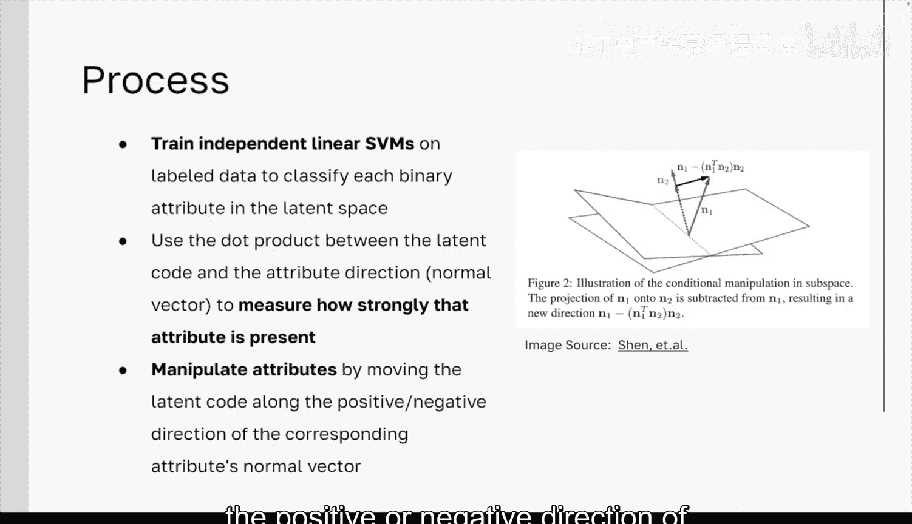

We can also integrate local explanations into the train of GNs。

 as was first demonstrated by Nagiceti in 2022。 They implemented salliency maps。

 Lime and a Sha variation called deep Shap into their GAN model itself， which they called X AI GN。

 The explanation produced by these models， were converted into an explanation matrix M。

For every feature in an example， for example， an input image。

 a value in the range of 0 to 1 is assigned to the corresponding cell of the matrix M。 If a feature。

 more precisely the corresponding cell in M is assigned value 0 or close to 0。

 then it means that pixel had no impact on the classification decision made by the discriminator D。

If a feature is assigned a value of1 or close to1， that feature is very important。

 This could be due to the feature being determinative in the classification made by D。

 or when it hurts the classification made by D， where precisely if the feature were to be changed。

 then the confidence of D in its classification would improve。

The matrix M generated by the XI system is then used in a modified gradient descent algorithm to update the weights of the generator。

 Traditionally， and again， the weights of the generator are modified by first computing the gradient of generator's output with respect to the loss and then applying the chain rule。

 The authors modify this algorithm by first computing the explanation matrix M via the X AI system and then calculating the product between M and the gradient of the generator output with respect to the loss。

 What this means is that the explanation matrix M is used to mass the gradient function。

 So the importance of the pixels that went into the discriminator's classification are taken into account in the modification of the generator's weights during gradient descent。

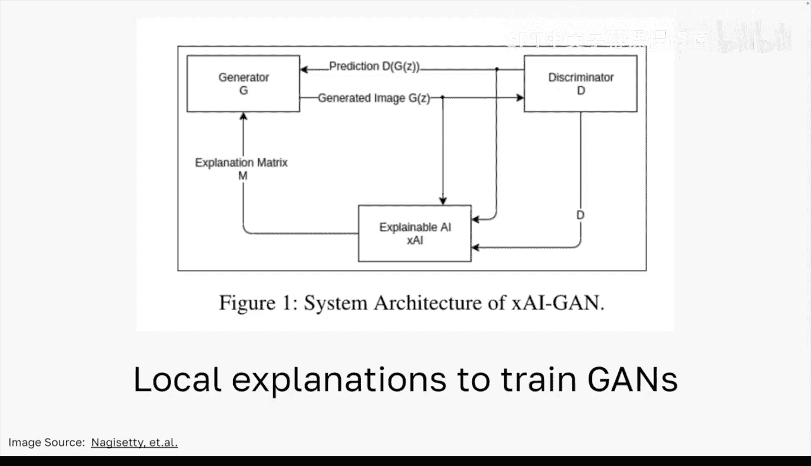

One quick side note， as we discuss X AI in image generation。

 something you may see pop up in evaluations of XAI techniques are image quality evaluation metrics。

 Most commonly the inception score and the fchet inception distance。

 The inception score is calculated by feeding the generated images through a pretrained inception model。

 a convolutional neural network used for image classification and then computing the KL divergence between the marginal class distribution of the generated images and the conditional class distribution given by the classifier。

 higher inception scores equal better image quality and diversity。

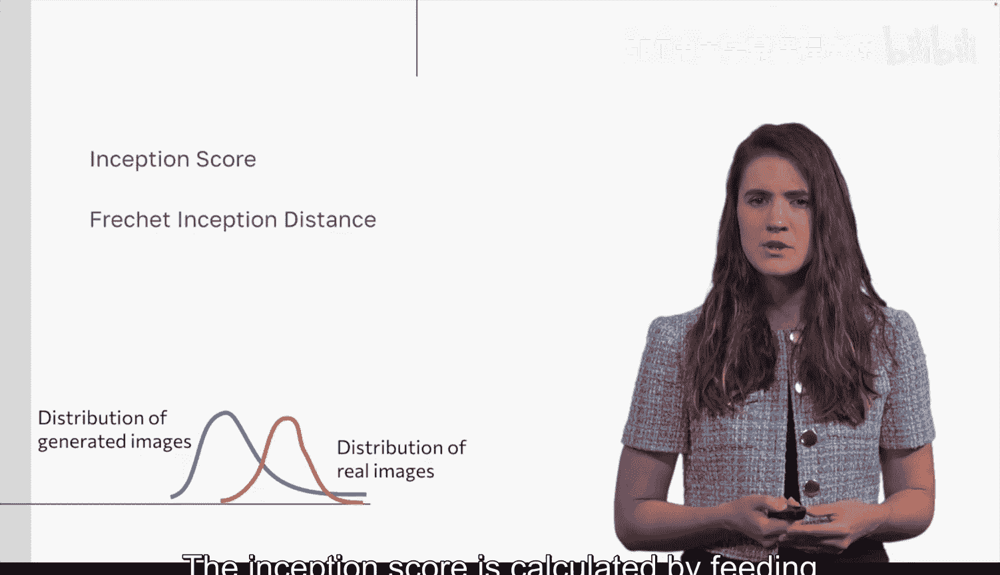

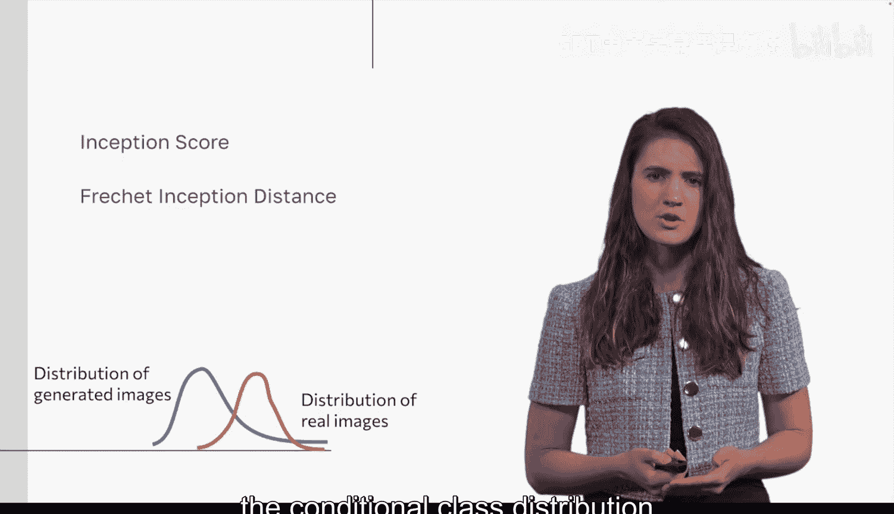

The fchet inception distance or FID measures the similarity between the distribution of real images and the distribution of generated images in feature space。

 The FID is calculated by computing the fchet distance between the feature representations typically obtained from an intermediate layer of a pretrained inception model of the real and generated images。

 Lower FiID scores equal better similarity between the distributions and higher quality generated images。

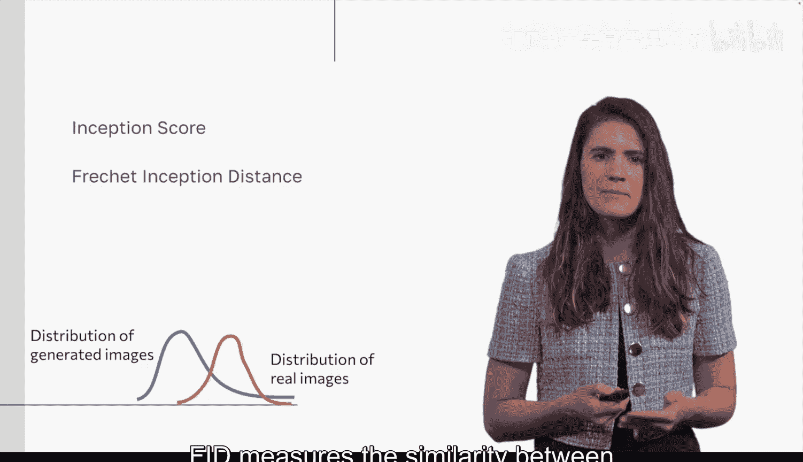

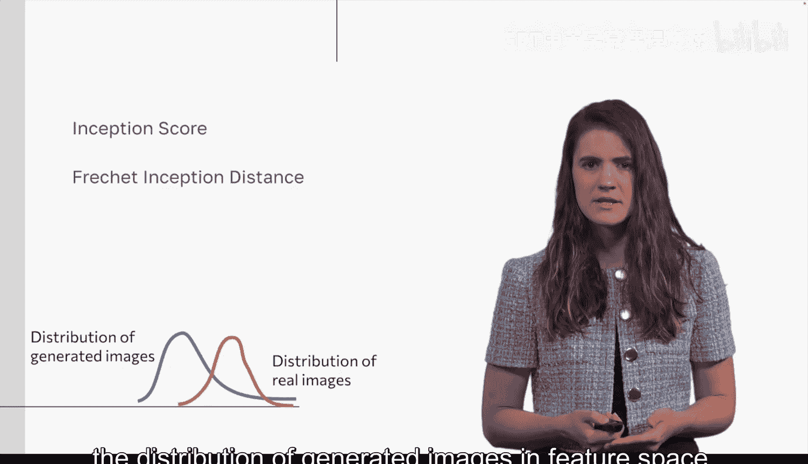

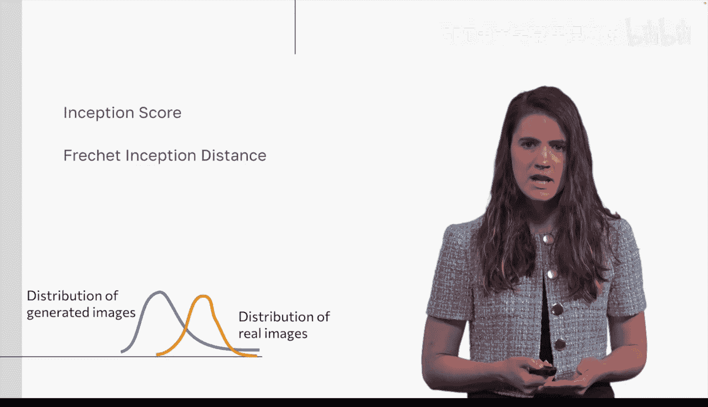

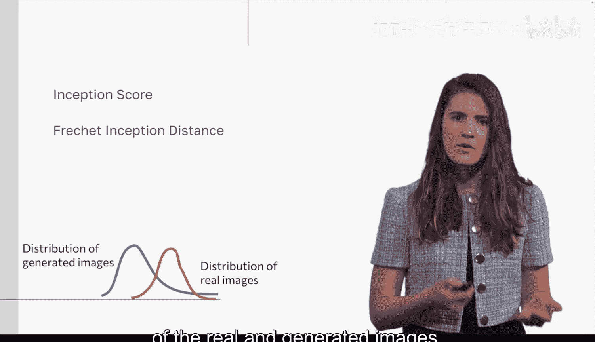

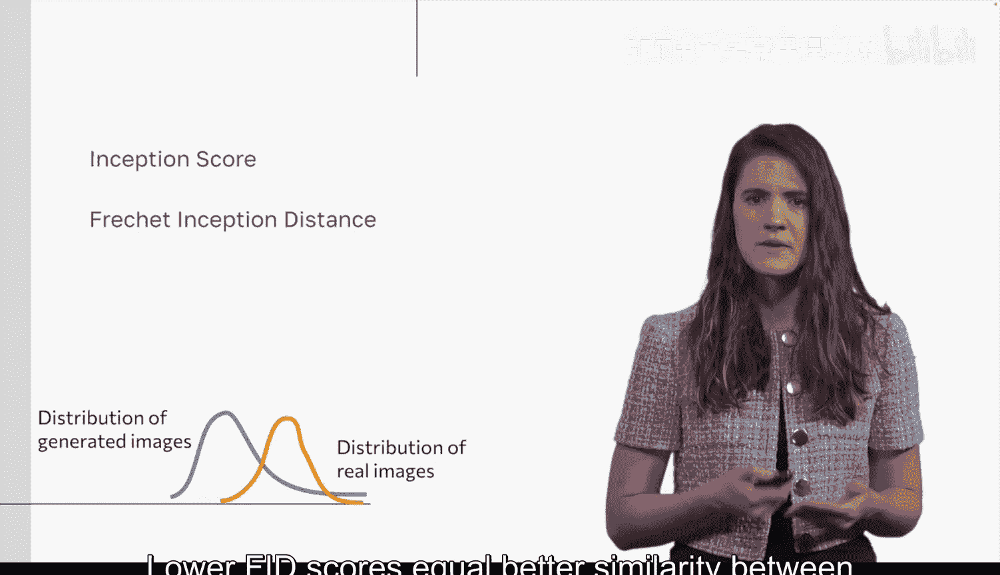