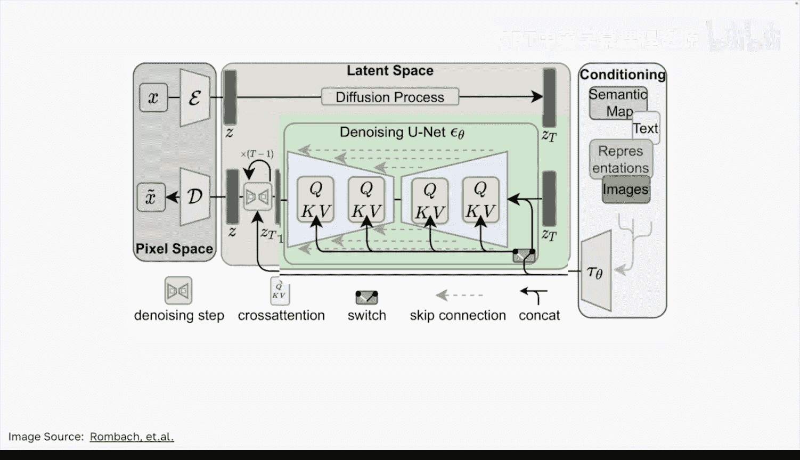
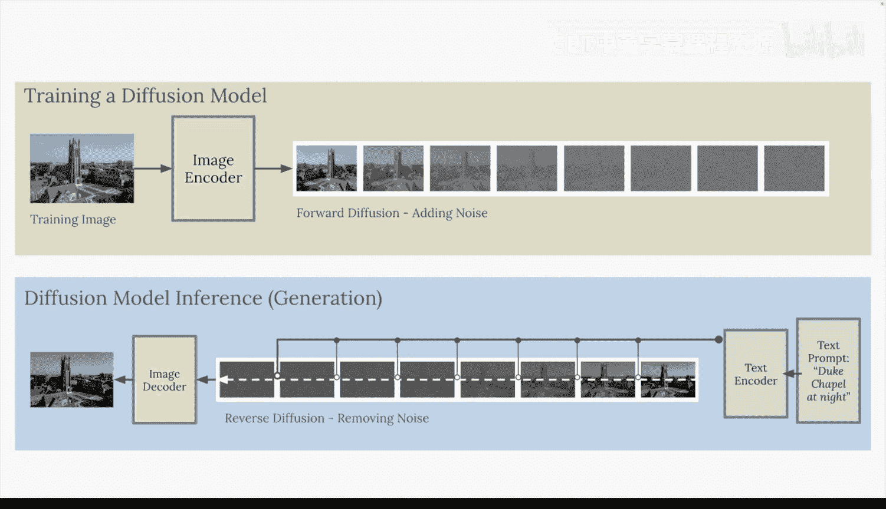
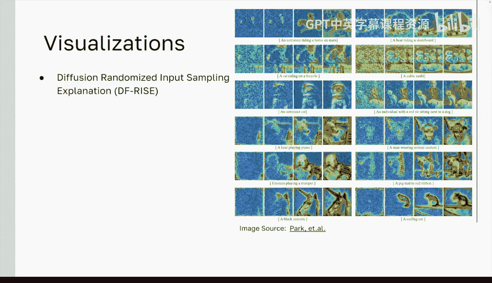
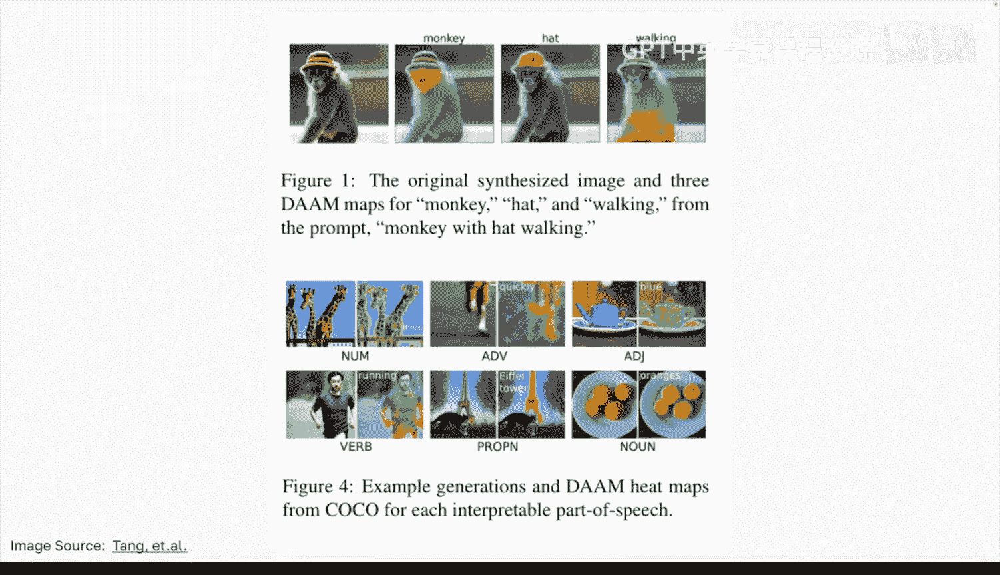
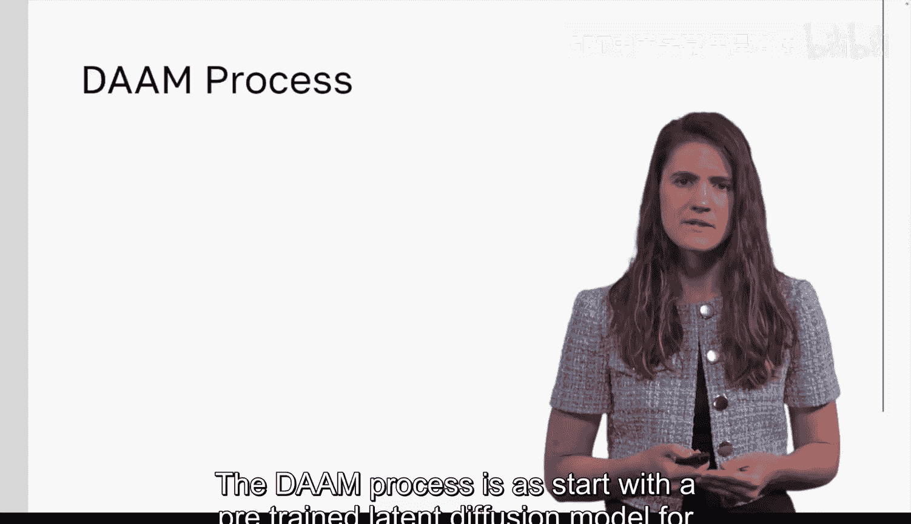
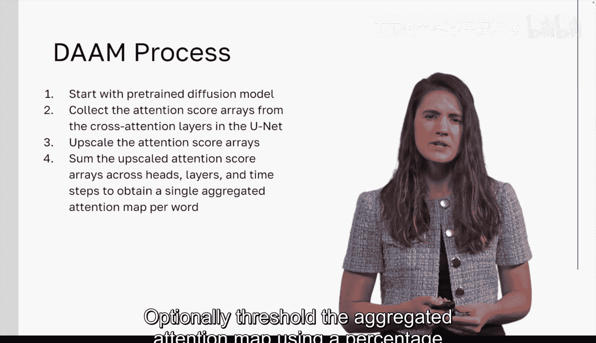
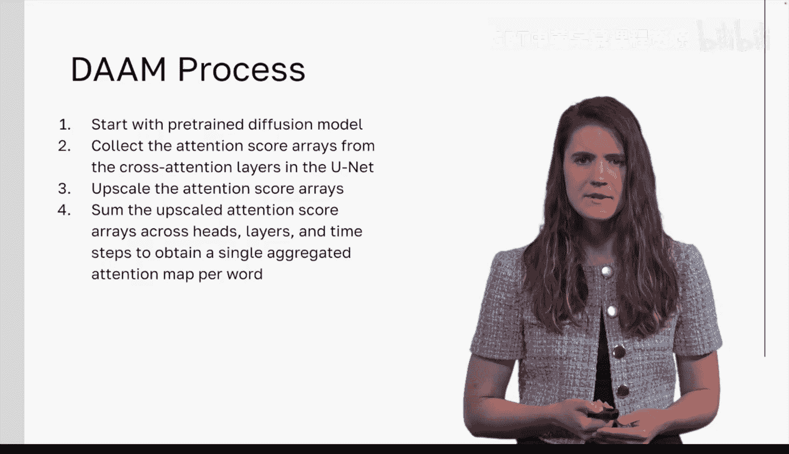
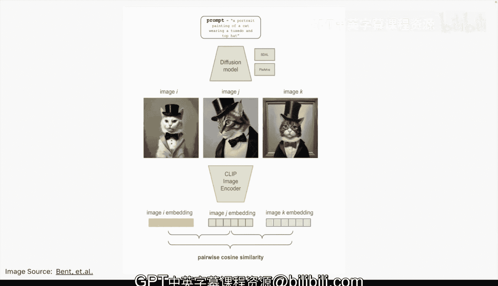

# 杜克大学《可解释人工智能｜Explainable AI (XAI)》中英字幕 p81 34_03_03_扩散模型可解释性.zh_en -BV1HnrBBmEon_p81-

Diffusion models are a class of generative models that have shown remarkable success in image generation tasks。

 They work by gradually adding noise to an initial image and then learning to reverse this diffusion process to generate high quality diverse images from random noise。

 The key idea behind diffusion models is to define a Markov chain that starts with a data distribution like images and gradually adds noise until the final state is pure Gaussian noise。

 During the reverse process。 The model learns to generate samples from the data distribution by removing the noise step by step。

 diiffffusion models are generally more stable to train compared to GNs。

 which can suffer from mode collapse and other training instaabbilities。

 The release of open source diffusion models like stable diffusion has democratized access to powerful image generation capabilities。

 enabling a wide range of applications in areas like art design and media creation。

 The figure shown here is from the seminal paper and latent diffusion models。😊。

The model behind stable diffusion。Let's review a few components of diffusion models。

 starting with this component， this is a variational autoencoder。

 it converts images to and from latent space。 you can think of this model as a translator。

 it is pre-trained on a large data set of images， the training process involves trying to encode to latent space and accurately recreate the training image。

Next， let's look at the conditioning element encoder。

 It encodes the user prompt into latent space in text to image generation。

 This is a text encoder in image to image generation， This is an image encoder。

 The user prompt is used to inform each step of the denoising unit guiding the unit to give a certain output。

This component is the denoising unit。 It guides the reverse diffusion process。 similar to GNs。

 you start with a random latent image。 The unit predicts how much noise there is。

 noiseise is subtracted from the last random latent image， and user input guides the unit。

 It repeats this process n times。

The training process of a diffusion model involves two steps， forward diffusion In this step。

 the model learns to gradually add noise to the original data distribution。

 creating a series of perturbed data distributions this is shown here。

And a reverse diffusion process。 The model is trained to reverse the forward diffusion process。

 starting from pure noise and gradually removing the noise to reconstruct the original data distribution During the generation process。

 The model starts with random noise and iteratively dennoises it。

 producing a high quality image at the end of the reverse diffusion process。

 the user text prompt is passed through a text encoder and used to guide this process through the unit。

Now that we have reviewed diffusion models， we will discuss a few emerging research trends and explainability in diffusion model image generation。

 starting with counterfactual explanations demonstrated by Gart et all。

 here is a figure from the paper which shows counterfactual explanations in diffusion models。

Park et all proposes methods for visualizing diffusion model image generation。

 These methods include DFIs or diffusion， randomized input sampling explanation。

 This method visualizes the denoising regions that the diffusion model focuses on at each step by generating saliency maps using randomized input masking and a structural similarity function tailored for generative models。

And Dfcam diffusion gradient weighted class activation mapping。

 This method visualizes the internal workings of the diffusion model by highlighting the specific visual concepts the model attends to at each denoisising step using gradient weighted activation maps。

And exponential time step sampling， this method adjusts the time step sampling strategy during the reverse diffusion process to concentrate on specific stages。

 early， middle or late， allowing analysis of the visual concepts emphasized at different time stages。

And relevant score the paper employs a relevant score between the generated image and the input text pro to quantify and analyze the visual concepts manifested at different time stepss and stages。

Here you can see a figure from PA et all， where they compare their methods。

 DFRs and DFcam with limeme。 While lime depends on the segmentation region shown here。

 DFRise visualizes the decision process unaffected by external factors。

Tang at all introduced Dam in 2022， a method for cross attention pixel attribution visualization。

 They produce pixel level attribution maps by upscaling and aggregating cross attention。

 word pixel scores in the denoising sub network。 The key idea is to repurpose the existing cross attention from the diffusion model as a means to attribute which words influence which image regions。

 Ex figures from the paper are shown here In the left figure。

 dam maps for monkey hat and walking are shown overlaid on the original generated image。

 The figure on the right shows dam heat maps for different parts of speech。

 like adjective verb and now。😊。

The dam process is as follows， start with a pretrain latent diffusion model for text to image synthesis like stable diffusion 2。

0， identify the cross attention layers in the U and noisy network that attend text embeddings to spatial image representations。

Collect the attention score arrays from these cross attention layers across different scales。

 down sampling and up sampling blocks of the unit。Upscale the attention score raised the original image size using bicubic interpolation。

Some， the upscale attention score raiseds across heads。

 layers and time steps to obtain a single aggregated attention map per word。

 The aggregated attention map associates words with image regions。

 where higher values indicate stronger attribution。Optionally。

 threshold the aggregated attention map using a percentage of the maximum value to generate a binary segmentation mask。

When applying diffusion models to image generation， there is variability in the generated output。

 This variability is a result of stochastic elements that are inherent to the process of diffusion。

 including random initialization of the diffusion process。

 sampling from probability distributions and nonlinear activations。

While variability is inherent to diffusion models， there are differences in the level of variability across different models due to differences in model architecture。

 train procedures， including approximations， and techniques used to control or guide the generation process。

 When applying these models to real world problems。

 the challenge lies in reconciling the desire for diversity and creativity and generated outputs with the need for consistency and coherence relative to the input prompt。

Quantifying the consistency or repeatability of generated outputs would allow for the quantification of this variability and would enable decisions to be made on this reconciliation between creativity and consistency when deciding on a diffusion model for a particular application or task。

This quantification can provide an assessment of model stability and consistency。

 detectect unintended bias， validate interpretations of model outputs and enhance user understanding。

 In this paper， I proposed a semantic approach to quantifying consistency in diffusion model image generation。

 This approach uses a multimodal embedding model clip to generate embedding of images generated n times and takes a pairwise cosine similarity over the end generated image embeddings。

 While not currently used frequently in explainability。

 Multimodal embedding models are a very interesting tool that could be used for explainability。

 We have to be cautious about inherent biases in these multimodal models and similar to all explainability metrics have to be thoughtful about the limitations of the approach。

😊。

