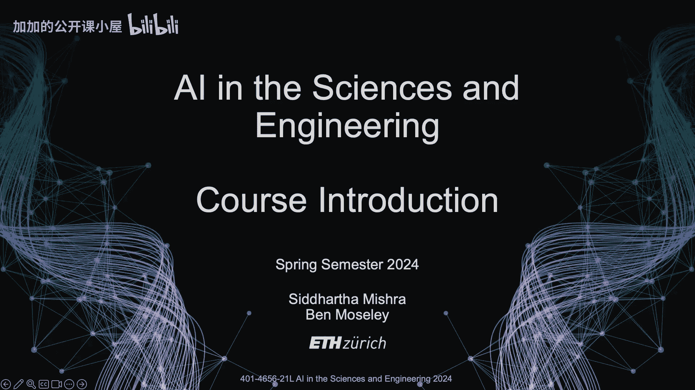
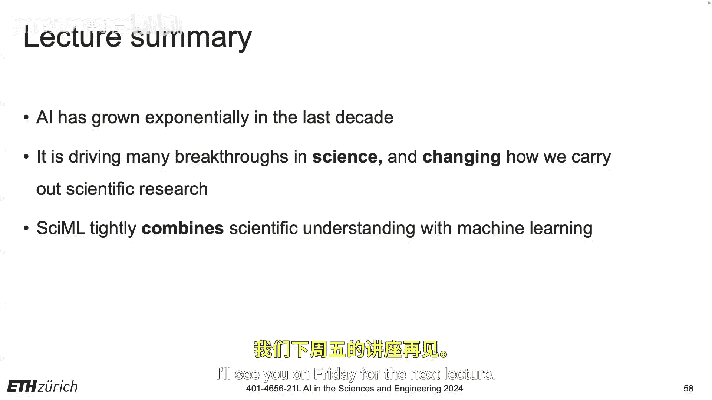

# 001：课程介绍 🧠

在本节课中，我们将一起了解“科学与工程中的人工智能”这门课程的整体概览。我们将探讨人工智能在当今科学领域产生的巨大影响，理解其背后的驱动力，并初步认识将科学理解与机器学习相结合的新兴领域——科学机器学习。

---

大家好，欢迎来到“科学与工程中的人工智能”系列讲座的第一讲。我的名字是 Ben Mosley，我将与 Sid Mira 共同教授这门课程。Sid 将在下周五开始讲授他的部分。现在，我将直接开始，为大家介绍这门课程的高层次动机，然后详细讲解课程内容、评估方式和具体安排。

人工智能正在对当今科学产生巨大影响，并推动着许多突破。尤其是在过去一年左右，这些突破开始引起公众的广泛关注。

以下是人工智能在科学领域产生影响的几个例子。

*   **天气预报与气候模拟**：英伟达的“FourCastNet”模型、谷歌的“GraphCast”等模型能够训练出准确模拟气候和天气模式的人工智能模型。其精度可与传统数值模拟相媲美，在某些情况下甚至开始超越传统方法。这些模型不仅性能优异，而且比传统数值模型快数个数量级。
*   **核聚变控制**：一项与瑞士 EPFL 的合作研究使用神经网络，特别是通过强化学习训练，来控制真实的核聚变反应堆。训练后的神经网络不仅能改变等离子体的形状，还能使其在更长时间内保持稳定。
*   **蛋白质结构预测**：谷歌 DeepMind 的 AlphaFold 模型能够根据氨基酸序列准确预测蛋白质的三维结构。这项过去需要在实验室耗费数月甚至数年时间的任务，现在可以在计算机上几秒钟内完成预测，并在药物发现等领域催生了许多下游应用。

那么，为什么人工智能今天能以如此大的方式影响科学？原因在于人工智能本身在过去十年左右经历了爆炸式发展。

如今世界上存在一些非常强大的人工智能技术。你们大多数人现在肯定都熟悉 ChatGPT，这个模型在过去一年左右席卷了全球。更广泛地说，大型语言模型能够与你进行完整对话，并执行总结文档甚至创建完全自主的数字代理等任务。

图像生成领域也取得了令人印象深刻的突破。我们现在可以输入一个文本提示（例如，“一张宇航员骑马的图片”），并从中生成高度逼真的图像。就在上周，OpenAI 发布了 Sora，这是一个从文本生成极其逼真视频的工具。

此外，人工智能领域当前的一个趋势是不仅仅用 AI 执行非常狭窄的任务，而是使其变得更加通用，成为通才代理。例如，Gato 模型不仅能进行图像分类，还能捕捉图像、玩 Atari 游戏，并使用同一个模型与你对话。

我们今天使用人工智能来帮助编码，GitHub Copilot 非常擅长补全代码并为你建议整个代码块。人工智能是自动驾驶汽车背后的基础技术，我们现在也能非常有效地使用人工智能进行翻译，可以在数百种不同语言之间无缝翻译。

如果你查看这些图表，还可以看到人工智能研究出版物的数量一直在快速增长，资金投入也几乎呈指数级增长。最近另一个有趣的趋势是，关于人工智能的法律数量也在增加，我们开始真正思考人工智能背后的伦理问题。

那么，为什么人工智能本身会爆炸式发展？我认为，过去十年或更长时间里，人工智能的大部分进展（约90%）是由深度学习驱动的。

深度学习就是训练深度神经网络。在继续之前，我想解释一下什么是深度学习，以确保我们理解一致。

深度学习关注的是训练深度神经网络。为了简单明了（我认为这对本课程来说也是一种非常有用的描述方式），我将一个深度神经网络简单地描述为一个数学函数：

`y = f(x; θ)`

其中，函数接收一个向量输入 `x`，并给出一个向量输出 `y`。非常重要的一点是，这个函数有一些自由参数，我们称之为权重 `θ`，这些参数是可调的。我们调整这些参数，使得神经网络的输出与训练数据集中某些期望的输出相匹配。

训练基本上包括拥有网络输入和输出的许多示例，还需要一个损失函数来比较网络的输出与模型的输出，以及一个能够基于该损失调整权重的优化算法。

这就是神经网络或深度神经网络的简单描述。接下来的问题是，那个函数 `f(x; θ)` 到底是什么？那个函数取决于你使用的特定神经网络架构。虽然有很多不同的选择，但几乎每个神经网络架构都可以用这种简单的方式来描述。

最后一个问题是，什么使它“深”？通常，我们将深度神经网络定义为具有两层或更多层的任何神经网络函数。

那么，为什么深度学习最近才真正爆发？总的来说，它如此流行有三大原因。

以下是主要原因：

*   **数据量指数级增长**：世界上某些衡量标准下的数据量呈指数级增长，这使我们能够训练越来越深、越来越复杂的模型。
*   **计算能力增长**：计算能力也大致呈指数级增长。或许不是在 CPU 能力方面，但随着 GPU 的出现（事实证明 GPU 对于训练深度神经网络非常出色），我们在计算规模上确实看到了扩展。
*   **成熟的深度学习框架**：现在有许多更成熟的深度学习框架，允许我们用几行代码训练神经网络。例如 PyTorch、Keras、TensorFlow 和 JAX 等平台。

除此之外，神经网络训练算法及其架构方面也有许多创新，这是一个非常有趣的研究领域。

我向大家展示了一些人工智能当今真正影响科学的例子。在这里，我试图思考一些人工智能能够真正帮助我们解决的科学重大挑战。科学中存在许多重大问题，如果我们能解决它们，将对世界和人类大有裨益。

以下是四个不同类型的重大挑战，我将解释我认为人工智能如何帮助解决它们。

*   **海量实验数据**：当今一些实验产生的数据量巨大。例如，欧洲核子研究中心每月记录数千 PB 的数据。人类不可能手动处理这些数据并从中找出我们寻找的特定粒子相互作用。人工智能可以真正帮助自动化我们的发现过程和数据处理。
*   **数据稀缺与噪声**：另一方面，我们进行的某些实验数据非常少，且数据噪声很大。例如系外行星发现。目前最流行的发现方法是凌星法，即观测行星直接从恒星前方经过，导致我们接收到的恒星通量出现非常微小的下降。问题是这种通量变化非常小，可能不到百分之一，并且产生的测量数据噪声非常大。人工智能可以真正帮助我们从噪声中提取信号。
*   **计算昂贵的模拟**：许多不同领域的模拟算法通常计算成本非常高。例如，模拟流过飞机机翼的气流，这种多尺度、高保真度的模拟可能需要数百万核心小时和数百万美元来运行。任何能使用人工智能/机器学习加速这些模拟的方法都可能对我们的模拟产生巨大影响。
*   **日益复杂的系统**：今天我们进行的许多科学实验或研究的科学系统，随着我们对它们了解得越来越多，正变得越来越复杂。一个很好的例子是 COVID 病毒及其随时间的演变。这实际上是一个超级复杂的问题，本质上是在模拟全球范围内的传播。我们这里有很多数据，人工智能可能能够帮助我们发现那些我们自己难以发现的数据模式。

与其我告诉你们为什么深度学习对科学很重要，我想不如直接问问人工智能本身。我询问了 ChatGPT“在科学中使用深度学习的好处是什么”，ChatGPT 给出了一个非常精彩的回答，基本上总结了我刚才告诉你们的内容。

人工智能可以帮助提高我们科学算法的准确性，也可以帮助我们从科学数据中自动化发现，通过检测我们以前无法看到的模式来增强我们的理解，并且可以提高效率，帮助加速我们一些计算成本高昂的工作流程。

我还有几张幻灯片展示人工智能在科学中的应用，以进一步说服你们这是一项真正具有影响力的技术。

我展示的是跨越许多不同领域的众多应用，我不会详细讲解，但会给你们一个快速总结。

*   **医学影像**：人工智能帮助我们拍摄眼睛的图像或扫描，分割这些图像，并能够检测眼睛中的问题或疾病。
*   **天体物理**：人工智能能够获取引力透镜星系的图像，消除透镜效应，并重建没有透镜效应的星系图像，实际上非常准确。
*   **粒子物理**：人工智能还能够筛选粒子对撞机的数据，并检测该数据中的事件。
*   **神经科学**：人工智能可以获取我们神经活动的记录，仅从该神经活动中解码我们所说的语音，帮助我们理解大脑及其工作原理。

以下是另外四个例子。

*   **月球探测**：这是我们做的一些工作，使用人工智能窥视月球上永久阴影区域。这些是火山口和其他永久被黑暗覆盖的地形凹陷。图像非常暗且噪声很大，因此我们训练人工智能去除这些图像中的噪声，首次使我们能够看到这些区域内的陨石坑和巨石等物体。
*   **抗体设计**：这是一个人工智能实际发现一种针对大肠杆菌（一种细菌）的新抗体的例子。它通过使用消息传递神经网络来实现，该网络经过大量示例训练，可以预测可能导致耐药性的各种分子特性。当它测试新的分子设计时，能够提出这种新抗体。
*   **解决几何问题**：人工智能可以解决奥林匹克级别的几何问题，这就是 AlphaGeometry。这非常有趣，因为它结合了大型语言模型和符号推理引擎来执行该任务。
*   **科学工作流程编码**：人工智能还可以帮助我们编写科学工作流程的代码，这是 ChatGPT 在编写代码求解二维扩散方程方面做得非常好的一个例子。

我已经大力宣扬了深度学习、人工智能及其在科学中的潜力，现在我想稍微回归现实，告诉你们深度学习也存在一些挑战。认识到这些挑战非常重要，特别是如果我们要将人工智能应用于科学工作流程。

深度学习存在一些众所周知的重大挑战。

我将介绍其中四个。

*   **模型规模庞大**：如今我们训练的模型规模非常庞大。例如，早期版本的 ChatGPT 有 1750 亿个参数，训练该模型还需要海量数据，本质上需要爬取整个互联网来寻找训练数据。有一张图表显示了一些已发布的主要机器学习模型的参数量趋势，你可以看到趋势是急剧上升的，我们正在迈向万亿参数模型。因此，即使只是将这些模型存储在计算机内存中并对它们进行推理也可能是一个挑战。
*   **偏见问题**：人工智能，或者说深度网络，也存在偏见问题。深度神经网络的一个特性是，如果你的训练数据中存在偏见，这种偏见也会出现在模型的输出中。不幸的是，我们训练深度神经网络的许多数据都包含偏见，例如在进行人脸识别时，性能在不同人群之间存在差异。因此，确保我们训练的人工智能是公平和合乎伦理的，是一个非常重要的考虑因素。
*   **缺乏可解释性**：与此相关的是深度神经网络缺乏可解释性。这根本上是因为神经网络在处理输入时使用分布式表示，这使得解释它们在做什么或让它们证明其行为变得非常困难。例如，如果你训练一个神经网络来驾驶汽车，你肯定希望解释它基于输入和上下文为什么向左转或向右转。
*   **网络架构设计**：最后一个挑战是实际设计神经网络本身。对于给定的任务，通常并不明显什么才是正确的神经网络架构（即我展示的那个神经网络函数）。我认为，过去十年人工智能的许多进展或研究，就是尝试了许多不同的架构。例如，在图像识别（计算机视觉中的经典任务）中，我们从全连接网络发展到卷积网络，再到 ResNets，再到 Transformer，我们仍在摸索使用哪种架构最好。

我还有两个挑战，我认为这两个挑战对于在科学中使用人工智能尤其突出。

*   **泛化挑战**：这是深度神经网络的一个特性。当给它们一个在其训练分布内或接近其训练数据的输入时，它们通常表现非常好。但一旦你给它们一个在其训练分布之外的输入，它们的性能通常会迅速下降。这是我亲自做的一个测试：我拿了一个在 ImageNet 上预训练的 ResNet（包含数千张不同的自然图像）。如果我让它对一张狗的图像进行分类（这是一张在其训练分布内的图像），它不仅能准确识别出是狗，还能告诉我们具体的品种。但一旦我给它一张在其训练分布之外的图像（比如某种太空狗），它就开始真正挣扎，无法直接标记它。
*   **推理挑战**：与此相关，或许是一个更广泛的问题是深度神经网络的推理挑战。它们通常难以在输出中表现出常识性推理。这是使用 DALL-E 3（一个最先进的图像生成模型）进行图像生成的例子。我要求它生成“一条绝对没有路灯的街道”。它没有生成我所要求的，反而给了我一条有很多路灯的街道，完全相反。你可以看到，模型在处理陈述背后的逻辑否定时遇到了困难。因此，将更多常识性推理融入神经网络是一个突出的挑战，绝对是当前一个非常热门的研究课题。

我展示了这些挑战，但我是通过传统人工智能任务的视角来讨论的。真正重要的是要理解，当我们将人工智能应用于科学时，这些局限性也会出现在我们使用人工智能的科学工作流程中。

这是我们做的更多工作，我向你们展示我们在哪里发现了这些局限性之一。

我们在这里训练了一个神经网络来进行模拟，特别是模拟地震在地球中的传播。你不需要知道确切的工作流程，但在很高的层次上，我们这里有一个神经网络，它接收地球结构作为输入，特别是地球的速度（这取决于地球的地质情况）。然后它产生一个输出，基本上是沿地球表面的地震响应，即无论你在地球表面何处，地震的强度。我们发现，当我们用许多非常简单的速度模型（只有水平分层和单个褶皱）训练这个神经网络时，如果我们在一个接近其训练数据的速度模型（类似的水平分层速度模型，带有单个褶皱）上测试该神经网络，它能够非常准确地预测地震波场。但一旦我给它一个在其训练分布之外的输入（例如，一个带有曲线或额外褶皱的速度模型），网络的预测就开始真正受到影响，性能会差很多。这就是泛化问题在科学工作流程中的体现。

当我们试图说“好吧，我们将用人工智能取代我们现有的科学工作流程”时，这种问题让许多科学家感到不安，因为我们知道深度学习存在这些缺陷，例如缺乏可解释性，有时难以泛化，并且我们还需要大量训练数据来训练这些算法。这与理解传统科学方式的科学家们的理念不太相符，传统科学方式严重依赖于理论和实验之间的相互作用。

传统的科学方式是提出一个非常可解释的理论，提出一些假设来检验该理论，进行实验，要么验证理论，要么告诉我们需要改进该理论。这是我们通常遵循的迭代改进循环。关于那个理论的一个非常重要的点是，一个好的理论应该是可解释的，并能做出新颖的预测，而这正是深度神经网络难以做到的。

因此，在过去五年左右的时间里，使用人工智能进行科学研究发生了真正的变化。我们现在开始看到“科学机器学习”这个领域出现。科学机器学习的核心论点不是仅仅用机器学习取代我们的科学工作流程，而是将我们现有的科学理解（我们拥有数百年的科学理解可以借鉴）与我们的机器学习工作紧密结合起来。

我们称这些模型为科学机器学习模型。我们希望它们比仅仅用人工智能取代我们现有的工作流程更强大、更稳健、更可解释。

已经提出并正在研究大量的科学机器学习技术，这是一个当前非常热门的领域。你们可能已经听说过其中一些技术，例如物理信息神经网络、可微分物理、神经算子、神经微分方程等。在本课程中，我们将详细涵盖许多这些技术，你们会看到更多相关内容。

这是一个快速发展的领域。在过去两三年里，所有主要的机器学习会议上都举办了关于将机器学习与科学理解相结合的科学机器学习研讨会。

我还做了一个关键词搜索，查看包含这些科学机器学习关键词的出版物数量，例如“物理信息神经网络”、“科学机器学习”、“算子学习”、“可微分物理”等。所有这些关键词在过去一年中收到的出版物数量都呈指数级增长，现在我们真的开始看到这个领域的真正兴起。

刚才我给了你们这门课程非常高层次的动机，并希望已经说服你们，人工智能确实正在对当今的科学产生影响，并且它可能是我们在科学中可以使用的一种变革性工具。

那么，这门课程的总体目标是什么？我们为你们设定了四个大的学习目标。

到课程结束时，我们希望你们能够：

*   **更了解人工智能在科学与工程中的高级应用**。
*   **更熟悉这些算法背后的具体设计、实现和理论**。
*   **对何时可以使用人工智能以及何时或许不应该使用人工智能来增强科学工作流程有更现实的认识**。
*   **不仅理解人工智能技术，还理解如何将科学理解与之紧密结合，从而领会这些关键的科学机器学习概念和最佳实践**。

这是课程时间表，这张幻灯片上有很多内容，我将为你们讲解。

我们每周有两节课，一节在周三（也就是今天的讲座），另一节在周五，它们都在同一个教室（ML H 44）。除了讲座，我们还有辅导课，这些将由我们的助教负责，包含实践练习（通常是编码练习），以补充我们在讲座中涵盖的所有内容。

我现在不会详细讲解每节课的具体内容，我将在讲座后面再谈课程概述。但为了给你们一个非常高层次的描述，Sid 和我将首先快速回顾深度学习，因为本课程的先决条件是理解机器学习的基础知识，例如优化和监督学习。这将是一个相当快速的回顾，但希望能让每个人都在同一起跑线上。

然后，我们将讨论不同类型的核心科学机器学习技术。我们将首先讨论物理信息神经网络，然后讨论算子学习领域。接着，我们将介绍几种在科学中使用的特定架构或最先进的架构，例如大型语言模型、图神经网络、扩散模型。然后，我们将讨论可微分物理。最后，我们有两场客座讲座，讲师将谈论化学和生物学中的机器学习。

我应该说的另一件事是，这个时间表可能会根据我们讲解材料的速度而改变，我们也在积极添加新材料。这门课程的很多材料都是在过去一两年内研究的，因此我们也在积极调整这门课程。

还有一些关于课程的实用信息。所有材料都将在我们的课程 Google 页面上提供，包括讲座录音和辅导练习。我们还运行 Zoom 会议，以便你们也可以在线参加。

你们可能最感兴趣的是我们如何评估这门课程。需要注意的是，这门课程没有任何考试。我们所有的评估都是通过三个独立的作业来完成的。

这些是要求你们完成的个人作业，每四周提交一次。我们将在 3 月 8 日发布第一个作业，然后在四周后（4 月 5 日）提交。这些作业将与我们讲座和辅导课中涵盖的内容相关。关于每个作业的具体要求和交付内容，将在我们发布作业时给出详细说明。你们也可以与我们的助教交流，他们将帮助我们批改这些作业。

我们这门课程的助教是 Bogdan 和 Victor，他们非常乐意帮助你们。你们也可以通过 Google 联系我们。

我已经讲了很长时间了，所以我们先休息一下，大约五分钟后回来。

那么，这节课的其余部分将如何安排？我刚才给你们讲的是课程动机和概述。现在，我们将用这节课剩余的时间来讨论一些关键的科学任务，这些任务在科学中以非常普遍的方式存在。

然后，我还将尝试向你们解释人工智能或机器学习如何帮助解决这些科学任务。我将在相当抽象的层面上进行讨论，跨越许多不同学科。但事实证明，有许多不同的科学任务是通用的，或者说是跨学科的常见任务。这些任务包括模拟问题、反问题、控制或数据同化问题、方程发现和异常检测。我将一般性地讨论这些任务。

在讲座的最后，我将更多地概述科学机器学习，并告诉你们如何更紧密地将科学理解整合到机器学习中。同时，尝试激发一些我们将在后续课程中更详细研究的关键科学工具和技术。

那么，我们这节课的学习目标是什么？我们有三个目标。

到课程结束时，你们应该能够：

*   **理解为什么人工智能在科学中如此有用及其产生的影响**。
*   **理解我们尝试使用机器学习解决的典型科学任务类型**。
*   **理解科学机器学习领域存在的原因，以及为什么将科学理解与机器学习相结合是一个好主意**。

现在，让我们来讨论一些跨许多不同科学领域都非常常见的关键科学任务。

在讨论科学任务之前，我应该先谈谈微分方程，或者实际上是偏微分方程。这些是科学背后的基石，它们以一种非常优雅的方式决定或描述了我们周围的世界。

从最小的尺度，例如使用薛定谔方程描述原子如何随时间演化，到非常大的尺度，思考黑洞及其动力学（这是爱因斯坦场方程）。它们还帮助我们理解地球，例如我在讲座第一张幻灯片中展示的气候模拟例子，其背后的基本方程是纳维-斯托克斯方程。我们还知道微分方程可以帮助我们理解生物学，特别是反应-扩散方程帮助我们理解动物皮肤生长时图案是如何形成的。

因此，偏微分方程是基础性的。在本课程中，我们将相当重视解决与偏微分方程相关的问题，正是出于这个原因。

现在，让我们开始讨论这些关键的科学任务。

正如我在谈论讲座概述时所说，在讲解过程中，我会给你们具体的科学任务例子，但我真的鼓励你们在更高的抽象层次上思考，也许在你们自己的科学领域，是否有任何类似的任务是你们感兴趣的，或者你们认为在特定领域中难以解决的。

第一个任务是模拟。我将尝试在非常高的层次上描述它。为此，我要说我们有一个物理系统，并且在该物理系统中有一些输入条件，我将其描述为 `A`。我们还有该系统的物理模型，这通常是一些微分方程组。然后，给定这些输入条件和物理模型，模拟的任务是预测给定这些输入条件的结果属性 `B`。

这显然是对模拟的非常高层次的描述，根据实际任务的不同，底层物理模型在数学上可能复杂得多。

这是一个模拟的例子，是模拟地震通过地球结构的例子。广义上的模拟对于许多不同的科学任务至关重要，对于理解不同的科学现象和预测它们的行为非常重要。模拟通常被用作许多其他科学任务的起点。例如，我们可能想看看这里的地震响应如何根据地震发生的位置在地球表面变化，并且我们可能想基于该模拟进行某种建模或灾害预测。

我在这里运行模拟所依据的底层方程是声波方程，这是一个非常著名和熟悉的方程。

为了更明确地使用我刚才描述的框架来阐述，我们在这里预测 `B`，在这个例子中，`B`（模拟结果）是波场，即该微分方程的解，本质上是地震波的压力，作为空间和时间的函数。模拟的输入是速度模型（这是我们对地球结构的模型）以及地震的位置。给定这些输入条件，我们想要预测地震波场。这里的 `F` 是我们的微分方程（波动方程），但除了知道方程，我们通常还需要一些方法来求解方程，例如，求解波动方程时，一个非常常见的方法是使用有限元求解器。

那么，我们如何解决模拟问题？传统上，我们使用数值方法。大多数偏微分方程，尤其是具有现实输入条件的，无法解析求解，我们必须求助于数值技术。这本身就是一个庞大的领域，已经研究了几十年或更长时间。

我们有许多不同的数值求解微分方程的方法，流行的技术包括有限差分求解器、有限元求解器、谱方法、主成分分解方法等，有很多技术可供选择。

那么，我们今天面临的模拟挑战是什么？我在讲座开始时已经告诉你们，通常模拟的最大挑战是运行这些数值方法（有限元、有限差分求解器）所需的计算成本。

这是 NASA 的一个视频，模拟火箭的排气。这是一个超级复杂的模拟，是一个多物理场、多相模拟。仅仅运行这几秒钟的模拟，就在他们的模拟中使用了 5 亿个网格单元，并在数千个核心上运行了数周，因此运行一次模拟就花费了数百万美元。这限制性很强。我们真正想做的是运行这个模拟数千次，改变火箭的设计，以帮助我们优化系统并制造出高效的火箭，但这在实际中是不可能的，我们只是受到计算的限制。如果我们能用机器学习加速这个过程，可能会彻底改变我们设计这些系统的方式。

还有其他一些重大挑战。像有限元方法这样的方法，我们需要花费大量时间仅为模拟设计一个合适的网格，这可能需要耗费大量人力，可能需要数周时间。除此之外，我们许多成熟的模拟代码（例如非常流行的流体动力学代码 OpenFOAM）有数百万行代码，如果你刚进入这个领域，可能很难在其基础上构建或理解。

现在，我们将转向下一类问题，这类问题是反问题。

那么，在非常高的层次上，什么是反问题？我们有同样的方程，但现在我们关注的不再是预测系统的输出，而是实际上想要预测或推断系统的输入条件，给定系统的一些观测结果。也就是说，给定一些观测 `B` 和对物理模型的理解，是什么输入条件产生了这些观测？

让我们思考一下将那个地震模拟任务框架化为一个反问题。那么，反问题将是：假设我们有检波器测量地球表面的压力响应，给定波场的观测数据，我们能否找出地震发生的位置，甚至可能找出地球的底层结构（速度模型）？

这些问题跨越许多不同的科学领域。这里有几个反问题的例子：地震成像、MRI 成像是另一个反问题的例子。图像去噪（从图像中去除噪声）可以被认为是一个反问题，或者估计感染率、设计问题等等。

那么，我们如何解决反问题？从根本上说，我们可以将反问题框架化为一个搜索问题：给定 `B` 的值，尝试寻找或搜索能给出该 `B` 值的 `A` 值。通常，将其框架化为一个优化问题特别有用。在优化问题中，我们定义一些目标函数或损失函数，我们试图最小化它。

一个常见的损失函数可能只是给定某个猜测输入条件 `A` 的预测值与真实观测值 `B` 之间的 L2 范数。然后，如果这个损失函数是可微的（例如），我们可以评估这个损失相对于 `A` 的梯度（顺便说一下，这也要求你的求解器 `F` 也是可微的，即你的有限差分/有限元求解器是可微的）。然后，我们可以使用梯度下降等方法来优化和求解 `A`。如果我们无法获得梯度，也可以使用许多其他无梯度方法，例如进化算法、贝叶斯优化，在某些情况下，暴力搜索也可能有效。

让我明确地向你们展示使用梯度下降解决反问题的过程。正如我之前所说，我们在顶部有这个目标函数或损失函数。我们所做的是从左上角的模型开始，进行正演模拟以预测 `B` 的值，得到一些合成数据。我们评估那个损失函数，它决定了该模型的好坏。然后，我们使用梯度下降更新该模型。通过这个迭代循环，我们最终得到对模型是什么的最终猜测。

顺便说一下，这实际上与我们训练深度神经网络所使用的算法完全相同，这实际上很有趣。我们将在课程后面更详细地探讨反问题和训练深度神经网络之间的联系。我们用来训练深度神经网络的许多技巧也可以用来帮助我们解决反问题，反之亦然。

具体对于我描述的那个地震反问题，我们的观测数据将是我之前展示的波场。我们将从对速度模型的某个猜测开始，通常我们只是从一个非常平滑的地球速度近似值开始。我们运行这个训练循环，最终希望得到一个接近真实地球模型的模型。

这实际上是一个真实的梯度下降算法在这个波场数据上运行。我们正在进行这个循环，更新梯度，这就是猜测的速度模型随着我们更新梯度而变化的过程。

在地球物理学中，这实际上被称为全波形反演，这是反问题的名称。你可以看到这里发生了一些相当有趣的事情。首先，它确实对真实速度模型有了一个相当好的猜测，并且基于该猜测速度模型的估计波场也是如此。但有趣的是，它没有更新波场尚未传播到的区域之外的模型。这是有道理的，因为波场尚未传播到的区域没有信息，因此你无法了解那里的速度。另一个有趣的事情是，它很好地捕捉到了右侧的大部分褶皱，但在左侧却表现不佳，并且在估计的速度中产生了一些非常奇怪的异常。

因此，这是反问题的一个挑战。在许多情况下，在许多现实世界的情况下，我们拥有的观测数据并不足以让我们唯一地确定反问题的解。而且，即使你有足够的信息，损失函数仍然可能非常复杂，并且有许多局部极小值，即使你有足够的信息，你可能仍然无法收敛，这可能就是这里发生的情况，我们有很多信息，但损失函数可能非常复杂。

实际上，反问题存在很多挑战，在实践中它们极其难以解决。最大的原因就是我提到的“不适定性”，即观测数据中通常没有足够的信息来唯一地确定解是什么。另一个导致不适定性的问题是观测可能很稀疏，也可能噪声很大，这再次使它们更难解决。最后一点是，当我们运行例如那个梯度下降循环进行优化时，我们必须评估那个正演求解器数千次才能进行反演。我已经告诉过你们，模拟（进行数值模拟）可能非常昂贵，而我们必须运行数千次，因此反问题在许多情况下甚至比模拟更昂贵。

这绝对是一个非常困难的事情。这是左侧反问题的另一个例子，是计算机断层扫描（CT），基本上就是进行 X 光检查。那么，在这种情况下，反问题是什么？我们有一个 X 射线源（实心小点），有一些介质，该射线源将穿过该介质。该介质对 X 射线有一些吸收，这种吸收是空间的函数，因此你身体的不同部位以不同的量吸收 X 射线，你可以将其解释为一张图像，让你看到身体内部。然后，我们沿着许多位置记录这些 X 射线。

你可以看到，如果我们只有一条线，根据我们记录的线数（X 射线穿过的介质数量），这实际上决定了反问题的不适定性。如果我们有很多线，那么我们可以得到一张非常好的图像。但如果我们只有很少的线，那么重建该图像就变得非常困难。你可以看到，我们实际接收到的数据（这些强度）实际上看起来一点也不像之前的信号。我们必须在那个信号上进行反演，这是一个特定的反演后投影算法的例子，它正在做这件事，显然没有得到确切的答案，它是对真实解的一个非常嘈杂的估计。

与反问题相关的是控制和数据同化问题，可以将它们视为不同类别的反问题。

什么是控制问题？控制问题是：给定一个微分方程组，我们能否向这些微分方程中添加一些作用力来控制该系统或系统的状态？一个经典的控制问题是倒立摆。你可以想象一个小车上的摆，任务是移动小车，使得摆最终像这样倒立，这是一个非常不稳定的平衡点。底层的运动方程在这里，我不会详细描述它们，但我们试图做的是改变这里的力，使得最终状态（摆角）趋向于零。

我们可以将其框架化为一个反问题，其中 `A` 是我们施加给小车的力，`F` 是运动方程及其求解方式，`B` 是摆角作为时间的函数趋向于零的条件。

另一类问题是数据同化问题。例如，这是一个任务，我们对摆本身有噪声测量，我们可能想推断摆的起始位置，或者可能是其位置随时间变化的路径。同样，我们可以说这里的 `A` 是我们想要理解的东西，即摆的起始位置。`B` 可能是对 `x` 和 `θ` 的测量。然后 `F` 再次是我们拥有的模型，可能还有一个叠加在其上的噪声模型（如果测量有噪声的话）。

最后一类反问题是设计问题。这就是我在谈论设计太空火箭时提到的问题。我们想要做的是，我们有一个物理系统，我们想要优化该系统的设计，以最大化该系统的某些指标。另一个例子是设计翼型的形状，以最大化翼型的升力。我们可以调整的参数可能是翼型的形状和机翼的迎角。这同样可以被认为是一种反问题。

现在，我们将转向最后一类科学任务，这实际上是理解 `F` 本身。这就是我所说的方程发现或模型发现。我们可能对系统的初始条件有一些观测，也可能对其输出（即它的行为方式）有一些观测，我们可能不完全理解底层的微分方程或模型是什么。这实际上是许多不同科学领域的实际情况，例如实验流体动力学正试图更好地理解流体的底层方程。

那么，我们如何做呢？传统上，它依赖于非凡的人类直觉（我不得不在这里放一张爱因斯坦的照片，因为我们在 ETH）。能够提出一个好的理论，就是我之前描述的在设计理论、进行实验、验证理论之间相互作用的过程，这主要是由人类完成的迭代循环。

从计算的角度，或者在我一直描述的这种框架背景下，你可以将其视为某种反问题，我们再次被给予一些观测数据，我们想要理解系统的某种底层描述。但在这里，我们实际上试图预测模型本身。一个好的模型的标志是：它应该是可解释的，应该是可泛化的，并且应该做出我们可以通过实验验证的新颖预测。

也许模型发现的一个更具体或特定的例子是异常检测。所以这不是发现整个模型，而是进行发现过程的一小部分，即检测数据中的异常，这可能导致你更新或发现一种新的物理现象。例如，异常检测的一个例子是检测系外行星，正如我讨论过的凌星法。但这具有挑战性，原因有几个。我已经解释过，数据中的噪声使得人类很难检测到原子和数据中的异常。如果异常来自我们目前不理解的物理现象（即它们是分布外的或来自无法解释的物理现象），那么检测异常也可能非常困难。而且，异常通常就像大海捞针，非常罕见。例如，想想粒子对撞机中我们正在寻找的特定粒子。

在接下来的部分，我有几个关于深度学习如何帮助完成这些任务的例子。我有一个深度学习改进模拟的例子，一个深度学习改进反问题的例子，然后是一个深度学习帮助我们发现系统底层方程的例子。

在较高层次上，深度学习如何帮助？正如我们之前所见，ChatGPT 为我们总结得很好：它可以帮助我们提高这些技术的准确性，可以提高效率，实现我们科学工作流程的自动化和发现。

这是一个在科学中使用机器学习的例子，也是我已经向你们展示过的使用深度神经网络进行气候模拟或天气模拟的例子。这就是 FourCastNet，我在右侧展示了这个动画。

那么，FourCastNet 到底是什么？FourCastNet 是一个称为傅里叶神经算子的深度神经网络。它只是一种神经网络架构，基于卷积网络。但有趣的是，它在傅里叶域中进行卷积。我们知道，在频域中的卷积本质上就是乘法。傅里叶神经算子与标准卷积网络的不同之处在于，当它进行傅里叶变换时，实际上会裁剪掉一些频率，即它本质上丢弃了输入数据中的一些高频成分。然后，它将其乘以进行卷积的权重矩阵，然后再进行逆变换回来。

这很有趣，关于傅里叶神经算子和算子学习背后的动机有很多可说的，我们将在课程中更多地讨论。但现在，你可以将其视为一种智能的神经网络架构，它只是偏好输入中的低频成分。因此，它有一个先验，认为我们应该更好地模拟低频趋势。事实证明，这个模型在进行天气模拟方面非常出色，最重要的是，它比使用传统数值技术求解纳维-斯托克斯方程或完整的气候模型快四到五个数量级。

现在，让我们谈谈如何使用深度学习来解决反问题？我向你们展示了那个经典的用于解决反问题的梯度下降算法，它经常被使用。

那么，我们如何将机器学习融入这个算法，以尝试提高其性能？有很多不同的方法可以使用机器学习来解决反问题，这只是其中一种特定方式。在课程中，我们将涵盖许多不同的方法。但一种特定的方式是使用神经网络来实际改进梯度的估计，或者你想在梯度下降循环的每次迭代中采取的步骤。

我们知道，当我们在损失函数中估计梯度时，特别是如果反问题是不适定的，那个梯度将会非常嘈杂，并且不会带我们走向解决反问题的正确方向。损失函数的景观将非常复杂，梯度方向可能不是最佳步骤。

这个想法是训练一个神经网络，但让它接受那个梯度并更新它，以便采取更好的步骤。我们如何学习那个神经网络？我们如何学习采取更好的步骤？我们将这个算法写下来，实际上使用自动微分对整个算法进行微分，以训练网络的权重。我们用来训练网络的损失函数是匹配许多示例反问题的最终算法最终模型。

当我们谈论课程后半部分的可微分物理时，我会更多地讨论这个问题。但事实证明，如果你这样做，如果你训练一个神经网络来改进梯度步骤，我们可以开始获得反演算法更好的性能。它开始消除由问题的不适定性带来的一些噪声。

最后要讨论的任务是方程发现。那么，机器学习如何帮助我们发现系统的底层方程？同样，这现在正成为一个完整的领域，这只是众多不同技术中的一个例子。

这个方法非常简单。你可以想象，我们这里有一些物理系统的观测数据。我们还不理解底层的微分方程是什么，我们只知道我们对某个变量 `u`（方程的解）以及它如何随时间演化有一些观测，这些是我们的噪声测量。

那么，我们如何发现这个 `u` 所遵循的底层微分方程？这非常简单。首先，我们拟合一个神经网络到这个数据。我们这里有一个神经网络函数 `NN(x, t)`，它直接尝试拟合这个数据，所以它只是对该数据的曲线拟合。下一步是计算那个训练好的神经网络的各种梯度。那个神经网络函数只是一个数学函数，我们可以从该函数获得解析梯度，例如网络输出相对于其输入的导数：`∂u/∂t` 和 `∂u/∂x`。

我们所做的是，我们在许多不同的随机 `(x, t)` 位置计算这些梯度的整个库，就像查询整个函数一样。然后，为了在给定这些梯度的情况下发现底层方程，我们只是对这些梯度进行稀疏线性回归。我们假设，例如，`∂u/∂t` 是所有这些不同梯度的线性组合。这就是我们对系统所做的假设，然后我们将尝试学习基函数的每个系数，以实际发现底层方程。

我不会说这是物理模型的全面发现，它本质上只是线性回归。但这是开始理解或开始发现方程的一种方式。

这是几年前发表在《自然通讯》上的一篇论文。它做得非常好，能够发现这个底层方程，这是流体问题中的 Burgers 方程。

刚才我所做的是，在高层次上告诉你们我们在科学中感兴趣解决的一般科学任务，并让你们初步了解了机器学习如何帮助我们解决这些任务。

现在，我将用讲座的最后一部分来谈谈科学机器学习这个领域，我已经说过，这是一种将我们现有的科学理解与机器学习紧密结合的方式，以产生更强大、更稳健、更可解释的模型。

我将给你们更多关于这个领域的概述。我已经描述过这一点，所以我们知道，当深度学习只是简单地应用于科学工作流程时，存在所有这些问题：缺乏可解释性、泛化能力差、需要大量训练数据。这就是科学机器学习正在做的事情：我们试图将我们的科学理解融入这些算法中。

那么，我们实际上如何做到这一点？人们研究和提出了哪些不同的方法来实际将理解与神经网络（特别是）融合？我喜欢将它们分为非常广泛的类别。

我们将在整个课程中解释这些不同的类别以及每个类别中不同技术的例子。但在非常高的层次上，有三种方法可以将科学理解融入神经网络。

*   **通过损失函数**：这是你用来训练神经网络的损失函数。与其仅仅训练网络来重现大量科学数据，你实际上可以将物理约束放入该损失函数中。例如，你可以告诉神经网络它必须守恒质量或能量，或者必须遵守底层的微分方程。这是提高这些模型性能并允许它们依赖更少数据的一种非常强大的方法。关于这一点有很多可说的，物理信息神经网络就是一个具体的例子，它们在过去的五年左右变得非常流行。我们将有三到四节课专门讲物理信息神经网络。
*   **改变神经网络架构**：下一类广泛的方法是改变神经网络本身的架构，使其在架构中编码科学先验知识。这是一种硬约束，而改变损失函数中的约束更像是一种软约束。例如，我们可以在神经网络中有特定的层，这些层编码我们在非常深层次上已知的对称性。它们也可以编码能量守恒、旋转不变性等。有很多非常有趣的技巧可以提高我们训练的循环模型的性能。
*   **混合方法**：最后一类方法，可能是最广泛的方法，是我称之为混合方法的方法。因此，不是用神经网络（即使它有一些聪明的约束）取代我们传统的科学算法或工作流程，在这种混合方法中，我们实际上尝试将神经网络紧密地结合在传统算法内部。例如，我描述的那个反问题，当我们将神经网络放入该算法的一小部分时。这些方法可能非常强大，也非常可解释。同样，我们将有两到三节课描述这个领域的技术，例如神经微分方程、可微分物理等，这些都可以归类为混合方法。

实际上，我说过科学机器学习是一个快速发展的领域，存在大量的技术，其中一些我们将详细涵盖。

这实际上是我在论文中制作的一个图表，这已经过时了（我在2022年做的），但我认为看到这个图表并以这种方式思考仍然有用。我所做的是，在顶部的表格中，我分解了我们试图执行的这三个不同的科学任务（模拟、反演