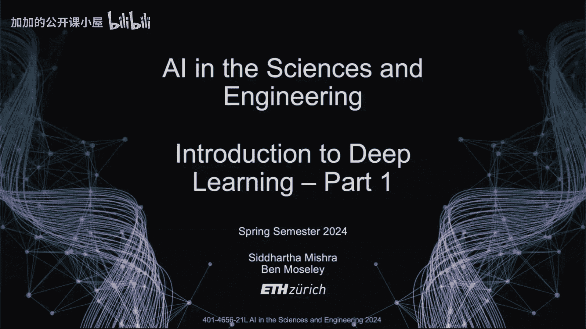
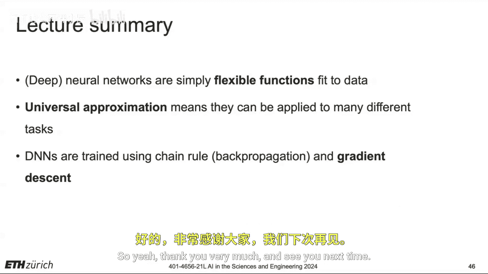

# 002：深度学习导论（第一部分） 🧠

在本节课中，我们将要学习深度学习的基础知识。我们将从宏观上理解什么是深度学习，介绍最基本的多层感知机（MLP）架构，探讨神经网络的通用近似定理，并了解深度学习用于解决的主要任务类型。最后，我们将学习如何使用梯度下降和反向传播来训练深度神经网络。

---

## 课程回顾

上一节课我们介绍了本课程的宏观动机。我们探讨了人工智能如何对科学领域产生巨大影响并推动突破，例如用于快速准确的气候模拟与天气预测、帮助控制核聚变反应，以及预测蛋白质的3D结构。

我们还讨论了科学研究中常见的核心任务，以及人工智能如何帮助我们解决这些任务，例如使模拟更高效、解决逆问题以及发现未知物理方程。

此外，我们引入了“科学机器学习”这一前沿领域，其核心思想是将我们已有的科学知识与机器学习紧密结合，以构建更强大、更稳健、更可解释的模型。

---

## 什么是深度学习？

在深入探讨之前，让我们将深度学习置于更广阔的人工智能领域中。人工智能、机器学习和深度学习这些术语有时定义模糊。对于本课程，我们可以这样理解：人工智能旨在训练智能体模仿人类行为；机器学习是人工智能的一个子领域，专注于学习世界的规则；而深度学习则是机器学习的一个特定分支，专门使用深度神经网络来学习这些模式或规则。

**核心观点**：神经网络本质上就是**拟合数据的灵活函数**。

这意味着什么？简单来说，神经网络接收一个输入向量 **X**，通过一个由网络架构定义的数学函数进行处理。这个函数包含一些可调参数 **θ**。网络最终产生一个输出向量 **Y**。训练过程就是通过调整参数 **θ**，使网络的输出尽可能匹配训练数据。

一个简单的例子是曲线拟合：给定一组带噪声的数据点，神经网络可以学习一个函数来拟合这些数据。

---

## 从线性回归到神经网络

假设我们想用多项式拟合数据。经典的方法是线性（多项式）回归：
1.  假设数据模型：**Ŷ = θ₀ + θ₁x + θ₂x² + ...**
2.  通过最小化预测值 **Ŷ** 与真实观测值 **Y** 之间的最小二乘误差来估计参数 **θ**。
3.  对于线性模型，存在解析解。

神经网络回归的思想非常相似：
1.  我们有一个神经网络函数 **f(x; θ)**。
2.  同样使用最小二乘目标函数，最小化网络输出与训练数据之间的差异。
3.  关键区别在于，神经网络函数 **f** 通常是非线性的且没有解析解。因此，我们使用**梯度下降**等优化方法来学习参数 **θ**，即计算损失函数对网络权重 **θ** 的导数，并沿梯度方向更新参数。

---

## 多层感知机

最基本、最经典的神经网络架构之一是**多层感知机**。一个两层的MLP可以用以下公式定义：

**a⁽¹⁾ = σ(W⁽¹⁾ x + b⁽¹⁾)**
**ŷ = W⁽²⁾ a⁽¹⁾ + b⁽²⁾**

其中：
*   **x** 是输入向量。
*   **W⁽¹⁾, b⁽¹⁾** 和 **W⁽²⁾, b⁽²⁾** 是可学习的权重矩阵和偏置向量。
*   **σ** 是激活函数（如ReLU）。
*   **a⁽¹⁾** 是隐藏层的激活值。
*   **ŷ** 是网络输出。

更多层的MLP就是这些层函数的简单堆叠（复合）。

**为什么选择这种结构？**
MLP的设计灵感来源于生物学中的神经元。单个神经元接收来自前一层神经元的输入，进行加权求和，加上偏置，然后通过一个非线性激活函数产生输出。这简化地模拟了生物神经元的工作方式。将许多这样的神经元分层连接，就构成了神经网络。

**激活函数的作用**
激活函数（如ReLU、tanh）引入了非线性。如果没有激活函数，多层线性变换的复合仍然是一个线性变换，网络将无法学习复杂的非线性关系。正是激活函数使得神经网络能够拟合高度复杂的函数。

---

## 通用近似定理

既然简单的多项式回归也能做曲线拟合，为什么还要使用神经网络？

答案在于神经网络的**通用近似定理**。该定理指出，只要拥有足够的参数（足够宽或足够深），一个神经网络可以以任意精度近似任何复杂度的连续函数。这使得神经网络异常强大，能够应用于图像分类、语音识别等极其复杂的任务，而这些是简单的线性模型无法胜任的。

---

## 卷积神经网络

上一节我们介绍了通用的MLP，本节我们来看看一种为特定数据类型设计的架构：卷积神经网络。

考虑图像分类任务。如果将一张128x128的图像展平为向量输入MLP，并且第一隐藏层有100个神经元，那么第一层的权重矩阵将包含超过160万个参数。这参数量巨大，容易导致过拟合。

**CNN有何不同？**
CNN专为处理网格状数据（如图像）设计。其核心思想是：
1.  **局部连接**：每个神经元只与输入图像的一小块局部区域（如3x3的像素块）连接，而非整个图像。
2.  **参数共享**：所有神经元使用相同的权重集（即卷积核或滤波器）在其对应的局部区域上进行操作。

这极大地减少了参数量。数学上，卷积操作可以表示为一种特殊的加权求和（交叉相关）。

**CNN的优势**
1.  **参数效率高**：显著减少了模型参数量。
2.  **平移等变性**：图像中某个特征（如狗耳朵）无论出现在何处，都会产生相似的激活响应。这使得CNN对物体位置变化具有鲁棒性。
3.  **层次化特征学习**：浅层CNN学习简单特征（如边缘、纹理），深层CNN则组合这些简单特征来识别更复杂的模式（如物体部件、整个物体）。网络的**深度**对于学习这些层次化表征至关重要。

通过将“函数是简单函数的复合”这一先验知识（归纳偏置）编码到网络架构中，CNN能更高效、更有效地处理图像类数据。

---

## 深度学习的主要任务

神经网络作为拟合数据的函数，可以应用于多种任务。以下是几种主要类型：

**1. 监督学习**
监督学习任务中，我们拥有输入数据 **X** 和对应的标签或目标输出 **Y**。
*   **回归**：目标是拟合一个连续函数。常用均方误差作为损失函数。从概率视角看，可以理解为假设数据服从以网络输出为均值的高斯分布，然后进行最大似然估计。
*   **分类**：目标是预测离散的类别标签。输出通常表示为每个类别的概率。常用交叉熵损失函数。为确保输出是有效的概率分布，通常在网络最后一层使用Softmax激活函数。

**2. 无监督学习**
无监督学习任务中，我们只有数据 **X**，没有明确的标签。
*   **特征学习/自编码器**：目标是学习数据的压缩、有意义的表示。网络先将输入编码为低维潜在向量，再解码重建输入。通过最小化重建误差，网络被迫学习数据的关键特征。
*   **自回归模型**：目标是基于序列中过去的数据预测未来的数据。例如，预测股票价格或生成文本（如大型语言模型）。循环神经网络是处理此类任务的经典架构之一。
*   **生成模型**：目标是学习训练数据的分布，以便从中采样生成新的、相似的数据样本。生成对抗网络是著名的生成模型之一。

---

## 训练神经网络：梯度下降与反向传播

几乎所有神经网络训练都涉及最小化一个损失函数，而通常没有解析解。因此，我们使用**梯度下降**。

关键问题：如何高效计算损失函数 **L** 对海量网络参数 **θ** 的梯度 **∇L**？

答案是**反向传播算法**，它本质上是链式法则在计算图上的高效应用。
1.  **前向传播**：计算网络输出，并保存所有中间层的激活值。
2.  **反向传播**：从输出层开始，逆向计算损失对每一层参数的梯度。利用链式法则，这些梯度可以表示为已知梯度与局部雅可比矩阵的乘积。

现代深度学习框架（如PyTorch、TensorFlow）的核心——**自动微分**——正是实现了反向传播算法。我们只需定义网络的前向计算过程，框架会自动计算梯度，从而让我们能够轻松地使用梯度下降来优化网络。

---

## 总结

本节课我们一起学习了深度学习的基础知识。
*   我们建立了核心概念：**神经网络是拟合数据的灵活函数**。
*   我们介绍了**多层感知机**的基本数学形式及其生物灵感来源。
*   我们探讨了神经网络的**通用近似定理**，这是其强大能力的理论基石。
*   我们了解了为图像数据设计的**卷积神经网络**及其优势（局部连接、参数共享、层次化特征学习）。
*   我们概述了深度学习解决的几类主要任务：**监督学习**（回归、分类）、**无监督学习**（特征学习、自回归、生成模型）。
*   最后，我们学习了训练神经网络的核心方法：**梯度下降**与**反向传播**。

理解这些基础概念，是后续探索更复杂架构（如下一讲将涉及的大型语言模型）及其在科学中应用的基石。