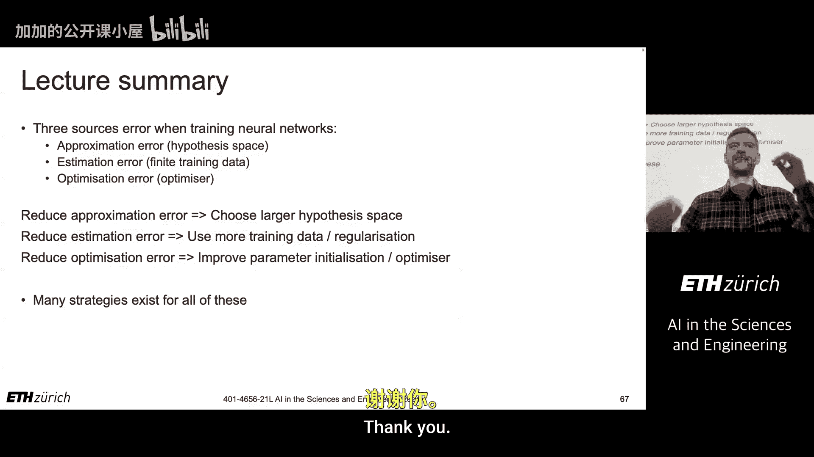

# 003：深度学习导论（第二部分）

在本节课中，我们将继续深入学习神经网络。我们将探讨训练深度神经网络时遇到的困难，特别是过拟合与欠拟合问题，并学习如何通过正则化来缓解这些问题。我们还将深入研究优化算法，了解它们如何影响网络性能。最后，我们将以ChatGPT为例，了解其背后的神经网络架构和训练原理。

## 回顾与引言

上一节我们介绍了神经网络的基本概念，核心思想是：尽管神经网络可以极其复杂，但可以简单地将其视为**用数据拟合函数**。这是一种思考训练神经网络的实用方式。

具体来说，我们有一个输入向量 **X**，将其通过一个依赖于参数 **θ** 的神经网络函数，得到一个输出向量 **Y**。我们通过将网络输出与大量训练样本进行匹配来训练它。这个神经网络函数取决于你选择的网络架构，显然，根据架构的不同，这个函数可以非常复杂。

例如，对于一个多层感知机，其函数相对简单：输入向量乘以权重矩阵，加上偏置向量，通过某个激活函数，并根据MLP的层数重复此过程。

另一个重要概念是**通用近似定理**。这是神经网络如此强大并被应用于众多任务的原因：只要有足够的参数，它们可以近似任意函数。这使得它们能够完成令人印象深刻的任务，例如对图像进行分类。

我们还讨论了深度学习的任务类型，包括监督学习（如回归、分类）、无监督学习（如特征学习）、生成建模（如图像生成）和自回归（如预测未来值）。但重要的是要记住，在所有情况下，我们都是在用某个损失函数训练网络来拟合数据，只是我们组织和标注数据的方式因任务而异。

此外，我们详细介绍了如何训练神经网络。通常，我们定义一个损失函数来匹配网络输出与训练数据。回归任务中一个非常典型的损失函数是**最小二乘误差**。99%的情况下，我们使用**梯度下降**来训练网络，即计算损失函数的梯度，然后沿梯度方向更新权重。我们进一步讨论了如何通过链式法则计算这些梯度。在实践中，我们使用PyTorch或TensorFlow等框架时，**自动微分**会处理这些计算，而**反向传播**算法是计算这些梯度的有效算法。我们将在本系列讲座的后半部分讨论可微物理时，更深入地探讨自动微分。

在本节课结束时，我将尝试向您解释ChatGPT在较低层次上是如何工作的。听完这节课，您应该能轻松理解这一点。

## 过拟合与欠拟合

到目前为止，我们一直在讨论如何训练神经网络，但接下来要讨论的是如何测试其性能，这是一个非常重要的区别。

当我们训练一个神经网络时，我们有一个损失函数，用于将网络输出与一些训练数据点进行匹配。例如，在回归任务中，我们试图基于这些蓝色的训练数据点来训练网络，以拟合这个多项式曲线。

从概率的角度看，我们的训练点是从某个联合分布 **P(x, y)** 中采样得到的。我们采样了n个值来创建训练数据。

但是，一旦我们训练好网络并想测试其性能时，我们通常不会使用相同的数据集。我们真正应该做的是使用一个**测试数据集**来验证网络的性能。这与训练不同，我们使用网络未训练过的、新的、未见过的样本来测试网络。因此，我们创建一个测试数据集，这些样本通常来自相同的底层分布。

我们使用某个损失函数（可能是相同的，如最小二乘，也可以是其他指标，如L1损失）来测试它。我们也可以使用不同的指标来评估训练误差。

当你观察训练误差和测试误差之间的差异时，会发生一些非常有趣的事情，这取决于你在此数据上训练的网络类型。

这里展示了我在这些训练数据上训练的三种不同的神经网络。
*   左侧是一个只有一层且零隐藏单元的模型（即线性模型）。你可以看到模型用一条直线拟合曲线，显然不是一个好模型，准确度不高。训练损失和测试损失都很高。
*   中间是一个有两层、16个隐藏单元的模型。它似乎拟合得很好，估计了数据的均值。训练误差和测试误差相似。
*   右侧是一个更大的网络。训练误差和测试误差开始**发散**。当你观察网络学习的函数时，可以看到它是一个频率更高的函数，非常精确地拟合了训练数据，但对测试数据的拟合效果不佳。

我们说右侧的函数**过拟合**了我们的训练数据，因此在训练误差和测试误差之间存在差距。从传统观点来看，我们会说这是一个**过参数化**的模型，参数太多，过于灵活，可以非常紧密地拟合训练数据，从而降低了测试性能。

我们可以更详细地思考网络产生的误差。考虑我们用于训练网络的损失函数，我们使用最小二乘误差，并有一个包含n个端点的训练数据集。

更一般地说，我们使用**经验损失**来训练神经网络，可以更一般地写为对所有训练样本的损失函数求和。这里的损失函数不一定是最小二乘损失，可以是任何指标。我们的训练数据点是从我们试图建模的联合分布中采样的。

然而，这并非我们真正想要最小化的实际损失函数。一个更好的损失函数是**期望损失**。它不是在一个有限数量的训练点上评估损失指标，而是希望在整个联合概率分布上对所有可能的(x, y)对进行积分。如果我们这样做，模型就不会过拟合，因为它对测试数据的匹配程度将与对训练数据的匹配程度一样好，因为在积分中我们采样了每一个可能的数据点。

但这在实践中是不可能的。为什么？主要原因是大多数时候，我们只能访问该分布的有限样本。我们甚至无法采样该分布，更不用说计算它了。例如，对于自然图像，我们并没有世界上所有可能的自然图像，我们只有一个有限的集合。

这导致了所谓的**估计误差**。这是在使用经验损失训练神经网络（仅拟合分布中的有限样本）与能够最小化期望损失的理想神经网络之间的差异。

还有另一个误差来源，称为**近似误差**。即使你用所有可能的训练点最小化了期望损失，你可能仍然找不到最小化该指标的真正函数。因为神经网络的表达能力可能不足以匹配那个函数。如果这是一个非常复杂的函数，而神经网络只建模了多项式空间，那么你将找不到这个期望损失的真正最小值。

因此，我们需要考虑这两个主要的误差来源，它们会导致欠拟合和过拟合。

一个很好的思考方式是将神经网络训练放置在一个函数空间中。这是一个所有可能函数的空间的图示表示。我们可以在这个空间中定位不同的函数。例如，星号代表我们试图建模的真实函数，它可能位于某个流形上。我在这里画的蓝色边界是神经网络可以表示的可能函数的空间。近似误差表明，网络永远无法建模该区域之外的函数。近似误差是真实函数与神经网络所在边界点之间的差异。但近似误差只是其一，估计误差源于我们不是最小化期望损失，并且我们使用的训练数据的有限性带来了误差。

我们可以用这个函数空间来绘制我训练的这三个不同模型，以帮助你理解。
*   对于线性模型，其可能空间在函数空间中是一个很小的区域，并且该区域远离真实函数，因此在这种情况下误差会很高。
*   对于过拟合的情况，我们有一个过参数化的模型，可以建模多种类型的函数，因此它可能包含了真实函数，但使用有限训练数据最小化经验损失的网络可能离得很远。
*   理想的模型是这样一个模型：我们恰好限制了函数空间，使其包含了我们想要建模的函数，但又不会太大以至于容易过拟合或最小值离得太远。

希望你现在理解了导致过拟合和欠拟合的误差来源。接下来，我将尝试从更概率的角度解释这一点，并分解这个期望损失，向你展示过拟合和欠拟合是如何从这种分解中产生的。

首先，我定义这个函数 **h(x; D)**，其中D是我们的训练数据。这就是训练后的神经网络，它是一个依赖于x和训练数据D的函数。我们可以认为，我只是用D替换了θ，因为θ依赖于D。

我们现在想要理解的是期望损失，即损失指标的期望值，不仅是对所有可能的输入和输出，也是对所有可能的数据集。即，对所有可能用于训练网络的数据集，其平均期望损失是多少？

为了进一步分析，我们必须做一些假设。我们假设使用的指标是最小二乘损失。然后，你可以证明（我不会在本幻灯片中推导，可以查看下面的链接），我们可以将这个项分解为三个独立的项，我们称之为**偏差**、**方差**和**不可约噪声**。我将更详细地解释这三个术语。

*   **方差**：这是特定训练数据集训练的网络的输出与平均模型 **h̄** 之间差异的期望值。**h̄** 是所有可能训练数据集上神经网络输出的期望值。你可以将其视为平均模型。方差本质上说明了我的网络输出对训练数据的敏感程度。
*   **偏差**：这是对所有可能网络输入的平均模型 **h̄** 与平均观测值 **ȳ** 之间差异的期望值。**ȳ** 是给定输入x时y的条件均值。这本质上是对随机变量y本身的最佳可能预测器（在使用最小二乘损失的情况下）。
*   **不可约噪声**：这是真实随机变量值与其均值之间的差异，我们无法克服这一点。

我们真正想做的是使这个对所有训练数据集平均的期望损失尽可能接近零。然而，我们通常发现，在评估特定神经网络和特定任务时，通常存在一种**偏差-方差权衡**。这是从统计角度说过拟合和欠拟合之间存在权衡。

我们发现，偏差和方差依赖于模型复杂度（即我们用于训练网络的参数数量）。如果我们有非常少的参数（例如线性模型），我们通常发现方差很低（模型输出不太依赖于训练数据），但偏差很高（平均模型误差很高，不能很好地拟合数据）。随着模型复杂度的增加，我们得到这种权衡：方差开始增加（对训练数据变得非常敏感），而偏差开始下降（我们的平均模型能很好地拟合数据）。我们的目标是尝试找到中间的某个最佳点，在那里我们有较低的偏差和可接受的方差，这基本上对应于良好的测试性能和训练性能。

回到那三个模型：
*   左侧的模型具有较高的偏差和较低的方差。
*   右侧的模型具有较低的偏差和较高的方差。
*   中间的模型在偏差-方差权衡中处于最佳点。

以一种非严格但实用的方式思考，你可以将训练损失视为偏差，将测试损失与训练损失之间的差异视为方差。

希望你现在理解了什么是过拟合和欠拟合，以及它们是如何发生的及其背后的误差来源。

## 缓解过拟合与欠拟合：正则化

现在我将用本节课剩余的大部分时间讨论如何缓解过拟合和欠拟合，以及不同的方法。

基本上，如果你处于高偏差（欠拟合）或高方差（过拟合）状态，有一些通用的策略。

*   **如果欠拟合**：提高测试损失和训练损失的最快方法是增加模型复杂度，即为网络添加更多参数，使其能够建模更复杂的非线性函数。从函数空间的角度思考，这就像向外扩展函数空间。或者，你可以选择新的架构设计，尝试将该函数空间转移到更接近你试图建模的真实函数的位置。
*   **如果过拟合**：减少过拟合的一种方法是增加你拥有的训练数据量，这有效地减少了网络输出对训练数据的依赖性。或者，你可以进行某种**正则化**，这就是我接下来几张幻灯片要讨论的内容。

让我解释一下什么是正则化。我们将考虑这样一种情况：我们有一个非常灵活且倾向于过拟合数据的神经网络架构。当我们认识到深度神经网络过拟合时，我们不是改变网络的表达能力（即函数空间的大小），而是尝试在正则化中**偏好**函数空间的某些区域而不是其他区域。

因此，正则化是说：我希望网络收敛到一个接近真实函数的函数，我们必须以某种方式引导网络更接近真实函数。你可以将正则化视为一种软约束，而不是改变空间边界的硬约束，它只是改变我们偏好收敛到空间中的哪些部分。

正则化的定义是：限制可能函数的空间（改变函数空间也可以被认为是正则化），或者偏好函数空间的某些区域，或者从概率意义上讲，它是在我们训练网络之前，对我们的神经网络或学习算法施加先验，以偏好某些解决方案。

有很多方法可以正则化神经网络。以下是一些方法：
*   **硬约束版本**：我们通过降低模型复杂度或改变神经网络架构来改变函数空间的边界。
*   **增加训练数据量**：减少网络对训练数据的依赖性。
*   **权重正则化**：在损失函数中添加项。
*   **Dropout**：随机丢弃一些激活。
*   **早停**：在训练过程中提前停止。
*   **添加额外的损失项**：使用更复杂的损失函数。

我将逐一详细介绍这些方法。

### 权重正则化

这是一个非常简单的想法。我们知道过参数化的网络倾向于过拟合数据。因此，我们在损失函数中添加一个软项，试图最小化权重的L2范数。这表示我偏好接近零的权重，而不是大值。你可以将其视为施加一个先验，让网络学习修剪不必要的连接，使其在训练过程中变成一个更精简的模型，这有助于防止过拟合。这也被称为**岭回归**。我们也可以使用其他范数，如L1范数。

从概率角度解释也很有趣。在进行回归时，我们真正试图做的是估计这个条件分布 **P(y|x)**。我们假设它是一个正态分布。在上节课中我展示了，如果我们对这个分布使用最大似然估计，我们可以推导出最小二乘误差损失函数。实际上，如果我们改变推导中的假设，我们也可以推导出这个损失函数。

我们假设数据似然是所有数据点的概率。与之前不同的是，我们现在假设网络参数有一个先验分布，例如正态分布。然后，利用贝叶斯规则，参数给定数据集的后验概率依赖于这个先验和给定参数的数据似然。我们不是最大化数据概率（最大似然估计），而是最大化后验概率（最大后验估计）。这允许我们将先验纳入估计。可以证明，最大化后验等价于最小化我们开始时提到的损失函数（带有权重正则化项）。因此，这为权重正则化提供了一个很好的概率解释。

### 额外的损失项

我们不一定只使用损失函数中这个特定的附加项，我们可以自由选择任何我们想要的附加项。通常，损失函数可以有一个正则化器，试图将网络的解推向某个偏好的解。有很多例子，它们取决于你想要训练网络完成的任务。

例如：
*   **图像生成**：一个可能的正则项是结构相似性指数，这是一种启发式的感知图像质量度量，试图对看起来自然的图像赋予高权重。
*   **建模特定频带**：如果我们想用神经网络建模数据的某个特定频带（例如在科学研究中），这个额外的损失项可以对网络的输出进行傅里叶变换以获得其频率分量，然后对较高频率分量施加损失。
*   **特征空间损失**：我们不一定必须在网络输出的向量空间中有损失，我们可以通过非线性变换将该输出转换到其他向量空间，并在该空间中进行欧几里得距离计算。例如，如果我们有两个图像，并且希望它们在图像的显著表示上匹配，而不是在图像的像素空间上匹配，我们可以使用CNN等特征模型，将网络输出通过该特征模型以获得潜在表示，然后在潜在表示中将训练数据点与模型输出进行匹配。这是一个可以改善性能的好技巧。

总之，我们可以使用许多不同的损失项。

### Dropout

这是另一种非常流行的正则化神经网络的技术。这里我们不改变损失函数，而是在训练网络的每个训练步骤中改变神经网络。

在训练过程中，我们随机将网络的一些激活设置为零。例如，在第一个训练步骤中，我们可能丢弃这个神经元、这个神经元和这个神经元的激活，将其关闭。然后我们通过网络传播并仅基于高亮显示的连接进行更新。然后，在下一个训练步骤中，我们将随机丢弃其他激活。

为什么这能正则化网络？以一种宽松的方式来说，它是在说：网络的输出不应该过于依赖于任何特定神经元的输出，或者等效地，单个神经元不应该过于依赖于它所连接的单个前一个神经元。这可以帮助网络学习一个不依赖于特定输入的泛化表示。

实际上，我们是在有效地训练一个模型集合，其中每个模型在网络中都有随机的连接集。你可以更深入地数学解释dropout，并证明这实际上是在估计网络输出的不确定性。在训练网络后，如果你从这个集合的许多不同成员中采样，你可以得到不确定性估计，即网络预测之间的方差。

### 早停

这里展示的是一个过参数化网络最终过拟合数据并导致泛化能力差的情况。我展示了网络预测如何随着训练步骤演变。绘制训练误差和测试误差随训练步骤的变化非常有趣。你会看到它们开始时非常相似，因为网络初始预测非常平滑，几乎是一个线性函数。然后，在训练过程中，存在某个点它们开始强烈发散，但在中间的某个地方，我们实际上处于一个测试误差低、训练误差低的区域，有一个性能良好的模型。

这被称为**早停**。也就是说，如果我们在这里停止训练算法，而不是继续训练更多步，我们将得到这个拟合数据良好的平滑模型。

研究为什么会这样真的很有趣。为什么网络在训练中途会有一个很好的平滑近似？至少对于全连接网络，存在一种称为**谱偏差**的特性，这正是它们倾向于更快学习数据中的低频分量而不是高频分量的属性。这可能是网络内置的一个很好的正则化器，也是为什么过参数化的深度神经网络仍然能很好地泛化并在训练数据点之间进行插值的原因，因为它们倾向于从拟合一个良好的低频近似开始。我们将在讨论物理信息神经网络时谈到谱偏差，实际上这会降低物理信息神经网络的性能，因此在那个讲座中将是一个有趣的讨论。

### 增加训练数据

正则化深度神经网络的最终方法，如果可能的话，通常是最好的方法，就是增加训练数据的数量。通过拥有尽可能多的我们试图建模的分布的样本，使网络难以过拟合数据。

问题在于，如果我们只能访问该联合分布的少量样本，我们如何做到这一点？我们没有数据来改进。因此，有很多技巧可以**增强**或改变我们的训练数据来尝试解决这个问题。

想象这样一种情况：我们想训练一个神经网络来进行数字分类。我们有一个数字图像，并希望产生一个分类（是什么数字）。但假设我们只有九张图像。这是一个非常危险的情况。如果我在此数据集上训练一个CNN，我保证它会很快过拟合，并且如果给它一个以前未见过的数字，它的表现不会好。

我们可以采取几种策略来尝试提高性能：
1.  **增强训练数据集**：通过某种变换改变输入，但保持相同的标签，并训练网络学习这些变换。例如，我们可能进行一些随机旋转，向图像添加噪声，以任何方式改变输入图像，使网络在更广泛的输入范围内学习。这样做的一个好处是，网络可以对真实世界数据中的噪声和其他扰动更具弹性，这非常有用。
2.  **预训练**：这也非常流行，我们有时称之为**自监督学习**。这意味着在训练网络执行分类任务之前，我们先预训练它执行其他任务，希望这能训练网络学习一些对我们要解决的主要任务有用的特征表示。例如，我们可能给这个分类网络（编码器）附加一个解码器，然后使用一个无监督损失函数（如重建损失）来尝试重建输入图像。这样做，这个网络将学习一个潜在表示或显著表示，然后在后续训练分类任务时会有用。也可以是其他类型的损失函数，例如随机屏蔽输入中的部分数据，并尝试让网络预测答案。所有这些方法都是自监督方法，用于预训练网络，帮助其在仅有的几张图像上泛化。这被称为**少样本学习**。

## 优化深度神经网络

我们讨论了过拟合和欠拟合，然后尝试讨论通过使用正则化来缓解这两者的方法。我谈到了许多不同的正则化技术。

现在我将讨论本讲座的最后一部分：优化深度神经网络，以及我们选择的优化器对网络性能的巨大影响。我们应该有时间在最后讨论ChatGPT。

我们讨论了这两个误差来源：近似误差（神经网络是否足够表达以建模真实函数）和估计误差（训练网络对训练数据的敏感性，以及我们没有最小化真实期望损失的事实）。但是，还有一个不容忽视的误差来源，即**优化误差**。

到目前为止，我一直假设当我们训练神经网络时，我们最终得到的参数确实最小化了这个经验损失，即这个损失函数的真正最小值。但在实践中，找到这个函数的全局最小值非常困难，我认为对于我们训练的几乎所有神经网络，我们都没有做到。因此，当我们讨论误差时，网络建模的函数的误差，我们还必须考虑优化误差的影响，这是这些误差来源的重要组成部分。

从某种意义上说，我在上节课开始时通过说神经网络具有通用近似定理来激发兴趣，理论上它们可以近似任何函数。但这个定理并没有说明找到那个函数有多容易，我们是否真的可以优化这个损失函数来得到那个函数。

让我们回到函数空间，现在我绘制了所有三个误差来源。这些是训练神经网络时必须考虑的三个误差来源。同样，我们有这里的真实函数，以及网络可以表示的可能函数空间。近似误差是该空间中最接近真实函数的网络函数。估计误差来自训练数据。而这里的优化误差是我们没有最小化经验损失，或者没有找到经验损失的全局最小值，而是找到了损失函数中的其他位置，因此我们有一个额外的误差。

如何缓解这三个误差？
*   **近似误差**：增加蓝色区域的大小，增加假设空间。
*   **估计误差**：使用正则化，或者如果有训练数据，增加训练数据。
*   **优化误差**：改进优化器，使优化器更能找到损失函数的全局最小值。

因此，当你训练神经网络并且发现其测试性能不佳时，我的建议是逐一思考这些问题：我是否有足够灵活的函数？我是否有足够的训练数据？我是否过拟合？我能改进优化过程吗？这些是你应该问自己的三大问题。

### 损失函数景观

让我们看看损失景观。这是一篇非常有趣的论文，他们试图可视化损失景观。这实际上相当困难，因为这里的损失函数是θ的函数，而θ通常是数百万个值（如果我们训练任何深度神经网络）。因此，在这个非常高维的空间中可视化损失函数实际上非常困难。

他们所做的是一个技巧，以便能够在2D中看到它。为了创建这个图，他们在网络的权重空间（这个高维参数空间）中随机采样了两个向量。然后，你不是绘制整个损失景观，而是只绘制沿这两个向量变化的损失值。因此，你显然没有在这里可视化整个损失景观，但我们可以看到它在一个平面上。这是一个在ImageNet上训练的真实ResNet的损失表面（我认为是分类任务）。你可以看到这个损失景观非常复杂。我们有一个全局最小值（顺便说一下，这是围绕优化器训练后着陆的位置）。实际上，它可能不是全局最小值，可能只是一个局部最小值。它被这些山谷和沟壑包围，你可以看到，如果你身处其中一个山谷，试图找到一个更好的最小值会非常困难。

因此，问题是损失函数非常高维，并且在实践中包含许多局部最小值。

### 优化挑战

我将讨论优化神经网络的困难或挑战，实际上有很多原因导致损失函数可能非常难以优化。

第一个原因有点违反直觉：实际上很多时候损失函数是完全平坦的。损失函数不是像这样，而是到处都平坦，当我们训练神经网络时，这是一个真正的大问题，因为我们评估损失函数的梯度来更新权重，如果损失函数是平坦的，那么我们将不会移动到任何地方，算法将无法优化网络。

为什么会这样？为什么在训练神经网络时会出现所谓的**梯度消失**（梯度处处为零）？这里有一个线索：我们使用一个MLP（全连接网络），并且我们在这里使用tanh激活函数。谁能想到为什么如果我们使用tanh激活函数，损失函数的梯度可能会变为零？

当x的幅度非常大（非常负或非常正）时，tanh具有我们称之为**饱和**的特性，基本上激活会饱和，无论x的值是多少，它都只给出一个值（+1或-1）。所以，如果我们给它一个不大约在-1到1范围内的输入，那么激活的输出将不再依赖于输入。如果你看一下函数，你可以看到这里的梯度是零。当我们评估损失函数相对于参数的梯度时，我们应用链式法则。在那个链的某个点，我们需要评估损失函数的导数，这是网络的一个中间输出。它将是零，因此它将使整个损失函数的梯度归零。

这是一个非常重要的点，经常被忽视。训练神经网络时经常出现的一个错误是我们忘记规范化我们的输入和输出。我们希望确保网络看到的输入大约在-1和1之间，输出也在-1和1之间。这只是一个非常好的实践，即使你不使用tanh激活函数，也绝对推荐这样做。

现在，假设我们已经正确规范化了输入和输出，这样就不会使激活函数饱和，我们仍然可能遇到梯度消失的问题。我们需要思考的是，当我们通过网络越来越深时，每一层的输出值如何变化。

让我们考虑单个神经元的输出，为了简单起见，我们不考虑激活函数，它只是一个MLP。那么单个神经元只是将其输入向量乘以其权重，基本上就是一个线性模型。然后我们做几个更多的假设，我们说神经元的这些输入只是随机变量。假设权重值本身也是随机变量，因此y也是一个计算的随机变量。那么y的方差就是这个对象的方差。如果你再做几个假设，例如每个输入元素是独立同分布的，权重也是如此，你可以证明，y的方差是x的方差乘以权重的方差，再乘以输入的数量（即我们求和的X元素的数量）。

这里展示的是权重的方差选择（即如何初始化权重）如何影响Y的方差在网络中的演变（即输出值如何变化）。这里绘制的是只是一个全连接网络每一层的输出。这个分布只是向你展示每一层输出值的范围。我们假设网络的输入以大约在-1和1之间的值范围开始。然后，当我们通过网络传递向量时，这些值的范围会减小或增加。

这里应用了三个不同的网络：
*   第一个网络的权重值从均值为0、标准差为0.05的正态分布中抽取。
*   第二个网络的权重从标准差较大的分布中抽取。
*   第三个从标准差更大的分布中抽取。

重要的是，这个MLP每一层有100个隐藏单元，所以我们假设输入也是100个值，产生一个有100个值的输出。从这个表达式我们知道，y的方差等于输入数量（这里是100）乘以权重的方差再乘以x的方差。因此，选择权重的方差非常重要，以便我们大致保持这些值在-1和1之间。从这个数学方程中，我们可以看到，如果我们的权重初始化的方差小于1除以输入数量，我们开始得到网络输出的指数级下降。因此，无论输入是什么，最终如果我们有足够的层，网络的输出将总是趋向于零，这是一个非常糟糕的情况。相反，如果我们选择权重的方差大于1除以n，那么我们看到相反的效果，输出呈指数级增长并爆炸。这被称为**梯度消失**和**梯度爆炸**。

最佳点是选择初始化权重，使其方差大约是1除以神经元输入数量的倒数。你可以看到底部情况和顶部情况将导致损失函数为零或损失函数的梯度为零。因为如果所有输出值都为零，那么损失函数可能为零。如果所有输出值趋向于无穷大，那么如果你使用tanh激活函数，你将开始使tanh饱和，并得到我之前谈到的梯度消失。

这种初始化网络的方式被称为**LeCun初始化**，我认为这是PyTorch中使用线性层时的默认设置。

你可以做同样的事情：我讨论了思考网络输出如何随网络每一层演变，你也可以考虑反向传播时，当我们通过反向传播在网络中反向传播梯度。我们可以进行相同类型的分析。记住我们使用了链式法则，所以 **∂L/∂x = ∂L/∂y * ∂y/∂x**，其中这是中间层，层函数是... 你可以做同样的事情，假设这些梯度是随机变量，并对梯度相对于输入的期望与梯度相对于层输出的期望进行相同的方差分析（在梯度下降算法的一步之后）。这实际上给出了相反的结果：权重的方差应该是1除以神经元输出数量的倒数，而不是1除以输入数量的倒数。有趣的是，稳定性取决于我们是向前通过网络还是向后通过网络。因此，我们必须选择某种折衷方案，一个常见的良好折衷方案是在初始化权重时使用这两个初始化策略的调和平均值。这被称为**Xavier初始化**。

### 批归一化

继续这个趋势，我们真正想确保的是，正如我之前所说，每一层的输出倾向于保持在-1到1的范围内，确保损失函数行为良好非常重要。除了选择权重来确保这一点之外，另一种方法是动态确保每个网络的输出在-1到1的范围内。这就是**批归一化**。

通常，当我们评估神经网络时，我们不只是给它一个输入，而是给它一批输入，特别是当我们做随机梯度下降时（我稍后会谈到）。在批归一化层中，我们只是获取该批次的统计信息，然后根据这些统计信息对层的输出进行归一化。我们取批次中输出值的均值和标准差，然后根据该均值和标准差对层的输出进行归一化。你可以看到，这里的这个对象将大约归一化在-1和1之间。

当我们进行批归一化时，我们还引入了一些可学习的参数，即这里的 **γ** 和 **β**。它们是可学习的参数，再次初始化为大约在-1和1之间。但它们可以变化，这给了该层机会，如果学习算法认为这是一个好主意，它可以撤销归一化。

这实际上改变了网络本身的架构，它不仅仅是一个初始化策略。因此，批归一化也经常被认为是一种正则化策略，更详细地理解这一点真的很有趣。另一件事是，一旦我们训练了网络并开始测试，最佳实践是固定这些值，我们不希望根据我们给网络的输入不断改变它们。因此，我们通常为网络的测试阶段保持这些均值和标准差的运行估计。

这里的 **ε** 只是为了确保数值稳定性，它是一个很小的数，比如10^-12。

### 残差连接

另一种确保梯度稳定性的方法，特别是当我们讨论梯度稳定性以及梯度在通过网络反向传播时不会消失，是在网络中使用**残差连接**。这是ResNet的思想。

什么是残差连接或残差连接？它也被称为**跳跃连接**，是一个非常简单的想法。我们这里有一些层的输入 **x**。我们不说层的输出只是这个层函数的输出（无论它是什么，带有网络的某些参数），而是说层的输出是这个层函数的值加上原始的 **x** 值。因此，这里的完整层函数是原始输入 **x** 加上我们正在学习的灵活函数。

这样，你可以看到该层正在学习对 **x** 的修正，而不是学习向量的完全改变，它学习向该输入向量添加一些修正项。现在，如果你这样做并思考通过这个函数的传播，例如，**∂L/∂x** 是什么？再次使用链式法则，我们可以证明它是 **∂L/∂y** 乘以这个对象。如果层函数为零（即网络没有学到任何东西），这一项为零，我们最终仍然得到应用函数之前的梯度，因此即使该函数的输出为零，反向传播仍然会有梯度流过该层。

这是一个非常巧妙的想法，在实践中非常有效。ResNet的一个很酷的特性是，你可以训练一个有数百层的ResNet，梯度会很好地流过它，在某个时候，ResNet会学习到它有足够的层，并将后面的层设置为零（至少理论上是这样，我不知道在实践中是否真的这样工作）。你可以将其视为学习通过网络的最佳路径。

在实践中，ResNet对于输入与网络试图学习的输出相似的任务也非常非常好。例如，如果我在做图像去噪，网络的输入是一个有噪声的图像，输出是无噪声图像。根据噪声的特性，它们可能看起来非常相似，因此带有残差连接的ResNet将只学习噪声分量。

ResNet与ODE求解器也有非常深刻的联系，这里的层函数开始看起来像是欧拉步中的单步。我将在本讲座课程的后半部分讨论混合工作流和常微分方程时更多地讨论这一点。

这是原始ResNet论文，他们能够训练非常非常深的模型，具有稳定的梯度流一直反向传播到输入。他们在论文中表明，如果我们在这里使用残差连接，我们可以开始提高深度神经网络的任务性能，而如果没有残差连接，深度神经网络的表现可能不那么好，这可能是因为在训练网络时，反向传播梯度并保持其稳定更加困难。

另一种我们经常使用的残差网络类型，特别是对于科学研究，称为**U-Net**，这是为医学成像提出的。它只是一个卷积网络，每个卷积层对图像进行下采样到某个非常低维的空间，然后再次上采样以给出最终图像。但在我们计算的每个尺度或中间尺度，我们在U-Net中添加了一个跳跃连接，所以我们有这种U形。这个网络非常有趣，它跨不同尺度学习，并学习输入之间的残差差异，事实证明这对于许多不同类型图像的分割非常有效。

### 优化器

我讨论了很多关于梯度消失以及确保损失函数是适当的可优化损失函数，以及使用批归一化、ResNet来确保这一点。现在我将讨论我们用于训练神经网络的实际优化器，即用于更新权重的算法。我说过，99%的时间，我们使用梯度下降来训练神经网络。

让我们回顾一下梯度下降是什么。我们有损失函数。我们随机初始化权重，但要确保其方差适合层的大小。我们计算损失函数的梯度，然后通过在该梯度方向采取一小步来更新权重，这里的 **γ** 是我们的学习率，通常我们将其设置为一个小数，以便在该方向采取一小步。

你可以可视化一下，假设我们在这里学习两个或三个参数，我们实际上可以绘制损失景观。我们可能从这里开始，然后沿着梯度下降方向前进。你可以立即看到，一个标准的开箱即用的梯度下降总是会陷入它找到的任何局部最小值。一旦它到达这个局部最小值，它将无法向上移动，因为它总是沿着梯度向下。

在实践中，有很多技巧或改进标准梯度下降算法的方法，以便能够发现损失函数中更好的最小值。

一种方法是使用更大的学习率。即使我们沿着梯度方向前进，如果我们到达这里，梯度将指向这个局部最小值，但那个局部最小值可能非常小和狭窄。如果我们采取更大的步长，我们可能直接跳过那个局部最小值，落到损失函数的不同区域，然后最终可能将我们带向损失函数更好的最小值。这在某种程度上是有效的，我们可以逃离局部最小值。但问题是，我们也可能逃离其他全局最小值或损失函数中性能更好的部分。因此，如果学习率足够大，它可能非常不稳定。因此，一种抵消这种情况的技巧是使用指数衰减或缓慢减少的学习率，这样它有一个探索阶段，在损失函数中四处碰撞，探索整个空间，然后慢慢缩小并收敛到解。

还有其他关于步长大小的技巧，例如所谓的**自适应学习率**或智能学习率。我们在这里做的是根据优化器的状态或优化器对其周围损失景观的背景信息来调整我们所采取的步长。例如，你可以根据梯度的大小、局部曲率、学习发生的速度（例如损失函数下降的速度）、权重的值等来调整学习率，有很多不同的方法。

另一种非常非常流行的方法，在训练神经网络的大多数情况下使用，是使用**随机梯度下降**，也称为**小批量梯度下降**。我们在这里使用相同的损失函数，但不是评估整个训练数据集上的损失函数（所有训练样本），我们只使用一个随机批次的训练样本来评估损失函数，即数量少得多的样本。根据我们之前关于使训练数据集更小的讨论，你可能会认为我们会真的过拟合，但事实并非如此，它实际上通过使真实损失函数的梯度估计变得嘈杂来帮助优化器。因为我们没有获得所有训练样本的真实梯度值，我们不一定在真实梯度方向上采取一步，我们可能只是采取一些随机偏离。因此，这种嘈杂的梯度估计帮助我们再次在损失函数中碰撞并逃离局部最小值。在实践中，它实际上非常善于将我们引向更好的解。

我强烈推荐这作为你训练深度神经网络时的默认选择。它产生嘈杂的梯度估计，使我们能够逃离局部最小值。另一个单独的原因是，这通常比使用全批量训练更高效。例如，如果我训练一个神经网络来分类图像，并且我有ImageNet，我不想评估相对于我所有训练数据的梯度，那可能是数百万个样本，计算成本太高。因此，我们可以使用数百而不是数百万的批量大小。是的，它在实践中被广泛使用。

### Adam优化器

基本上，我会说如今大多数人训练深度神经网络的默认选择是**Adam**优化器。Adam只是梯度下降的一个变体，它也可以使用小批量进行随机梯度下降。

Adam与标准梯度下降有何不同？算法非常简单。同样，你循环，估计梯度并循环。但为了估计你前进的方向，你首先计算损失函数的梯度。然后，你估计这些称为**矩**的量。这两个量本质上是保持梯度随训练步骤的运行平均值，以及梯度平方的运行平均值（对于每个参数）。这里的 **β** 被称为遗忘因子，表示这个运行平均值应该依赖于先前值与当前梯度值的程度，这是一种平滑平均。然后我们应用一个偏差校正（我稍后会解释这是什么意思），然后我们通过在这个平均方向（或运行平均方向）上采取一步来更新权重，但该步长也由梯度幅度的运行平均值归一化。

为什么这有用？我们为什么使用它？基本上有两个想法使其不同于梯度下降：
1.  当我们在参数空间中移动时，我们保持一些**动量**，因为我们采取的梯度步骤依赖于梯度的先前值（因为我们取了这个运行平均值）。所以它给了我们一些动量，如果我们正在下坡，我们可能会保持那个方向的动量，并能够上坡一点以逃离局部最小值。
2.  第二个想法是**自适应步长**。这是一个基于梯度幅度的自适应算法。本质上，它做的是归一化梯度，它说这个步长方向在参数值方面大致平均为1。因此，这里的学习率更直观，因为它基本上告诉你平均每个训练步应用于参数的更新幅度。

我之前幻灯片中展示的偏差校正只是为了消除移动平均初始值的影响。

这是一张Adam与梯度下降的对比图。你也可以混合搭配，例如，你可以只使用带动量的梯度下降，或只使用自适应步长的梯度下降。这是标准梯度下降、带动量的梯度下降和Adam（即步长调整加动量项）的对比。你可以看到我们保持了一些动量，并且能够跳过这个凸起并落在函数的全局最小值中。

这绝对是我推荐的最佳起点，使用Adam。

### 高阶优化算法

我想讨论的最后一种优化算法类型是**高阶优化算法**。到目前为止我一直在谈论的优化器只使用函数的一阶导数（梯度），但使用损失函数的高阶导数来帮助你探索损失函数可能更强大。

我们知道，如果我们取这个损失函数（只是这个单一权重参数的标量函数），我们可以使用泰勒展开并在某点附近局部近似这个函数。通常我们做的是只估计梯度（这个近似中的一阶项），并使用梯度下降来采取一步。但我们可以做的是，通过使用损失函数的二阶导数，对这个函数进行二阶近似。现在，我们不是用直线拟合这个函数，而是开始用二次函数拟合它。然后当我们采取一步时，我们不只是沿着梯度方向走，而是直接走到那个二次函数的二阶近似的最小值。这就是**牛顿法**。现在这一步不仅依赖于梯度，还依赖于二阶导数（损失函数的曲率）。

在实践中，我们的神经网络有很多参数，所以输入是一个向量而不是标量。因此，对于多元函数，我们可以做同样的事情，但我们必须使用海森矩阵，采取这一步涉及求这个损失函数的海森矩阵的逆。问题在于海森矩阵本身是一个巨大的矩阵，它是P×P，其中P是参数的数量。所以如果我有一个有一百万个参数的神经网络，计算完整的海森矩阵将是一百万乘以一百万，这是一个巨大的数组，计算量很大。因此，这通常昂贵得令人望而却步，大多数使用高阶优化的现代方法都使用海森矩阵的某种近似，例如保持海森矩阵的运行估计。例如，LBFGS是一种非常常见的方法。事实证明，当我们训练神经网络时，例如物理信息神经网络，高阶优化器可以在这些网络中有所帮助。

## ChatGPT的工作原理

我们还有五分钟，我将讨论ChatGPT。我向你保证，在本节课