# 004：偏微分方程在科学中的重要性 🧮

在本节课中，我们将要学习偏微分方程在科学中的核心地位，理解传统数值方法面临的挑战，并探讨机器学习如何为解决这些问题提供新的思路。

## 概述：科学研究的范式

上一节我们介绍了深度学习的基础。本节中，我们来看看如何将机器学习应用于科学领域，特别是物理学领域。科学研究的一个核心范式是：对于任何自然现象，我们都可以找到描述其过程的微分方程。正如诺贝尔奖得主赫伯特·西蒙所言：“给定对某种自然现象的描述，找到能产生该现象的过程的微分方程。”换句话说，科学问题的数学建模通常归结为寻找并求解一个偏微分方程。

## 什么是偏微分方程？

偏微分方程是描述物理量在空间和时间上变化的数学工具。它建立了我们感兴趣的物理量与其导数之间的复杂非线性关系。

**公式**：`F(u, ∇u, u_t, ∇²u, ...) = 0`

其中：
*   `u` 是感兴趣的物理量（如温度、速度）。
*   `∇u` 是 `u` 的空间梯度。
*   `u_t` 是 `u` 的时间导数。
*   `∇²u` 是 `u` 的拉普拉斯算子（二阶空间导数）。

这个方程将物理定律（如傅里叶热传导定律、牛顿引力定律）编码为数学形式。

## 无处不在的偏微分方程 🌌

偏微分方程是描述从微观到宏观各种尺度物理现象的通用语言。以下是不同领域的例子：

*   **量子尺度**：薛定谔方程是化学和原子物理的基础方程，描述了电子等粒子的波函数行为。
    **公式**：`iħ ∂ψ/∂t = - (ħ²/2m) ∇²ψ + Vψ`
*   **宇宙尺度**：爱因斯坦场方程描述了引力以及黑洞碰撞等天体现象。
*   **全球气候**：气候系统由耦合的偏微分方程组描述，包括流体运动的纳维-斯托克斯方程和辐射传输方程。
*   **生物尺度**：反应-扩散方程可以描述果蝇翅膀等生物结构的图案形成。

所有这些截然不同的现象，都通过偏微分方程这一共同的数学语言来表达。

## 传统数值方法：近似求解

由于绝大多数偏微分方程无法用纸笔求得精确解（解析解），我们必须依赖近似方法。这就是传统数值方法的作用，其核心思想是“离散化”。

以最简单的一维热方程为例：
**公式**：`u_t = α u_xx`， 其中 `0 < x < 1`, `0 < t < T`

以下是数值求解的基本步骤：

1.  **离散化域**：将连续的时空域用网格点代替。
    **代码**：`x_j = j * Δx`, `t_n = n * Δt`
2.  **离散化解**：在网格点上近似解 `u(x_j, t_n) ≈ U_j^n`。
3.  **离散化导数**：用有限差分近似导数。
    *   时间导数：`u_t ≈ (U_j^{n+1} - U_j^n) / Δt`
    *   空间二阶导数：`u_xx ≈ (U_{j+1}^n - 2U_j^n + U_{j-1}^n) / (Δx)²`
4.  **构建数值格式**：将离散导数代入原方程，得到一个可以从已知时间步推进到下一时间步的迭代公式。
    **公式**：`U_j^{n+1} = U_j^n + λ (U_{j+1}^n - 2U_j^n + U_{j-1}^n)`， 其中 `λ = α Δt / (Δx)²`

这种方法（有限差分法）以及有限体积法、有限元法、谱方法等，构成了过去近百年科学计算的基础，并成功模拟了超新星爆发、云层动力学、海啸传播、飞机绕流等复杂现象。

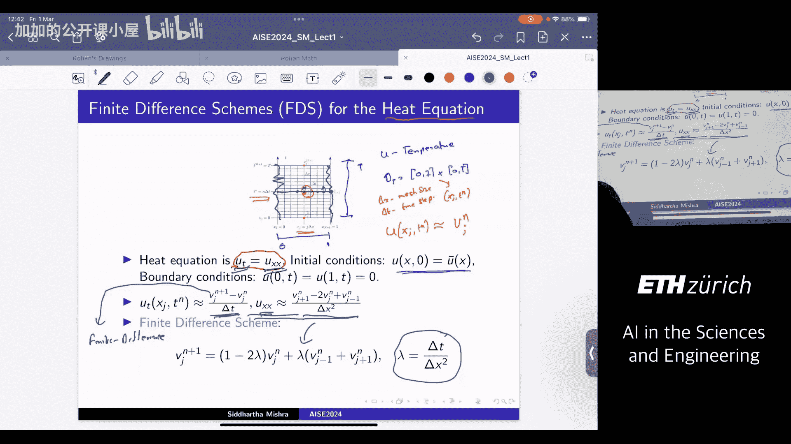

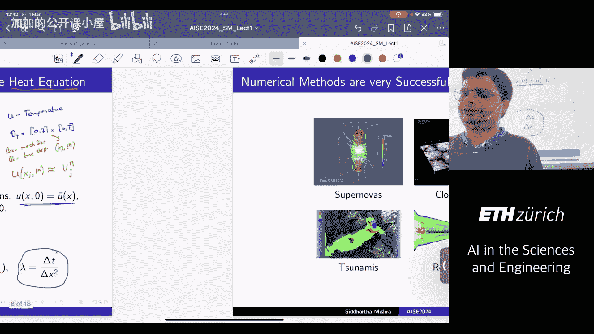

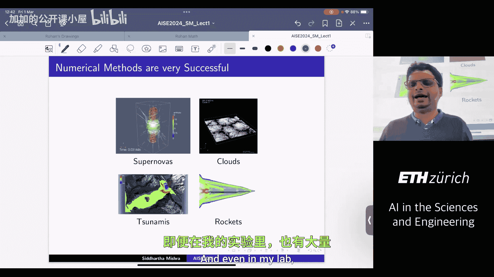

## 传统方法的挑战与瓶颈 ⚠️

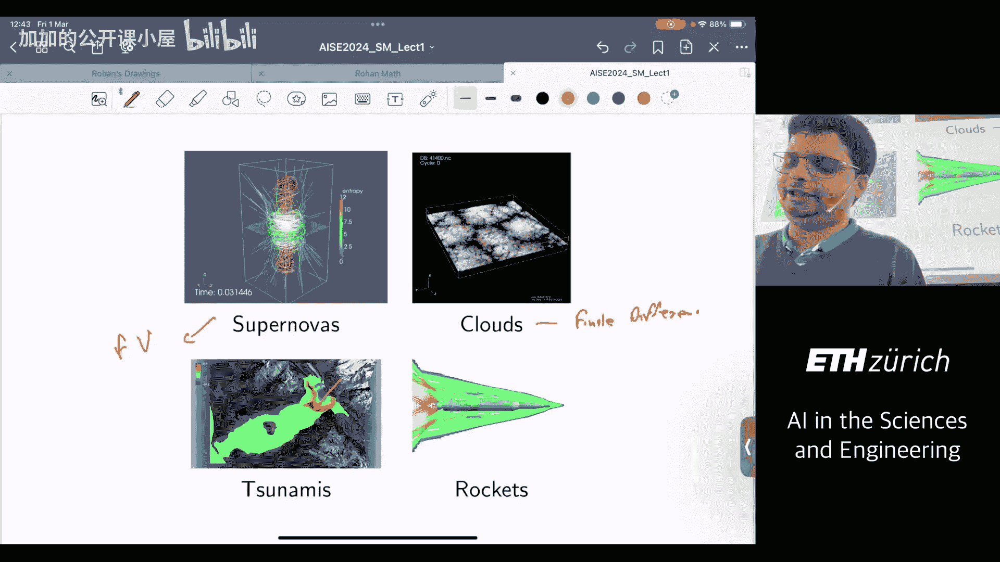

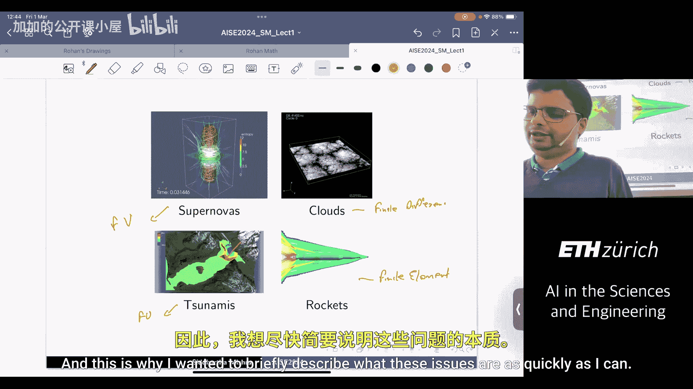

尽管传统数值方法非常成功，但它们也面临几个重大挑战：

### 1. 计算成本高昂
数值方法的计算复杂度随问题维度指数增长。对于高维问题（如多粒子薛定谔方程），计算变得不可行。
**公式**：计算成本 `∝ (1/误差)^(d/2)`，其中 `d` 是空间维度。

### 2. 多次查询问题
在许多实际应用中，需要成千上万次调用PDE求解器，导致总成本极高。
*   **工程设计**（如飞机机翼优化）：需要反复模拟流动以计算梯度，进行迭代优化。
*   **反问题**（如地质勘探）：需要迭代求解正问题以匹配观测数据，反推物理参数。

### 3. 不确定性量化
在湍流等系统中，需要计算统计量（均值、方差），这要求进行大量样本的模拟，成本巨大。例如，一次高分辨率流体的不确定性量化模拟可能需要数十万CPU小时，价值数十万瑞士法郎。

### 4. 物理知识缺失
对于许多复杂系统（如气候模型中的植被作用、城市交通流、生物体内的流体动力学），我们无法从第一性原理推导出完整的控制方程，存在“物理缺失”的情况。

## 新方向：融合物理与数据 🤖

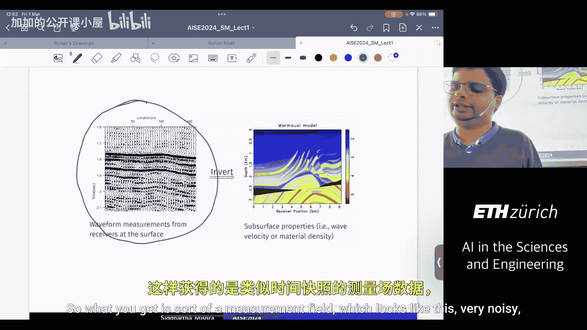

上述挑战为我们指明了方向：我们需要发展能够**降低可行问题的成本**、**使不可行问题变得可行**，并能够**利用数据补充缺失物理**的新方法。

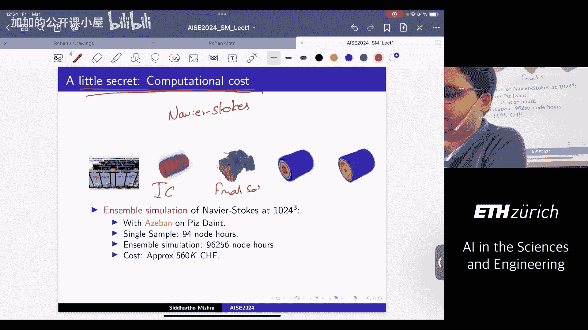

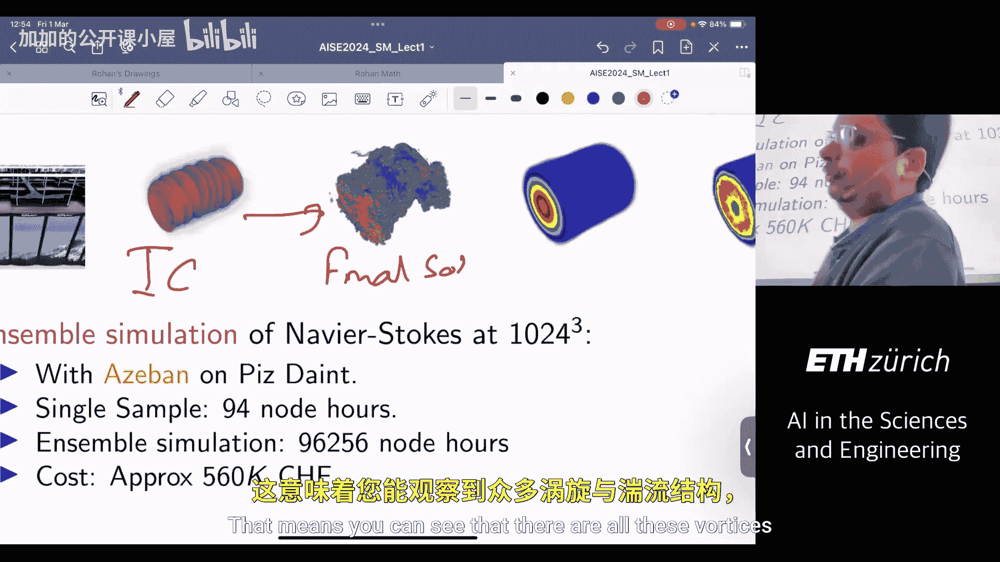

这正是机器学习，特别是深度学习，可以发挥作用的领域。我们将探索如何将物理定律（以PDE形式）与数据结合起来，创建新的建模和求解范式。

在接下来的课程中，我们将学习：
*   **物理信息神经网络**：用神经网络直接求解PDE，替代传统数值求解器。
*   **降阶建模**：构建快速、低成本的代理模型，用于优化和不确定性量化。
*   **数据驱动的物理发现**：从数据中学习缺失的物理项或本构关系。

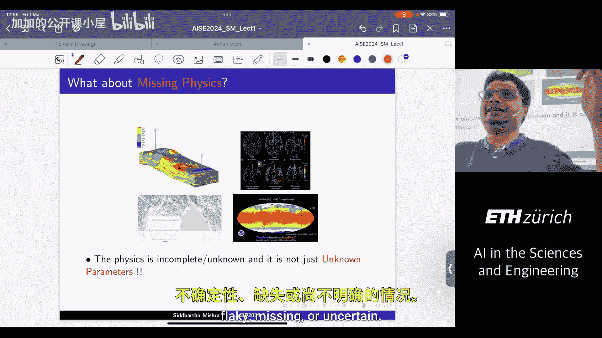

## 总结

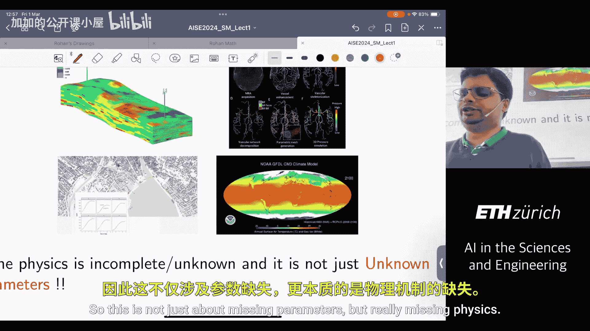

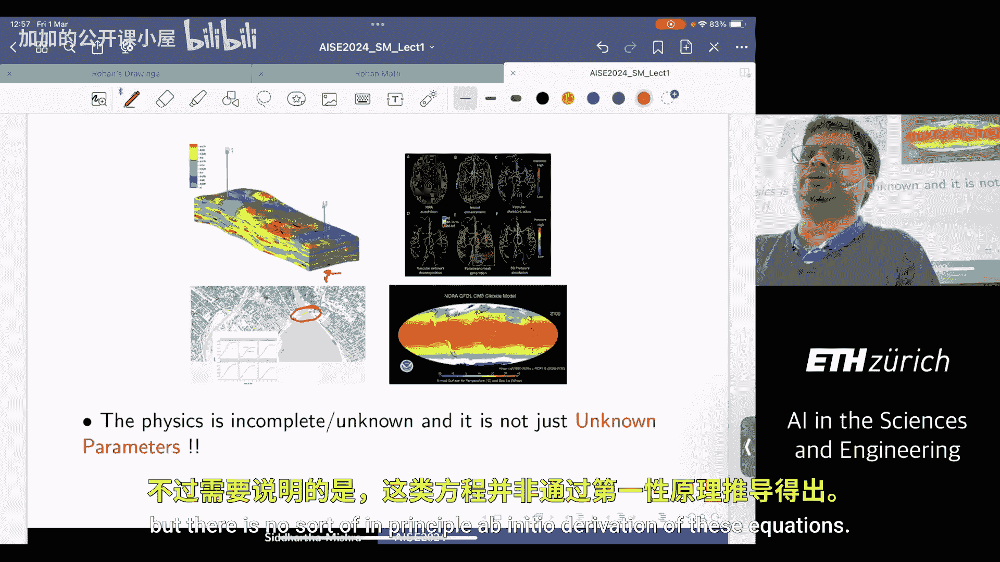

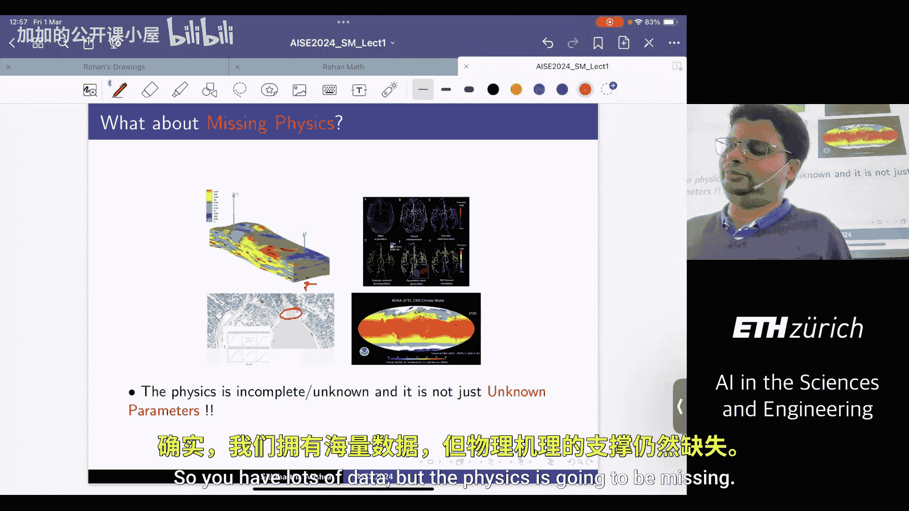

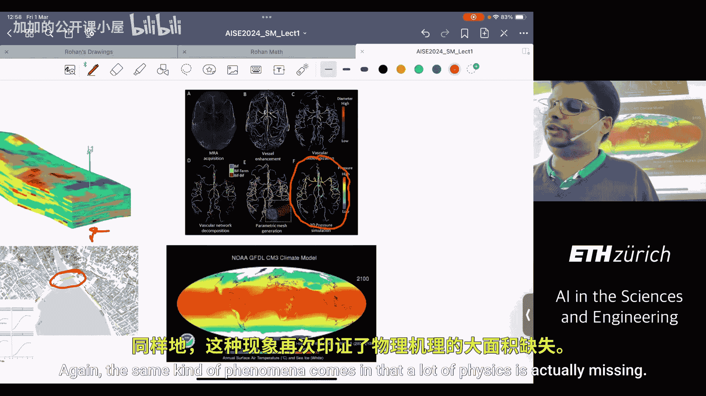

本节课中我们一起学习了：
1.  偏微分方程是描述科学和工程中各类物理现象的通用数学语言。
2.  传统数值方法通过离散化来近似求解PDE，已成功应用近百年。
3.  然而，这些方法在应对**高维问题**、**多次查询场景**、**不确定性量化**和**物理知识缺失**的系统时，面临计算成本过高或根本不可行的挑战。
4.  这些挑战为机器学习与科学计算的融合提供了契机。在后续课程中，我们将探索如何结合物理原理与数据，开发出更高效、更强大的问题解决方法。

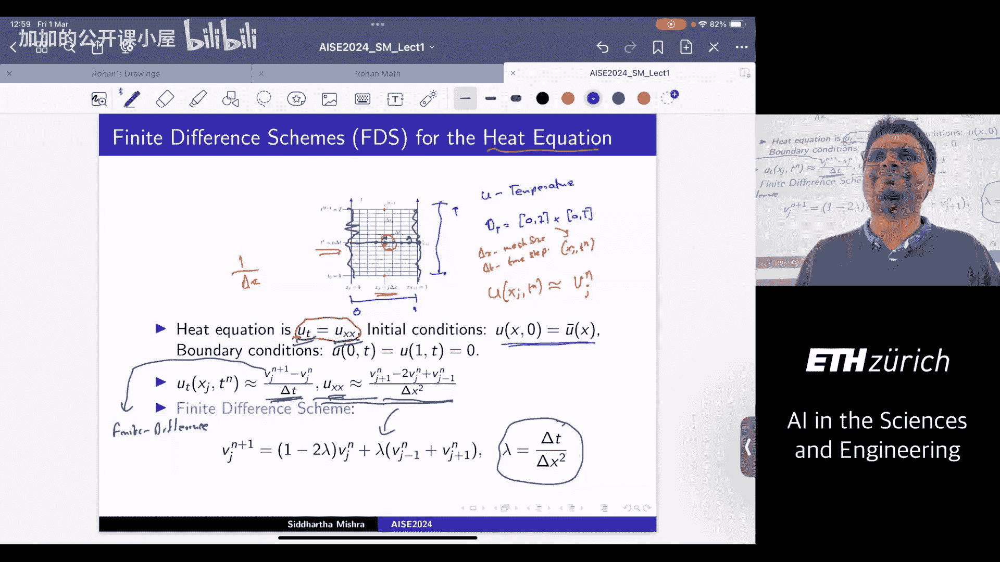

下一讲，我们将开始学习第一个关键工具：物理信息神经网络。