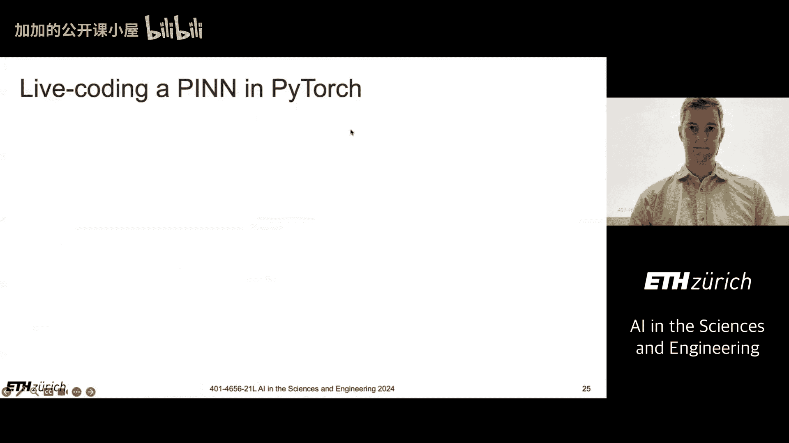
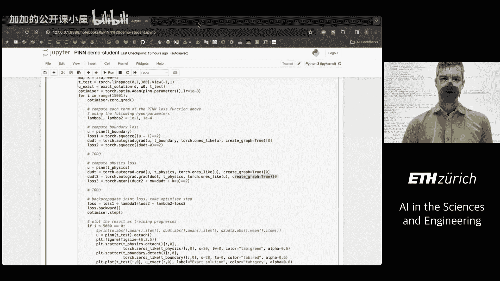
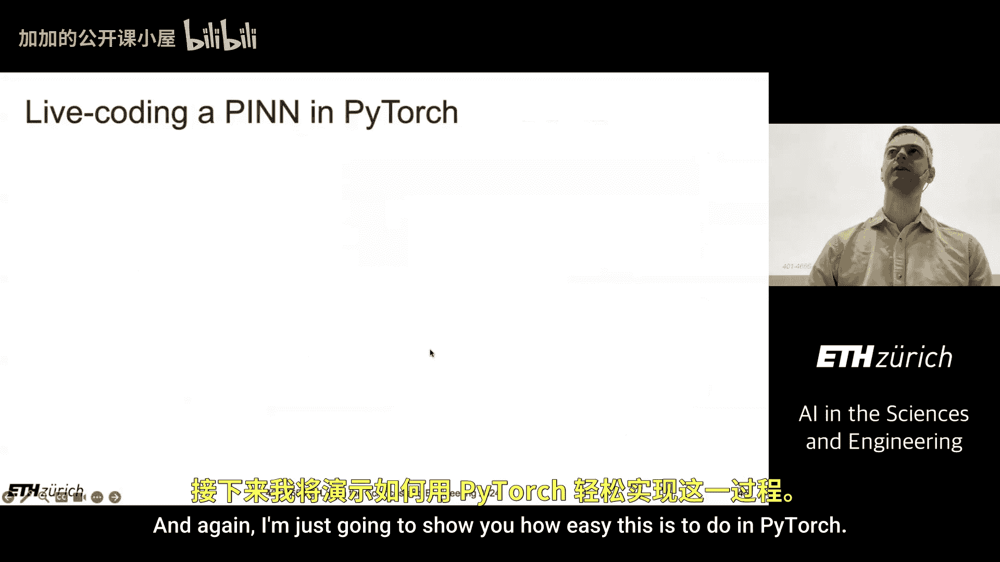
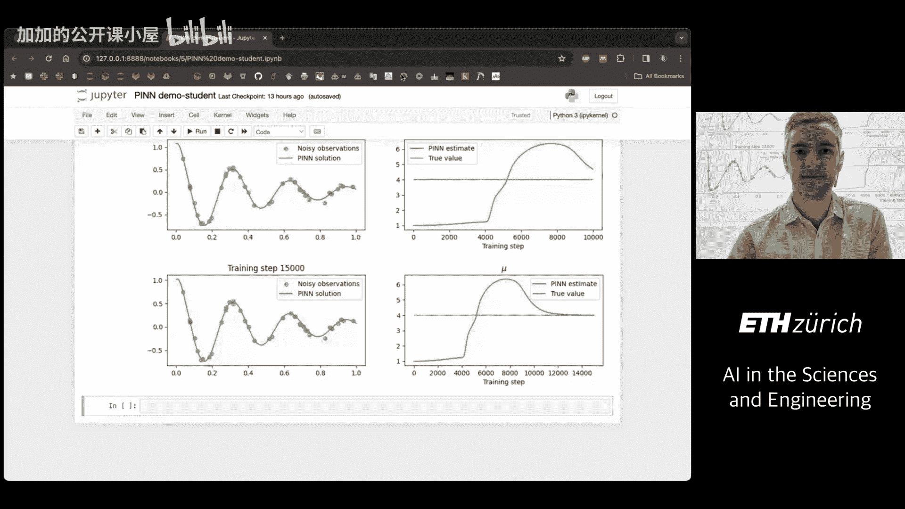
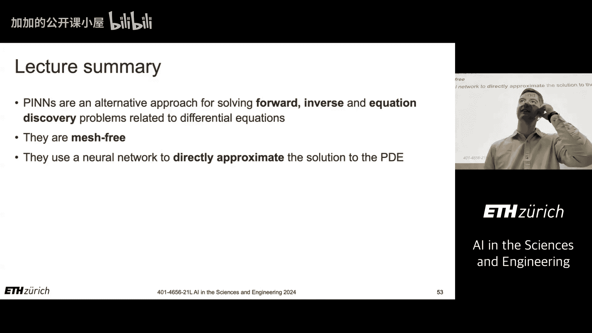

# 005：物理信息神经网络 - 引言

在本节课中，我们将要学习物理信息神经网络的基本概念。这是一种利用神经网络求解微分方程的新方法，它将物理定律直接融入到神经网络的训练过程中。我们将从高层次概述开始，通过代码演示其实现，并探讨其在正演模拟、反演问题和方程发现等领域的广泛应用。

## 课程概述

在开始讲解物理信息神经网络之前，我们先回顾一下上周Sid所讲的内容。他谈到了偏微分方程的重要性。偏微分方程确实是我们用来描述和理解许多不同科学现象的基本构建模块。从使用薛定谔方程模拟原子动力学的最小尺度，到使用爱因斯坦方程模拟黑洞的最大尺度，偏微分方程都至关重要。

偏微分方程对于理解地球上发生的现象也极为重要。例如，纳维-斯托克斯方程对于理解气候如何演变及其流体动力学至关重要。令人惊奇的是，一些生物系统也可以用偏微分方程来描述。例如，反应扩散方程可以用来模拟动物皮肤上的图案如何随时间生长而演变。

这就是为什么我们在本课程中如此重视偏微分方程。物理信息神经网络是求解微分方程或解决与微分方程相关问题的一种方法。我将向你们展示物理信息神经网络具体如何做到这一点。这是关于物理信息神经网络的几讲中的第一讲，我们现在真正进入了课程的主体部分，开始深入探讨这些我们一直在谈论的新型科学机器学习技术。

## 什么是物理信息神经网络？

在具体描述物理信息神经网络之前，我希望你们思考一下如何利用神经网络来求解微分方程。Sid在上次讲座中谈到了所有传统的数值方法，比如有限差分法、有限元法。他讨论了这些方法的优缺点，但物理信息神经网络从根本上不同，它们使用神经网络来求解微分方程。

所以，我想让你们先开始思考，并与同伴讨论：你们能想到哪些使用神经网络来求解微分方程或帮助求解微分方程的方法？

### 神经网络求解微分方程的初步想法

一种想法是，让神经网络的输入是初始条件，输出是模拟结果，并基于大量来自有限差分模型等示例以监督学习的方式训练它。这确实是一种方法。

另一种想法是，与其生成大量数据来训练网络，不如直接使用波动方程本身来训练网络，并最小化或惩罚其与方程的差异。这是一个很好的起点，让我们开始思考物理信息神经网络。

### 物理信息神经网络的核心思想

现在，让我们开始思考什么是物理信息神经网络。我将以一个更简单的微分方程为例，这是一个常微分方程，即阻尼谐振子方程。这是物理学中的一个典型问题，它模拟了一个弹簧上的质量块，其位移随时间变化的函数。

我们知道位移 `u` 是时间 `t` 的函数，它遵循这个微分方程，其中 `m` 是振子的质量，`μ` 是摩擦系数（阻尼项），`k` 是弹簧常数。根据振子的不同状态，可以有过阻尼、欠阻尼和临界阻尼状态。我们这里展示的是欠阻尼状态，振子随时间缓慢衰减，是一个带有指数衰减的正弦函数。

通常，为了求解微分方程，我们需要给定一组唯一的初始条件和边界条件，以获得一个特解。这里合适的条件是：质量块从位移为1、速度为零开始，这使我们能够唯一地（在本例中是解析地）求解 `u(t)`。

那么，我们如何尝试使用神经网络来求解这个方程呢？这里“求解”的意思是，我们希望能够计算这个函数 `u(t)`。我们假设不知道它的解析解，因为对于绝大多数偏微分方程，我们确实不知道解析解。

物理信息神经网络的核心思想非常简单：直接用神经网络来近似解。我们说我们的解 `u(t)` 近似于一个函数 `N(t; θ)`。记住，神经网络只是拟合数据的函数。它是一个神经网络函数，接收坐标 `t`（时间值）作为输入，并有一些自由参数 `θ`。

为了更明确，我们通常从多层感知机开始。在这个例子中，MLP有一个标量输入（时间值），然后给出一个标量输出，即位移的预测值。

这里的一个关键问题是：我们通过这种技术得到的解，与例如有限差分模型得到的解有何不同？根本的不同在于，我们这里是在对解进行函数逼近。物理信息神经网络的输出是一个函数，我们可以在任何时间点查询它，它会给出解的近似值。而当我们运行有限差分建模时，我们得到的是解的离散化版本，即在我们使用的网格点上解的值。因此，物理信息神经网络的一个关键特性是它们是**无网格**的，我们不需要网格来计算解。

### 损失函数设计

接下来的问题是：我们使用什么损失函数来训练物理信息神经网络？这就是我们将微分方程信息融入损失函数的地方。我们有两个损失函数组成部分：一个称为边界损失，另一个称为物理损失（有时也称为PDE残差）。

边界损失确保神经网络匹配我们的初始条件。它包含两项：第一项表示神经网络在 `t=0` 时的输出应等于1；第二项表示神经网络对 `t` 的导数在 `t=0` 时应等于0（即初始速度为零）。

最重要的部分是物理损失，它计算底层微分方程的残差。我们取神经网络，计算所需的所有梯度（例如对时间的导数），来计算微分方程的左端。如果神经网络是微分方程的精确解，我们期望这个残差的值是多少？是的，是零。我们试图确保这个残差尽可能接近零。如果残差为零，那么神经网络就给出了一个精确解。

我们需要在域内的许多不同点评估这个残差，因此我们在许多不同的时间值上进行采样，以确保在整个解域内，微分方程的残差都很小。

你可以将边界损失视为施加边界条件并确保解的唯一性，而物理损失则确保底层方程在域内所有点都被遵守。

### 训练过程可视化

下图展示了使用上述损失函数训练一个全连接神经网络的过程。灰色曲线是精确解，蓝色曲线是神经网络在训练步数增加过程中对位移的拟合或预测。图中还绘制了几个点：橙色点是边界点（即 `t=0` 的点），绿色点是物理损失训练位置（也称为配置点），这些是我们采样物理损失的时间点，以确保微分方程在域内所有点都被遵守。

这张幻灯片对于理解物理信息神经网络的训练方式和定义至关重要，我们在后续关于物理信息神经网络的讲座中讨论的所有内容都将回到这些核心思想。

### 关于泛化与采样的问题

有人可能会问：如果我们从域外采样呢？如果我们取这个训练好的神经网络，并给它一个域外的时间坐标，它很可能不遵守底层解，因为它超出了网络的训练分布。因此，神经网络的泛化能力在这里仍然是一个问题，我们将在下一讲中讨论。

另一个问题是关于训练步骤和采样。我们像训练普通神经网络一样，使用梯度下降法训练这个网络。我们计算损失函数对权重的梯度，然后更新权重。图中展示的是网络预测随训练步数的变化。

与通常使用小批量训练点的神经网络不同，在物理信息神经网络中更常见的是使用全批量训练，即每个训练步骤都使用所有绿色点和橙色点。这样做通常更有意义，因为它使问题更适定，确保PDE损失在整个域内一致。我们需要能够将边界条件向前传播，如果没有这个边界点，我们可能学到微分方程的任何解，它可能从任何地方开始。因此，拥有所有这些点有助于实现这一点，而不仅仅是随机采样。

### 配置点与损失权重

如前所述，域内的这些绿点被称为配置点，我们在整个域内对它们进行采样。另一个我尚未提及的是这些 `λ` 值，它们只是我们应用于损失函数中每一项的权重。我们将它们视为超参数，允许我们缩放或平衡损失函数中各项的贡献。在实践中，这对于确保物理信息神经网络快速收敛非常重要。例如，如果你将边界权重设置得非常低，你可能只会学到微分方程的非特解。

## 扩展到偏微分方程

我向你们展示了用于阻尼谐振子的物理信息神经网络，但物理信息神经网络之所以强大并成为当今热门研究领域，是因为它们实际上是求解偏微分方程的通用框架。我可以将使用神经网络表示微分方程解并对其进行训练的想法，应用于任何我喜欢的微分方程。

我们可以更抽象地设置物理信息神经网络：给定某个偏微分方程和一些边界/初始条件。我们可以说，偏微分方程通常只是应用于解的某个微分算子，它给出某个函数作为输出。我们有一个D维空间中的域，例如一个包含 `x`、`y` 和 `t` 的3D问题。我们有一些边界算子，可能有 `K` 个，每个算子等于在域边界上评估的某个边界函数。这精确定义了我们想要求解的边值问题。

物理信息神经网络通过直接近似解来训练神经网络以逼近偏微分方程的解，这是解的函数逼近。我们使用刚才描述的两个损失项：边界损失（对每个边界条件有一个单独的损失项）和物理损失（最小化底层微分方程的残差）。

### 具体示例：Burgers方程

为了使它更具体，并向你们展示物理信息神经网络应用于不同偏微分方程的例子，我将考虑Burgers方程，它模拟流体流动。这是粘性Burgers方程，其中 `ν` 是粘性参数，`u` 现在代表流速。我们考虑流体通过一个一维截面随时间的变化，所以解是流速在截面位置和时间的函数。

我们设置这些初始条件：起始流速是 `x` 的某个正弦函数，然后我们有一些边界条件，说明在域的边缘流速应为零。我们实际上模拟的是流体通过管道的流动，例如，流体开始时具有正弦分布的流速。

然后我们说，解由神经网络近似。然后我们像以前一样，有边界损失，现在边界损失中有三项，对应这三个边界条件。例如，在 `t=0` 时，对于所有 `x` 点，我们希望神经网络匹配负的正弦函数。因此，我们需要在评估此项时采样许多可能的 `x` 值。然后，对于 `x = -1` 的所有 `t` 值，我们应确保它为零，对于 `x = +1` 也是如此。物理损失则是在域内所有可能的 `x` 和 `t` 值上评估完整微分方程的残差。

下图展示了这种情况。这是相同的损失函数，但图中黑点和绿点分别代表我们采样边界损失和物理损失的位置。对于一维谐振子，我们只需要一个边界点，但在更高维度，我们需要采样域的子空间。我们在这里沿着域的边缘采样边界损失，绿点是我们采样物理损失的位置。你还可以看到，我们不再进行均匀采样，也可以在域内进行随机采样。实际上，随机或准随机采样实际上可以帮助改善物理信息神经网络的收敛性，我们将在后面讨论。

这是物理信息神经网络的解。你可以再次看到，这是流体通过管道的流动，我们从一个正弦分布的流体流动开始。Burgers方程有趣且值得研究的地方在于，随着时间的推移，流体开始形成激波，你开始看到流体向一个方向流动，然后向另一个方向流动，并在中间形成激波。这对于研究数值方法来说是一个相当有趣的问题，因为当解中存在这些不连续性时，我们可能会开始出现很大的离散化误差。

有趣的是，如果你将精确解与神经网络训练后的预测进行对比，神经网络确实在某种程度上很好地模拟了这种激波，并且与真实解匹配得相当好。这张图直接取自Raissi等人的物理信息神经网络论文，这是该领域的开创性论文。

### 实现细节

更具体地说，他们使用了10,000个配置点用于物理损失，并且没有使用均匀采样，而是使用了拉丁超立方采样（一种伪随机采样）。然后他们有100个边界点采样。他们使用的网络是一个全连接网络，有9层，每层20个隐藏单元，总共3003个参数。他们使用了 `tanh` 激活函数和一个二阶优化器（不仅仅是梯度下降，而是拟牛顿优化器）。

关于激活函数的一个有趣问题是：为什么他们选择使用 `tanh` 激活函数而不是 `ReLU`？答案是，`tanh` 是一个连续可微的光滑函数。为什么这很重要？因为我们需要能够评估神经网络对其输入的二阶导数。如果我使用 `ReLU` 激活函数，它的值会怎样？`ReLU` 是一个分段线性函数，其梯度是分段常数，二阶导数为零。因此，使用 `ReLU` 激活函数的神经网络实际上是在进行分段线性逼近。但如果我们使用 `tanh` 激活函数，那么我们通常有一个连续可微的函数可以拟合。当然，你不必只使用 `tanh`，也可以使用其他光滑的激活函数近似，如 `Swish` 函数等。

## 物理信息神经网络的研究领域

物理信息神经网络已经发展成为一个完整的研究领域。如果你查看每年发表的包含“物理信息神经网络”关键词的论文数量，你会发现其增长非常迅速。这是一个庞大的研究领域，有许多物理信息神经网络的扩展，我们将在接下来的讲座中介绍其中一些。

如果你真的想更深入地了解物理信息神经网络，可以查看这篇综述论文，它对迄今为止物理信息神经网络的整个研究领域进行了相当全面的回顾。有趣的是，物理信息神经网络背后的基本概念——使用神经网络近似解，然后使用微分方程残差训练它——可以追溯到20世纪90年代的论文，例如Lagaris等人的工作。但最著名的物理信息神经网络论文是Raissi的论文，这篇开创性论文使用现代深度学习框架重新实现和扩展了物理信息神经网络，展示了我们可以训练深度全连接网络和其他网络来求解这些微分方程。

## 训练过程详解与代码演示

希望我已经向你们描述了物理信息神经网络的高层概念。现在，我将更详细地讨论训练过程，其中有很多因素我尚未提及或省略。我将尝试在本节中通过PyTorch的实时编码向你们展示训练物理信息神经网络是多么容易。

让我们更详细地思考物理信息神经网络的训练循环。回到阻尼谐振子这个简单的例子。我们再次有边界损失和物理损失。

训练循环的步骤如下：
1.  首先采样边界点和物理训练点（配置点）。
2.  计算网络输出。
3.  关键步骤：我们需要评估网络对其输入的导数（`du/dt` 和 `d²u/dt²`），以便计算物理损失和部分边界损失。
4.  这使我们能够计算损失函数的值。
5.  然后我们需要另一个步骤：计算损失函数对神经网络参数的梯度，以便更新参数来学习解。

关键问题是：我们如何计算所需的梯度，例如 `du/dt` 和 `dL/dθ`？在一般情况下，神经网络只是一个数学函数，是一系列线性运算加上一些激活函数。我们可以解析地写出网络对其输入的导数。但在实践中，我们不这样做，我们可以使用自动微分和反向传播作为计算这些梯度的有效方法。

重要的是，我们不仅可以使用自动微分来获取损失函数对权重的梯度，还可以使用自动微分来获取网络输出对其输入的梯度。这是相同的算法，相同的自动微分。

让我展示一下我们如何使用自动微分来获取这两种梯度。假设网络是一个MLP，其形式如下。当我们对损失函数关于权重进行微分时，我们使用链式法则来计算该梯度。类似地，我们可以使用链式法则来计算网络对其输入的梯度。我们可以解析地做到这一点，虽然今天没有时间详细推导，但这可以作为一个练习。

一旦我们得到了这个导数，我们如何得到损失函数对权重的导数？我们可以使用自动微分，只需将计算网络对其输入的导数视为扩展我们在使用自动微分时的计算图。自动微分通过创建所有操作的图并跟踪该图，然后通过该图反向传播来提供梯度。网络对时间的导数只是一些额外的计算，你可以将其视为扩展了网络前向图的一部分。这个导数只依赖于激活函数 `g` 和 `h`，并通过一些函数（激活函数的导数）并乘以权重。我们可以将其绘制为计算图的额外部分，然后允许我们计算图的最终输出，即损失函数。

一旦我们扩展了计算图，我们就可以对整个组合图调用自动微分，从损失函数反向传播以获取权重的梯度。关键的认识是，我们可以递归地应用自动微分，首先获取网络对其输入的梯度，创建新图，然后获取该图对网络参数的梯度以更新参数本身。

以下是在PyTorch中实现这一点的伪代码。在实践中，你可以直接使用自动微分来获取这些梯度。`t` 是我们的时间坐标，`θ` 是网络参数。我们得到网络在给定 `t` 值下的预测。然后我们计算第一个梯度，即网络输出对时间的导数，我们可以使用 `torch.autograd.grad` 来做到这一点。我们还需要关于时间的二阶导数来评估物理损失。在PyTorch中，我们做的一件事是设置 `create_graph=True`，这会扩展计算图，以便我们在最后调用自动微分以获取损失函数对权重的梯度时，可以再次进行微分。

现在，我们拥有了在PyTorch中实际训练物理信息神经网络所需的一切。我将尝试为你们进行一些实时编码。

（代码演示部分展示了如何定义网络、采样点、计算边界损失和物理损失，并使用自动微分获取高阶导数。训练循环成功运行，并动画展示了网络解如何收敛到精确解。）

## 计算成本与其他考量

重要的是要考虑计算这些导数的成本。正如我所说，它们是可用的，我们可以解析地计算它们，或者等效地使用自动微分。但获取这些导数的成本可能相当高。

如果你只考虑当我们添加这些额外计算来计算关于输入的梯度时所构建的计算图，你会发现这些计算大致使计算图的大小翻倍。更精确地说，给定某个向量函数，计算雅可比向量积所需的时间大约是计算网络前向传播时间的 `ω` 倍，其中 `ω` 是介于2和2.5之间的某个值。要真正理解这个推导，可以参考这里的引用。

这听起来不错，我们可以在大约与前向传播相同的时间内计算它。但是，在训练物理信息神经网络时，我们通常需要高阶导数，例如二阶甚至更高阶导数来评估物理损失。计算这种高阶导数的成本随 `n` 值呈指数增长，具有 `ω^N` 的计算缩放比例。因此，当你训练物理信息神经网络时，你通常会发现大部分时间不是花在网络的前向部分，而是在计算梯度时。这是物理信息神经网络计算成本的一个关键限制。

还有其他一些重要的考虑因素，我认为我们现在已经基本讨论过了。`λ` 值确实显著影响收敛性，通常正确定义它们是关键选择。我们还需要确保域内有足够的配置点，以确保我们在整个域内精确约束PDE残差。“足够”很难精确定义。当我们使用有限差分法或有限元法时，我们有非常清晰的收敛准则，例如采样间距应该是多少。你可能会想，这里基本上是一个正弦波，因此我们希望确保采样点低于奈奎斯特采样率，这将是一个合理的起点。同样，我们需要足够的边界点来确保学习的解是唯一的。我们可以随机或均匀地采样这些配置点。

正如有人在最开始指出的那样，物理信息神经网络尽管内部有这种巧妙的物理损失，但归根结底仍然是神经网络，它们仍然遭受我在深度学习导论讲座中谈到的所有误差来源。因此，如果神经网络不够灵活或表达能力不足以表示真实解，它们仍然会有近似误差，不会收敛到该解。如果我们没有选择足够的配置点，它们会有估计误差，不会收敛到最小化真实期望损失的解。还有优化误差，即使我们可能有一个可以给出解的网络，但对于优化器来说，这可能是一个非常复杂的目标函数，它仍然可能不收敛。

实际上，我们将在下一讲中讨论如何在训练物理信息神经网络时克服其中一些限制。

## 从机器学习视角看物理信息神经网络

在讨论应用之前，最后一种看待物理信息神经网络的方式是从机器学习角度重新构建它。我认为这非常有趣，考虑到本课程是关于科学与工程中的人工智能，处于这两个领域的交叉点，从更纯粹的机器学习角度看待这些技术可能非常有用。

从数学角度来看，我们设置这些神经网络来求解偏微分方程，是对解的函数逼近。但是，从纯粹的机器学习角度——训练神经网络的角度——我们能对物理信息神经网络说些什么？这个损失函数有什么有趣之处？

想象一下，如果我们只是将边界损失解释为监督损失。我们这里有神经网络，我们将其匹配到一些标签训练数据，例如1和0，我们说它应该取这些值。那么物理损失有什么不同呢？它更像是一种正则化项。完全正确，物理损失这里不需要任何标签。如果我们从监督学习与非监督学习的框架来思考，边界损失有这些标签（我们希望解是什么），而物理损失只给出这些时间点（网络的输入），并根据网络的这些输入评估损失函数。

因此，从机器学习角度来看，我们可以将物理损失视为一种无监督的正则化器，它断言了先验知识，为我们提供了一种归纳偏好或正则化项，将网络学习的解的类型推向遵守微分方程的解。

这是一种从机器学习角度思考的非常好的方式，它是一个正则化项。让我说得更清楚一些：这是一种训练物理信息神经网络的不同方式，不是有特定的边界损失，而是假设我们只有一堆解的观测点（橙色点）。那么，如果我仅使用监督损失在这些观测点上训练一个标准神经网络，你可以看到网络在其训练范围内非常拟合数据，但一旦我在这些训练数据点之外查询网络，解就变得平坦，是一个非常差的近似。

现在，我们将物理损失视为基本上添加了额外的正则化，并将配置点扩展到训练点之外。我们可以开始学习一个更通用的解，但需要注意的是，如果我们在这些配置点更远的地方测试它，它的表现不会很好。因此，希望这从机器学习角度讲得通。

然后，如果我退回到更高的层次，思考我在第一讲中谈到的将科学原理融入机器学习的三种广泛类别，我们非常处于左侧：我们正在改变神经网络的损失函数，在物理信息神经网络中我们只是使用标准神经网络架构，并在损失函数中添加一些科学理解来提高网络的性能。

## 物理信息神经网络的应用

在课程开始时，我向你们解释了什么是物理信息神经网络，并展示了如何训练它，还进行了一些实时编码。现在，我将讨论物理信息神经网络的应用，即我们可以使用物理信息神经网络解决的所有不同类型的科学任务。

到目前为止，我一直专注于模拟任务，即求解微分方程。但我要向你们展示的是，我们也可以使用物理信息神经网络来解决反演问题以及方程发现问题。

让我们回顾一下我们经常想要解决的关键科学任务。这只是使用波动方程的一个例子，例如地震模拟，但你可以取任何偏微分方程，都会有与之相关的类似任务。

正演模拟的任务是：给定系统的一些输入条件，例如地球的速度模型和地震的位置，我能预测该物理系统的输出吗？在这种情况下，就是通过该介质传播的地震波的振幅。因此，我们可以说系统的输出 `B` 仅取决于系统的某个模型（通常是偏微分方程）和一些系统输入 `A`。

反演问题是尝试做相反的事情：给定系统输出的一些观测值（在这种情况下是波场，地震振幅），我们能否反演出地球的底层结构或地震的位置？

最后一个任务是方程发现，这不仅是发现输入参数的任务，而且是理解所有这些动力学背后的底层微分方程或模型的任务。在这种情况下，你的观测数据可能是波场、震源位置以及地球模型本身，给定所有这些数据和观测，我们能否反演出底层微分方程（在这种情况下是声波方程）？

因此，在本讲座的最后一部分，我将试图说服你们，物理信息神经网络可以解决所有这三类任务，而不仅仅是模拟任务。

### 正演模拟示例：波动方程

在我转向其他任务之前，再举一个物理信息神经网络进行模拟的例子。这是我们做的一些工作，我们使用物理信息神经网络求解了波动方程。这里的任务是给定一个速度模型（描述地球的速度，这里我假设地球只是一个非常简单的水平层状结构）和背景中的一个震源位置，我能预测地震波如何通过该地球模型传播吗？

这是如果我使用有限差分建模运行模拟时的样子。观察这些波场如何随时间演变非常有趣，发生了许多复杂的物理现象。我们得到了震源向外爆炸的一般情况。但是，当我们遇到速度模型中的这些界面时，我们开始在每个界面处得到这些反射。我们还开始看到波场或子波根据其通过的速度而压缩和扩展，当速度慢时它会挤压在一起。波物理中还会发生许多其他有趣的现象，因此总的来说，这是一个非常有趣的建模问题。

看看物理信息神经网络是否能对这种函数进行建模，这个函数比我们之前看的单个正弦函数复杂得多。我们如何做到这一点？设置与我描述的完全相同。这里我们有一个全连接神经网络，其输出只是一个标量，本质上是地震波的压力。网络的输入是空间二维坐标和时间。为了确保网络学习这个问题的边界条件，我们所做的是将网络与非常少量的有限差分步骤进行匹配，仅用于模拟的最初0.02秒。基本上，我们将这个红色框作为解的有监督示例来匹配网络。然后，我们在整个时空域（一直到时间0.2秒）使用配置点采样物理损失。

结果如下：重要的是这里的物理信息神经网络解。你可以立即看到，物理信息神经网络能够对解进行建模，这非常有趣。不仅如此，它不仅得到了波场向外运动的一般情况，还模拟了这些反射，而它只是基于最小化PDE残差来学习模拟这些反射，在给定的边界条件训练数据中它没有见过这些反射。这真的很酷。

这里我还应用了一个朴素神经网络的输出。这个朴素网络是如何训练的？它非常简单，只使用边界损失而不使用物理损失。这个朴素网络只使用损失函数中的第一项。比较这两种解很有趣：朴素网络显然在它有训练点的地方对边界数据建模得很好，但在没有训练点的地方，它捕捉到了波场向外运动的概念，但不理解波场中的这些反射。因此，你可以真正看到为什么物理信息损失对于获得正确的动力学至关重要。

这个网络的一些数值细节：在这种情况下，有人问我们是否使用全批量，这里我使用了小批量采样，每个训练步骤在域内随机采样500个点，边界点也是如此。这是一个相当大的网络，有10层和10000个隐藏单元，这是一个相当大的网络，能够对这种复杂度的函数进行建模。它使用了 `softplus` 激活函数，这是 `ReLU` 的连续版本，并使用 `AdamW` 优化器。

这里最大的限制，也是物理信息神经网络最常被批评的一点，就是训练这个网络所需的时间。在GPU上训练这个解花了一个小时。如果我将其与有限差分建模进行比较，你认为有限差分解需要多长时间？大约30秒到一分钟。因此，在物理信息神经网络的原始形式中，它完全无法与有限差分建模竞争。我将在下一讲中解释如何克服这个问题，以及如何加速物理信息神经网络以使其更具竞争力。我还将在接下来的幻灯片中尝试证明为什么物理信息神经网络对于反演问题和方程发现仍然有用。

### 反演问题

现在，让我们继续使用物理信息神经网络解决反演问题。再次明确说明反演问题是什么，我将使用通过地球模拟地震波的相同例子。我有波动方程，现在我有一些波场的观测值。我想要反演的是介质的底层速度，或者甚至震源位置。

传统上我们如何做到这一点？传统上，解决反演问题的一种方法是将其构建为优化问题。我们说我们有观测值 `B`，以及一个给定底层输入猜测（例如速度模型的猜测）的系统前向模型。然后我们最小化预测输出与真实观测输出之间的差异。如果 `F` 在这里是可微的（如果这是一个可微的有限差分解算器），我们可以直接对这个目标函数使用梯度下降。

物理信息神经网络有何不同？物理信息神经网络如何以不同的方式解决这个反演问题？我将解释我们如何做到这一点，我们所做的非常简单：我们只是改变用于训练物理信息神经网络的损失函数，这是一个非常简单的改变，使我们能够解决这些反演问题。

再次，这是用于正演模拟的损失函数，我们之前已经看过。这里，这是损失函数的一般形式，但这里的微分算子可能是波动方程。如果我们想解决反演问题，我们这样做：一般来说，我们可以访问这些额外的解观测值，因此我们要做的是添加一个额外的损失项，在这个损失项中，我们说在有解观测值的地方，我们将神经网络输出与该观测值匹配，这是一个我们可以添加到损失函数中的额外监督损失。

这是我们要做的第一个改变。第二个改变是：我们可能不知道问题的边界条件是什么，假设我们无法访问它们，我们只有解的观测值。因此，我们去掉边界损失。然后我们保持物理损失不变，像以前一样在域内采样许多点并评估PDE残差。

另一个关键改变是：这个微分算子有一些我们想要反演的底层参数，例如在波动方程中是这个速度模型 `c(x)`。为了能够解决这个反演问题并估计这些参数，一个非常简单的技巧是：这些将只是我们在训练物理信息神经网络时的额外自由参数，我们将与网络参数 `θ` 一起联合优化。你可以想象，当物理信息神经网络训练时，它不仅同时学习正向求解模型，还同时学习底层参数，它正在进行某种问题的联合优化。

这很酷，这与我之前构建反演问题的方式非常不同，之前我们只专注于优化底层参数，而不学习解，我们只是通过解算器进行微分。这是一种思考解决反演问题的非常有趣的方式。在计算上，这可能与使用梯度下降的传统算法具有竞争力，因为我们不再需要评估昂贵的前向解算器，我们只是训练一个网络来拟合数据，因此在反演算法中没有昂贵的前向解。

### 反演问题示例：振动板

这是一个使用物理信息神经网络解决波动方程反演问题的例子，但这次我们想要了解速度模型是什么。假设我们有一个振动板，我们振动这个板，并测量板随时间的位移。这用于无损检测，例如调查板上是否有裂纹或任何扰动。

你可以看到，当波在板中传播时，这里有一些异常导致反射。我们想进一步研究这一点。给定这些观测值（这是真实数据，这篇论文实际上使用了这个振动板的真实数据），我们将训练网络来匹配这些观测值，然后我们还将在这里添加物理损失，其中包含速度模型，并且我们假设我们不知道这个板的速度模型。

相反，我们要做的是：我们将用另一个具有额外自由参数 `φ` 的神经网络来近似速度。我们可以这样做，我们可以说速度 `c(x)` 只是由某个具有参数 `φ` 的额外神经网络近似。当我们训练神经网络时，我们将同时联合优化 `θ` 和 `φ`。

结果如下：当物理信息神经网络训练时，它逐渐开始拟合解，这是解网络的输出。同时，它训练那个速度模型网络来学习速度，我们可以像查询解网络一样在任何空间点查询速度网络。这是它预测的底层速度，你可以看到它学会了发现板中的这个裂纹，并显示为速度模型中的扰动。

### 代码演示：反演阻尼系数

我将回到我的实时编码，向你们展示如何使用阻尼谐振子来做到这一点，我们将学习振子的摩擦系数 `μ`。再次，我将向你们展示这在PyTorch中是多么容易。

（代码演示部分展示了如何修改训练循环，将摩擦系数 `μ` 作为可学习参数，与网络权重一起优化。训练过程同时拟合观测数据和学习 `μ` 的值。）

### 反演问题示例：心脏激活映射

在转向物理信息神经网络的最终应用之前，这是使用物理信息神经网络解决反演问题的另一个例子。这是物理信息神经网络的一个完全不同的用例。这里的目标是能够更好地表征心脏，特别是当你的心脏跳动时，心脏的激活像波一样穿过心脏。你实际上可以绘制心脏表面各点激活发生的时间。这里的底层方程是Eikonal方程，它告诉我们心脏表面的速度与心跳发生时该点激活所需时间之间的关系。

一般来说，能够理解这个速度模型对于医学诊断非常有用，可以寻找心脏的任何问题。因此，目标基本上是：给定心脏各点激活时间的观测值，我能理解心脏表面的底层速度吗？

我们可以暂时将其简化为一个简单的2D版本问题，我们只有一个看起来像这样的速度模型，这只是一个简单的玩具模型。我们可以绘制给定这个速度模型时穿过心脏所需的激活时间。我们要做的是使用物理信息神经网络同时拟合速度和激活时间。我们在这里使用一个物理损失，其中神经网络近似激活时间，并用参数 `φ` 近似速度。我们只是将近似激活时间的神经网络与观测到的时间点进行匹配。

结果如下：这是精确解，这是物理信息神经网络的结果。物理信息神经网络能够精确地近似这些激活时间，并且对底层速度结构进行了相当好的反演。这里的比较是，如果我们只使用朴素神经网络（仅使用观测时间而没有Eikonal方程残差），你可以看到它在没有损失函数中物理方程理解的情况下，对速度的插值效果要差得多。你还可以将其与仅使用高斯过程插值这些故障点以及线性回归进行比较，很明显，具有额外正则化的物理信息神经网络是更好的模型。

## 方程发现

在最后五到十分钟，我将继续讨论如何实际使用物理信息神经网络来发现底层微分方程本身，而不仅仅是方程的参数。

这是我们用于使用物理信息神经网络解决反演问题的设置，我们说我们联合优化网络的权重以模拟问题，同时也优化微分方程的底层参数 `φ`。现在的问题是：我们如何实际学习微分算子 `D`，而不仅仅是算子的一些参数？

我们要做的是：我们将假设 `D` 由许多不同的微分算子组成。我们将构建一个算子库，说我们的偏微分方程可以包含这些算子的任何组合，例如解对 `x`、对 `t` 的偏导数，二阶导数及其组合。然后我们假设微分算子可以表示为这个 `Λ` 矩阵，即系数矩阵乘以这个不同算子的库向量。

例如，如果我们要以这种方式表示阻尼谐振子方程，我们将有这个算子库和这个系数矩阵（在这种情况下它只是一个行向量）。你可以看到，我们不需要的算子，我们只需将该矩阵中的系数设为零，因此我们只需要这个库中的前三个系数。

然后，学习方程的目标就变成了学习这个 `Λ` 矩阵的系数的问题。这就是我们构建损失函数并训练物理信息神经网络进行方程发现的方式。我们将用这个 `Λ` 矩阵乘以我们可能的算子库来代替微分算子。

一般来说，这比仅仅解决反演问题更难。反演问题在观测数据不足时已经很难解决，而这是一个更难的问题，需要对所有这些算子进行线性组合的回归。是的，我们假设它是线性组合，但如果你知道存在非线性项，你可以在库中包含非线性项，例如 `u * ∂u/∂x` 或 `∂u/∂x * ∂u/∂t`。因此，根据你想要建模的可能微分方程空间，你选择相应的库。

我要指出的是，这个可能的微分方程空间呈指数增长，如果你想象所有这些算子的所有组合，那绝对是一个巨大的组合空间。因此，这实际上是一个非常困难的问题。我们通常必须做的是对微分方程的系数施加一些正则化或先验。例如，我们假设稀疏性，我们想找到一个具有最少可能算子数量的微分方程，例如，通过在损失函数中添加一个额外的正则项，说明 `Λ` 应该是稀疏的，应该趋向于零。这有助于使问题收敛并成为一个更适定问题。除此之外，我们以与反演问题相同的方式进行拟合，我们有解的观测值，我们只是将网络拟合到这些观测值，一旦我们拟合了这些观测值，我们就对梯度进行回归以得到底层方程是什么。

### 方程发现示例

这是一篇几年前发表在《自然通讯》上的论文，它正是做了我刚才描述的过程。他们有一个数据损失，将网络解与一些观测数据匹配。然后他们有物理损失，最小化PDE残差，但使用这个算子库并尝试学习这些算子的系数。然后它添加了一些稀疏正则化，以尝试最小化我们使用的系数数量。它通过交替训练进行训练：首先学习网络的权重（首先拟合解数据），然后进行学习系数的步骤，这似乎比仅进行联合优化更好。

这是论文中的一个例子，这是物理信息神经网络发现Burgers方程的例子，在系数上进行线性回归。他们的输入数据只是Burgers方程在不同初始条件下解的噪声观测值。仅给定这些观测值并假设算子库，他们能够发现给出与底部真实偏微分方程非常接近的近似系数。

## 总结

我们已经涵盖了很多内容。我向你们解释了什么是物理信息神经网络以及如何训练它们，我还向你们展示了我们可以在正演、反演和方程发现问题中使用它们。非常重要的一点是，它们是无网格的，因此它们给出解的函数逼近，而不仅仅是离散化版本，这是对解的直接逼近。

下一讲我将讨论物理信息神经网络的局限性，以及人们使用的许多可能的扩展，物理信息神经网络被这些扩展所扩展。好的，我们下一讲再见。谢谢。