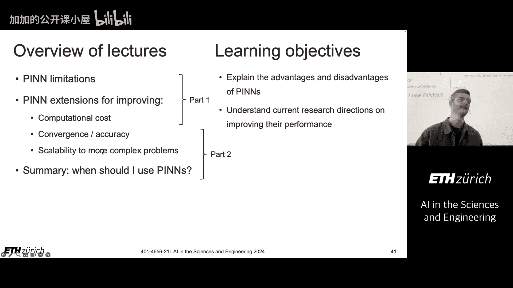

# 006：局限性及其扩展（第一部分） 🧠


在本节课中，我们将要学习物理信息神经网络（PINNs）的局限性，并探讨一系列旨在克服这些局限性的扩展方法。我们将首先回顾PINNs的基本概念，然后深入分析其在计算成本、收敛性和可扩展性方面面临的挑战。本节课的重点将放在如何通过扩展方法来提升PINNs的计算效率。

## PINNs 核心概念回顾

上一节我们介绍了PINNs的基本思想，本节中我们再来回顾一下其核心概念。

物理信息神经网络是一种用于求解微分方程或其相关问题的无网格方法。其核心思想是使用一个神经网络直接近似微分方程的解。

**核心公式**：
对于一个待求解的未知函数 `u(x)`，PINN使用一个神经网络 `NN(x; θ)` 来近似它，即 `u(x) ≈ NN(x; θ)`。其中 `θ` 是神经网络的参数。

训练该网络的损失函数通常包含两个主要部分：
1.  **边界/初始条件损失**：确保网络输出满足问题的边界或初始条件。
2.  **物理（PDE）残差损失**：在域内的一系列配置点上，最小化控制微分方程的残差。

**代码概念**：
```python
# 伪代码示例：PINN 损失函数
def pinn_loss(x_domain, x_boundary, u_true_boundary):
    # 神经网络预测
    u_pred_domain = neural_net(x_domain)
    u_pred_boundary = neural_net(x_boundary)

    # 边界损失（例如，均方误差）
    loss_bc = mse(u_pred_boundary, u_true_boundary)

    # 物理损失：计算PDE残差（需自动微分求梯度）
    residual = pde_residual(u_pred_domain, x_domain) # 涉及对u_pred_domain求导
    loss_physics = mse(residual, 0)

    # 总损失
    total_loss = loss_bc + lambda_ * loss_physics
    return total_loss
```

PINNs的优势在于其无网格特性、能够联合求解正反问题、拥有可解析的梯度以及通常只需少量数据。

## PINNs 的主要局限性

尽管PINNs具有诸多优势，但在实际应用中仍面临一些显著挑战。以下是三个主要的局限性：

### 1. 计算成本高昂

对于纯正演问题，训练一个PINN通常比运行传统的数值模拟（如有限差分法）要慢得多。一个关键问题是，PINN需要为**每一组**新的初始条件或边界条件重新训练，而传统方法只需运行一次求解器。

### 2. 收敛性不佳

PINNs的损失函数景观可能非常复杂和非凸，导致优化困难。其中一个关键因素是边界损失与物理损失之间的权重系数 `λ` 难以选择。若 `λ` 太小，网络可能忽略边界条件，学习到PDE的任意解（例如零解）；若 `λ` 太大，则可能无法满足控制方程本身。

### 3. 难以扩展到复杂问题

PINNs在处理高频率、多尺度或大尺度问题时面临挑战。神经网络的表达能力有限，拟合高频振荡解需要大幅增加网络规模（更多层、更多神经元），这进一步加剧了训练难度和计算成本。

## 扩展方法一：提升计算效率

针对计算成本高昂的问题，研究人员提出了多种扩展方法。本节我们将重点介绍其中两种：条件PINNs和离散化PINNs。

### 条件物理信息神经网络

核心思想是，与其为每个新场景重新训练一个网络，不如训练一个能泛化到多种场景的单一网络。实现方法是将变化的参数（如源位置、方程系数、初始条件函数）作为额外的输入提供给神经网络。

**网络架构变化**：
原始PINN输入：`NN(坐标 x; θ)`
条件PINN输入：`NN(坐标 x, 条件参数 c; θ)`

**训练方式**：
在训练过程中，不仅要在域内和边界上采样坐标点，还要在条件参数的空间中进行采样。损失函数需在所有采样到的条件参数值上评估。

**优势**：
*   一次训练后，可快速查询不同参数下的解，适用于灵敏度分析、不确定性量化等任务。
*   可被视为一个快速的代理模型。

**示例**：
在波方程模拟中，将震源坐标 `(s_x, s_y)` 作为条件输入，网络便能学会预测任意震源位置下的波场。

### 离散化物理信息神经网络

这是一种思路上的转变，将PINNs从“函数近似器”拉回到“在网格上预测解”的范式。

**核心思想**：
使用一个神经网络（如卷积解码器）直接输出定义在规则网格上的离散化解。网络的输入可以是一个固定的随机向量或我们希望条件化的参数。

**关键区别与训练**：
1.  **输出**：不再是连续函数，而是网格点上的值矩阵。
2.  **梯度计算**：不再使用自动微分计算精确的物理损失梯度，而是使用**有限差分**方法在输出网格上近似计算PDE所需的导数（如 `∂u/∂x`, `∂²u/∂t²`）。
3.  **边界条件**：通常通过硬约束实现，例如在输出网格周围填充已知的边界值。
4.  **训练**：使用与PINN类似的物理残差损失（但基于有限差分梯度）进行无监督训练，无需任何模拟数据。

**优势**：
*   可以利用成熟的CNN等架构高效处理网格数据。
*   训练可能更稳定，避免了损失函数中平衡权重 `λ` 的选择问题。
*   对于其训练分布之外的输入，有时表现出比纯数据驱动模型更好的泛化能力。

**局限性**：
*   回到了网格依赖的方法，失去了经典PINN的无网格优势。
*   使用了近似的（有限差分）梯度，精度受网格大小和差分格式影响。

## 其他加速技巧：使用有限差分梯度

一个更直接的加速技巧是，即使在传统的（连续）PINN中，也用有限差分来近似计算物理损失中所需的网络输出梯度，以替代计算成本高昂的自动微分。这通常能带来2-4倍的训练加速，但代价是引入了梯度近似误差，且差分步长的选择变得重要。

## 总结

本节课中我们一起学习了物理信息神经网络（PINNs）的主要局限性，并深入探讨了旨在降低其计算成本的扩展方法。

我们回顾了PINNs在计算效率、收敛性和可扩展性方面的挑战。针对计算成本问题，我们介绍了两种有效的扩展：
1.  **条件PINNs**：通过将问题参数作为网络输入，训练一个可泛化的模型，避免为每个新场景重复训练。
2.  **离散化PINNs**：将网络输出改为网格上的解，并使用有限差分计算物理损失，结合硬边界约束，进行无监督训练。



这些方法显著提升了PINNs在需要多次求解或快速代理建模场景下的实用性。在下节课中，我们将继续探讨如何改善PINNs的收敛性以及将其扩展到更高频率和更复杂问题的方法。