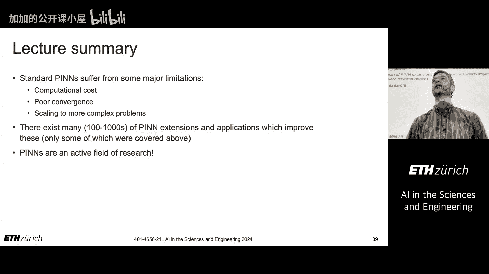

# 007：局限性与扩展（第二部分）

在本节课中，我们将继续探讨物理信息神经网络的局限性与扩展方法。上一节我们主要讨论了如何降低PINNs的计算成本，本节我们将重点关注另外两个核心挑战：如何改善PINNs的收敛性，以及如何将其扩展到更复杂的多尺度、多物理场问题。

---

## 回顾与课程安排

上一节我们介绍了PINNs的三个主要局限性：
1.  **计算成本高昂**：训练PINNs，特别是用于正向模拟任务时，通常非常耗时。
2.  **优化困难**：梯度下降等优化算法难以收敛到损失函数的全局最小值。
3.  **扩展性差**：在处理复杂的多物理场或多尺度问题时，PINNs难以有效扩展。

上一讲我们深入探讨了如何通过**条件化PINNs**和**离散化PINNs**等方法来应对第一个挑战，即降低计算成本。本讲将聚焦于后两个挑战：**改善收敛性**和**提升扩展能力**。

---

## 改善收敛性：损失项间的竞争

在上一讲中，我们展示了一个训练PINN求解波动方程的例子。其收敛曲线呈现出剧烈的震荡行为：在训练的前半段，PINN似乎停滞不前，直到后期才开始收敛。在训练步数为20000时，PINN仅学会了初始条件，而在其他区域输出近似为零。

**为什么会出现这种情况？**
这是因为损失函数中不同项之间存在竞争。对于波动方程，`U = 0` 是一个平凡的、易于满足的解（PDE残差损失项为零）。PINN在训练初期，可能会陷入这个局部最小值，因为它能最小化PDE残差，尽管这违反了边界条件。边界条件损失项和物理残差损失项之间需要“沟通”，才能使网络找到既满足边界条件又满足PDE的正确解。

这种竞争关系可以通过损失函数中的权重参数 `λ` 来调节：
`L = λ_BC * L_BC + λ_PDE * L_PDE`
然而，手动调整这些标量权重 `λ` 非常困难且依赖经验：如果 `λ_BC` 太小，网络学不到唯一解；如果太大，网络可能只满足边界条件而忽略PDE。

接下来，我们将介绍几种方法来缓解这种竞争，帮助网络同时最小化所有损失项。

---

### 方法一：硬边界条件

**核心思想**：重新构建优化问题，使边界条件在数学上被**精确满足**，从而将其从需要优化的损失项中移除，将约束优化问题转化为无约束优化问题。

**实现方式**：我们不再让神经网络直接近似解 `U(x, t)`，而是将其作为**解表达式**的一部分。我们手动设计一个数学表达式（称为Ansatz），使其自动满足边界条件，神经网络则负责学习表达式中的灵活部分。

**示例（Burgers方程）**：
假设边界条件为：`U(x, t=0) = sin(πx)` 且 `U(x=±1, t) = 0`。
我们可以构造如下Ansatz：
`U_θ(x, t) = sin(πx) + t * (1 - x^2) * N_θ(x, t)`
其中 `N_θ(x, t)` 是神经网络。可以验证，当 `t=0` 或 `x=±1` 时，无论神经网络输出什么，`U_θ` 都精确满足边界条件。

**优势**：
*   消除了边界条件损失项，避免了项间竞争。
*   训练完全无监督，不需要任何边界条件的训练数据。
*   可以通过自动微分计算梯度，以评估PDE残差。

**局限性**：
*   对于复杂的几何形状（如机翼绕流）或不等式边界条件，手动设计满足条件的Ansatz非常困难。

尽管如此，对于许多问题，硬边界条件方法能显著改善收敛。例如，在求解带有收缩管道的不可压缩Navier-Stokes方程时，标准PINN难以收敛，而使用硬约束方法则能成功。

---

### 方法二：自适应权重

**核心思想**：与其手动设置固定的全局权重 `λ`，不如让算法在训练过程中**自适应地调整**每个训练点上的权重。

**具体方法（自适应性PINNs）**：
1.  为**每一个**边界点和配点分配一个独立的权重 `λ_i`。
2.  在训练神经网络参数 `θ` 的同时，也学习这些权重 `λ`。
3.  更新 `θ` 时，使用梯度下降最小化损失 `L`。
4.  更新 `λ` 时，使用梯度**上升**最大化损失 `L`。

**为什么使用梯度上升更新 `λ`？**
对物理损失项 `L_PDE = Σ λ_i * r_i^2` 求导可得：`∂L/∂λ_i = r_i^2`。
因此，梯度上升意味着：在残差 `r_i` 大的地方，增加其权重 `λ_i`。这相当于一个“注意力机制”，引导优化器更加关注当前误差较大的区域。

**效果**：这种方法被应用于求解Helmholtz方程等问题，能够成功收敛。训练完成后，可以观察到 `λ` 值在解的高振幅区域（如波峰）较大，表明网络确实在重点关注这些难以拟合的区域。

---

### 方法三：自适应采样

**核心思想**：与其调整损失权重，不如动态调整**配点的分布**，在PDE残差高的区域放置更多的配点。

**实现方式**：
1.  在训练过程中，评估当前PINN在整个域上的PDE残差 `r(x)`。
2.  将残差的绝对值归一化，视为一个概率分布：`p(x) ∝ |r(x)|`。
3.  根据此概率分布采样新的配点，替代或补充原有的配点集。

**类比**：这类似于传统数值方法中的**自适应网格加密**。我们根据解的误差分布，动态分配计算资源。

**研究结果**：实验表明，与均匀网格采样或纯随机采样相比，这种基于残差的自适应采样策略（以及准随机采样）能显著提升多种PDE（如波动方程、Burgers方程、扩散方程）的求解性能。

---

## 扩展到复杂问题：应对谱偏差与多尺度挑战

PINNs在简单问题上表现良好，但我们的目标是将其应用于现实世界问题，如全加州地震模拟或全球气候模拟。这涉及到多尺度、多物理场、高频率等挑战。

**一个关键障碍：神经网络的谱偏差**
谱偏差是指神经网络在训练时，倾向于**优先学习低频模式**，而学习高频模式的速度很慢。这对于需要精确捕捉高频变化的PDE求解非常不利。

**示例**：在求解简单ODE `du/dx = cos(ωx)` 时，PINN能快速收敛于低频（`ω=1`）解，但当 `ω=30` 时，收敛变得极其困难，需要大幅增加网络参数，且最终精度仍较差。

除了谱偏差，高频率还意味着需要更多配点、更大网络，这些都使得优化问题更加困难。

---

### 扩展方法一：傅里叶特征网络

**核心思想**：在标准全连接网络之前，加入一个**傅里叶特征映射层**，将输入坐标显式地映射到一组高频和低频的三角函数空间，为网络提供丰富的频率基。

**实现**：
`γ(x) = [cos(2π B x), sin(2π B x)]^T`
其中 `B` 是一个从某个分布（如高斯分布 `N(0, σ^2)`）中采样得到的矩阵。然后将 `γ(x)` 作为特征输入到后续的全连接网络。

**直观理解**：这相当于为网络提供了一个包含多种频率的“预处理器”，减轻了网络自身学习高频函数的负担。理论分析（基于神经正切核理论）表明，这可以改善高频成分的收敛速度。

**局限性**：性能强烈依赖于矩阵 `B` 中频率的选择（即高斯分布的方差 `σ`）。需要根据解的先验知识来调整，这本身是一个超参数调优问题。

---

### 扩展方法二：结合域分解——有限基PINNs

**核心思想**：采用“分而治之”的策略。将全局复杂的优化问题，分解为多个**子域**上较简单的、耦合的优化问题。

**早期方法（扩展PINNs）**：为每个非重叠的子域分配一个独立的神经网络，并在损失函数中添加**界面连续性条件**作为软约束。问题在于，训练后界面处常出现不连续的跳跃。

**改进方法（有限基PINNs， FBPINNs）**：
1.  使用**重叠的**子域分解。
2.  将解表示为所有子域网络输出的加权和：
    `U(x) = Σ_i w_i(x) * N_θ_i(x)`
    其中 `w_i(x)` 是定义在第 `i` 个子域上的光滑窗函数（在子域外为零），`N_θ_i` 是该子域的神经网络。
3.  **关键优势**：通过数学构造，解 `U(x)` 在整个域上自动连续可微，无需在损失函数中添加额外的界面约束。可以像训练标准PINN一样，仅使用PDE残差和边界损失进行训练。

**其他优势**：
*   **克服谱偏差**：在每个子域内，对输入坐标进行归一化，将子域内可能的高频函数“拉伸”成网络眼中的低频函数。
*   **计算高效**：每个子域网络可以非常小（例如1层，8个神经元），因为只需学习局部简单函数。总体计算量远小于训练一个庞大的全局网络。
*   **高度并行**：子域网络可以分配到不同的GPU上进行并行训练，只需在重叠区域进行简单的通信，非常适合大规模扩展。
*   **与FEM类比**：可以理解为用小型神经网络作为局部基函数，继承了有限元方法的思想，但基函数更灵活。

**示例**：FBPINNs在求解多尺度波动方程（多个不同频率源）时，表现出比标准PINN更稳定、更快速的收敛，并能扩展到数万个并行子域网络。

---

## 其他重要扩展方向概览

PINNs的研究领域非常活跃，有数百种扩展方法。以下是一些重要的方向：

*   **求解更复杂的方程**：分数阶微分方程、随机偏微分方程等。
*   **使用不同的方程形式**：在损失函数中使用变分形式（弱形式），使其更接近有限元方法。
*   **不确定性量化**：贝叶斯PINNs，将权重视为分布，可以给出解的置信区间，特别适用于反问题。
*   **网络架构创新**：除傅里叶特征外，还有自适应激活函数、小波层、SIREN（正弦激活网络）等。
*   **优化算法改进**：设计专门针对PINNs优化的算法，如基于NTK理论的优化器、因果训练策略等。
*   **软件生态**：出现了许多强大的PINNs库，如NVIDIA Modulus、DeepXDE、SciANN等。

---

## 两个扩展案例

### 案例一：贝叶斯PINNs

**目标**：将PDE求解从确定性任务转变为概率性任务。给定边界条件和PDE源项的**噪声观测数据**，推断解的后验概率分布，而不仅仅是单个解。

**方法**：
1.  假设神经网络权重服从某个先验分布（如高斯分布）。
2.  假设观测数据在给定网络输出时，服从以网络输出为均值的高斯分布（似然）。
3.  使用马尔可夫链蒙特卡洛等方法，从权重和数据的后验分布中采样。

**结果**：可以获得解的均值估计以及不确定性范围。当观测数据噪声增大时，解的不确定性区间也会相应变宽。这为基于不确定性的决策提供了信息。

### 案例二：小波编码器-解码器PINN

**动机**：针对弹性波方程等具有波动特性的解，将物理先验融入网络架构。

**方法**：
1.  **编码器**：一个全连接网络，输入坐标，输出一组小波参数（如位置、尺度、频率）。
2.  **小波求和**：根据这些参数计算一系列小波函数，并求和。
3.  **解码器**：另一个全连接网络，对小波求和的结果进行非线性变换，得到最终解。

**思想**：用神经网络学习解的“波形成分”（小波参数），而不是直接学习像素/点值。这为网络提供了更适合波动问题的表示空间。

**结果**：在弹性波方程模拟中，这种定制化架构比标准全连接PINN误差更低，收敛更好。

---

## 总结

本节课我们一起深入探讨了物理信息神经网络在**收敛性**和**扩展性**方面的核心挑战及其扩展方法。

*   **改善收敛性**：我们介绍了**硬边界条件**、**自适应权重**和**自适应采样**三种策略，它们通过不同方式缓解了损失函数中各项间的竞争，引导优化过程更有效地进行。
*   **提升扩展性**：为了应对多尺度高频率问题，我们学习了**傅里叶特征网络**来缓解神经网络的谱偏差；并深入探讨了**有限基PINNs**这一基于域分解的强大框架，它通过“分而治之”和并行计算，显著提升了PINNs处理复杂大规模问题的能力。
*   **广阔的研究图景**：我们还简要浏览了PINNs的其他众多扩展方向，如贝叶斯PINNs、定制化网络架构等，表明这是一个充满活力且快速发展的领域。

尽管标准PINNs存在局限性，但蓬勃发展的研究正在不断提出创新的解决方案。理解这些方法及其背后的思想，将帮助我们根据具体问题选择合适的工具，推动科学机器学习在更复杂、更真实的场景中的应用。