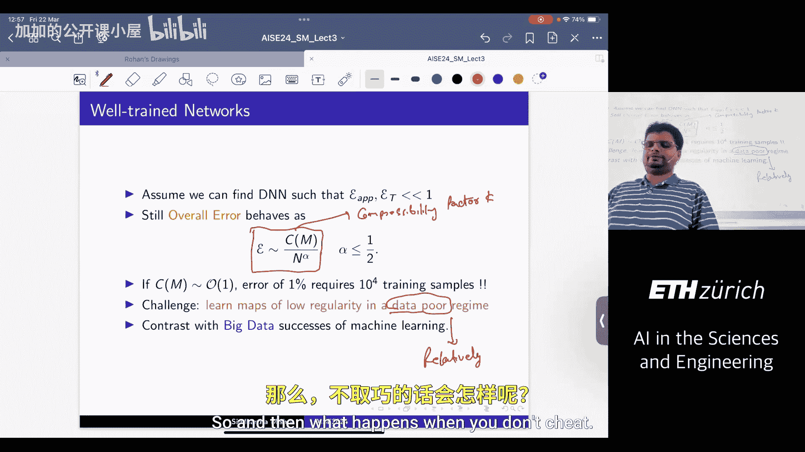

# 010：算子学习导论（第一部分） 🧠

在本节课中，我们将要学习一种新的、用于求解偏微分方程的数据驱动方法——算子学习。我们将探讨其核心概念、基本框架，以及它与之前学习的物理信息神经网络有何不同。

## 课程回顾与背景

上一节我们介绍了物理信息神经网络及其优缺点。PINNs 在数据稀缺时表现良好，但其训练过程可能因微分算子条件数等问题而变得困难和昂贵。此外，对于解具有多尺度、高频特征的复杂偏微分方程，PINNs 可能面临挑战。

因此，当有更多数据可用时，我们需要探索替代方案。从本节课开始，我们将视角转向**监督学习**，即利用现有数据来求解偏微分方程。

## 求解偏微分方程意味着什么？

在深入数据驱动方法之前，让我们重新思考：求解一个偏微分方程究竟意味着什么？

考虑一个简单的椭圆型偏微分方程原型：

\[
-\nabla \cdot (a(x) \nabla u(x)) = f(x), \quad x \in \Omega
\]

其中，`u(x)` 可以是温度、压力等物理量；`a(x)` 是系数（如热导率、渗透率）；`f(x)` 是源项。

我们可以将偏微分方程视为一个**系统**：它接收输入，经过处理，产生输出。
*   **输入**：系数 `a(x)` 和源项 `f(x)`（以及边界条件、定义域等）。
*   **输出**：方程的解 `u(x)`。

因此，求解这个偏微分方程，等价于找到或计算一个**解算子** `G`，它完成了从输入函数到输出函数的映射：

\[
G: a \mapsto u
\]

关键在于，这里的输入 `a(x)` 和输出 `u(x)` 都是**函数**，是无限维的对象。解算子 `G` 是将一个无限维空间映射到另一个无限维空间的**算子**。这是算子学习与经典机器学习（处理有限维向量）的根本区别。

另一个例子是时间依赖的偏微分方程，如可压缩欧拉方程。其解算子将初始条件函数映射到未来某个时刻的解函数。这同样是一个无限维到无限维的映射。

我们可以将问题抽象化：设输入函数空间为 `X`，输出函数空间为 `Y`，存在一个由偏微分方程定义的解算子 `G: X -> Y`。我们的任务是基于数据样本来学习这个算子 `G`。

## 算子学习问题定义

假设我们有一个输入函数的数据分布 `μ`。我们从该分布中采样得到 `N` 个输入函数 `{a_i}`，并通过（可能是数值的或实验的）方法得到对应的输出函数 `{u_i = G(a_i)}`，可能带有噪声。

给定数据集 `{a_i, u_i}_{i=1}^N`，算子学习的目标就是学习解算子 `G`。

## 一种“取巧”的方法：参数化PDE

直接处理无限维映射是一个挑战。一种“取巧”的方法是**限制输入/输出函数的空间**，将其投影到有限维，从而将算子学习问题转化为标准的函数逼近问题。

具体做法是，假设我们的输入函数来自一个由有限个参数描述的特定函数族。例如，输入函数是有限项正弦级数的和：

\[
a(x) = \sum_{k=1}^{10} \alpha_k \sin(k\pi x), \quad \alpha_k \in [-1,1]
\]

这样，输入就由10维参数向量 `α` 完全决定。同样，我们可以将输出解 `u(x,t)` 视为关于空间 `x`、时间 `t` 和参数 `α` 的函数。于是，无限维的算子 `G` 被简化为一个从有限维参数空间（如 `R^{12}`，包含时间和参数）到输出值（如 `R`）的**函数**。

以下是这种方法的一个工程实例：
*   **问题**：飞机机翼的气动外形设计。
*   **参数化**：机翼截面（翼型）的形状由一组（如20-50个）设计参数 `y` 控制。
*   **求解目标**：对于给定的形状参数 `y`，计算绕该翼型的流场（速度、压力等分布），进而计算升力、阻力等关键指标。
*   **转化**：问题转化为学习一个函数 `L(t, x, y) -> (流场物理量)`，其中输入是空间坐标 `x` 和形状参数 `y`，输出是物理场。这是一个标准的回归问题。

一旦完成这种转化，我们就可以使用熟悉的**普通深度神经网络**来学习这个映射。网络接收拼接后的输入向量（如 `[t, x, y]`），通过带有权重、偏置和激活函数（如ReLU）的层，输出预测值。我们使用随机生成的参数样本进行模拟，获得训练数据，然后通过优化损失函数（如均方误差）来训练网络。

## 理论考量与挑战

从理论上讲，只要目标函数是连续的（甚至可测的），深度神经网络的**通用近似定理**保证了我们可以用足够大的网络以任意精度逼近它。

然而，我们需要关注几个误差来源：
1.  **近似误差**：网络结构逼近真实映射的能力。对于一般的函数，逼近误差可能随维度 `d` 指数增长（维度灾难）。但幸运的是，**偏微分方程的解**通常具有特殊的规律性和可压缩性，使得其逼近误差的缩放比例远优于指数级（可能是线性或多项式级），这缓解了维度灾难。
2.  **优化误差**：训练过程中未能找到全局最优解带来的误差。
3.  **泛化误差**：模型在未见数据上的表现。当训练数据是随机采样时，泛化误差通常以 `~ C / sqrt(N)` 的速率衰减，其中 `C` 是与问题复杂度相关的常数，`N` 是样本数。

**核心挑战在于数据稀缺性**。为了达到1%的误差，若 `C≈1`，则需要约 `N ≈ 10000` 个样本。在科学与工程中，每个样本（即一次高保真物理模拟）的计算成本极高（从几分钟到数千小时不等）。因此，我们通常处于一个**数据相对贫乏**的 regime，这与图像、文本等领域的大数据成功范例形成对比。

## 总结与展望

本节课中我们一起学习了算子学习的基本概念。我们认识到求解偏微分方程本质上是寻找一个将无限维输入函数映射到无限维输出函数的解算子。为了应用现有的深度学习工具，我们介绍了一种通过参数化将问题“降维”到有限维空间的取巧方法，并将其转化为标准的神经网络回归问题。

然而，这种方法受限于数据获取的高昂成本，我们往往只能获得少量样本。在下一讲中，我们将探讨当这种“取巧”方法因数据不足而受限时，如何发展更先进的算子学习方法，以直接且高效地处理无限维的函数到函数映射。