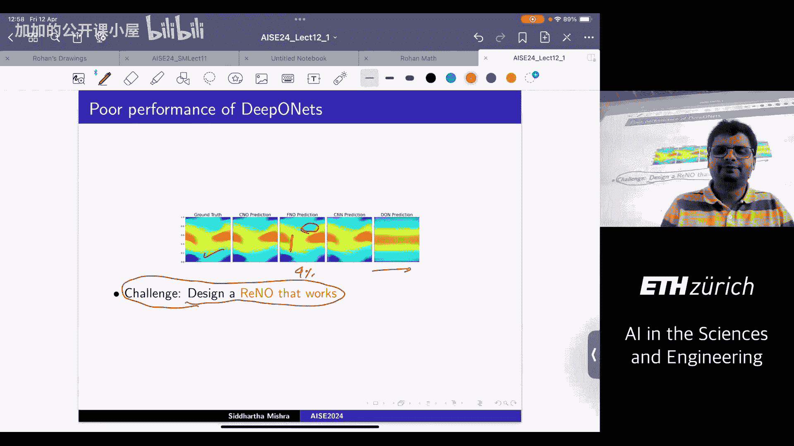

# 013：谱神经算子与深度算子网络

在本节课中，我们将要学习两种重要的神经算子架构：谱神经算子和深度算子网络。我们将探讨它们如何从传统数值方法中汲取灵感，以及它们各自在解决算子学习问题上的优势和局限性。

## 概述与背景

上一节我们介绍了傅里叶神经算子，并讨论了其在处理不同分辨率数据时面临的混叠误差问题。本节中，我们来看看两种旨在解决此问题的新方法。

我们继续之前的内容。在最近几讲中，我们一直在研究算子学习，其基本设置是相同的：给定一个抽象的偏微分方程，并关联一个将函数空间映射到函数空间的解算子。换句话说，它接收输入系数和源项，并返回解。由于问题本质上是无限维的，我们必须考虑如何离散地表示它。我们需要思考连续与离散的等价性，这是算子学习的核心概念。

我们引入了神经算子的表示等价性概念。其核心思想是，我们无法直接处理这个算子，即使我们想学习它。我们必须拥有该算子的有限维表示或近似，而两者之间的联系真正定义了算子学习。

具体来说，如果下图可交换，即无论你直接在连续层面操作，还是从连续函数空间开始，映射到网格（离散化），在网格层面进行操作（如CNN等），然后再映射回来，如果整个过程完全相同，那么这个图是可交换的，你就没有混叠误差。两者之间的差异就是混叠误差。只要没有混叠，你就可以进行真正的算子学习。这是我们当前所处的框架。

我们之前看到，卷积神经网络打破了这种等价性。

## 傅里叶神经算子回顾

在上一讲中，我们花了大部分时间学习傅里叶神经算子。

让我们回顾一下傅里叶神经算子，以便加深印象。

我们有一个输入 `a` 和一个输出 `u`。其处理过程包含不同的层。首先是**提升层**，你简单地增加更多特征通道，从而不是处理物理变量（如密度、压力），而是处理这些特征的某种更抽象的表示。提升之后，你还会进行**投影**。这两层通常是线性层或MLP。但所有核心操作都发生在通过**傅里叶层**进行的处理中。

以下是傅里叶层的示意图：你从一个函数开始，对其进行傅里叶变换（如果在网格上，则使用快速傅里叶变换）。然后你截断傅里叶模式的数量，并进行傅里叶乘子运算（这是可学习的参数）。这里发生两件事：首先，你以某种方式变换傅里叶系数；其次，你截断它们，只保留部分谐波。然后，你通过逆傅里叶变换回到物理空间。接着，你通过所谓的**残差连接**保留部分信号，这有助于训练并保留一些空间信息。最后，你应用逐点非线性激活函数。这个过程会重复多次。

但正如我在上一讲末尾解释的，FNO存在一个问题：激活函数（非线性）打破了交换图。因为最终，这些空间之间必须存在清晰的对应关系。

如果你将这些空间视为带限函数空间，并应用一个非线性函数，那么这种等价性就被打破了。一旦等价性被打破，你就会遇到像上次展示的随机分配那样的例子：你可以在特定网格上训练并获得非常好的结果，但一旦稍微改变表示（例如分辨率，即使只改变一个点），误差就会开始变大。这是因为条件不满足，你总会遇到混叠。

这在处理实际问题时得到强化。例如，回到纳维-斯托克斯方程，这是一个我们课程中主要研究的方程。其算子接收一个速度场并输出另一个速度场。我们通过涡量来可视化它。你可以看到初始的剪切层导致了涡旋的脱落。

如果你使用FNO，在训练分辨率下表现良好，但在不同网格的测试分辨率下，当你降低分辨率但仍保持在带限内时，会出现较大误差。这再次表明它不具备表示等价性，存在混叠误差，这将影响解的质量。问题在于，有时高频分量在问题中被阻尼掉，而在其他情况下高频分量会保留。

因此，我们面临的挑战是：需要设计一种能够规避此问题的神经算子，它能够在不同网格之间进行处理，能在任何分辨率下操作，从而学习到真正的算子，而不仅仅是获取特定有限维表示并输出另一个有限维表示的映射。

## 从传统数值方法中汲取灵感

在今天的讲座以及下一讲中，我们将看到一些例子。

对于今天的讲座，我们从传统数值方法中汲取了一些灵感。正如我在课程一开始所说，存在多种数值方法，如有限差分法、有限体积法、有限元法和谱方法等。从某种意义上说，这些方法也必须在相同的范式中工作，因为无论你是通过机器学习还是数值建模来近似解算子，最终都是在近似一个算子。因此，你本质上是在处理一个无限维的问题。

例如，如果我想用谱方法（它生成真实解）来解决这个问题，我需要将其投影到某个网格或某个基上，用该基进行处理，然后继续。

这是如何完成的呢？

同样的图再次出现，符号略有变化。事实上，数值方法可以非常相似地用与机器学习方法相同的范式来表示或解释。同样，你有一个算子（这里用 `A` 表示以区别于学习近似 `G`），但本质上，你希望近似这个算子 `G`，它将输入函数空间映射到输出函数空间。

所有这些方法都依赖于相同的原理：你从一个无限维函数空间开始，将其投影到有限维空间，在有限维空间中工作（例如时间步进或求解刚度矩阵），然后通过某种插值回到无限维空间。

以有限差分法为例。对于热方程 `U_t - U_xx = 0`，你在空间和时间上取一个网格。要计算某个时间步 `U^{n+1}` 在点 `j` 的值，公式是：
`U_j^{n+1} = (ΔT/Δx^2) * U_{j-1}^n + (1 - 2ΔT/Δx^2) * U_j^n + (ΔT/Δx^2) * U_{j+1}^n`
我取这三个点，然后演化到下一个时间步，并持续进行。这里的数值格式（近似器 `A`）取代了图中 `G` 的角色。因为它基于物理第一性原理，你可以访问方程并求解它。

类似地，一旦你有了点值，你总是可以使用多项式插值。这部分是插值器 `R`。编码 `E` 只是点值求值。有限元法也是完全相同的原理：你有一个由有限元函数组成的基，然后取节点值作为系数，对它们进行一些操作（例如求逆刚度矩阵），然后通过伽辽金基回到无限维空间。谱方法对傅里叶系数做同样的事情。

这里的要点是，当你有一个无限维问题时，你将其简化为有限维。在最一般的情况下，这可以是某个基的系数，甚至可以是点值（即我在上一讲中介绍的sinc基的系数）。所有这些本质上都是：编码 `E` 是某种基投影，重建 `R` 是基重建。如果你有一个基（无论是有限元基、分段常数基还是傅里叶基），你投影到该基上，在另一侧你取系数并形成基展开。所有数值方法都以某种方式落入这个方案。在这之间是物理发生作用的地方：你拥有方程的离散版本，并传播它，但你始终使用这些基系数。

这与FNO的做法不同。FNO我们做了一些提取，但同时保留了它的一些元素，我们将其学习为某种函数到函数的映射，而不是直接处理某些基本元素。

## 谱神经算子

事实证明，你可以模仿刚才介绍的方案，并最终得到一类机器学习或算子学习方法。

这些方法可以统称为**谱神经算子**。其思想与之前完全相同：就像数值方法一样，我们将事物降维到一个基，然后使用该基将其投影回来。在这之间，我们不是使用数值方法，而是严格地使用一些深度神经网络（如MLP）。现在不能是CNN，因为CNN基于像素等，而这里只基于某种MLP。

让我重复一下。这里有一些数学，但在特定例子中相当简单。让我给你一个非常简单的想法。你有一些输入 `a`，我将其表示在某个基上：`a = Σ_j a_j ψ_j`。`ψ_j` 是我要选择的某个基。现在我访问向量 `a_j`（`j` 从1到 `n`）。我取一个神经网络（称之为 `L`），输入 `a_j`，输出一些 `u_j`（`j` 从1到 `m`）。你直接使用基工作，忘记我们之前所有的空间概念，忘记这些是函数的一部分，你只处理这些离散系数，并通过你的DNN处理它们。最后一步，你取 `u ≈ Σ_j u_j ψ_j`。假设输入和输出的基完全相同。

这就是谱神经算子中所做的。根据你选择的基，你会得到不同类别的函数。请注意，FNO并不完全在这个框架内，因为它不一定总是有这种表示；你仍然有空间的概念。同样，对于CNN，你仍然有空间的概念。在这里，你完全移除了这一点，将这些对象作为离散对象处理。你期望这些信息（即它们来自一个函数）以某种方式被表示，例如，如果你有一个光滑函数，傅里叶系数将具有某种衰减。

这个方案清楚了吗？看看它与我们之前所做的区别：之前我们处理整个图像或整个像素，这里我们不这样做；我们取一个函数（图像），先取前20个傅里叶系数，在神经网络中处理它们，得到另外20个系数，然后返回。这与我们之前所做的有细微差别，之前我们是直接操作图像并对其进行处理。

只要有一个特定的实现（由这里的人们完成），你会发现有好有坏。使用傅里叶基是最简单的想法，特别是对于周期性问题，很自然地用正弦和余弦（傅里叶基）来表示。当然，你需要处理带限函数，否则空间太大无法执行此程序。然后是这个构造。因为我们总是处理傅里叶系数，我取复数值，但在实践中我们取实数值，虚部会抵消。

其思想正是我在这里所说的。`T` 和 `T'` 只是算子，告诉你可以将事物降维到一个基并重建它们。但关键思想是，当然，这是一个神经算子，因为这里的一切都是在有限维方式下完成的，意味着没有空间的概念。

想象它的最简单方式是：如果你有两个不同的网格，这并不重要，因为我从一个网格取函数，简单地将其投影到固定数量的傅里叶系数上；我从另一个网格取函数，将其投影到相同数量的傅里叶系数上；然后我进行处理和重建。对我来说，函数是在细网格还是粗网格上并不重要，只要我不改变傅里叶系数的数量。当然，关键在于，如果你有一个粗网格上的函数，并将其投影到20个系数上，这可能是一个很好的表示；另一方面，当你在细网格上时，你可能想将其投影到更多傅里叶系数，但这里你没有这种灵活性。

它在某种意义上并非完全不同，但这里的参数（你稍后会看到）可以扩展以覆盖非严格参数化的情况，因为之前你从未能以某种方式使用函数。这增加了一个额外的层。现在它告诉你的是，你从一个函数开始，将其投影到一些固定数量的参数上；之前你是直接处理那些参数，所以你甚至不需要这第一步。所以你多了一个额外的层，但在某种意义上，它遭受了与参数化表示相同的一些问题。我并不是说所有问题都将通过这种方法解决，但这是解决一个问题的一种特定方式：你拥有网格上的不同信息，你不在乎，因为你将其投影到一个有限的基上。当然，这非常有限，因为它告诉我们，我们必须给自己套上一个紧身衣，这并不好。

## 深度算子网络

有一个推广或变体，你也可以称之为泛化。

这是最早引入的算子学习架构之一，尽管当时还没有这个名字，它叫做**深度算子网络**。这实际上可以追溯到90年代两位中国计算机科学家的工作，但其现代版本只有三、四年的历史。其思想是：这里的问题是，我们需要提供基，这需要一些专家知识。我们说，好吧，这些是周期函数，所以用傅里叶基；或者这些是其他结构，用更一般的基；或者这些是在球面上，用球谐函数。这需要一些我们将要使用的专家知识。这些研究者提出的论点是：如果你也学习基，而不仅仅是系数，会怎样？这似乎是更聪明的做法，以获得那种能够学习基的泛化能力。这就是深度算子网络所做的。

让我相当快地解释一下，以便你也能了解这个主题的一些历史。

你会看到它有自己的问题，但你可以看到它的来源。它与之前的图完全相同。

这里有两件事：系数（类似于之前的 `G`）和基（称为**主干网络**）。系数则是一个分支网络。

乍一看，这似乎是一个非常复杂的构造，但实际上是一个相当简单的想法，只是你现在有了一个可学习的基。首先，从你拥有的数据中，你学习一个基，或者同时学习基和系数。这两件事是同时完成的。当然，你可以想象这似乎是一个聪明的想法，但它也有自己的问题，因为可能同时学习的东西太多了。

让我用这张图来解释。抱歉符号有些混乱，因为我从某处复制了图片。这是你的输入（这里称为 `u`）。编码由逐点求值给出，即传感器评估。这些是点值。

其启发式是：假设这是你的输入温度，你想预测六小时后的温度（就像我们在天气预报中所做的那样）。你将通过使用一些传感器来观测这个温度，这些传感器正是温度的逐点值。在这种情况下，这些点值甚至不必位于网格上，它们可以是随机点，这不是问题。然而，对于不同的实现，这些必须是相同种类的传感器或相同的点。所以，点求值提取了这些输入系数，就像我们做卷积时一样，只是这里的灵活性在于，只要你为每个样本保持相同的传感器（例如，你现在在相同的传感器处测量温度，六小时后在相同的传感器处测量，等等），你就可以拥有任意的点集合。这是一种限制，但这是第一件事。

然后你将处理这些系数，就像我们在谱神经算子中所做的那样，将它们输入一个神经网络，该网络输出一些输出系数。这与之前完全相同，没有什么特别的。但现在，基呢？我们也必须学习表示函数所用的基。基就是这些 `τ` 函数。它们代表基。我们如何学习它们？记住，基现在是一个函数。每个基函数都是一个函数。让我分离出其中一个，称之为 `τ*`。它是 `y` 的函数，`y` 属于作用发生的域 `B`。当然，这个函数的输入将是你评估函数的坐标。我们将形成一个函数。

例如，假设你的域是 `[0,1]`。我需要评估一个函数。我所做的是，输入任何值，输出提取的值。你必须为 `m` 个基函数都这样做（10个或更多，取决于你的问题）。你将有一些基函数，这将是一个通用函数，不应该是正弦、余弦、切比雪夫多项式或有理函数等。现在，这就是神经网络的普适性发挥作用的地方：在之前的一讲中，你看到神经网络是通用的，任何连续函数、可测函数、可积函数都可以用神经网络近似。这些研究者的想法是：好吧，让这些成为神经网络。

因此，这些 `τ` 中的每一个都是DNN或MLP。可以有更多的结构，也可以是CNN等，但在这种情况下，最简单的是将其设为MLP（多层感知器）。现在你将有 `m` 个神经网络来表示你的基，同时有 `m` 个神经网络来表示你的系数。它们并行运行，具有不同的语义和启发式，它们之间存在差异。

现在的近似完全是根据我们在这里提取的系数完成的，就像在SNO中一样，然后重建是根据这些基函数完成的。记住，这里发生了两层：系数被近似，但表达它的基也同时从数据中学习。这两件事都是可行的，这不是一个不可行的问题。最终，你形成求和，得到一个神经算子。

这个构造本身非常简洁，因为你有一个可学习的基和可学习的系数，这些空间将在其中表达。这与统计学中的主成分分析有些相似。在PCA中，你也学习基，这些基基于你给定数据的统计结构的主成分。这有点像那样，只是你使用神经网络而不是主成分，因为原则上神经网络可以近似任何东西。

这个构造本身在这个意义上是简洁的：你有一个可学习的基和可学习的系数，这些空间将在其中表达。

## 深度算子网络的问题与局限性

关于这个构造有任何问题吗？……好的。

有一个区别，因为PCA更偏向于这个时期……我也可以快速描述一下。PCA是，如果你有数据（我不在这里过多细节，因为需要介绍协方差算子/矩阵），PCA所做的就是查看你拥有的数据，从数据的结构中提取基，它不处理数据，只是从数据的结构中提取基。例如，你有这些输入 `u_i`，我不知道如何表达它们，假设有1000个数据对（1000个例子）。你把它们放在一起，计算它们的协方差（这是一个矩阵），有一些有效的算法来提取其特征值和特征向量。然后你将任何输入 `a` 重写为 `a = Σ_j a_j p_j`，其中 `p_j` 是输入的PCA基。你在输出层做同样的事情，只是查看数据并提取输出的PCA基。这在一定程度上是预处理。然后在这之间，你需要 `a_j` 和 `u_j` 之间的联系，这由一个神经网络提供。

从某种意义上说，你也在使用学习，但只是在输入和输出端使用统计学习，在中间使用神经网络。这里的区别在于，你不是同时学习基和系数，而且这里输入和输出可能有不同的基，而使用DeepONet，你试图学习相同的基。它们在精神上有些内在联系，因为我当然可以用神经网络近似我的PCA函数，或者用PCA函数近似我的神经网络。

它们与我们之前所做的略有不同，之前我们是直接处理图像或函数，即函数的空间结构。在这里，你只是取函数，将其放入一袋系数中，这些系数隐含地表示函数，你处理它们，然后返回。所以你只是在非常并行的层面上进行所有处理。这清楚了吗？

那么，它的好处是什么？当然，你可以像训练FNO一样训练它，事实上人们已经这样做了。好处是，这些也是无混叠的，因为同样的原理：现在你总是将事物限制在某个有限维空间中，无论你查看什么网格，因为它只是一组固定的传感器。当然，这里没有问题。事实上，有一些条件，例如，即使你将其训练为一个基……对于PCA，如果有无穷多个样本，那么它将是一个基，这是有保证的。另一方面，这里没有这样的保证；你只是试图拥有基的语义，并且你认为你的学习问题将为你提供一个基，它不一定是一个基。在实践中，这些函数看起来根本不像基，但也不必是基。事实上，理论表明，使用所谓的框架就足够了，这些不是基函数而是框架。当然，因为你在非均匀网格、随机网格等上操作，所以会有一些来自那里的混叠误差。如果你在均匀网格上操作，则没有混叠误差，因为尼奎斯特条件得到满足。

我说过，这不必是一个基，因为没有理由强加正交性等。这是目标，但在训练过程中我们没有这样做。我们可以在训练过程中强加它，我们可以说我们将强加一些正交性条件，但这不公平，因为你不知道从数据中你将使用什么内积。所以在这个意义上，它并不那么清晰。

你明白了吗？所以这只是一个我们始终可用的选项，在某种意义上，它是一个基线。但它做了它所做的，即它能够表示来自不同网格的数据，仅仅因为它将它们投影到某个特定的袋中然后处理它们。所以在这方面，存在一些“作弊”。

那么，这有什么问题呢？这个构造清楚了吗？问题是什么？它们在实践中有效吗？在某些情况下当然有效。然而，我将给你一个非常简单的例子，说明这种方法的一些问题出现的地方。

你能想到的最简单的非线性PDE是所谓的**伯格斯方程**。它是由伯格斯作为纳维-斯托克斯方程的模型发明的，结果证明它是一个很好的模型。方程本身由这种形式给出，它是一个一维时空方程。有时人们添加粘性，但这里不重要。让我们看看无粘形式（无粘性伯格斯方程），然后我们有一些初始数据 `a(x)`，它来自某个概率测度 `μ`。

这是一个非常简单的设置。在这个特定情况下，我们的初始数据选自所谓的高斯随机场。高斯随机场是布朗运动对函数的简单推广。本质上，这些是噪声。你从某种有色噪声开始，高斯随机场，但这只是给你一个具体的数值例子，其他例子也同样有效。你从高斯随机场作为初始数据开始，然后让解演化到某个时间，比如 `t=1`。

典型的高斯随机场函数可能具有以下形状（类似噪声）。你将其放入非线性中，对于来自流体力学的人来说，这很明显，非线性会使其变陡。因此，一段时间后，如果你有这样的初始数据，这些小的噪声结构会清除，你会形成所谓的激波（尖锐前沿）。例如，当飞机以超音速飞行时，发出的声波会突破音障并产生激波。解看起来像这样（橙色是真实解，由数值方法生成）。现在我们使用DeepONet进行训练，我不记得用了多少样本，也许大约1000个。然后你可以开始看到问题所在：当然，它提供了一些答案，但有几件事是错误的。它没有得到不连续点的正确位置，当然，一旦位置错误，幅度也就错误。在这个特定情况下，误差非常大，大约30%。相对误差的百分比并不像你在图片上看到的那么重要，有时如果问题非常困难，30%是可以接受的，但这是一个非常简单的问题，误差很大。所以很明显，尽管所有这些保留结构的好属性都得到了满足，但有些地方出了问题，否则我们就解决了问题。

这在某种程度上得到了回答，因为现在我们将其与FNO进行比较。FNO不具有这种结构保留属性，但这并不意味着结构保留不好，它只是你评估事物的一个维度。例如，我的实验室有一些理论，我们做的是在理论上比较两者（一个非常简单的问题）。同样的也可以用于伯格斯方程。

如果你取线性平流方程：`u_t + c u_x = 0`。你知道解将是什么：`u(x,t) = a(x - ct)`。例如，如果你从一个这样的凸起开始，你只是平移它。你从一个稍微不同的凸起开始，你将其平移到相同的位置，只是形状不同，这取决于初始数据。在这种情况下，人们可以严格地数学证明，原则上假设你可以完美训练（这从未发生），但即使在完美训练的假设下，为了获得一定量级的误差 `ε`，使用DeepONet你需要参数数量与误差的平方成比例。为了获得1%的误差（即1/100），你需要大约10,000个参数（粗略计算）。有一些常数，但大约是10,000的数量级。

而FNO对于同样的问题，你可以严格证明其复杂度按对数缩放。所以它不仅是线性的，你不需要100个，你需要10个，你需要log(100)。这是一个严格的证明，表明对于解决完全相同的问题（尽管是一个非常学术的问题），FNO需要对数复杂度，而DeepONet需要平方复杂度。因此，即使你试图学习基等，它在准确性方面并没有真正得到回报。你保留了一些结构，很好，但它在准确性方面没有回报，因为你离你想做的还很远。

这也被展示出来（我想这是针对平流方程）。即使对于这个非常简单的问题，你也可以看到DeepONet给出大约8%的误差，而FNO给出其十分之一。对于相同的大小，你得到十分之一的误差。当然，这个定理就是这样，它很简洁，但有常数，并且很难评估常数。

所以这告诉你，保留结构只是故事的一部分。FNO也有它自己的优势。通过将所有东西放入一个固定的基或一个可学习的基，你并没有真正解决问题，因为一些重要的信息丢失了。这就是为什么DeepONet在实践中表现非常差的原因。

这里有一个我们之前见过的相同问题的例子：这是真实解，这是FNO的预测，相当合理，虽然有一些干扰和问题，但误差我记得FNO大约是4%（下一讲你会看到）。CNN（我们之前见过的那个）存在混叠，但也做了合理的工作。看看DeepONet发生了什么：它只是预测了整个样本的平均值。它根本没有性能。在这个特定情况下，误差是12%或15%，但它根本没有以任何合理的方式工作。

这主要是因为，当然，有一些定理告诉你哪里出错了，但直观上发生的是，我们通过将其放回仅仅一组固定参数中而失去了问题的某些结构，这正是你所说的观点。在参数方面有什么区别？在某种意义上没有太大区别，但道德上你在做同样的事情：你并没有真正保持无限维结构，你解决了一个问题，但创造了另一个问题，即你失去了表达能力。

所以挑战仍然存在：我们需要设计一些真正有效的东西。我想说这仍然是一个挑战。

我们还没有以任何方式解决这个问题，但在下一讲中，我将开始向你展示在这个方向上走得更远的架构，它们既保留了结构，同时也能工作。

但了解存在哪些东西、什么有效、什么无效也很重要。所以这是今天的主要目标。

好的，我们在这里停止。我们几乎准时。下周我们继续这个主题。